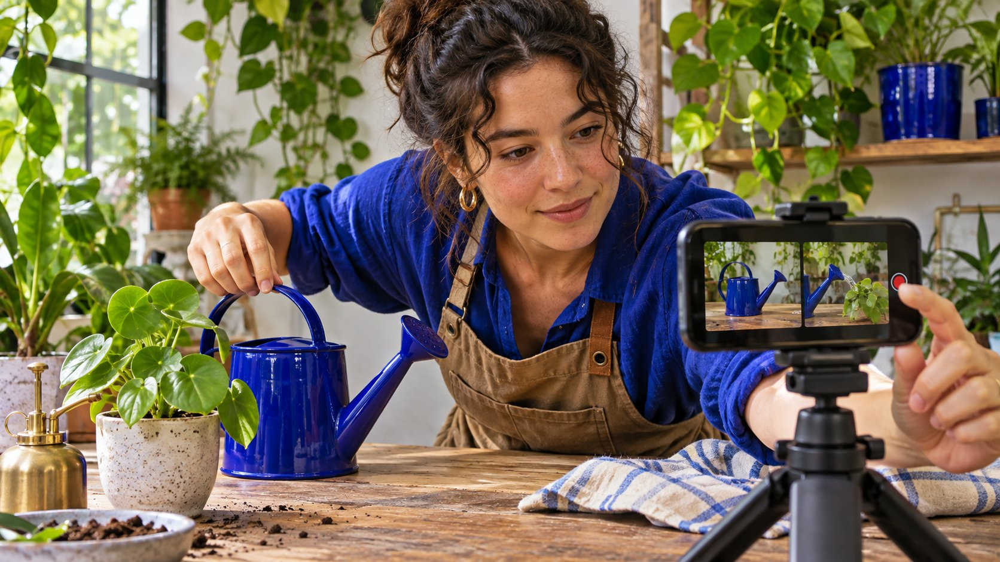

# How to Get More Followers on Instagram Organically

Status: local review draft; confirm the publication date before release.

Use comparable Instagram series to test the profile promise, opening and reason to follow.

AI-generated editorial illustration, not an actual creator, client, product or event.

To get more Instagram followers, make the profile clear about whom it serves and what people can expect. Then use a few comparable pieces in a series to test whether viewers want more. Change one meaningful variable and record reach, profile visits, follower changes and useful feedback in consistent windows. Keep paid and organic records distinct and interpret changes from actual account evidence.

## Give the intended audience a reason to come back

Imagine an urban garden shop serving beginners with room for only a windowsill. Its profile could promise one windowsill care demonstration each week. That is easier to assess than a general phrase about lifestyle and inspiration. Choose two recurring questions, such as watering and repotting. Define audience, problem, language and what the next post will offer. Use the [social media operating plan](https://www.quickkol.com/blog/social-media-marketing-operating-plan/#answer) to assign production, response and measurement. Viewers can decide whether to follow from work they actually see. If the account serves several regions, indicate which information depends on local season or location. Ask a colleague unfamiliar with the shop to open the profile and describe who it serves. If they expect landscape gardening instead of apartment care, correct the promise before reading growth numbers. A clear account description also helps the team reject topics that might generate a large incidental audience without creating interest in the series. Keep the wording short enough to scan without assuming that a particular phrase affects distribution.

## Connect the profile, featured examples and next step

Review the name, description, destination, representative work and what the visitor can watch next. Ask someone outside the planning team to open the profile from a real video and find the beginner guide and series. Record the version and time when you change the profile. If pinned content is available, consider one useful starting point and one example showing what the series will continue to do. Give viewers enough information to solve the present problem. They can decide whether they want future updates. For the garden shop, a video might demonstrate how to check one pot and point to a second post about drainage. The profile should make that second post easy to locate. If a campaign sends visitors to a store page, give that journey its own measurable destination. A profile visit after a tutorial and a visit to buy a plant may represent different motivations. Decide which pathway the current pilot is designed to improve.

## Test one variable across comparable posts

The [Instagram creator Best Practices announcement](https://about.fb.com/news/2024/10/best-practices-education-hub-creators-instagram/) describes education on creation, engagement and reach. Choose one variable you can change, such as opening with a yellow-leaf problem or opening with the result. Use comparable topics, language and duration and set a common review point. Record cover, headline, known shares, promotion and other changes. A single unusual result cannot establish a repeatable rule. A small trial can identify a presentation worth testing again. Suppose the first two posts each show one pot at a similar stage and are published on comparable days. In the next pair, use different plants but keep the topic and problem equally specific. Have the editor note when a post gets extra distribution from a partner. Even if you cannot control every condition, keeping a record helps interpret the result. Avoid changing the profile, content hook, link and promotion all at once if the project needs to know which element mattered.

## Check the definitions of views, reach, visits and follows

The [Instagram Insights overview](https://help.instagram.com/788388387972460) distinguishes views, accounts reached, interactions and follower trends. Use the definitions and dates available in the actual account. If a content-level follow metric is available, record its scope rather than attributing the entire account’s net change to one post. Keep profile visits, follows and unfollows separate. One account can see several posts. Adding their reach figures does not deduplicate people at account level. Use the [Instagram follower change guide](https://www.quickkol.com/blog/instagram-followers-check-net-vs-gross-change/#answer) to distinguish additions, unfollows, net change and missing data. Check how your exports define the reporting period before comparing series. If native insights display views but not profile visits for a given item, leave visits unknown. Do not estimate them from likes. If you compare followers with the prior week, make sure the earlier value was taken under compatible settings. When promotion ran, label the affected records and inspect available paid reporting before describing the change as organic.

## Use two windows to interpret follower growth

Suppose the first week has eighty new follows and twenty unfollows, a net change of sixty. The second has 110 new follows and seventy unfollows, a net change of forty. The second week had more additions and lower net growth. If there is no evidence tying unfollows to a particular post, do not claim that a video caused them. Review profile visits, saves, questions and any known promotion within the same windows. A learning series may care about whether viewers ask useful questions about the next lesson. These numbers illustrate interpretation and are not a growth benchmark. If the profile gained visits without follows, ask whether its promise matches the content that sent people there. A visitor seeking one answer may have no need for a continuing series. That can still be a good outcome if the post helped them. Choose the action that reflects the campaign objective before deciding that one week performed better.

## Use observable feedback to choose the next topic

Classify feedback as a specific question, reported outcome, product inquiry or general response. If three comments ask about drainage, a follow-up can show the actual container and explain which steps apply to its material. One comment does not establish widespread demand. Answer broadly useful questions in an appropriate public setting and route individual cases to the suitable destination. Give each follow-up a source, window and owner. Avoid trying to compensate for unclear content with misleading follow prompts or bulk engagement. A strong response can be a new post, a change to the profile’s featured work or a correction to the product guide. Choose the lightest change that addresses the observed problem. If visitors ask for something outside the business scope, explain the boundary and direct them to accurate information if available. A growing series can continue to refine its topic without promising every viewer the same result.

## Separate the organic pilot from promotion and external distribution

When a post is boosted or shared by a partner, record asset, account, time, delivery window and provenance. Compare organic and paid only if compatible evidence allows the split. If you have only an overview, label it that way. Retain actual permission and scope for links and partner materials. Suppose a local organization recommends the account in week two. You can document the public event and leave causal attribution open. Repeat a set of ordinary publications to see whether relevant feedback recurs. If the team wants to test paid distribution, define its own objective, budget, rights and reporting before including it in the plan. A paid test can answer a useful question about a particular audience or offer. It should not overwrite the baseline for the organic test. Give each intervention its own start date and use comparable measures when the evidence supports them.

## Choose to continue, revise or close the pilot

At review, check whether the intended audience can understand the profile, whether the team can sustain the series, whether relevant feedback recurs and whether the records are comparable. If reach rises but visitors cannot find related work, fix the profile pathway before testing another series. If production takes more time than the team can afford, narrow the format. Set the next review date, test variable and owner. Keep the observed results alongside the decision. If the test did not include a comparable distribution period, report it as learning about workflow or creative rather than a finding about growth.

## Rehearse the journey from content to profile

Ask a colleague to use a phone to open the profile from a watering video, then locate the drainage explanation, market and next lesson. If the only apparent path is the store, clarify the tutorial destination. Document the steps from watching to finding the next item, then repeat the same task after the change. Without native event evidence, describe the walkthrough as a manual observation. If the updated route works for two colleagues, the operating team has a reason to keep it during a real content test. That does not prove how every visitor will behave. Include the profile version and device in the note. Do the same check after a layout change or campaign link replacement so the next series begins with a usable journey. One colleague can begin at the profile and another from a shared video. Ask both what they would expect after following. If one expects discounts and the other expects weekly instruction, check whether the entry points promise different things. Record each observed route and fix the specific confusion. In the live pilot, keep other profile changes out of the first comparison where possible. If the follower count changes later, use the native observation period and record any simultaneous changes before interpreting it. The manual walkthrough can show that a destination is readable. It cannot establish how many people found it or attribute their decision to follow. In a recap, link the walkthrough result, native metrics and content examples so a future owner can review the reasoning for the next experiment. Give that owner a question the new round can answer, such as whether people can locate the next episode without following a separate shopping link.

## Instagram organic series review

| Record | Check | Decision |
| --- | --- | --- |
| Profile | Promise, entry and examples | Can viewers find the next item? |
| Series | Topic, variable and window | Whether to test again |
| Follower change | Adds, losses, net and provenance | Interpret separately |

Worked values are not benchmarks.

## Organic content pilot checklist

Review actual results using consistent windows.

- [ ] Profile makes recurring value clear
- [ ] Change one main variable per comparison
- [ ] Record native metrics and distribution context
- [ ] Choose next action from observed feedback

## Research date and limitations

Sources reviewed November 6, 2026. Methods, tables and decision rules are editorial recommendations. Hypothetical examples are not actual client results or industry benchmarks. Source geography and periods are specified where relevant. This draft is in independent local review; confirm its publication date before release.

## Start creator research with a clear task

Use QuickKOL to interpret a brief, discover relevant creators and research their work and contact routes. Verify data, commercial terms and outcomes at their source.

[Explore QuickKOL](https://www.quickkol.com/#capabilities)

## Sources

- [Instagram creator Best Practices announcement](https://about.fb.com/news/2024/10/best-practices-education-hub-creators-instagram/)
- [Instagram Insights overview](https://help.instagram.com/788388387972460)
