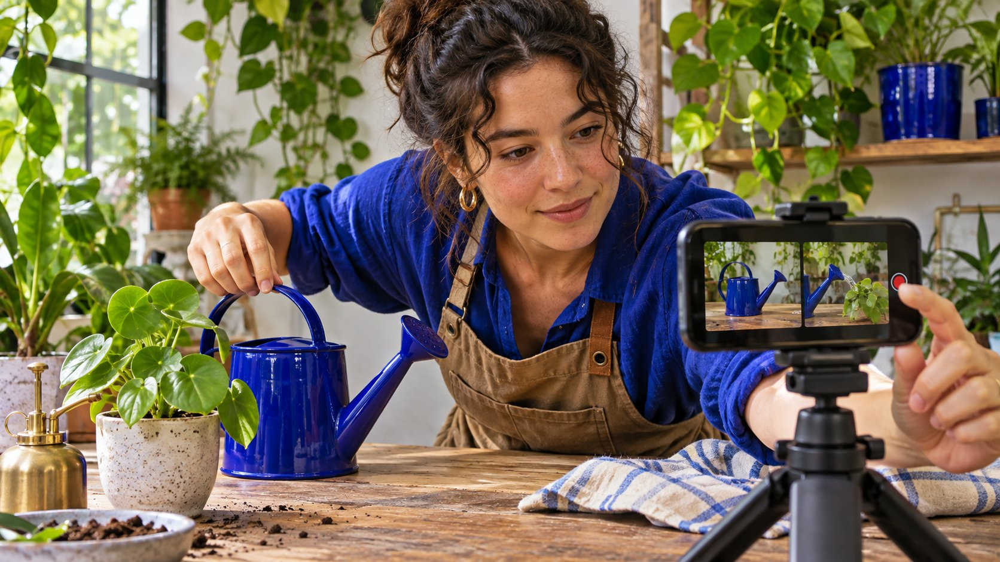

# Instagram 怎么涨粉：做一次自然内容试验

状态：本地审阅稿；正式发布日期待确认。

用可比较的 Instagram 系列测试主页承诺、开头和关注理由。

AI 生成的编辑示意图，不是真实达人、客户、产品或活动。

想获得更多 Instagram 粉丝，先让主页清楚说明谁会得到什么，再用几条可比较的系列内容测试观众是否愿意继续看。选择一个变量，在一致的窗口记录内容触达、主页访问、关注变化和有用反馈。把推广与自然记录分开，用实际账号数据解释变化，避免把任何单条内容当成增长承诺。

## 给目标观众一个愿意回来看的理由

例如一家城市园艺店服务只有窗台空间的新手。主页承诺可写“每周一个窗台养护动作”，比写“灵感与生活”更容易理解。选两类经常出现的问题，比如浇水和换盆。先定受众、问题、内容语言和下一次会更新什么。用[社交营销执行计划](https://www.quickkol.com/zh/blog/social-media-marketing-operating-plan/#answer)分配制作、回复和数据复查。观众能从真实的连续内容判断值不值得关注。若账号服务多个地区，明确哪些信息通用，哪些取决于季节和地点。

## 把首屏、置顶和内容下一步连起来

审核名字、介绍、主页链接、代表内容和下一次看什么。让一个没有参加策划的人从某条视频打开主页，看看能否找到入门教程和完整系列。改主页时记录版本和时间。若可用置顶内容，选一条起步和一条说明下一次内容的代表作。对只需要解决当前问题的人，给直接有用的信息，不要求先关注才讲完整。新关注应来自持续价值，而不是给不了的信息承诺。

## 用可比较的系列测试一个变量

[Instagram 创作者最佳实践公告](https://about.fb.com/news/2024/10/best-practices-education-hub-creators-instagram/)介绍了制作、互动与触达等教育内容。选择一个可控变量，例如开头先展示黄叶问题还是先展示处理后的对比。用两组相近题材、相同语言和相近时长，设置统一复查点。试点记录封面、标题、是否有人转载、是否投放以及其他明显变动。不要把偶然的一次爆发当成确定规律。小试验可以告诉团队哪种表达值得下一轮再验证。

## 核对浏览、触达、主页访问和关注的口径

[Instagram 成效分析说明](https://help.instagram.com/788388387972460)区分浏览、观看人数、互动和粉丝趋势。使用实际账号展示的口径和日期。若有内容级关注数据，记录所见范围，避免把账号净增归给单条帖子。主页访问、关注和取关分别记录。一个人可看多条内容；不同帖子独立触达不能直接相加成账号独立人数。用 [Instagram 粉丝净变化指南](https://www.quickkol.com/zh/blog/instagram-followers-check-net-vs-gross-change/#answer)记录新增、取关、净变化和缺失。

## 用两个窗口判断关注增长是否有业务含义

假设两周的账号窗口中，第一周 80 新关注、20 取关，净增 60；第二周 110 新关注、70 取关，净增 40。第二周新增更多，但净增更少。若平台没有证据将取关归到单条内容，不能说某个视频导致。另查看同时间主页访问、保存、问题和已知推广。若系列目标是持续学习，后续重点看有没有人对下一条提出具体问题。例子是演算，不是增长基准。

## 用真实反馈决定下一条内容

给反馈分为具体问题、使用结果、产品咨询和泛互动。例如三条评论都问盆底排水，下一条可以补拍真实容器，讲清哪些步骤适合当前材质。若只有单个评论，不用写成行业需求。公开回答有普遍用处的问题，个案通过合适入口处理。给每条跟进写来源、窗口和负责同事。不要用误导关注或批量互动来弥补内容没有说清楚的问题。

## 把自然测试与付费或外部传播分开

如果一条内容被速推或由合作方转载，记录资产、账号、时点、投放窗口与来源。报告能拆出同口径自然与付费时才比较。若只能看到总览，把它写成总览。链接和合作资料保留真实权限与使用范围。假设第二周一个本地机构推荐你的内容，可以描述这项公开事件，再把因果留待验证。用下一组普通发布复查是否能再次获得相关反馈。

## 给复盘确定继续、修正或结束

复查时确认目标观众能否读懂主页、系列能否持续、有无重复出现的有用反馈，以及记录是否可比。若视频触达上升但主页找不到同类内容，先补主页导航，再试一组。若制作成本超出团队可承受的范围，缩小系列。留下一次复查的时间、观察变量和负责人。

## 跑一次从内容到主页的演练

让同事在手机上通过一条浇水视频进入主页，找到排水说明、品牌所在地区与下一篇预告。若中途只能找到销售页，先把内容入口写清。记录从观看到找到下个教程的步骤，再比较更新前后的相同任务。没有原生证据时只写人工观察。可让一位同事从主页开始，另一位从分享链接开始，再请两人描述为什么值得关注。如果答案分别是产品折扣和每周教学，查看入口是否讲了不同的承诺。把不合适的推广路径单列，先修正可以观察到的阅读困难。试点后若关注数变化，仍用原生窗口核对，不把两次走查直接当成归因。

## Instagram 自然系列观察表

| 记录 | 看什么 | 决定 |
| --- | --- | --- |
| 主页 | 承诺、入口和代表内容 | 观众能否找到下一条 |
| 内容系列 | 题材、单一变量和窗口 | 是否再测试 |
| 关注变化 | 新增、取关、净增与来源 | 分别解读 |

演算数值不是增长基准。

## 自然内容试点清单

同一窗口核对实际结果。

- [ ] 主页能说明持续价值
- [ ] 每组只改一个主要变量
- [ ] 记录实际指标和分发事件
- [ ] 按反馈选择下一步

## 研究日期与使用边界

资料核验于 2026 年 11 月 6 日。文中方法、表格和决策规则为编辑建议，标为假设的示例不是实际客户结果或行业基准。外部资料的适用地区与时期按各段说明；本稿处于独立本地审阅阶段，正式发布日期待确认。

## 用清楚的任务开始达人研究

用 QuickKOL 理解 Brief、发现相关达人并研究作品与联系路径；数据、合作条件和结果仍需核验。

[了解 QuickKOL](https://www.quickkol.com/#capabilities)

## 来源

- [Instagram 创作者最佳实践公告](https://about.fb.com/news/2024/10/best-practices-education-hub-creators-instagram/)
- [Instagram 成效分析说明](https://help.instagram.com/788388387972460)
