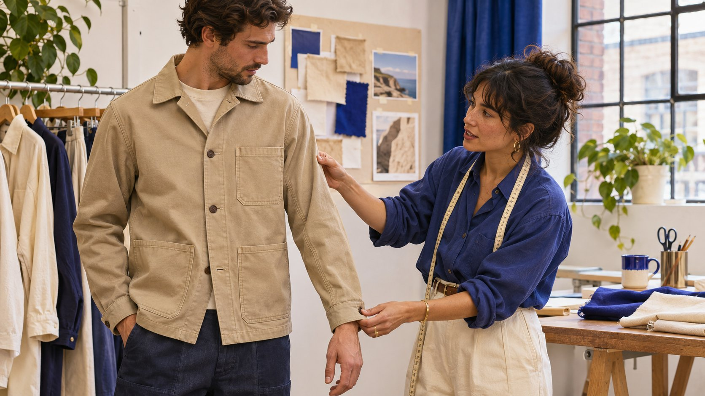
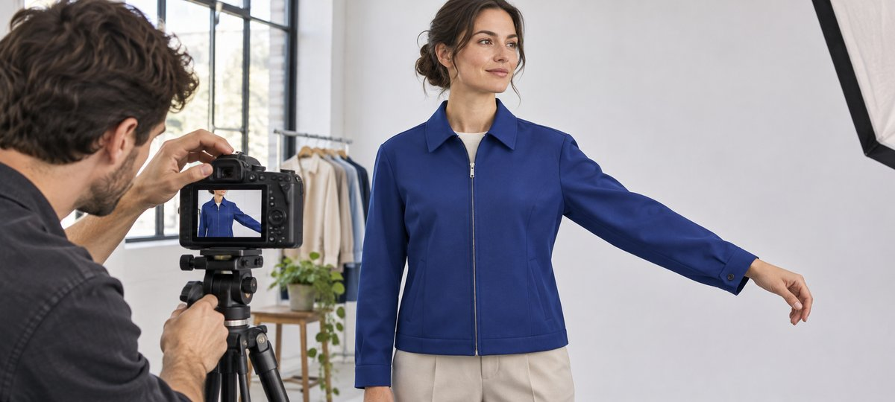

# Instagram Model Casting for a Fit Brief

Status: local review draft; confirm the publication date before release.

Cast an Instagram model for garment fit, on-camera movement and the intended usage.

AI-generated editorial illustration, not an actual creator, client, product or event.

When casting an Instagram model for apparel, define the fit and movement the viewer needs to understand. Then confirm roles, sample garments, sizes, production conditions and publication permissions. Review relevant work and use an agreed camera test if needed. Accept the work on garment fit, legible movement and permitted use. Appearance judgments and follower counts do not answer those questions.

## Start with the fit question a shopper needs answered

An outerwear brand may want to show whether someone can raise an arm with the jacket zipped, how far the cuff moves during a reach and whether the pocket is easy to locate. Write each as an observable action. Use the [campaign brief guide](https://www.quickkol.com/blog/write-a-useful-campaign-brief/#answer) to record product version, delivery ratio, language, audience, primary channel and publishing role. A model may appear only in the footage. A creator may also film, narrate or publish. Define those jobs before comparing work or requesting a quote. Do not ask the model to make unsupported fit claims during production. A shopper may need to see the side of a garment rather than another front-facing portrait. The relevant performance is the ability to carry out the motion consistently and make the feature clear. A buyer can specify a full view to establish the fit and a detail view to explain the cuff. Put those requirements in the same document the photographer, stylist and editor will read. They may otherwise make different assumptions about what the clip needs to prove.

## Check samples, sizing and role requirements

List the style, color, sample size, measurement method, production status and intended layers. Give the model the confirmed brand size information and a clear route for fitting questions. Request only measurements the assignment needs and the person agrees to provide. Keep access limited. Identify differences between a pre-production sample and the eventual garment. Prepare suitable alternate sizes or layers instead of forcing a sample to fit a shot. If clothing is clipped or altered for styling, do not present the modified appearance as evidence of normal fit. A medium sample and a medium retail garment may have different dimensions if development is ongoing. Give the stylist a way to check the version before filming. When two models show different sizes, verify that the captions identify the relevant garment and layer, without including unnecessary personal details. Agree how to show the fit naturally. The buyer can accept a frame that demonstrates a product feature without requiring a generalized statement about every person who might wear it.

## Rehearse the same movement in a wide view and a detail

Start with a neutral front view, then film a side reach, raised arm, seated position or hand entering a pocket as relevant. Use a movement that reflects the planned use and let the model work within a comfortable range. Leave room for cuff and hem in the wide view. In the detail, keep the same garment, size, zipper and direction of motion. Check the vertical phone view for captions and interface overlap. In the editorial photo the arm extends while the shoulder, elbow and cuff remain part of one composition. If the planned frame cannot show all three, capture the full movement first and then pick up the detail. A side close-up can show the cuff changing position without falsely suggesting the whole jacket has a different fit. Give the editor a timecode and record the matching take. Test the actual delivery ratio rather than reviewing only a horizontal master. If a different camera height changes the apparent length, use consistent angles when comparing samples. Do not infer a product measurement from a perspective shot.

AI-generated editorial illustration. Keep the upper body and cuff in frame so the viewer can see how the sleeve moves when the model reaches.

## Choose evidence related to the casting task

Review relevant ordinary work, collaborations and fitting examples the candidate can share. Give each person the same task, such as a neutral stance, a side turn and a comfortable reach. Evaluate whether the motion and garment details are clear and whether they can work with the production team. If they would publish, separately review the actual account, audience evidence and sponsor delivery. A model may be a good on-camera performer without prior brand posting work. A creator who makes tutorials may offer narration as a separate skill. Do not infer size, identity or personal characteristics from profile photos. If a camera test is needed, agree the scope, use and handling of the result first. Keep review focused on the assignment. A trial can be short enough to establish whether the cuff stays visible and whether an edit can be matched. It does not need to reproduce a complete unpaid campaign. A responsible reviewer can give concrete feedback, such as a hand covering the pocket opening, that the candidate can act on.

## Confirm use permissions and posting identity before filming

Use the [creator rates and usage rights guide](https://www.quickkol.com/blog/creator-rates-usage-rights/#answer) to distinguish fitting, appearance, production, editing, creator posting, organic brand use and paid advertising. Specify accounts, territory, term, edits, stills, raw footage and retention. Check permissions for other people, music and locations as well. If a creator publishes an endorsement with a material connection for a U.S. audience, the [FTC influencer disclosure guidance](https://www.ftc.gov/business-guidance/resources/disclosures-101-social-media-influencers) covers clear disclosure. Have the responsible party review the actual market and platform requirements. Confirm fitting work and posting separately. If a brand wants to turn an organic video into a paid crop later, check the agreement and applicable permissions before adapting the file. An actor appearing in brand footage may not have agreed to publish anything. Conversely, a creator’s post may have a limited license for the brand to reuse it. Give the publisher the actual agreed scope and expiry, rather than relying on a release sheet that uses a broad project nickname. Store signed or otherwise accepted records through the organization’s proper process.

## Keep size notes and captions consistent with the footage

The [W3C captions guide](https://www.w3.org/WAI/media/av/captions/) explains captions for speech and sounds needed to understand content. Use the correct style, sample size and layers without turning one fitting experience into a universal claim. Check which sample appears and whether the captions and product page refer to the same size. If a version includes narration, match the script to the actual footage. Play it with captions on and confirm the cuff remains visible. Give important sizing information a readable home on the product page as well. Suppose the brand measures sleeve length from a different point than another retailer. Explain the method in the appropriate product information rather than letting a short clip imply a universal standard. If the editor adds a numerical label, ask the product owner to verify the source before publication. Keep captions accurate when an alternate cut uses a different size or omits a spoken qualifier. A silent version can show the action clearly, but the user still needs the right model and sizing context to interpret it.

## Use one product example to accept the edit or request pickups

Suppose the first jacket edit looks clear on a phone, but the cuff leaves the frame during the reach. Look for a wide take of the same garment and movement. If it exists, use matching coverage or capture the missing detail. If the only available footage uses a different size, do not combine it as though it shows the same fit. Ask the stylist to verify the sample, the editor to review continuity and the publisher to check captions and copy. A pickup can focus on the missing action when that is what the job requires. Give the receiving team the approved asset, version, size information, rights and date. At closeout, review how many planned actions can be seen clearly and whether all included product facts match the actual sample. If a label says retail stock and the clip shows a prototype, fix the statement or choose eligible footage. Write down which versions are cleared for each account. A future team can locate the approved material without expanding its use.

## Leave production notes that can support a repeat shoot

Record date, style, size, layers, marks, framing, camera distance, take and action order. Note which sample should be retired and what facts need checking when the product launches. Keep production notes separate from personal information. Even when the same model and room are available, repeat the important action when the garment or ratio changes. If a new version will appear on a store page, confirm permission and product accuracy again. A repeat shoot should start from the conditions that made the last demonstration useful. Give the next stylist the original visual intention and the fit questions to check, without asking them to reconstruct the shoot from a finished Reel.

## Decide what footage survives a product revision

Suppose the cuff changes from a snap to an adjustable closure before release. A wide take that clearly shows the old hardware cannot describe the new version. Have the product owner inspect the relevant shots and mark each as usable, requiring a pickup or suitable only for a dated historical reference. Check fit and rights even for a scene that appears reusable. For a new fitting, arrange the actual sample and comparable layer, then capture a new movement that matches the relevant wide coverage. Recheck the size chart and captions at release. If the new sample has a different sleeve length, record that change rather than adjusting the older footage to suggest it was filmed on the production garment. Give the publisher a list of approved versions and the one it replaces. The release owner can then update product copy and asset together.

## Fit-content acceptance

| Item | Evidence | Decision |
| --- | --- | --- |
| Sample | Style, size, production status | Matches publication information |
| Movement | Matching wide, detail and take | Cuff and action visible |
| Publishing and permissions | Account, use scope, term and version | Review per channel |

Retain only fitting evidence needed for the assignment.

## Model shoot handoff

Review against the actual fitting and edit.

- [ ] Identify sample and demonstration actions
- [ ] Confirm phone readability for movement and captions
- [ ] Confirm production and publication owners
- [ ] Record clearance and version by use

## Research date and limitations

Sources reviewed November 6, 2026. Methods, tables and decision rules are editorial recommendations. Hypothetical examples are not actual client results or industry benchmarks. Source geography and periods are specified where relevant. This draft is in independent local review; confirm its publication date before release.

## Start creator research with a clear task

Use QuickKOL to interpret a brief, discover relevant creators and research their work and contact routes. Verify data, commercial terms and outcomes at their source.

[Explore QuickKOL](https://www.quickkol.com/#capabilities)

## Sources

- [FTC influencer disclosure guidance](https://www.ftc.gov/business-guidance/resources/disclosures-101-social-media-influencers)
- [W3C captions guide](https://www.w3.org/WAI/media/av/captions/)
