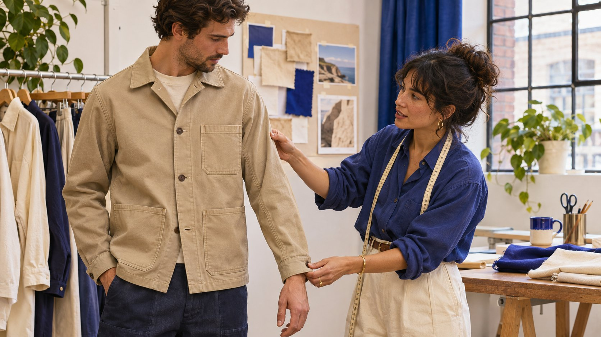
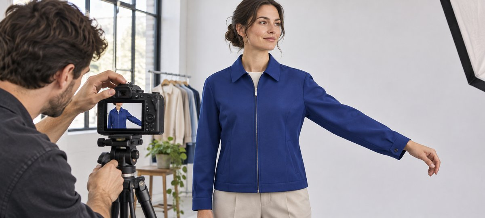

# Instagram 模特：如何写试穿拍摄简报

状态：本地审阅稿；正式发布日期待确认。

用服装版型、实际动作和素材使用范围筛选 Instagram 模特。

AI 生成的编辑示意图，不是真实达人、客户、产品或活动。

品牌找 Instagram 模特做服装内容时，先写观众需要看懂的版型与动作，再确认角色、样衣、尺寸、拍摄条件和发布权限。让候选用已有作品展示同类动作，必要时安排获准试拍。最终验收看衣服如何贴合、动作是否清楚以及素材可用范围，不按外貌或粉丝数决定。

## 从顾客需要看懂的版型问题开始

例如外套品牌想展示拉上拉链后是否方便抬臂，袖口是否在伸手时上移，口袋位置是否容易摸到。把这些写成三个可以拍的动作。用[活动 Brief 撰写指南](https://www.quickkol.com/zh/blog/write-a-useful-campaign-brief/#answer)记录产品版本、成片比例、语言、受众、主渠道和发布角色。模特可以只参与拍摄，也可能由同时做内容的创作者试穿、解释并发帖。先定义任务，再询价或比较作品。现场不要求模特用没有依据的描述解释尺码。

## 核对样衣、尺码和角色需求

列出款号、颜色、样衣尺码、量法、是否量产和需要展示的搭配。给模特已确认的品牌尺码表，说明如何沟通试穿和隐私。只收当前确有必要且对方同意的尺寸信息，限制访问。若拍的是预生产样衣，标注与上市商品是否存在差异。准备相近尺码或可调整搭配，现场不强求为了画面套入不适合的样衣。若衣服被临时夹紧或改动，明确不能把修正后外观当作原版证据。

## 用同一动作试全景和局部

先拍正面静止，再拍侧面抬臂、伸手、坐下或把手伸进口袋。安排代表真实使用方式的动作，让模特决定舒适的范围。给全景留足袖口和衣摆，细节镜头保持同一件衣服、尺码、拉链和动作方向。查看手机竖屏，避免字幕或界面盖住袖口。示意照片里的手臂伸出时，相机仍能保留肩、肘和袖口；如果只能拍其中两处，先退开拍全动作再补近景。

AI 生成的编辑示意图。让上身和袖口同时入画，观众才能看到伸手时袖口如何移动。

## 用任务相关作品做试拍判断

查看候选的普通作品、合作作品和获准分享的试穿片段。给相同要求，例如站姿、转侧面和一次自然伸手。评估动作可读、服装细节和是否能与摄影团队配合。若发布由模特负责，另核对实际账号、受众范围和历史合作表达。假设一个人擅长镜头动作但无品牌发帖经验，可先谈出镜；另一个会做教程，可以单独评估叙述。不要用主页照片推断体型、身份或私人特征。

## 提前确认素材授权和发布身份

用[达人费率与使用权指南](https://www.quickkol.com/zh/blog/creator-rates-usage-rights/#answer)区分试穿、表演、成片、剪辑、模特发布、品牌自然使用和付费投放。明确账号、地区、期限、二次剪辑、截图、原片和留档。拍摄时还有其他出镜者、音乐和场地的使用范围。若有创作者在美国市场发布带有重要利益关系的推荐，参考[美国FTC达人披露指南](https://www.ftc.gov/business-guidance/resources/disclosures-101-social-media-influencers)处理清楚的披露。不同地区和账号实际规则由负责人核对。试穿工作与发布义务各自确认。

## 让尺寸说明、字幕与实际画面一致

[W3C字幕指南](https://www.w3.org/WAI/media/av/captions/)说明字幕如何呈现语音与理解内容所需的声音。用正确款号、尺码和搭配说明，不把某位试穿者的体验写成人人适用。检查视频中说的是哪件样衣，字幕和产品页是否用同一尺码。若一个版本加口播，确认台词与实际镜头一致。开字幕看一遍画面，保证不挡袖口。重要尺寸信息同时放在产品页可读文字中。

## 用同一个产品例子验收成片与补拍

假设首版外套在手机上颜色清楚，但伸手时袖口离开画面。先核对是否已有同一件衣服和同一动作的全景。若有，可用对应片段或补一条合适近景；若只有另一码的素材，不能无提示混剪作同一对照。请造型师核对样衣、剪辑师核对连续性、发布人核对字幕和文案。若项目只需要动作示范，补拍可以限定在问题镜头。把最终素材、版号、尺寸说明、许可和截止期一并交接。

## 为再次合作留一份可复用的场记

记录拍摄日期、款号、尺码、搭配、站位、画幅、拍摄距离、拍号和动作顺序。备注哪件样衣不应再用、哪项信息要上市后重新确认。把拍摄说明和个人信息分开保存。下一次即使同一位模特、同一房间，换款或换画幅也重跑关键动作。若新版本要加入品牌商店图片，确认许可和信息一致。

## 提前确定改款后哪些旧镜头还能用

例如上市前外套的袖口由按扣换成可调节搭扣。已拍的全景若清楚出现旧配件，就不能继续作为新款试穿说明。产品人员核对每个镜头，内容组分别标记可用、需补拍或只能用于历史说明。允许用的场景镜头也要再核对版型和许可。如果要补拍新款，先安排实际样衣和一致的内搭，再重拍与全景匹配的动作。产品页上线时检查尺码表与字幕。

## 试穿内容验收表

| 对象 | 材料 | 验收 |
| --- | --- | --- |
| 样衣 | 款号、尺码、是否量产 | 与发布说明一致 |
| 动作 | 对应全景、特写、拍号 | 袖口和关键动作可见 |
| 发布与许可 | 账号、使用范围、期限和版号 | 逐渠道核对 |

只保留当前任务所需的试穿资料。

## 模特拍摄交接清单

按实际试穿和成片检查。

- [ ] 列清样衣及展示动作
- [ ] 手机能看到动作与字幕
- [ ] 确认制作与发布责任
- [ ] 逐用途保存许可与版号

## 研究日期与使用边界

资料核验于 2026 年 11 月 6 日。文中方法、表格和决策规则为编辑建议，标为假设的示例不是实际客户结果或行业基准。外部资料的适用地区与时期按各段说明；本稿处于独立本地审阅阶段，正式发布日期待确认。

## 用清楚的任务开始达人研究

用 QuickKOL 理解 Brief、发现相关达人并研究作品与联系路径；数据、合作条件和结果仍需核验。

[了解 QuickKOL](https://www.quickkol.com/#capabilities)

## 来源

- [美国FTC达人披露指南](https://www.ftc.gov/business-guidance/resources/disclosures-101-social-media-influencers)
- [W3C字幕指南](https://www.w3.org/WAI/media/av/captions/)
