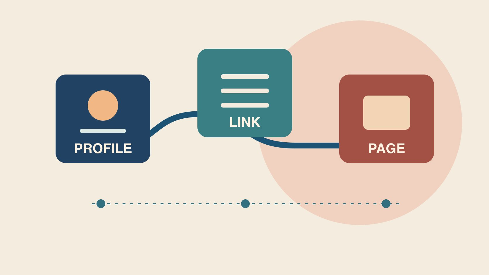

# Link in Bio: Test the Path to the Destination

Status: local review draft; confirm the publication date before release.

Start from the public profile and verify the link in bio destination, redirects and attributable events.

QuickKOL editorial graphic; not actual account metrics or a platform interface.

A link in bio is a clickable link in a profile’s bio area. For brand collaborations, check whether a visitor can move from the actual profile to a working page and take the intended action. If one task dominates, consider a direct destination. A hub can help when several stable destinations matter. Test each step on the public profile and real devices. Record market, reporting window and event unit. A profile link click is different from an order.

## Work backward from the viewer’s task

Start with one action, such as reading installation instructions, booking a trial or joining a local event. Use [a useful campaign brief](https://www.quickkol.com/blog/write-a-useful-campaign-brief/#answer) to assign owners for the publishing profile, market, language, campaign end date and destination. Suppose a creator demonstrates how to fit a paper filter. The closing cue should direct people to the instructions for that exact dripper, and the profile label should match the wording. Follow the path a viewer sees from the actual profile. The URL sent to an editor proves only what was in the brief. If several campaigns share the profile, give the priority action a visible place and document when other links should appear. Keep the route maintainable so the team does not have to recover the last campaign’s address from an old message. A successful viewer journey can start with a useful label, continue through the approved destination and end with a completed action. Assign someone to check each stage. The person who controls the public profile may be different from the person who can repair the destination. Define the handoff before the first post sends traffic.

## Choose between a direct link and a hub

A direct link fits one clear destination, such as a booking page. A hub can serve several stable needs, such as instructions, support and appointments. Every extra hop needs a real destination, descriptive label and check. The [Linktree Instagram profile link guide](https://linktr.ee/help/articles/5434089-how-to-add-your-linktree-url-to-your-instagram-bio) shows where to add its complete URL under Links in Instagram’s Edit Profile flow. Check the actual publishing account and avoid assuming that every platform offers the same controls. Use the [W3C link purpose guidance](https://www.w3.org/WAI/WCAG22/Understanding/link-purpose-in-context.html) to see whether someone can tell where a link goes from its label or context. A label that names the dripper instructions is easier to use than a generic invitation to click. If the campaign moves from a hub to a brand-owned page, agree on transition, fallback and ownership. Suppose the hub already serves ongoing customer support. A temporary promotional button may be better than replacing the whole route. If a direct destination is chosen, make sure that other important profile instructions still have a maintained home. Document the reason for the design so another operator can review it when the next campaign begins.

## Walk the full path on real phones

Start from the public profile and tap the profile link, hub button, market selector and final action. Record device, date, language, market, intended URL and observed destination. If possible, compare an in-app browser with a standard mobile browser for sign-in, consent prompts, redirects and back navigation. Suppose a creator posts for Hong Kong, but a tap reaches a United States product page. Find the hop that changes the market and give it to the relevant owner. Check whether an older campaign remains visible or linked somewhere else. A successful HTTP response cannot confirm that the correct product opens or the form can be used. Ask a second reviewer to reproduce the journey from the profile route shown in the post. Keep the steps they actually saw, including any extra prompt. If an app update changes where a profile link appears, mark the device and version rather than assuming all viewers have the same experience. Test both a normal route and a reasonable fallback. A support link can remain useful when a campaign destination is temporarily unavailable, provided the instructions are accurate.

## Give destinations consistent campaign parameters

The [Google Analytics campaign URL guide](https://support.google.com/analytics/answer/10917952?hl=en) explains how UTM parameters can help identify referring campaigns and recommends using source, medium and campaign. Set naming case, media classification, a unique campaign name and a reviewer. Use another approved field for a creator or button variant if the reporting system needs it, without putting personal information in the URL. Follow a live test tap and check the final URL and corresponding report. If the hub rewrites parameters, log the route from profile to hub separately from hub to brand site. Avoid naming the same campaign differently at every hop. A tag helps classify an eligible observation; it does not prove a click occurred. Suppose an agency uses different capitalization for the same source and the report shows two rows. Check the actual parameters, whether they are valid in your setup and which classification the team agreed to. Correct the source rule and preserve the affected dates. If a redirect strips the tag, work with the destination owner to restore a trackable route. Give the next editor the accepted URL and a check they can repeat without publishing a new post.

## Report taps, sessions and conversions separately

Use the [creator campaign measurement guide](https://www.quickkol.com/blog/creator-campaign-measurement/#answer) to document source, unit, window, deduplication and attribution limits for each event. Suppose the hub records 120 button taps, the site records 95 sessions and the order system confirms six campaign-associated orders. These hypothetical values describe different systems. Repeated taps, loading failures, consent and timing can affect the difference. Identify a cause only with supporting evidence. If the destination also appears in a profile and an email, check whether the routes have distinct approved campaign fields. Keep unknown-source orders out of the creator result. Give orders their own reporting and settlement date if their attribution window differs. A campaign can record visits even while purchases remain pending. Define the source and accepted status before the buyer evaluates payment. A tracked session may reflect a returning user or a particular analytics definition, so avoid describing it as a unique buyer. In the review, use a table that lets each owner see the observations they can reproduce and the remaining gaps. Preserve the query date and compare the same reporting scope in the next release.

## Maintain evergreen and time-limited destinations differently

Assign an owner and review date to each destination. Evergreen instructions need a check after product updates, while a short campaign needs start and end times and a fallback. If a discount ends while a video remains public, update the profile route to an accurate explanation or an available next step. Keep the earlier path and switch time to reconcile historic activity. When a domain changes, test redirects, market selection and whether campaign parameters survive. The change record should identify who made the change, the public label and the source page. Old content can still circulate after an offer ends. A scheduled review can catch a route that is technically working while no longer describing what the old call to action promised. Decide how the brand will handle those cases before the first launch. If a creator manages the profile, arrange a simple update handoff and verify the public result after it changes. If only one market is affected, retain the valid paths for the others.

## Turn an observed failure into the next check

At closeout, separate finding the link, arriving at the right page, completing the task and getting reliable reporting. Suppose the label is clear but some tested devices arrive in the wrong market. Repair the redirect and retest from the same public profile. If the route works but viewers cannot identify the next action, improve the label or destination. Give any creative revision its own version and effective date. Assign one follow-up, such as asking an independent reviewer to reproduce the phone path and verify the final destination and recorded event. Keep any unresolved evidence visible. A check that passes on a teammate’s device may still need a separate market check if the audience sees a localized site. Record which tests were performed and their actual results. Keep failures that affect launch in the decision log until the owner verifies the fix. A tidy spreadsheet can be useful for the next campaign if each row leads to a real public link and the approved reporting source. Use it to coordinate the work, with the destination and event owners responsible for their respective checks.

## Recheck shared links at handoff

If several creators point to the same destination, verify each starting profile and use approved labels to distinguish the routes. The destination can remain the same while a campaign tag identifies a particular placement. If the source cannot be separated, report a combined figure with the actual scope. When two creators publish in different time zones, record their own start and end times and translate them to the reporting time zone. If an older link is accidentally used, preserve the observed route, correct it and identify when the new window starts. Keep test events distinguishable from customer activity. Before signing off, ask one reviewer to reproduce each path and one analyst to confirm how it appears in reporting. A missing row can reflect a broken link or a classification issue. Give each problem to the owner who can reproduce it and date the correction. This makes a repeatable check possible when a seasonal destination or creator profile changes during the campaign.

## Link in bio journey review

| Stage | Evidence | Owner |
| --- | --- | --- |
| Profile entry | Actual profile, label and campaign | Publisher |
| Redirect and destination | Final market, URL and path | Site or hub owner |
| Reporting | Event definition, window and attribution | Analytics and commerce |

The example is hypothetical. Verify the actual reporting definitions.

## Link in bio checklist

Start with the public profile.

- [ ] Name the main visitor action.
- [ ] Test the full path on a phone.
- [ ] Verify actual market and campaign tags.
- [ ] Separate taps, sessions and orders.
- [ ] Record expiration and owner.

## Research date and limitations

Sources reviewed November 6, 2026. Methods, tables and decision rules are editorial recommendations. Hypothetical examples are not actual client results or industry benchmarks. Source geography and periods are specified where relevant. This draft is in independent local review; confirm its publication date before release.

## Start creator research with a clear task

Use QuickKOL to interpret a brief, discover relevant creators and research their work and contact routes. Verify data, commercial terms and outcomes at their source.

[Explore QuickKOL](https://www.quickkol.com/#capabilities)

## Sources

- [Linktree Instagram profile link guide](https://linktr.ee/help/articles/5434089-how-to-add-your-linktree-url-to-your-instagram-bio)
- [W3C link purpose guidance](https://www.w3.org/WAI/WCAG22/Understanding/link-purpose-in-context.html)
- [Google Analytics campaign URL guide](https://support.google.com/analytics/answer/10917952?hl=en)
