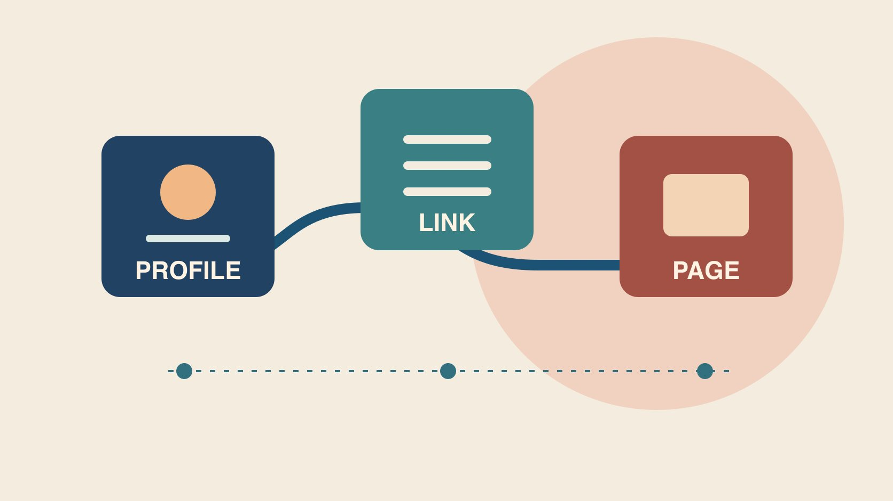

# Link in Bio：检查主页到落地页的路径

状态：本地审阅稿；正式发布日期待确认。

从实际可见的主页开始，核对 link in bio 的目标、跳转和可归因事件。

QuickKOL 编辑图形；不呈现真实账号指标或平台界面。

Link in bio 是主页简介区域中可点击的链接。对品牌或创作者合作来说，关键是用户从实际账号能否抵达有效页面、完成明确动作，以及团队如何核对结果。只有一个当前任务时可优先评估直接链接，有多个稳定入口时考虑聚合页。用公开主页和真实设备测试各跳转，标明市场、活动窗口与事件单位，不把主页链接点击等同于订单。

## 从观众要完成的动作反推路径

先写出一个动作，例如读产品安装说明、预约试用或参加线下活动。用[实用合作简报](https://www.quickkol.com/zh/blog/write-a-useful-campaign-brief/#answer)给实际发帖账号、市场、语言、活动有效期和落地页指定负责人。假设一名创作者用短片演示如何装滤纸，片尾应能准确指向这款滤杯的说明，主页链接标签也要与文案匹配。检查用户会从主页进入哪条链接，别只拿发给编辑的 URL 当证据。品牌若有多个活动同时进行，把当前首要任务放在能找到的位置，并给其他链接说明何时显示。保持路径可维护，不能每次活动临时找出上一次所用的地址。

## 比较直接链接和多入口聚合页

直接链接适合一个明确目的地，例如预约页面。聚合页适合多个长期入口，例如说明、客服和预约。每多一跳，团队都要测试地址、标签与用户理解。[Linktree的Instagram主页链接指南](https://linktr.ee/help/articles/5434089-how-to-add-your-linktree-url-to-your-instagram-bio)说明如何在 Instagram 编辑个人主页的 Links 栏加入完整 URL。它描述的是 Linktree 链接放置，不代表其他平台或账号的按钮完全相同。打开实际账号查看可用控制。用[W3C链接用途指南](https://www.w3.org/WAI/WCAG22/Understanding/link-purpose-in-context.html)检查标签是否说明去哪里，例如“查看滤杯安装”比“点这里”更明确。若活动计划改用品牌自有页，先准备过渡、备用目的地及确认人。

## 用真实手机走完整条链路

从公开主页开始，逐步点主页链接、聚合按钮、地区提示与最终操作。记录设备、日期、语言、市场、预期地址与实际地址。在应用内浏览器和一个普通浏览器都能测试时，分别核对登录、弹窗、重定向和返回。假设创作者发帖针对香港，但链接默认进入美国页面，先定位哪一跳改变地区，再交给对应人。核对旧活动页是否仍在缓存或被其他入口引用。仅有跳转 200 不代表用户找到了对应型号或能完成表单。让第二位检查人从原帖所见的主页入口开始复现。

## 为目的地标记一套可维护的活动字段

[Google Analytics活动链接指南](https://support.google.com/analytics/answer/10917952?hl=en)解释 UTM 参数如何帮助识别引荐活动，并建议使用 source、medium 和 campaign。先约定命名大小写、媒体归类、唯一活动名和复核人。可用其他经批准的字段区别创作者或按钮版本，但参数不要带个人信息。实际点一次，核对最终地址和对应报表；若聚合页重写参数，分别记录主页到聚合页与聚合页到品牌站两段。在有多个跳转时避免每一跳用不同名称代表同一活动。各项参数按记录解释，不能把某个标签直接当成一次真实点击。

## 把点击、会话与转化分开报告

用[创作者活动衡量指南](https://www.quickkol.com/zh/blog/creator-campaign-measurement/#answer)写清每个事件的来源、单位、时间窗、去重和归因限制。假设聚合页记录120次按钮点击，分析工具记录95次会话，订单系统记录6笔与活动相关的已确认订单。三个数描述不同系统。差值可能包含重复点击、加载失败、同意设置或时间差，需要证据才能确定。若同一链接也出现在主页和邮件，检查是否有独立活动字段。不要把来源不明订单补进创作者结果。若归因窗口不同，给订单独立的统计和结算日期。

## 给长期资料和短期活动不同维护方式

给每项入口加责任人和检查日。长期说明需要在产品更新后核对型号与版本，短期活动需要设开始、结束与替代页。假设折扣结束而视频仍可看，把主页目标更新为准确说明或当期有效选项。保留旧路径和切换时间，方便核对历史结果。若改域名，查看重定向、地区选择及活动参数是否还工作。版本记录应说明谁修改、用户看到的链接文字及来源。只要内容还会传播，过期说明也可能被用户看到。

## 把失败情形变成下次验收规则

试点结案分开看能否找到链接、是否到达正确页、是否能完成动作和有无可靠报告。假设按钮标签清楚，但在部分设备跳转到非目标地区，优先处理重定向，再测试相同原始入口。若链接完好但用户看不懂下一步，补标签或更新落地页。若内容改了，单列新版本及有效时间。最后写一项后续动作，例如让独立审阅人从同一主页复制移动端路径，核对最终地址与分析事件。证据不齐时保留待核验。

## 在交接时复查共同入口

若一个品牌在多个创作者主页用了同一落地页，先查各自的出发位置，再按允许的标记区分。团队可保留同一个页面内容，用活动代码区分入口；若渠道无法分开，就如实报合并结果。假设两人发布时区不同，分别记录起始和终止时间，随后再按共同报告时区核对。若一个创作者改用旧版链接，保存实际观察，修正以后再开始新窗口。注意测试标记不会被误读为用户行为。

## 主页链接路径验收

| 阶段 | 核对 | 负责人 |
| --- | --- | --- |
| 主页入口 | 实际账号、按钮文字和活动 | 发帖负责人 |
| 跳转及落地 | 最终市场、URL 和完成路径 | 网站或聚合页负责人 |
| 报告 | 事件定义、观察期和归因 | 分析与电商 |

算例为假设，实际以报告定义为准。

## 主页链接检查清单

从用户看到的主页开始。

- [ ] 写清观众主要动作。
- [ ] 在手机测试完整路径。
- [ ] 核对实际市场及 UTM。
- [ ] 分开点击、会话和订单。
- [ ] 标注到期和责任人。

## 研究日期与使用边界

资料核验于 2026 年 11 月 6 日。文中方法、表格和决策规则为编辑建议，标为假设的示例不是实际客户结果或行业基准。外部资料的适用地区与时期按各段说明；本稿处于独立本地审阅阶段，正式发布日期待确认。

## 用清楚的任务开始达人研究

用 QuickKOL 理解 Brief、发现相关达人并研究作品与联系路径；数据、合作条件和结果仍需核验。

[了解 QuickKOL](https://www.quickkol.com/#capabilities)

## 来源

- [Linktree的Instagram主页链接指南](https://linktr.ee/help/articles/5434089-how-to-add-your-linktree-url-to-your-instagram-bio)
- [W3C链接用途指南](https://www.w3.org/WAI/WCAG22/Understanding/link-purpose-in-context.html)
- [Google Analytics活动链接指南](https://support.google.com/analytics/answer/10917952?hl=en)
