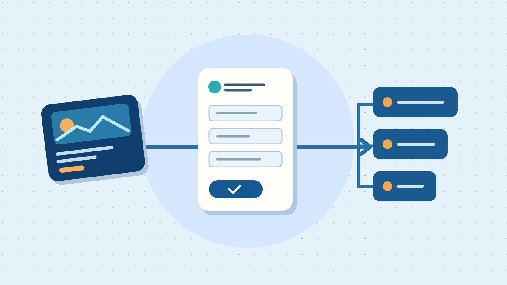

# LinkedIn Ads: Preflight a B2B Lead Campaign

Status: local review draft; confirm the publication date before release.

Test LinkedIn Ads objectives, forms, CRM delivery and qualified lead cost through one real handoff.

QuickKOL editorial graphic; not actual account metrics or a platform interface.

Before launching LinkedIn Ads, choose the user action you want to buy, such as a website visit or lead submission. Then send a tagged test record through the ad, form, CRM and sales follow-up. Track Campaign Manager submissions, unique reachable CRM records and sales-qualified leads separately. Expand the budget once the ad, sales and data owners can reconcile those stages from the same example.

## Define who submits and who receives

Write the business requirement before configuring the ads. For example, a machine monitoring vendor wants teams responsible for maintenance across at least three facilities to request a demo. Sales commits to replying within one business day. Each record needs enough information to identify a working contact, company and market. A technical report download would be a different action and deserves its own qualification rule. Use the [campaign brief guide](https://www.quickkol.com/blog/write-a-useful-campaign-brief/#answer) to document market, buyer responsibility, offer, handling capacity and stop conditions. Local working hours and language coverage affect how quickly the lead can be served. Start where your follow-up team can deliver what the ad promises. If the operations team can handle eight new inquiries a day, a plan that produces thirty is already a poor operational fit. Write down how overnight requests are queued and who covers leave. Give the request a clear label that remains recognizable in the CRM. When demand generation and sales disagree about what constitutes a qualified request, resolve the definition before running a test.

## Match the objective to the conversion location

The [LinkedIn objective and format guide](https://www.linkedin.com/help/linkedin/answer/a422880) separates Website Visits from Lead Generation and maps objectives to eligible formats. The [LinkedIn Campaign Manager guide](https://business.linkedin.com/advertise/ads/best-practices/create-your-first-campaign) also starts with the objective and audience. Use a native form when the intended interaction takes place in LinkedIn. An owned landing page can let someone inspect product specifications, suitability or scheduling before taking a measured website action. Choose the objective and event that reflect the planned journey. If you test both paths, distinguish budgets, forms and sources rather than rolling them into one conversion count. An ad linked to a detailed case study and an ad asking for a demo can both be valuable. They give the reader different tasks. Keep their baselines separate and compare each with its stated purpose. Check that the ad format supports the desired setup in the actual account before approving creative. Save the objective and form identifier in the launch record so an analyst can interpret the export after a campaign is renamed.

## Define targeting and exclusions from buyer responsibility

Start with the responsibility the buyer must have, using options available in the account. Plant operations, equipment management and engineering can all own parts of a maintenance decision. List adjacent groups, such as consultants and service providers, then decide whether they belong in this pilot. Set geography, language and company coverage. Decide whether current customers are excluded or handled in a separate flow. Hold the offer and form stable when you test a clearly defined audience so sales can interpret the difference. A forecast describes potential delivery. The response and qualification records describe who actually engaged. If job titles differ across markets, have a regional owner review examples before dividing the campaign. Include the audience version in your QA note. If you later discover contractors were routed to the wrong owner, correct the routing first and then decide whether the targeting rule needs changing. When a large company operates multiple sites, the right filter may be a pilot question about operational scope rather than an assumption from company size.

## Give each form field a job

The [LinkedIn Lead Gen Form setup guide](https://www.linkedin.com/help/lms/answer/a427102/create-lead-gen-forms?lang=en) covers field and privacy settings. Request only information needed for routing, deduplication and the qualification decision. If facility count matters, use clear ranges and avoid asking for internal production details. State what the submitter will receive and align the confirmation with the offer. Review the journey on a phone and check that error feedback and the privacy link work. Have the relevant data owner review applicable obligations and retention rules. Test a work email and a missing optional value without using a real prospect’s details. If a field fills automatically, verify whether the user can confirm what it contains and whether the CRM receives the expected value. Keep a data dictionary explaining the purpose of every required field. If a department asks to add another question, have it identify the action that will change when the answer changes. A field without an owner can create unnecessary friction and leave sales guessing what to do with the information.

## Send a test lead to the actual queue

The [LinkedIn lead integration guide](https://www.linkedin.com/help/linkedin/answer/a425316) recommends testing synchronization and notes that support for some fields varies by integration. Before launch, have an authorized person submit a tagged test record. Check time, form ID, deduplication, routing and notification. Ask the receiving salesperson to open the record and simulate a status change. Submit again using a known test contact to learn whether the CRM merges or creates a second record. If synchronization is delayed, preserve the log and assign any manual reconciliation to one owner. Identify test records clearly and handle them under the team’s test data process. Next test a record that falls outside the sales territory. It should go to the expected holding or rejection state rather than vanish. Where the system cannot pass a qualification question, confirm how it is recovered and who sees it. Record the time at each handoff so you can distinguish a slow connector from a queue with no owner. Confirm the test does not trigger unintended prospect outreach.

## Use three explicit denominators

In a hypothetical pilot, ad spend is 1,200 dollars, the platform reports 60 submissions, the CRM identifies 45 unique reachable contacts and sales has qualified 15. Cost per submission is 20 dollars, cost per unique reachable contact is about 26.67 dollars and cost per qualified lead is 80 dollars. If ten records still await review, show them as pending. Use the [campaign measurement guide](https://www.quickkol.com/blog/creator-campaign-measurement/#answer) to align spend window, time zone, currency and qualification cutoff. These figures exclude creative production, tools and sales labor. The reporting choice changes the business decision. A low cost per submission can coincide with slow follow-up or few eligible accounts. Put the disposition counts next to the cost so readers can see what changed. If a record is merged with an earlier contact, decide in advance how new interest is credited. If sales completes the qualification review several days after the platform export, version the table and preserve the original date. A refreshed denominator is evidence of a more mature cohort, even when the ad spend stayed fixed.

## Use failure paths to decide whether to pause or scale

Before launch, give advertising, CRM and sales a named acceptance step. Confirm that the ad describes the offer, the form can submit and the record reaches the intended queue. If clicks are steady but submissions are low, walk the form journey. If submissions appear but records are missing, inspect synchronization and merge rules. If both counts look reasonable and qualified leads are rare, review audience, offer and qualification criteria. Choose the next step in light of sample size, response deadlines and budget. Change one interpretable element at a time and preserve the form, audience and report versions. In the first week, separate conversion delays from recurring routing failures. A small pilot might reveal that the demo is scheduled in the wrong time zone even though tracking works. Fix that defect before seeking more reach. When increasing spend, note the new daily follow-up capacity and the threshold that will trigger another review. Share the handoff evidence with the people who will receive the next batch.

## Schedule the first-week review and handoff record

Suppose the cost per submission falls after five days, but sales finds that requests from one campaign often come from people who do not oversee equipment purchases. Check the campaign and form identifiers for those records. Then look at whether an offer described as a free equipment diagnostic was understood as technical support. You could first change the ad copy to clarify that the offer is a software demonstration while holding the audience, form and follow-up constant. If the CRM did not receive the job field, review the relevant records you are allowed to process before treating an anecdote as representative. Three contacts at the same company may have three legitimate follow-up histories. Group them as an opportunity only under the rule the sales team agreed in advance. Show spend, submissions, unique contacts, qualified leads and demos booked in one review table, with separate observation windows and pending counts. Ask sales what should happen to records still under review before changing the ad budget. Rerun the test record when the market, language or form changes. Include a dated screenshot of the ad preview, a redacted example of the received record and the name of the queue owner in the handoff folder. If a field was removed during a revision, keep the old field definition with the older export. At the next meeting the analyst can then explain which differences reflect genuine buyer behavior and which reflect a changed measurement setup. If the team pauses the campaign because someone cannot follow up, preserve the pending work and set a date to review capacity before restarting. The first week is useful for testing the whole service process because ad delivery is only one part of it.

## B2B ad handoff

| Stage | Acceptance evidence | Owner |
| --- | --- | --- |
| Ad and form | Ad version, objective, form ID | Media |
| Lead sync | Tagged lead, CRM ID, delivery time | Operations |
| Sales qualification | Status, rule version and cutoff | Sales |

Keep pending reviews separate from disqualified records.

## Four preflight checks

Capture the results in one pilot record.

- [ ] Business action and ad objective agree
- [ ] Every form field has a purpose
- [ ] Test lead reaches the real queue
- [ ] Reconciliation scope and dates are agreed

## Research date and limitations

Sources reviewed November 6, 2026. Methods, tables and decision rules are editorial recommendations. Hypothetical examples are not actual client results or industry benchmarks. Source geography and periods are specified where relevant. This draft is in independent local review; confirm its publication date before release.

## Start creator research with a clear task

Use QuickKOL to interpret a brief, discover relevant creators and research their work and contact routes. Verify data, commercial terms and outcomes at their source.

[Explore QuickKOL](https://www.quickkol.com/#capabilities)

## Sources

- [LinkedIn objective and format guide](https://www.linkedin.com/help/linkedin/answer/a422880)
- [LinkedIn Campaign Manager guide](https://business.linkedin.com/advertise/ads/best-practices/create-your-first-campaign)
- [LinkedIn Lead Gen Form setup guide](https://www.linkedin.com/help/lms/answer/a427102/create-lead-gen-forms?lang=en)
- [LinkedIn lead integration guide](https://www.linkedin.com/help/linkedin/answer/a425316)
