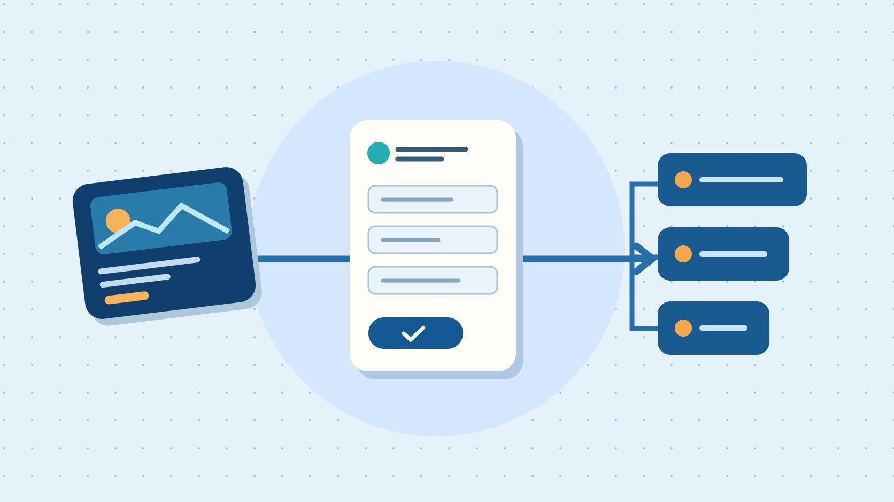

# LinkedIn Ads：B2B 线索广告投放前检查

状态：本地审阅稿；正式发布日期待确认。

按实际交接测试 LinkedIn 广告的目标、表单、CRM 和合格线索成本。

QuickKOL 编辑图形；不呈现真实账号指标或平台界面。

上线 LinkedIn Ads 前，先明确要买的是网站访问还是线索提交，再让一条有标记的测试记录走完广告、表单、CRM 和销售跟进。Campaign Manager 的提交量、CRM 的唯一可联系记录和销售认定的合格线索要分别统计。只有广告、销售和数据负责人能用同一份样例对齐这三个数时，才有依据扩大预算。

## 写清谁提交，谁接收

广告设置前先写业务要求。比如，一家设备监测软件商希望让负责三家以上工厂维护的团队申请演示，销售承诺在一个工作日内回复。每条线索至少要能匹配一个工作联系人、公司和地区。若目标改为下载行业报告，下载者的意向可能不同，应单独设置资格规则。用[活动 Brief 撰写指南](https://www.quickkol.com/zh/blog/write-a-useful-campaign-brief/#answer)写明地区、买方职责、要约、运营能力和停止条件。不同地区的销售工作时段和语言不同，先选能及时处理的区域。

## 让广告目标与转化地点对应

[LinkedIn目标与广告格式说明](https://www.linkedin.com/help/linkedin/answer/a422880)将 Website Visits 和 Lead Generation 区分开，并列出适配格式。[LinkedIn Campaign Manager入门](https://business.linkedin.com/advertise/ads/best-practices/create-your-first-campaign)也从目标和受众开始。原生表单适合在 LinkedIn 内完成的流程。自有落地页可以让用户看规格、适用性或可约时间，再通过网站完成动作。分别用各自的广告目标与转化事件。若两条路径都运行，单独标记预算、表单与来源，报告不要直接合并。

## 按买方责任设定受众和排除

在广告账户允许的范围内，以买方实际工作为起点。工厂维护需求可以来自工厂运营、设备管理和技术工程等岗位。先列出相似但不同的角色，比如咨询方和外部服务商，再决定他们是否符合当前销售范围。设定地区、语言和公司覆盖，明确有现有合同的客户是否单列。固定要约和表单，先试一个明确的人群，便于解释线索差异。受众预估是计划信息，销售验证才说明实际资格。

## 让每个表单字段有明确用途

[LinkedIn表单制作帮助](https://www.linkedin.com/help/lms/answer/a427102/create-lead-gen-forms?lang=en)提供字段和隐私设置。只索取接收、去重与资格判断需要的数据。若必须知道工厂数量，用明确的范围问题，避免要求用户提供内部生产信息。表单里说明提交后会收到什么，后续页也要与广告一致。发布前用测试样例检查手机上是否看得清、错误反馈是否具体、隐私链接能否打开。由负责数据处理的同事审查适用政策和内部保留规则。

## 送一条测试线索到实际队列

[LinkedIn线索同步帮助](https://www.linkedin.com/help/linkedin/answer/a425316)建议测试同步，并提示不同集成对部分字段支持不同。在启动前由已授权人员提交带标记的测试记录，核对时间、表单 ID、去重方式、路由和提醒。让销售打开记录并模拟改状态。第二次用已有测试联系人观察是否合并。若同步超时，保留日志和人工导入责任人，避免重复导入。标明测试数据，结束后按团队流程处理。

## 按三个分母分别计算

假设广告花费 1,200 美元，平台有 60 次提交，CRM 找到 45 条唯一可联系记录，销售已判定其中 15 条合格。每提交成本 20 美元，每条唯一可联系记录约 26.67 美元，每条合格线索 80 美元。若另有 10 条待判定，应单列而不是算不合格。用[活动衡量与对账指南](https://www.quickkol.com/zh/blog/creator-campaign-measurement/#answer)统一花费窗口、时区、币种与资格截止日期。例子中的成本不含创意、工具或销售人工。

## 用失败路径决定暂停还是放量

上线前请投放、CRM 与销售各确认一项验收。广告说明准确，表单能提交，线索能进入正确队列。若点击正常但提交少，先重走表单；若提交正常但 CRM 少，查同步和合并；若两者正常但销售合格少，检查人群、要约和资格规则。根据样本量、响应时限与当前预算决定下一步。每次只改能归因的一项，保留原来的表单、受众和报表版本。

## 安排首周复查和交接记录

假设投放五天后提交成本下降，但销售发现某个活动送来的申请集中在不负责设备采购的岗位。先查这组记录的活动和表单 ID，再看广告上的“免费设备诊断”是不是被理解成技术支持。可以先改广告说明，让潜在买方知道这是软件演示，保持受众、表单和后续跟进不变。如果 CRM 的岗位字段当时未传入，先重新核对已获准处理的记录，不用销售的印象代表整个样本。若同一家公司有三个联系人，分别保存实际跟进，只有符合预先约定的规则才合并为一个商机。复查时把花费、提交、唯一联系人、合格线索和已安排演示放在同一张表，旁边注明各阶段的统计窗口和仍待处理的数量。让销售复查是否要继续处理待判的人，再由投放决定预算。换了地区、语言或表单后重新跑一遍测试记录。

## B2B 投放交接表

| 阶段 | 验收材料 | 负责人 |
| --- | --- | --- |
| 广告与表单 | 广告版本、目标、表单 ID | 投放 |
| 线索同步 | 标记记录、CRM ID、抵达时间 | 运营 |
| 销售资格 | 状态、规则版本与截止时间 | 销售 |

合格待判与已判不合格分开。

## 广告上线前四项

把结果写进同一份试投记录。

- [ ] 业务动作与广告目标一致
- [ ] 表单字段各有用途
- [ ] 测试记录进入实际队列
- [ ] 对账口径与时间已确认

## 研究日期与使用边界

资料核验于 2026 年 11 月 6 日。文中方法、表格和决策规则为编辑建议，标为假设的示例不是实际客户结果或行业基准。外部资料的适用地区与时期按各段说明；本稿处于独立本地审阅阶段，正式发布日期待确认。

## 用清楚的任务开始达人研究

用 QuickKOL 理解 Brief、发现相关达人并研究作品与联系路径；数据、合作条件和结果仍需核验。

[了解 QuickKOL](https://www.quickkol.com/#capabilities)

## 来源

- [LinkedIn目标与广告格式说明](https://www.linkedin.com/help/linkedin/answer/a422880)
- [LinkedIn Campaign Manager入门](https://business.linkedin.com/advertise/ads/best-practices/create-your-first-campaign)
- [LinkedIn表单制作帮助](https://www.linkedin.com/help/lms/answer/a427102/create-lead-gen-forms?lang=en)
- [LinkedIn线索同步帮助](https://www.linkedin.com/help/linkedin/answer/a425316)
