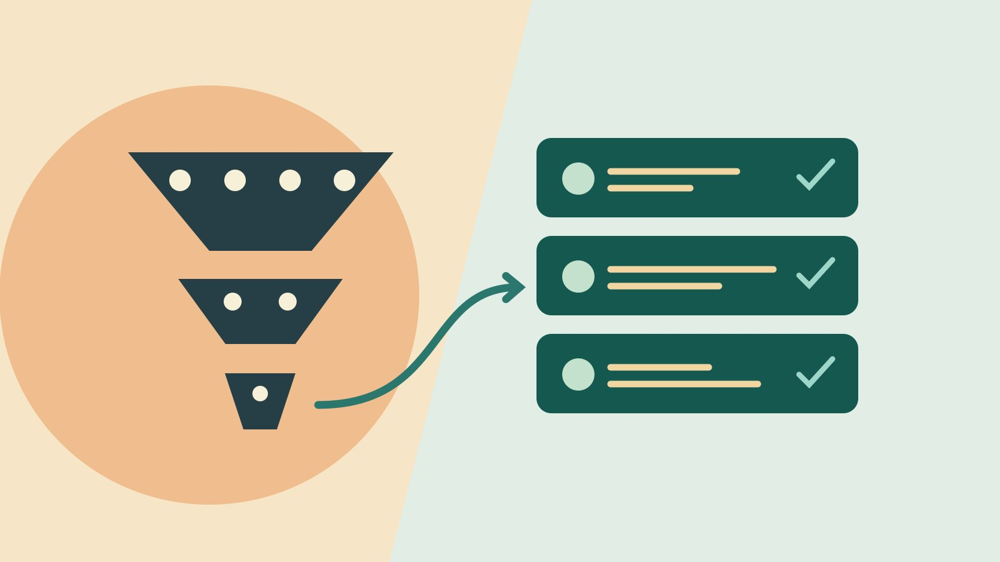

# Modash: Test Discovery and Audience Evidence

Status: local review draft; confirm the publication date before release.

Validate Modash discovery with known candidates, public work and authorized reports.

QuickKOL editorial graphic; not actual account metrics or a platform interface.

Modash helps teams discover creators and inspect third-party profile reports. Start with a defined assignment, then test filters against known matches and borderline cases. Review representative public work and distinguish creator location, audience estimates and authorized native reports. Judge efficiency from candidates you actually verify and assign follow-up for missing data.

## Begin with an assignment you could actually commission

Suppose a cycling light brand that ships within Canada needs six creators who can film a French-language commuting tutorial at night. Specify delivery area, suitable filming conditions, visual requirements and file type. Creator location, content language and share of audience in the target region are different conditions. Decide which ones are requirements and which can remain open for review. Use the [creator selection guide](https://www.quickkol.com/blog/creator-selection-beyond-followers/#answer) to define what work counts as evidence of production ability. Do not make a demographic percentage the sole gate. Give the researcher two known matches and two negative examples before opening the tool. A creator with a polished studio review might not be equipped to show the light in an outdoor setting. A bilingual creator may be able to make the film even if some of their earlier work is in English. Describe the observable production task so a second researcher can assess the same candidate. Keep the ability to film separate from the decision to publish to an audience. The two matter differently for a brand-owned asset and a sponsored post.

## Move from broad to narrow filters with a record of exclusions

The [Modash Discovery overview](https://www.modash.io/features/influencer-discovery) describes creator location, view counts, engagement, topic and audience filters. Start with a broad sample using platform, recent content and language. Add the audience or geography filters that would change the decision one at a time. Keep each query, date, plan, candidate count and whether your known examples remain visible. If a known match disappears when you add a field, see how the actual filter handles missing data. You can retain candidates found through public research, with their source and unresolved fields labeled. Suppose one known French-language cycling creator is absent after a region filter. Check if the selected field represents the creator’s location or their audience location. If the filter removes a relevant candidate for a sensible reason, preserve the reason. If it removes them because the value is unknown, try a separate manual review queue. Do not present the set left by an intersection of filters as all eligible creators. The pilot tests whether the search helps your particular team find and review work efficiently.

## Look for apparent matches and missed candidates

Run two checks. First, review candidates surfaced by the tool. Inspect recent examples that resemble the assignment and establish whether the fit is real. Second, take creators already found through independent public research and see which ones the query missed. Suppose a query returns eighteen profiles and a reviewer checks ten. Six have the required work samples. Report six passes among the ten inspected. It is not an estimate of overall platform accuracy. If three of four known candidates appeared, describe that small coverage test in the same way. Give each discrepancy a reason when it can be determined. The query might use terms associated with sporting competitions while a qualified commuter talks about bicycle maintenance. A stale handle could cause an apparent miss. A creator might appear as a fit because a popular older post is unrelated to their current work. Record the sample selection method, including whether the reviewer chose the first ten or spread selections across result pages. That makes the result interpretable when someone tries a revised query.

## Label audience estimates and their scope

The [Modash audience insights guide](https://help.modash.io/en/articles/13715083-understanding-audience-demographics-and-insights) describes platform-specific geography detail and modeled age and gender estimates based on a sample. When copying a field, include platform, observation date, estimated or first-party provenance, window and missingness. Even if a report estimates that thirty-five percent of an audience is in the target country, a sponsored post is not assured the same geographic mix. Use the [follower country evidence guide](https://www.quickkol.com/blog/how-to-see-followers-countries-evidence/#answer) to request the relevant permitted native information from the account owner. If the native report and vendor sample use different definitions, retain both with an explanation. Avoid comparing percentages without a common window. For a smaller or newly observed account, a missing geography field can justify a follow-up while leaving its content fit intact. Do not fill the row with the creator’s home city or the language of the comments. If an analyst needs a city breakdown and the tool only displays country, record the limitation before choosing candidates. A conversation with an authorized creator can resolve some questions without sharing unrelated demographics. Document any data handling limits with the source.

## Put creative fit, audience evidence and open questions side by side

Give each shortlisted candidate two readable work links, timecodes, profile identity, estimated audience scope and a next step. Someone may produce excellent French demonstrations without available geography evidence. For a brand-owned production file, the creator’s audience may be secondary context. For a sponsored post it can be an important open question. Record the provenance and scope of a score or credibility field. A low, missing or unusual value can support further review, without establishing that a person did anything wrong. If an account is cross-listed under several platforms, inspect each actual profile. A tutorial on one does not establish the same audience or format on the other. In the example pilot, the analyst can mark one candidate ready for a production conversation and another pending an authorized report for publication. The campaign manager should see what distinguishes them. Keep any unpublished commercial notes limited to the intended team. A shortlist that shows uncertainty explicitly is easier to update after outreach than one that forces all rows into a single rating.

## Have a second reviewer use the actual export

The [Modash profile report guide](https://help.modash.io/en/articles/13715024-profile-reports-and-summaries) describes individual profile PDFs and list CSVs, with data availability depending on platform and account. Inspect what the proposed plan can actually export. Check identity, links, dates, fields, missing values and sharing permissions. Give three candidates to a colleague who did not run the search and ask them to recover why each advanced. If a CSV lacks provenance or filter settings, attach a concise evidence note. Review what an outside recipient needs before sharing a full report. If the buyer needs to update work samples without repeating the whole search, store the public links and selection criteria in a portable file. Separate the vendor export from the team’s editorial notes so updates do not obscure the source. Check how the export represents an unavailable numeric field. A blank and a zero can lead to different decisions. When joining several records, use the stable identifiers available to your team and validate similar handles manually. For a changed public account, retain the old observation date and mark the new link as checked.

## Measure time per qualified candidate

Record time from the first query to a shortlist ready for discussion, including sample review, added candidates, deduplication and reporting. In a hypothetical test, ninety minutes for six ready candidates equals fifteen minutes per candidate. Sixty minutes for three ready candidates equals twenty minutes each. These are process examples. Define ready in advance through relevant work, correct identity, explicit open questions and an appropriate contact route. A small trial does not establish what a whole team will achieve. Inspect which activity consumes time before deciding what to repeat. If the shortlist takes longer because a reviewer actually checks the video, the additional work may be appropriate. Compare the same quality threshold in both runs. A cheaper or faster search can create more work in outreach if many candidates cannot deliver the required format. Keep timing separate from the final campaign outcome. The pilot can show which workflow helps the team make a better evidenced first contact.

## Close each review with a verifiable action

Use separate statuses for outreach, follow-up, exclusion and future review. Add an owner and reason to each. An open task might be to verify whether country data is available or who filmed the work sample. When changing filters, preserve the previous query and explain the difference. Recheck scope when market, plan or needed features change. A shortlist can be useful before every question is resolved if the person making the next decision knows which evidence is pending. Preserve a minimal handoff that supports the actual purchase decision.

## Compare two creators with different supporting evidence

Suppose creator A has public work showing a rainy nighttime commute and no available audience geography. Creator B has a vendor audience estimate but only indoor unboxing work. If the brand first needs an owned creative asset, ask A for the proposed production setup and ask B whether they can film the required scene under suitable conditions. If the buy changes to creator publication, request appropriate audience evidence from A and review the estimate’s window and geography for B. A single percentage should not erase the difference in observed work. Give both the same assignment and commercial scope while making the open questions explicit. Confirm the person, account and usage before contracting. In the handoff, show how the same two names can get different statuses for the two assignments. Keep permission to publish, ability to produce and likely audience fit as independent checks. After the first conversation, update the evidence date and owner instead of overwriting what the tool originally showed. If the account cannot provide a material item, explain how that affects the decision rather than filling the blank. Another buyer can then reuse the work sample for a production-only assignment without accidentally relying on an unresolved audience estimate.

## Modash pilot evidence

| Evidence | Check | Use |
| --- | --- | --- |
| Query version | Known candidates surfaced or missing | Validate discovery |
| Work sample | Link, timecode and relevant action | Review production fit |
| Audience | Source, market, window and unknowns | Decide follow-up |

This pilot evaluates evidence for the current assignment.

## Four checks before exporting

Ask someone outside the first review to inspect the evidence.

- [ ] Keep query versions and known examples
- [ ] Review work and identity for each candidate
- [ ] Label estimates, native data and gaps
- [ ] Record next action and owner

## Research date and limitations

Sources reviewed November 6, 2026. Methods, tables and decision rules are editorial recommendations. Hypothetical examples are not actual client results or industry benchmarks. Source geography and periods are specified where relevant. This draft is in independent local review; confirm its publication date before release.

## Start creator research with a clear task

Use QuickKOL to interpret a brief, discover relevant creators and research their work and contact routes. Verify data, commercial terms and outcomes at their source.

[Explore QuickKOL](https://www.quickkol.com/#capabilities)

## Sources

- [Modash Discovery overview](https://www.modash.io/features/influencer-discovery)
- [Modash audience insights guide](https://help.modash.io/en/articles/13715083-understanding-audience-demographics-and-insights)
- [Modash profile report guide](https://help.modash.io/en/articles/13715024-profile-reports-and-summaries)
