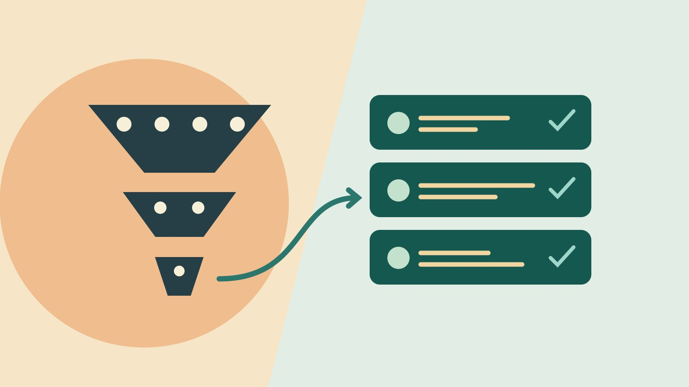

# Modash：如何核对达人发现与受众数据

状态：本地审阅稿；正式发布日期待确认。

用已知候选、公开作品和账号报告验收 Modash 发现流程。

QuickKOL 编辑图形；不呈现真实账号指标或平台界面。

Modash 可以辅助发现达人并查看第三方账号报告。试点先定义任务，再用已知符合的候选与边界案例测试筛选。查看有代表性的公开作品，把创作者所在地、估算受众和获准原生报表分别记录。用实际找到并核实的候选评估效率，未知字段交给下一步复核。

## 先写一个可以买或可以做的任务

例如一家在加拿大供货的骑行灯品牌需要六位能拍法语夜间通勤教程的达人。规定产品能到达的地区、能展示的安全场景、画面要求和成片类型。创作者是否住在加拿大、作品是不是法语、观众有多少在目标地区是不同条件。先决定哪些是硬要求，哪些允许跟进。用[达人筛选指南](https://www.quickkol.com/zh/blog/creator-selection-beyond-followers/#answer)说明什么作品可以作为能力证据，避免把受众百分比设成唯一门槛。给研究员两条符合与两条不符合的已知样例作为起点。

## 从宽筛到窄筛，每次记下排除理由

[Modash 达人发现说明](https://www.modash.io/features/influencer-discovery)描述创作者所在地、观看量、互动、内容和受众维度。先用平台、近期主题和语言建立宽样本。随后逐步加可能影响决策的受众或地域筛选。保存每次查询、日期、计划、候选数量和已知样例是否仍出现。若目标达人因为资料缺失消失，查实际筛选如何处理空值。可以人工补充公开发现的候选，标明来源和未验证字段。

## 查两种错误：看起来符合和被漏掉

做两个抽查。第一组是工具筛出的候选，读最近与任务相近的几条作品，验证是否真的匹配。第二组是人工已经确认符合的候选，核对工具为什么会漏。假设筛选出 18 人，人工核查 10 人，其中 6 人有实际作品证据。结论写“本次核查的 10 人里 6 人通过”，不能推成平台总体准确率。第二组若找到 4 个已知候选中的 3 个，只描述该小样本的发现情况。

## 标明受众估算的来源与适用范围

[Modash 受众信息帮助](https://help.modash.io/en/articles/13715083-understanding-audience-demographics-and-insights)说明不同平台提供的地区层级不同，年龄与性别等来自样本估算。抄字段时附上平台、采集日期、估算或一方来源、窗口和缺失状态。一个达人 35% 受众在目标国家，即使报告如此显示，也不能理解为合作帖子会触达相同比例。用[粉丝国家核验指南](https://www.quickkol.com/zh/blog/how-to-see-followers-countries-evidence/#answer)向账号持有人核对获准的目标国家数据。若账号原生数据与供应商样本口径不同，分别保存并解释。不要比较没有共同窗口的两个百分比。

## 把作品能力、受众证据和待核问题并排

每个入围者写两条可打开的作品链接、具体时间点、账号身份、估算范围和下一步。一个候选可能擅长法语演示，但无法提供该地区证据。若任务是制作文件供品牌发布，创作者受众可能只作背景；若要购买其发帖，则待核受众可能决定能否签约。对得分或可信度字段只记录来源与适用范围。低值、缺失或异常走势只能提示进一步核验，不能证明造假。

## 用实际导出做第二人复核

[Modash 主页报告帮助](https://help.modash.io/en/articles/13715024-profile-reports-and-summaries)描述单个主页 PDF 与名单 CSV，且数据是否可用受平台和账号影响。试点中分别打开实际方案可导出的文件，检查账号 ID、链接、窗口、字段、缺失标记和权限。把三条候选交给没参与搜索的人，要求他找出入围依据。若 CSV 缺少需要的来源或筛选，另附一页证据说明。不要无条件转发完整 PDF，先看外部收件人需要哪些内容。

## 按合格候选而不是返回数量衡量效率

记录从开始查询到可发起沟通的时间，包括复核作品、补候选、处理重复和阅读报告。假设一轮用 90 分钟留下 6 位能沟通的人，平均每人 15 分钟；另一轮 60 分钟只确认 3 位，平均 20 分钟。两组是流程演算。定义“可沟通”为任务相关、链接正确、重要未知已列出和有适当联系路径。人少时不要外推到整个团队，先看哪些操作占时，再安排下轮对比。

## 把下一步写成可核实的动作

入围表分为沟通、补证、排除和留待以后，给每条写原因和负责人。比如“补法国和加拿大市场是否分别可看”，或“核对现有视频是否本人拍摄”。更新筛选时保留旧查询和差异。新市场、报价模块或计划发生变化时重新确认。把正式采购建立在实际已验证范围内。

## 复核两位都能拍片但证据不同的候选

假设 A 在公开作品中展示雨夜通勤，受众地区字段缺失；B 有供应商估算，但只有室内开箱作品。若品牌先买自有账号素材，可让 A 提供实际制作安排，同时向 B 核对是否能安全拍出所需场景。若改买创作者账号发帖，给 A 补查获准的受众报告，对 B 核对估算的窗口和适用地区。不要把单个百分比覆盖公开作品证据。给两个人同样的任务与询价范围，同时明确各自尚缺什么。合同之前重新确认人选、账号和许可。

## Modash 试点证据表

| 证据 | 要看 | 用途 |
| --- | --- | --- |
| 筛选版本 | 已知样例是否出现 | 验证发现过程 |
| 作品 | 链接、时间点和实际动作 | 核对制作能力 |
| 受众 | 来源、市场、窗口和未知 | 决定需要什么复核 |

试点衡量当前任务的证据质量。

## 导出前的四项检查

由未参加初筛的人复看。

- [ ] 保留查询版本与已知样例
- [ ] 逐条核对作品和身份
- [ ] 标记估算、原生与缺失
- [ ] 写清下一步和负责人

## 研究日期与使用边界

资料核验于 2026 年 11 月 6 日。文中方法、表格和决策规则为编辑建议，标为假设的示例不是实际客户结果或行业基准。外部资料的适用地区与时期按各段说明；本稿处于独立本地审阅阶段，正式发布日期待确认。

## 用清楚的任务开始达人研究

用 QuickKOL 理解 Brief、发现相关达人并研究作品与联系路径；数据、合作条件和结果仍需核验。

[了解 QuickKOL](https://www.quickkol.com/#capabilities)

## 来源

- [Modash 达人发现说明](https://www.modash.io/features/influencer-discovery)
- [Modash 受众信息帮助](https://help.modash.io/en/articles/13715083-understanding-audience-demographics-and-insights)
- [Modash 主页报告帮助](https://help.modash.io/en/articles/13715024-profile-reports-and-summaries)
