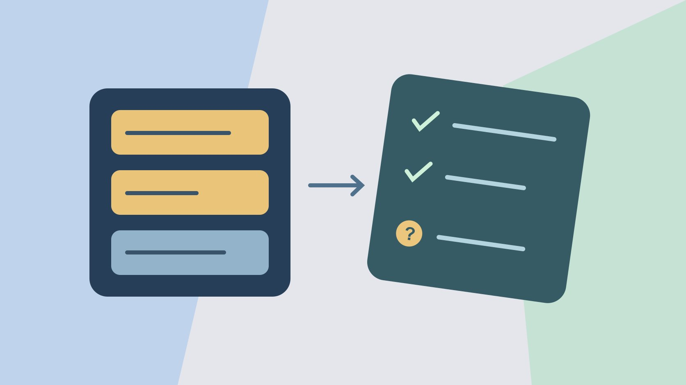

# Social Listening: Validate the Query and Sample

Status: local review draft; confirm the publication date before release.

Validate a social listening query with manual labels, known examples and source coverage.

QuickKOL editorial graphic; not actual account metrics or a platform interface.

Social listening collects evidence from accessible conversations to answer a defined business question. Set the question, sources and dates, then test the query with known matches, ambiguous examples and coverage gaps. Review returned results for relevance and check whether known examples were missed. Report coverage limits and query version, and give the finding a responsible next action.

## Turn general listening into a decision question

Suppose a bottle brand wants to understand why people ask whether a lid feels loose. The decision is whether to revise instructions, film another demonstration or send the concern to product. Define the product, example types, sources, languages, markets and dates. Public comments, support cases and surveys cover different populations. Combining them does not make the result representative of the market. Use the [social media operating plan](https://www.quickkol.com/blog/social-media-marketing-operating-plan/#answer) to assign ownership and record the scope. If the listening project uses public posts only, leave individual repair cases to support. Retain no personal details the work does not need. A narrow question gives the analyst a practical way to distinguish general brand visibility from evidence about use. Write the threshold for a follow-up, such as at least several independently observed examples showing the same misunderstanding. That threshold is an internal review trigger rather than an industry standard. Ask the decision owner what evidence would change the product, instructions or campaign.

## Build known positive and negative examples first

Manually find a few public discussions that clearly concern the lid. Add examples involving a namesake product, promotional duplicates and unrelated content. Save the link, date, language, short label reason and whether the chosen collection can cover it. Two posts might independently ask about assembly, one might name another brand and two might be copies of a promotion. Hold back several examples for final review instead of tuning the query on all of them. If a known match is missing, check date and source coverage before changing keywords. Do not collect unrelated material to fill a quota. A colleague can review the set without seeing your expected query. If two people label a post differently, write the disagreement and decide which meaning matters to the business question. For example, a customer posting that a cap looks loose in a picture is different from a customer documenting a real defect. Both can be relevant, but they need separate tags and next actions.

## Write the portable rule before using vendor syntax

Start in plain language. A brand or model term must occur with a lid or assembly term. The [Brandwatch query syntax guide](https://social-media-management-help.brandwatch.com/en/articles/17449912-building-advanced-queries-in-listen-social-listening) describes quoted phrases, AND, OR, NOT and grouped clauses. Verify syntax, case rules and module restrictions in the product you actually use. Give each term a purpose and include relevant local language variants. If the brand name is also a common surname, a blanket exclusion may remove real mentions. Try model or context terms first and check the labeled examples. Save what the tool actually executed if it changes quotation marks or groups. A portable rule is useful when the same research is performed in a second source with different syntax. Keep the business rule and vendor query in different fields. For example, your rule may accept a model nickname that needs two explicit phrases in the interface. Document why each phrase is present, then see what happens when it is removed. One small change at a time makes it possible to explain a gain or loss of relevant posts.

## Verify source coverage and time windows separately

The [Brandwatch source coverage guide](https://social-media-management-help.brandwatch.com/en/articles/17449910-sources-for-listen-social-listening-mentions) describes where Listen mentions come from and how coverage differs by source. Record the actual account or plan, selected platforms, relevant authorized sources, collection date, content window and limits. Support for a platform does not mean every conversation is covered. Keep private messages, restricted groups and inaccessible material outside the stated scope where applicable. A known example could be missing because it was deleted or fell outside the date window. Do not attribute every miss to wording. Check source, window, available fields and query separately. If a tool can read a caption but does not provide the spoken portion of a video under your setup, a relevant spoken reference may be invisible to the query. Report the difference after verifying the actual evidence. Use the same source scope when comparing query versions. If you add a new source at the same time as adding a synonym, you cannot tell which change explains the new matches from the counts alone.

## Calculate sample relevance and bound conclusions about misses

Suppose a query returns 120 records. A manual sample of twenty-four across sources and dates contains eighteen relevant records, an observed sample relevance of seventy-five percent. Separately, six of eight known positives appear. That is six of eight in the test set and cannot establish recall across the public web. Record selection method, unresolved items and duplicates. If your sampling is stratified, describe weighting before aggregating. Use the [guide to reading creator engagement data](https://www.quickkol.com/blog/read-creator-engagement-data/#answer) to distinguish a count from the conclusion it can support. If the sample contains no relevant records, say none were observed under that scope. Do not conclude that nobody discussed the issue. A reviewer might choose to read more of a small source with unusually frequent false positives, while keeping the result for the main comparison separate. Give each rate a denominator. If several items are copies of one announcement, decide whether the business question concerns individual mentions, original statements or distribution. Preserve the deduplication rule and explain why it suits the decision.

## Separate query noise from genuine product questions

If false positives mostly concern a namesake product, add the model term or use an exclusion that preserves relevant examples in testing. If relevant regional expressions omit the brand name, gather manual examples before broadening the scope. A first query may surface lid complaints while a second pulls in many promotional duplicates. Decide which items inform the product question and which describe distribution. Preserve the before and after queries and sample results. Give verified feedback to the appropriate content or product owner without speculating about the author. If a legitimate complaint disappears after an exclusion, retain it as a regression example. Test the rule again when a new product shares the ambiguous term. A query can preserve brand mentions while classifying reasons in a later step rather than discarding material early. That can be appropriate when the cost of missing a serious issue is high. The final judgment should explain the tradeoff using observed examples rather than choosing whichever version produces a more attractive count.

## Hand off findings with readable evidence and dates

For each finding, retain an original link or verifiable record, time, scope, label, reuse limits and action owner. A recap might say that three independent posts in this review asked how to tell when the lid was fully closed. Product can verify the intended indicator and content can decide whether to add a detail shot. Mark an inaccessible original as unavailable. Handle authorized support data with suitable redaction and access and use appropriate primary documentation for public claims. Review applicable permissions before republishing content. If the finding needs another reviewer, give them a small set of examples with the exact inclusion reason. An executive slide can present a summarized issue while the research log preserves enough evidence to interpret it. Recheck the sources before converting a pilot into an ongoing report. A new term, changed source or updated policy might require a different query or a fresh sampling plan. Record the date on which the team decided how to use the finding.

## Schedule a review and state when to stop

Schedule the next query version, collection scope and manual review size. If a product test can now answer the question, end or narrow the listening task. When a new model or language enters scope, add relevant examples before resuming. Preserve progress, decisions and unknowns. Ask whether the next collection still answers the original question. A routine dashboard can continue showing mentions after the team’s decision changes. Have an owner remove unused metrics from the recap and preserve only the evidence required for the project. Give a successor the query, scope and next review date so they can reproduce the work.

## Use two query runs to locate the source of the change

Suppose the first run returns ten relevant lid discussions and nine mentions of a namesake. Adding a model term in the second run removes eight irrelevant records but also misses three relevant posts that use a nickname. Check the held-out examples, then try separate clauses for the model and nickname and inspect the difference manually. If a source returns nothing in the second run, verify its access and dates before attributing the change to the new keyword. Report execution time, coverage, relevant evidence and known misses for each run. The team might retain a broader query with a second classification step, or use a narrower rule for one clearly bounded question. Compare the actual review work and consequences of missing a record, not just the result totals. If the report concerns one repair instruction, higher precision may make a short review easier. If the team is looking for an urgent product issue, an independent manual check can catch exceptions the narrow rule loses. Write down the sample used to make that decision. Assign someone to review what happens when the new product goes on sale and customers start using unfamiliar terms. Keep the previous query so the next analyst can explain any break in a time series.

## Social listening sample test

| Check | Evidence | Limit |
| --- | --- | --- |
| Sample relevance | 18 relevant out of 24 | Applies to the reviewed sample |
| Known positives found | 6 of 8 found | Limited to the test set |
| Coverage | Source, window, account and limits | Inaccessible content is outside scope |

Values are illustrative.

## Four checks before handing off a query

Ask a second reviewer to use the same query version.

- [ ] Define question, language and dates
- [ ] Label known matches and ambiguous examples
- [ ] Record coverage and manual review scope
- [ ] Assign next action, owner and date

## Research date and limitations

Sources reviewed November 6, 2026. Methods, tables and decision rules are editorial recommendations. Hypothetical examples are not actual client results or industry benchmarks. Source geography and periods are specified where relevant. This draft is in independent local review; confirm its publication date before release.

## Start creator research with a clear task

Use QuickKOL to interpret a brief, discover relevant creators and research their work and contact routes. Verify data, commercial terms and outcomes at their source.

[Explore QuickKOL](https://www.quickkol.com/#capabilities)

## Sources

- [Brandwatch query syntax guide](https://social-media-management-help.brandwatch.com/en/articles/17449912-building-advanced-queries-in-listen-social-listening)
- [Brandwatch source coverage guide](https://social-media-management-help.brandwatch.com/en/articles/17449910-sources-for-listen-social-listening-mentions)
