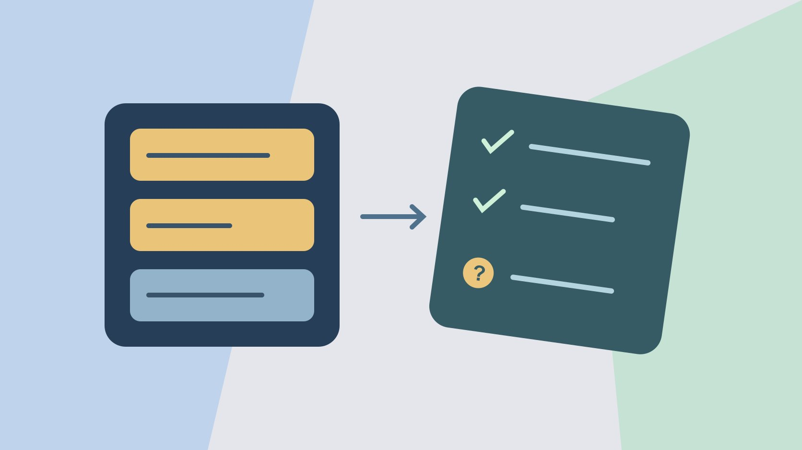

# 社交聆听：怎样设计查询和人工抽样

状态：本地审阅稿；正式发布日期待确认。

用人工标注、已知命中和来源范围验收社交聆听查询。

QuickKOL 编辑图形；不呈现真实账号指标或平台界面。

社交聆听是从可访问的讨论中收集与业务问题相关的证据。先写问题、平台和时间，再用已知相关、容易误判与来源缺失的例子测试查询。人工检查命中的相关性，也检查已知样例是否漏掉。报告说明数据范围、无法覆盖的讨论和版本，给每条发现安排下一步。

## 把“听一听大家怎么说”改成可操作的问题

假设一个水壶品牌需要知道消费者为什么问“盖子是否松动”。要判断是更新说明书、补拍短视频还是交产品团队检查。定义内容对象、样例类型、平台、语言、地区和时间。公开评论、支持工单和调查各有范围，不能直接并成代表整个市场的数据。用[社交营销执行计划](https://www.quickkol.com/zh/blog/social-media-marketing-operating-plan/#answer)写清项目范围和负责人。假设只看公开帖子，个案维修记录另由客服处理。数据表不保存不必要的个人信息。

## 先准备已知命中和误判样例

由人工找几条与盖子相关的公开讨论，再找同名产品、促销转发和真正无关的内容。保留原链接、日期、语言、简要理由和能否被工具覆盖。比如两条独立帖子在问装配，一条提到另一品牌，另两条是复制促销。另留几条在最后复查，不用全部样例调规则。测试时如果已知相关内容没出现，先核对来源和日期，再查关键词。不用人为扩大收集范围以凑数量。

## 先写可移植的规则，再翻译为工具语法

先用普通文字写条件，例如“品牌或型号词”和“盖子或安装词”同时出现。[Brandwatch 查询语法帮助](https://social-media-management-help.brandwatch.com/en/articles/17449912-building-advanced-queries-in-listen-social-listening)介绍引号、AND、OR、NOT 和分组。使用具体产品时核对语法、大小写和模块限制。给每个词写用途，记录要查不同语言的同义词。假设一个品牌词同时是常见姓氏，不要直接排除所有带这个姓氏的帖子。先以型号或场景限定，再用样例确认。若工具转换自动加引号或变更分组，保存真实执行版本。

## 逐平台验证覆盖和观察窗口

[Brandwatch 数据来源帮助](https://social-media-management-help.brandwatch.com/en/articles/17449910-sources-for-listen-social-listening-mentions)列出 Listen 来源及各平台的取数方式与范围。报告要写实际账号、选择的平台、是否有认证来源、采集日、内容日期和限制。只写支持某平台不能说明覆盖全部讨论。不能看到私信、封闭群组或受限内容时，应标为范围外。假设某条已知案例由账号删除或超出时间，别把漏掉它全归因于搜索词。看待缺失先分来源、窗口、字段和查询。

## 计算抽样相关性，限制对漏报的结论

假设返回 120 条，按来源和日期抽查 24 条，人工判 18 条相关，观察到的抽样相关率是 75%。另有 8 条已知真实样例，工具返回 6 条，只能说已知集合中命中 6/8，不能说覆盖全网 75%。记录抽样方法、未判和重复。若按不同来源分层抽样，整体汇总应说明权重。用[阅读达人互动数据指南](https://www.quickkol.com/zh/blog/read-creator-engagement-data/#answer)区分计数与可支持结论。未见相关讨论时写在该范围内没有找到。

## 把噪声修正和真实问题分开

若多数误报来自同名产品，可加型号词，或在能证明不会误删相关样例时排除无关词。若结果出现地区术语但不含品牌，增加人工样例再决定是否扩大范围。假设第一次查出“杯盖”相关吐槽，第二次发现大量促销重复。分别核对哪些有内容洞察，哪些是传播记录。保存修正前后查询与样本。把产品反馈交内容或产品负责人，不对发帖者做无证判断。

## 用引用和时间点交付洞察

每条洞察留原链接或可验证记录、时间、范围、标签、引用使用边界和行动负责人。汇报例子可以是“本轮检查中，三条独立帖子询问盖子完全锁紧的提示”，下一步是产品团队确认提示是否确实存在，内容团队决定是否补镜头。若平台或权限导致原帖不可见，标记缺失。内部支持数据脱敏并限制访问，公开文章需要时引用适当的一方说明。按当前法律与授权核对可用方式。

## 把复查安排和停止条件一起写入

安排下一轮的查询版本、数据范围和人工抽查数量。如果当前问题已能通过产品测试回答，就结束这个查询或缩小监控范围。若有新型号或语种，加几条对应样例再启动。保留进度、决策与剩余未知。用同一规则检查下次是不是还在回答最初的问题。

## 用两轮查询决定该改术语还是改采集

假设第一轮收集到十条关于真实盖子的帖子和九条来自同名品牌的帖子。第二轮加一个型号词，排除了八条无关内容，也漏掉三条本来相关但只写俗称的帖子。先用保留样例测试，再将查询拆成型号和俗称两条，人工判断差异。若某来源第二轮没有返回数据，先检查权限与日期，不能归因于新关键词。报告分别标明两轮检索的执行时间、范围、有效样例和已知漏项。团队可以选择保留更宽的查询并加二次分类，或只用较窄的规则回答一个清楚的问题。选项成本写成实际核查工时和遗漏风险，不只比较数量。

## 社交聆听样本测试

| 检查 | 证据 | 边界 |
| --- | --- | --- |
| 样本相关性 | 24 条中 18 条相关 | 限抽查范围 |
| 已知样例命中 | 8 条中 6 条出现 | 不是全网召回率 |
| 来源范围 | 平台、窗口、账号与限制 | 不覆盖无法访问的内容 |

数字是演示样例。

## 交付查询前的四项检查

请另一位同事复看同一版本。

- [ ] 定义问题、语言和时间
- [ ] 标注命中与容易误判的例子
- [ ] 保存覆盖与人工抽查范围
- [ ] 留下一步、负责人和复查日期

## 研究日期与使用边界

资料核验于 2026 年 11 月 6 日。文中方法、表格和决策规则为编辑建议，标为假设的示例不是实际客户结果或行业基准。外部资料的适用地区与时期按各段说明；本稿处于独立本地审阅阶段，正式发布日期待确认。

## 用清楚的任务开始达人研究

用 QuickKOL 理解 Brief、发现相关达人并研究作品与联系路径；数据、合作条件和结果仍需核验。

[了解 QuickKOL](https://www.quickkol.com/#capabilities)

## 来源

- [Brandwatch 查询语法帮助](https://social-media-management-help.brandwatch.com/en/articles/17449912-building-advanced-queries-in-listen-social-listening)
- [Brandwatch 数据来源帮助](https://social-media-management-help.brandwatch.com/en/articles/17449910-sources-for-listen-social-listening-mentions)
