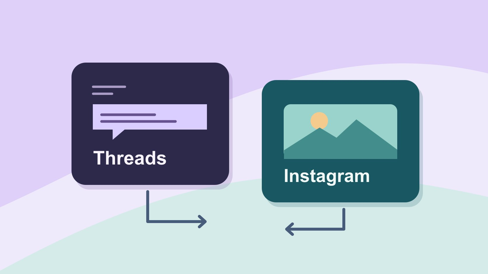

# What Is Threads on Instagram? Plan Publishing Roles

Status: local review draft; confirm the publication date before release.

Understand the Threads and Instagram relationship and assign account, publishing and response ownership.

QuickKOL editorial graphic; not actual account metrics or a platform interface.

Threads is a Meta social app built by the Instagram team for public conversations. Its original launch described signing in through Instagram. Confirm current login, linking and settings in the actual account and market. For a brand, identify the publishing profile, response owner and whether related content should also be published separately on Instagram.

## Separate the app, sign-in and content

The [Meta Threads launch announcement](https://about.fb.com/news/2023/07/introducing-threads-new-app-text-sharing/) introduced an app built by the Instagram team for public conversation and described its original Instagram login route. Treat that as dated context rather than proof of the current setup for every market and account. When you see a Threads recommendation, shortcut or share within Instagram, check which app, profile and post it points to. A brand may use Instagram for image and video discovery and Threads for questions, updates and replies. A team can also operate one channel if that matches its purpose and staffing. An observed share alone does not establish that two native posts exist. For example, a product designer could publish a question on Threads and show a related carousel on Instagram. Those are different artifacts with different comment queues and evidence. If the Instagram story includes a link to a Threads conversation, record it as a route and confirm that it reaches the intended thread. Use the actual posts and destinations in a handoff instead of relying on the names of the apps.

## Verify current access, market and account settings

The [Meta Account rollout announcement](https://about.fb.com/news/2026/04/meta-account/?trk=article-ssr-frontend-pulse_little-text-block) describes a gradual transition from Accounts Center, with shared settings and settings managed within individual apps. The [Meta Threads Türkiye update](https://about.fb.com/news/2026/06/threads-returns-to-turkiye-with-new-features/) says the service returned to that market in June 2026 and identifies the app and threads.com routes. Record the date and market beside such claims. Have the account owner use the official entry point and record which creation, sign-in, reactivation or connection options actually appear. Include device, account type and role without putting passwords or verification codes in a shared document. A screenshot from another market can explain a possible path but cannot verify the local account. If one teammate has an updated settings interface and another does not, record each observation and follow the authorized account’s current support path. Confirm the public name and account recovery owner before launch. Do not move the brand’s publication to a temporary personal identity to work around an unresolved access issue. The launch decision should identify the profile the company is actually prepared to operate.

## Give the pilot two distinct content jobs

Imagine a shoe studio showing three sole diagrams on Instagram and asking on Threads which commuting surfaces customers find difficult. The Threads task is to gather situations worth investigating. The Instagram task is to make the visuals understandable. Ask the question within a clear scope and avoid requesting private information. Give the carousel its own readable labels and explanation. Use the [social media operating plan](https://www.quickkol.com/blog/social-media-marketing-operating-plan/#answer) to define cadence, response handling and the pilot end date. Let each job determine its success measures. The public conversation might yield several specific situations to bring to the design team, while the image post might be evaluated for relevant saves or visits under its own reporting rules. Do not directly compare those counts as if they measure one action. If a creator will participate in both pieces, define what they contribute to each. A designer may reply from the brand account using approved information while the creator posts from their own account under a separate agreement. List those roles before agreeing to the schedule.

## Assign publishing and response authority separately

Make a short ownership table for the account owner, publisher, responder, approval scenarios and urgent escalation. A writer can draft the post, an approver can review product statements and a shift worker can respond from approved information. Leave recovery to the authorized company team. Route individual cases, reimbursement requests or private details to formal support. If an outside partner publishes on Threads, specify its actual account, identity, timing and correction process. Use the [campaign brief guide](https://www.quickkol.com/blog/write-a-useful-campaign-brief/#answer) so each person understands what they must deliver. Suppose an agency drafts the content and the company’s support team responds. The agency should know which replies to forward and which it can answer. A product recall, an inaccurate offer or an impersonation concern each needs a named internal owner. Test that the publisher can use the intended profile and that the response owner can find the approved information. If the same employee manages both platforms, agree on how they indicate which queue they are checking and how a backup sees pending issues.

## Rehearse one post and one correction path

The [Meta Threads reply controls announcement](https://about.fb.com/news/2025/03/new-threads-features-more-personalized-experience-you-control/) describes options such as follower-only replies and quotes. Check what the actual account offers and distinguish the selected controls from your broader response process. Rehearse with an internal draft. The publisher records the account and version, a reviewer identifies an error and the response owner receives approved correction language. If a release date is wrong, locate the native post, shares and derivative image wherever they appeared. Correct each according to its actual state. Copying a message does not establish that both surfaces have the same link, version or response queue. During the rehearsal, ask a teammate to open the correct profile and show which post contains the authoritative update. If someone asks about a prior version, give a clear response with the current information and an appropriate route. Record who can restrict replies and which conditions justify changing that setting. A product question may benefit from open responses, while an update intended for a particular community may need a different setting supported by the account.

## Record post links and actual measurement sources

For each post, save the profile, content link, publication time zone, version, share route and reporting cutoff. Record which surface generated each interaction. An Instagram story may point to Threads and the discussion may receive replies. You can review those replies for relevant topics without attributing all of them to Instagram when no suitable evidence supports that attribution. If a tagged link points to an owned site, preserve its visit data and platform counts under their respective definitions. A sampled set of comments only describes that set. Leave unavailable reporting unknown. A useful pilot worksheet might have one row for a native Instagram post, another for a native Threads discussion and a third for the website destination. Add the date and owner beside each source. If a comment is moved into a support case, record the workflow without duplicating private details in an analytics sheet. Distinguish a person following the discussion from an individual account confirmed to have taken a website action.

## Repeat the handoff when people or markets change

Suppose a regional operator leaves and the replacement can reach Instagram but cannot access Threads. Check app access, publishing, recovery, scheduled content and pending responses separately before marking the handoff complete. Record upcoming commitments and unresolved issues. Pause a scheduled item if the assigned team cannot correct or respond to it. If the brand needs another public profile, update the verified destinations and keep historical records linked to their original account. At the end of the pilot, retain the relevant policies, assets and reporting for the people who will review them. Set a specific follow-up date for account changes. The same brand may use different product support routes by market, which affects who can respond even if the language is shared. Put market and responsible staff beside the current profile so a new editor can choose the right account before drafting.

## Decide whether both publishing jobs can continue

At review, compare the quality of questions, ability to respond, staff time and accuracy of updates. Do not decide from one interaction count. If Threads produces relevant questions and nobody can capture the answers, reduce the frequency or assign the work before expanding. Where one channel handles the recurring need, keep the serviceable route clear. Record the test window, staff coverage and decisions so that a later pilot can start from evidence rather than a memory of how active the profile looked. If a launch is too unusual to represent ordinary operations, repeat the assessment during a standard week and document which follow-up duties remained.

## Walk through a cross-platform question

Suppose the product team wants to learn where commuters need a different sole grip. Design publishes a labeled outsole image on Instagram and the community owner posts a separate question on Threads. The response owner classifies replies once a day. One visitor mistakes the public thread for warranty intake and shares unnecessary case details. The shift owner directs them to formal support with approved wording and records only that a support case was routed. A second visitor describes an underground platform, which becomes a dated research example with its appropriate public source. Keep product observations, support cases and publication records in their own places. If the wording differs across the two channels, preserve each actual version and check both destinations after any correction. In the recap, the product manager can use the question to plan a follow-up study. The team cannot infer from this small sample how often all commuters encounter the condition. A support lead can inspect response times without receiving the research archive. If public replies reveal that the original question was ambiguous, revise the next version and leave a note about the changed wording. This test gives the team a concrete way to decide which staff commitments and account checks it needs before running another paired post.

## Threads and Instagram handoff

| Item | Evidence | Owner |
| --- | --- | --- |
| Current account | Official entry, market and visible settings | Account owner |
| Publishing | Content, account, time and link | Publisher |
| Responses | Reply scope, support and escalation | Shift owner |

Verify sign-in, roles and content results separately.

## Four checks before publishing

Verify the current situation on each platform.

- [ ] Verify official entry and actual account
- [ ] Define each platform’s content job
- [ ] Assign reply and correction owners
- [ ] Save links and metric definitions by surface

## Research date and limitations

Sources reviewed November 6, 2026. Methods, tables and decision rules are editorial recommendations. Hypothetical examples are not actual client results or industry benchmarks. Source geography and periods are specified where relevant. This draft is in independent local review; confirm its publication date before release.

## Start creator research with a clear task

Use QuickKOL to interpret a brief, discover relevant creators and research their work and contact routes. Verify data, commercial terms and outcomes at their source.

[Explore QuickKOL](https://www.quickkol.com/#capabilities)

## Sources

- [Meta Threads launch announcement](https://about.fb.com/news/2023/07/introducing-threads-new-app-text-sharing/)
- [Meta Account rollout announcement](https://about.fb.com/news/2026/04/meta-account/?trk=article-ssr-frontend-pulse_little-text-block)
- [Meta Threads Türkiye update](https://about.fb.com/news/2026/06/threads-returns-to-turkiye-with-new-features/)
- [Meta Threads reply controls announcement](https://about.fb.com/news/2025/03/new-threads-features-more-personalized-experience-you-control/)
