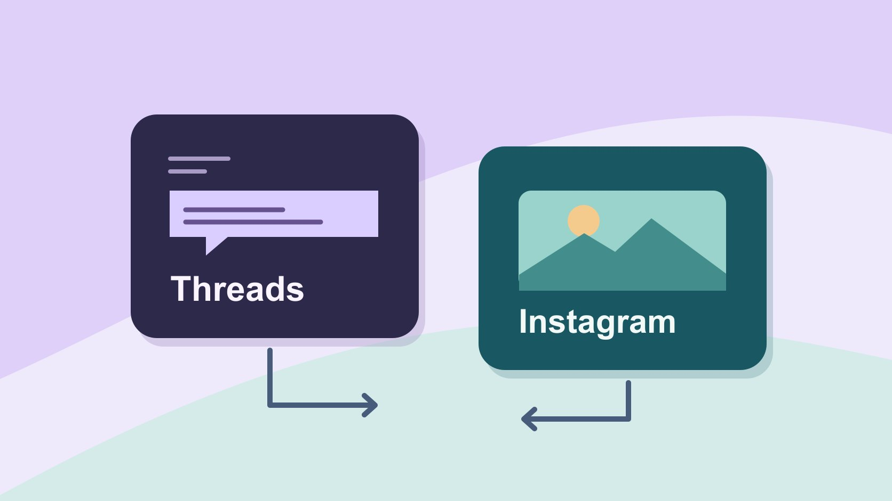

# Instagram 的 Threads 是什么：账号与发布分工

状态：本地审阅稿；正式发布日期待确认。

弄清 Threads 与 Instagram 的关系，再分配账号、发布和回复。

QuickKOL 编辑图形；不呈现真实账号指标或平台界面。

Threads 是 Meta 的社交应用，由 Instagram 团队开发，面向公开对话。早期发布说明介绍了通过 Instagram 登录的路径。现有账号的登录、连接和设置按实际市场和产品界面核对。品牌使用时先确认哪个身份在发帖、哪个团队能回复、内容是否需要另在 Instagram 发布。

## 把应用、登录和内容分开

[Meta Threads 发布说明](https://about.fb.com/news/2023/07/introducing-threads-new-app-text-sharing/)把 Threads 介绍为 Instagram 团队开发的公开对话应用，并描述当时通过 Instagram 账号登录。引用时写清是历史发布路径，不能根据它概括所有今天的市场和账号。看到 Instagram 里的 Threads 推荐、入口或分享，先核对它指向哪个应用、账号和帖子。品牌可以将 Instagram 做成图像与视频入口，把 Threads 用于提问、更新和回应；也可以只维护一处，取决于团队的目的和回复能力。不要从一次分享就推断两边都发布了。

## 验证现在的登录、地区和账号设置

[Meta Account 更新公告](https://about.fb.com/news/2026/04/meta-account/?trk=article-ssr-frontend-pulse_little-text-block)说明从 Accounts Center 逐步过渡，部分设置集中管理，应用独有设置仍分别管理。[Meta 土耳其 Threads 更新](https://about.fb.com/news/2026/06/threads-returns-to-turkiye-with-new-features/)在 2026 年 6 月宣布当地恢复访问，并指出应用与 threads.com 入口。把日期与市场写在旁边。让账号所有者通过官方页面打开，记录所见的创建、登录、重新激活或连接选项。确认设备、账号类型和团队角色，不根据单个市场的页面推断所有人都能用同一方式。不需要在协作文档保存密码或验证码。

## 给品牌试点两个有区别的内容任务

假设一间制鞋工作室用 Instagram 展示三张鞋底对比图，用 Threads 问通勤用户遇到哪种地面最容易打滑。先明确 Threads 的目标是收集可进一步研究的使用场景，Instagram 的目标是让人看懂图示。Threads 的提问里写清适用范围，不引导用户公布私人资料；Instagram 另配读得懂的标题和说明。用[社交营销执行计划](https://www.quickkol.com/zh/blog/social-media-marketing-operating-plan/#answer)决定发帖节奏、问题处理和何时结束试点。每个平台的成功标准由任务决定。

## 把发布权和公开回应权分开

写一个小表，包含账号所有者、内容发布人、回复人、需要审批的情况和紧急转交。内容同事可以起草，审批人核对品牌说法，值班人只用已获准资料回复。恢复权限交给品牌指定团队。有人要求查个案、索赔或私人信息时，给正式支持入口。若由外部合作方发布 Threads，先确认其实际账号、身份和时间，并约定修改。用[活动 Brief 撰写指南](https://www.quickkol.com/zh/blog/write-a-useful-campaign-brief/#answer)把责任和输出留给每个人。

## 先试一条内容和一条纠正路径

[Meta Threads 回复控制公告](https://about.fb.com/news/2025/03/new-threads-features-more-personalized-experience-you-control/)介绍了关注者回复和引用控制等选项。核对实际账号有哪些功能，区分所选设置与后台治理。可以用内部草稿做演练，发布人记录账号和首稿，审核人发现错误，值班人员收到纠正说明。若第一条内容写错上市日期，先查哪个平台有哪些原帖、分享与衍生图，再按每处情况分别更正。不要凭复制成功就认定两边用的是同一个链接、版本或评论区。

## 记录发布链接和实际数据来源

每个帖子保存账号、内容链接、发布时区、版本、分享路径和数据截止点。记录互动来自哪处。假设 Instagram 引导到 Threads，并有一些回复，可以检查这些回复里哪些是项目主题，但没有合适的归因证据时不能说所有人来自 Instagram。若使用带参数的自有页面，按实际访问和内容平台各自口径保存。示例中的评论数量只能代表抽样。缺失的报表按未知处理。

## 换人或地区时重做账号交接

假设区域运营离职，接手者能进 Instagram，但 Threads 仍无法访问。不要把它当作已经完成的统一交接。分别核对应用的当前登录、发布权限、恢复负责人、排程和未完成回复。记录预定活动和待解决问题，暂停只有原发布人能改的内容。若需要换品牌账号，重新对齐主页链接和历史归属。试点结束后保留政策、素材和报告，给合适的人复查。

## 决定是否值得继续运营两处

复盘时看提问质量、评论能否处理、维护耗时和内容更新准确性。试点不以单一互动量决定。若 Threads 的问题多但没人收集答案，把发布频率和分工调到可维护范围，再评估。若常见问题已经在一个地方处理，保留实际能服务的渠道和清晰的指路。

## 跑一次跨平台问答样例

假设产品组想知道通勤者在哪里需要更防滑的鞋。设计组先在 Instagram 发带文字的鞋底图，社区运营随后在 Threads 单独发问题，回复人每天一次归类。一个用户把公开问题误解成保修受理并留下不必要的个案细节。值班人用批准的文字引导到正式支持入口，报告里只保留“一条支持问题已转交”。另一个用户提出地下站台的场景，记录为待研究，并附公开来源和日期。把产品反馈、客服事件和两个渠道的发布记录分别交接。若品牌在两边发布的句子不同，保留各自版本；更新材料时也检查两个公开入口。

## Threads 与 Instagram 分工表

| 项目 | 证据 | 负责人 |
| --- | --- | --- |
| 当前账号 | 官方入口、市场、所见设置 | 账号所有者 |
| 公开发布 | 内容、账号、时间、链接 | 发布人 |
| 互动处理 | 回复范围、支持与升级路线 | 值班人 |

把登录、账号角色和内容表现分别核对。

## 发布前的四项核对

逐平台确认当前真实情况。

- [ ] 验证官方入口和实际账号
- [ ] 定义各平台的内容任务
- [ ] 安排回复与更正负责人
- [ ] 逐处保存链接和数据定义

## 研究日期与使用边界

资料核验于 2026 年 11 月 6 日。文中方法、表格和决策规则为编辑建议，标为假设的示例不是实际客户结果或行业基准。外部资料的适用地区与时期按各段说明；本稿处于独立本地审阅阶段，正式发布日期待确认。

## 用清楚的任务开始达人研究

用 QuickKOL 理解 Brief、发现相关达人并研究作品与联系路径；数据、合作条件和结果仍需核验。

[了解 QuickKOL](https://www.quickkol.com/#capabilities)

## 来源

- [Meta Threads 发布说明](https://about.fb.com/news/2023/07/introducing-threads-new-app-text-sharing/)
- [Meta Account 更新公告](https://about.fb.com/news/2026/04/meta-account/?trk=article-ssr-frontend-pulse_little-text-block)
- [Meta 土耳其 Threads 更新](https://about.fb.com/news/2026/06/threads-returns-to-turkiye-with-new-features/)
- [Meta Threads 回复控制公告](https://about.fb.com/news/2025/03/new-threads-features-more-personalized-experience-you-control/)
