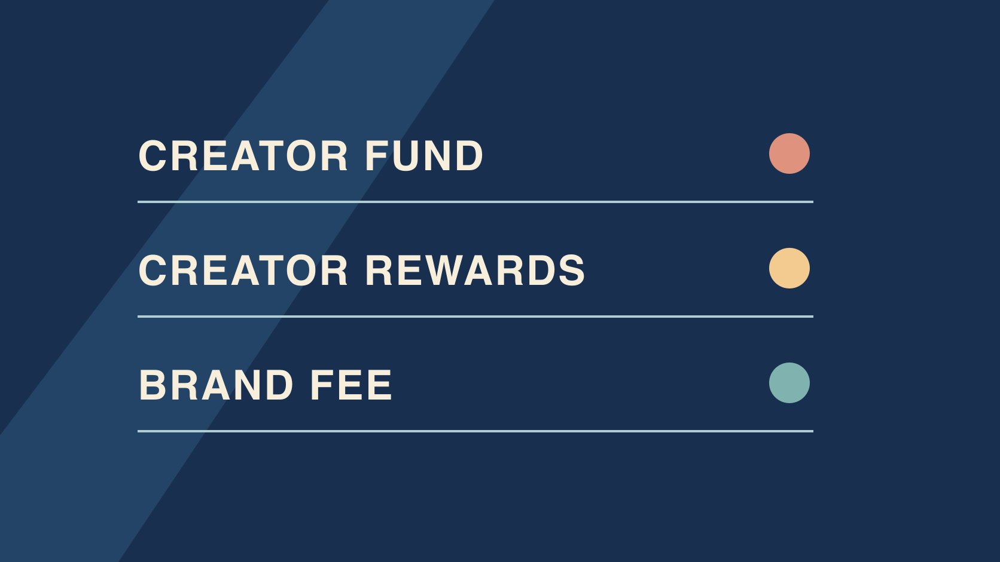

# TikTok Creator Fund: Reconcile Legacy Earnings

Status: local review draft; confirm the publication date before release.

Identify historical TikTok Creator Fund records and separate them from current Rewards, platform payments and brand fees.

QuickKOL editorial graphic; not actual account metrics or a platform interface.

The TikTok Creator Fund was an earlier creator funding program. TikTok announced a U.S. fund in 2020 and introduced Creator Rewards in 2024 after Creativity Program Beta. When you see an older report, verify its program, market and period. Check the current account’s official rules for program access and qualified views. Keep legacy Fund amounts, current Rewards and brand fees in separate records. An old dashboard capture or a public view count cannot establish what was paid.

## Start with the original program name and date

The [TikTok Creator Fund launch announcement](https://newsroom.tiktok.com/introducing-the-200-million-tiktok-creator-fund?lang=en) introduced a U.S. fund with an initial amount of 200 million dollars on July 22, 2020. The figure described the program as announced. It does not document what was ultimately paid or any individual allocation. The [TikTok Creator Rewards launch announcement](https://newsroom.tiktok.com/introducing-the-new-creator-rewards-program?lang=en), dated March 18, 2024, describes the transition from Creativity Program Beta to Creator Rewards. Store each record under the original platform program name, market, review date and reporting scope. Avoid renaming several programs as a single fund in an archive. A brand usually needs only the permitted evidence relevant to a delivery or date. It does not need a creator’s unrelated earnings. Suppose an older client brief uses the name Creator Fund because that was familiar at the time. Check whether the attached evidence actually names that program, a beta or a later report. Record what the evidence says and retain the brief as originally issued. A title can be useful for searching historical files without serving as evidence of the program or the amount.

## Separate historical access, eligibility and settlement

A dashboard capture can show what an account holder saw on a particular day. It cannot establish that all its videos qualified. Match account, market and reporting period first, then label application, admission, video eligibility, estimates, adjustments and settlement as separate states. If the archive contains only a screenshot, have the account holder check for an authorized original record. When it is unavailable, document the gap rather than recalculating historical earnings from present rules. Suppose a worksheet has two copied amounts and no currency or date. It cannot support a payment conclusion. If the account was renamed, keep the former identifier and current public profile with a date. A project may be able to confirm a legacy report’s title while leaving the receipt unresolved. Write each confirmed fact separately. If a creator has multiple profiles, check which one the old report refers to before putting it in a project folder. Give the next reviewer the named report period and payer, even when an amount cannot be verified.

## For current rewards, use the current program rules

[TikTok Creator Rewards requirements](https://www.tiktok.com/support/faq_detail?id=7581821550694013452) describe eligibility at account, market and content levels. Qualified views use an eligible For You scope and exclude certain sources and viewing events. The video needs to meet relevant originality and duration rules and be posted after admission. Ads, paid promotions and sponsored content are among the listed exclusions. A legacy Fund record cannot establish eligibility under the current program. Use the [campaign measurement guide](https://www.quickkol.com/blog/creator-campaign-measurement/#answer) to separate platform results and brand deliverables. In reporting, identify the source for public views, qualified views and any estimated amount. Reading the published rule does not show that a creator has enrolled. Suppose a brand receives a current screenshot showing qualified views for one video. The screenshot may be useful for that account and post if the holder authorizes it. It does not establish earnings for unrelated videos or make sponsored content eligible. Have the account holder confirm the actual program status and leave unavailable details open. Check the current official rules at the time of each new campaign.

## Reconcile the path from estimate to receipt

Give each row a program, account, market, window, currency and observation time. Record estimates, settled amounts, adjustments and receipts separately. In a hypothetical archive, a June estimate says 120 dollars, a later settlement says 105 dollars and a receipt is dated in July. Preserve all three facts. If the reason for the difference is unknown, avoid assigning it to tax, fees or excluded views. Determine whether each report is cumulative, monthly or a payment event, and check whether a single line appears again in a summary. Let the authorized account holder use the official support route when the records conflict. Brand compensation belongs in the contract record. If an exported table has a month column but no currency, identify that unit before totaling it. If a receipt covers several earnings periods, label it as a combined payment and wait for reconciliation rather than splitting it evenly. A finance reviewer can document that the amount cleared on one date while leaving the precise allocation to earlier activity pending. The relevant evidence should remain accessible to the account owner.

## Price brand work from its agreed deliverables

Use the [creator rates and usage rights guide](https://www.quickkol.com/blog/creator-rates-usage-rights/#answer) to separate production, publication, revisions, raw footage, paid use, territory and term. When fees depend on delivery, name the reviewer, date and verifiable condition. Suppose the creator independently makes longer tutorials and produces a short demonstration for the brand. Give the two projects separate budgets. A change in platform rewards does not alter the agreed production fee by itself. If the parties choose a performance bonus, identify the exact campaign report and qualifying event. Do not use rewards from unrelated videos to fill missing data. Share only the scope the project needs. For example, a client can verify the public post and its agreed publication date without seeing the creator’s earnings history. If the brand later wants to run the edit as an ad, review the approved rights and payment terms before using it. Treat the commercial change as a decision about a specific asset, not a correction to platform income. Give finance the agreement, approved version and receipt of the deliverable so the invoice can be reviewed independently.

## Preserve the old label and the reason for correction

If the team has long called every TikTok payment Creator Fund, identify reports that need correction. Use original titles and dated observations to distinguish entries you can establish. Suppose a current record is clearly from Rewards, while another shows only a transfer description. Correct the first label and preserve the earlier wording. Keep the second program unknown until it can be verified. Use a program dictionary for future reporting and review authorized sources at a suitable interval. Leave original numbers intact. Give editors the affected sentence and finance the actual settlement evidence. If an old slide mixed historical amounts with current platform rules, separate them before sharing it again. A narrow correction can show that the historical fund was mentioned in an announcement and the current statement came from another program. If a report is only for internal planning, mark which rows use assumptions. If it leaves the organization, include the original source and time so readers can judge the context. An audit trail should allow a later analyst to see why a label changed.

## Decide whether the legacy record is still needed

Decide whether the question concerns historical payment, procurement, current enrollment or a published citation. Each needs different evidence. For a historical reconciliation, seek the permitted original. For a current eligibility question, use the current official documentation and actual account. If the record remains unavailable, name what is missing, who can check and when to review it. An open platform question can coexist with an accepted brand deliverable. Keep the relevant supporting files with their review dates so someone can reopen only the unresolved part. If the project changes from editorial research to a payment dispute, involve the responsible owner and identify which evidence is appropriate for that separate task. A useful final note gives one confirmed fact and one remaining question, with exact scope.

## Keep a version record across program changes

Record the first observation and most recent review without overwriting a historical capture. If an old help address now displays newer monetization information, report what the page showed on the review date. That observation cannot establish that a particular account’s records are gone. Use the actual account or approved export to review the settled and unknown items. A later reviewer should be able to tell whether the entry point, terminology or payment status changed.

## Set separate citation scopes for articles and internal reporting

A public article can cite the announcement date, the initial planned U.S. fund amount and the later program announcement. An internal payment review needs the actual account, period, currency and authorized materials. Suppose the old press release announced a fund size and the old worksheet mentioned one receipt. The press release cannot support a claim about that receipt. Put the year, market and planned or actual status beside any public number. Use only the aggregate evidence the internal question requires. Before comparing two years, check whether the records refer to the same program and whether both describe estimates or settlements. Confirm how each report handles late adjustments. A summary can display an unresolved program beside a confirmed receipt if it states the different scopes. If the team wants to estimate future brand costs, build that calculation from accepted deliverables and permission rather than historical fund figures. At handoff, give editors a dated citation and the account holder the records they need to complete any open reconciliation. Keep the distinctions visible even when a slide title has limited space. This is especially useful when people use the word fund informally to refer to several kinds of income.

## TikTok Fund and Rewards archive

| Record | Evidence | Use |
| --- | --- | --- |
| Historical program | Original name, announcement and market | Confirm history |
| Current rewards | Actual account report and qualified scope | Check program status |
| Brand fees | Agreement, delivery, approval and payment | Reconcile the project |

The historical announced amount describes the program, not individual income.

## Creator Fund record checklist

Start with the original record and the actual account.

- [ ] Record the historical program name.
- [ ] Check window, market and currency.
- [ ] Separate estimates, settlement and receipts.
- [ ] Separate current eligibility and historical payment.
- [ ] Record brand deliverables and fees separately.

## Research date and limitations

Sources reviewed November 6, 2026. Methods, tables and decision rules are editorial recommendations. Hypothetical examples are not actual client results or industry benchmarks. Source geography and periods are specified where relevant. This draft is in independent local review; confirm its publication date before release.

## Start creator research with a clear task

Use QuickKOL to interpret a brief, discover relevant creators and research their work and contact routes. Verify data, commercial terms and outcomes at their source.

[Explore QuickKOL](https://www.quickkol.com/#capabilities)

## Sources

- [TikTok Creator Fund launch announcement](https://newsroom.tiktok.com/introducing-the-200-million-tiktok-creator-fund?lang=en)
- [TikTok Creator Rewards launch announcement](https://newsroom.tiktok.com/introducing-the-new-creator-rewards-program?lang=en)
- [TikTok Creator Rewards requirements](https://www.tiktok.com/support/faq_detail?id=7581821550694013452)
