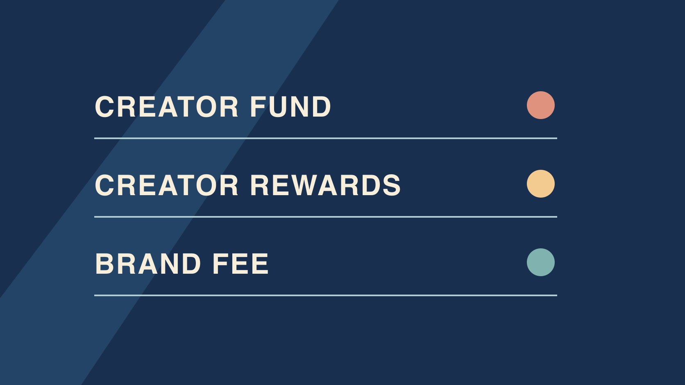

# TikTok 创作者基金：如何核对历史记录

状态：本地审阅稿；正式发布日期待确认。

识别 TikTok 创作者基金的历史记录，区分现行奖励、平台支付和品牌合作费。

QuickKOL 编辑图形；不呈现真实账号指标或平台界面。

TikTok Creator Fund 是早期的创作者基金。TikTok 2020 年公布美国基金，2024 年公布由 Creativity Program Beta 演变而来的 Creator Rewards Program。查看旧报表时，先核对它标的是哪个计划、哪个地区和期间。现行项目资格与合格播放要看实际账号的官方规则。旧基金金额、当前奖励与品牌费用各用自己的记录，不能凭历史截图或公开视频播放量推断到账。

## 从原始计划名称和日期开始

[TikTok创作者基金启动公告](https://newsroom.tiktok.com/introducing-the-200-million-tiktok-creator-fund?lang=en)于2020年7月22日介绍美国基金，初始金额为2亿美元。这是当时公布的项目总规模，不是已结算总额，也不能推算个人分配。[TikTok奖励计划发布公告](https://newsroom.tiktok.com/introducing-the-new-creator-rewards-program?lang=en)于2024年3月18日介绍 Creativity Program Beta 转为 Creator Rewards。把每份档案按平台原始项目名、地区、核验时间和报表范围存放。不要为了让目录简洁把多个计划改成“基金”。品牌通常只需核对与交付或时间有关的汇总，没必要获取创作者无关收入。

## 把历史访问、资格与结算分开

一张报表可能只证明创作者在某日看到了项目面板，不能证明所有内容符合条件。先按账号、地区和报告期间确认可比性，再标记申请、入选、视频资格、预估、调整和结算等状态。若档案只存截图，请账号持有人从合法渠道找可用的原记录；若历史数据不可用，写明缺失而不是用现在的规则补算。假设表格只有两行手抄金额，没有币种或时间，不应作为实际到账。若同名账号改名，保留旧标识和当前公开链接。

## 现在要问奖励就核对现行规则

[TikTok创作者奖励规则](https://www.tiktok.com/support/faq_detail?id=7581821550694013452)说明资格取决于实际账号、地区与内容。合格播放来自符合条件的 For You 信息流，并排除部分播放来源和行为。视频在加入后发布且应符合原创、片长等要求，广告、付费推广和赞助不在合格类别内。旧基金数据不能替代当前项目资格。若品牌需要理解如何分开算，使用[活动衡量与对账指南](https://www.quickkol.com/zh/blog/creator-campaign-measurement/#answer)。报告时写清公开播放、合格播放与估算金额分别在哪里看到。当前看到规则不代表某个人已经加入。

## 做一份估算到到账的对账表

按项目、账号、地区、窗口、币种和时间，把预估、最终结算、调整和实际到账分开。假设一张 6 月预估截图有120美元，随后结算报告显示105美元，实际付款说明写7月入账。应并存三种记录。差值原因未知时不擅自归到扣税、手续费或不合格播放。核对每份材料是累计、按月还是单笔付款，并注意是否在汇总重复出现。请有权访问的账号持有人处理官方请求。品牌合作费用在合同对应的一行。

## 品牌合作按约定的制作和使用范围计价

用[达人费率与使用权指南](https://www.quickkol.com/zh/blog/creator-rates-usage-rights/#answer)拆分制作、发布、修订、原片、广告、地域和期限。费用与交付状态挂钩时，写明审核人、期限和可验证条件。假设创作者独立制作长教程，另为品牌做短片，两个项目各有预算。平台奖励的变动不会自动改变已约定的制作费。若双方同意绩效奖金，就明确采用哪份活动报表与哪类可验证事件，不用其他作品的奖励数字填补。营销报告和创作者私人结算只共享项目确实需要的范围。

## 保留旧名与更正理由

如果团队长期把 TikTok 的所有款项写作“Creator Fund”，先列出需要修订的历史报告。用原始标题和观察日期区分可明确的记录。假设当前已知一项来自 Rewards，另一项只有转账描述。修正第一项并保留原词，第二项列为支付项目待确认。以后用项目名字典并按季度检查一次授权报表。不要为了快速消除差异更改原始数字。让内容编辑看到哪一句引用需要修订，财务看到哪一条有已确认的到账。

## 决定是否还需要找旧报表

明确问题是历史付款核对、品牌采购、创作者了解新计划，还是文章引用。不同问题需要不同证据。若要核对历史账，就在权限内找出原记录；若只是想了解现行资格，直接查看官方现行文档。找不到时写出缺什么、由谁处理和下次时间。不要让平台项目的未知影响已确定的品牌交付。

## 给新旧系统之间留一个可复核的版本记录

记录第一次所见及最近一次复核，不用新截图覆盖旧截图。若原入口变为新帮助页，描述当天实际所见，不断言旧记录已消失。用实际账号或获准报表验证已结算和未知部分。其他人复核时能分辨平台改变了入口、术语或结算状态。

## 给历史文章和内部汇报不同的引用范围

面向读者的文章可以引用公告日期、当时美国基金计划规模及后续奖励计划的起源。内部付款复核则需要实际账号、期间、币种和授权材料。假设旧新闻稿写了计划规模，旧报告只写收到过一笔款，不能把前者变成后者的来源。对公开内容，在金额旁注明计划性或实际性、时间和地区。对内部材料只留与问题相关的汇总。如果后续有人把年度数据拿去比较，要先检查是否同一项目、是否都是估算或结算，以及有无期末补记。

## TikTok 基金与奖励档案

| 记录 | 证据 | 用途 |
| --- | --- | --- |
| 历史计划 | 原计划名称、公告日与地区 | 核对历史背景 |
| 当期奖励 | 实际账号报告及合格口径 | 核对平台状态 |
| 品牌费用 | 合同、交付、审批与付款 | 按项目对账 |

历史公告金额是计划信息，非个人收入。

## 创作者基金记录清单

从原文件和实际账号核对。

- [ ] 记录平台当时的计划名。
- [ ] 核对时间、地区与币种。
- [ ] 分开估算、结算与到账。
- [ ] 区分当前资格和历史支付。
- [ ] 单列品牌交付和费用。

## 研究日期与使用边界

资料核验于 2026 年 11 月 6 日。文中方法、表格和决策规则为编辑建议，标为假设的示例不是实际客户结果或行业基准。外部资料的适用地区与时期按各段说明；本稿处于独立本地审阅阶段，正式发布日期待确认。

## 用清楚的任务开始达人研究

用 QuickKOL 理解 Brief、发现相关达人并研究作品与联系路径；数据、合作条件和结果仍需核验。

[了解 QuickKOL](https://www.quickkol.com/#capabilities)

## 来源

- [TikTok创作者基金启动公告](https://newsroom.tiktok.com/introducing-the-200-million-tiktok-creator-fund?lang=en)
- [TikTok奖励计划发布公告](https://newsroom.tiktok.com/introducing-the-new-creator-rewards-program?lang=en)
- [TikTok创作者奖励规则](https://www.tiktok.com/support/faq_detail?id=7581821550694013452)
