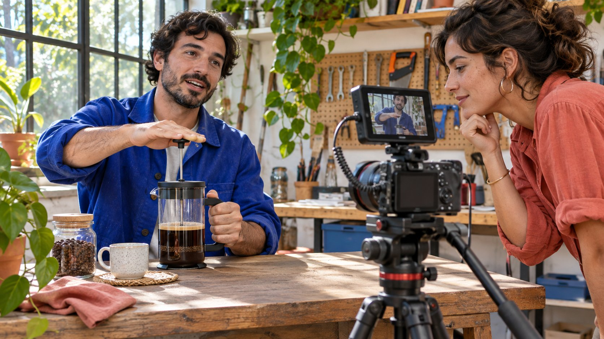
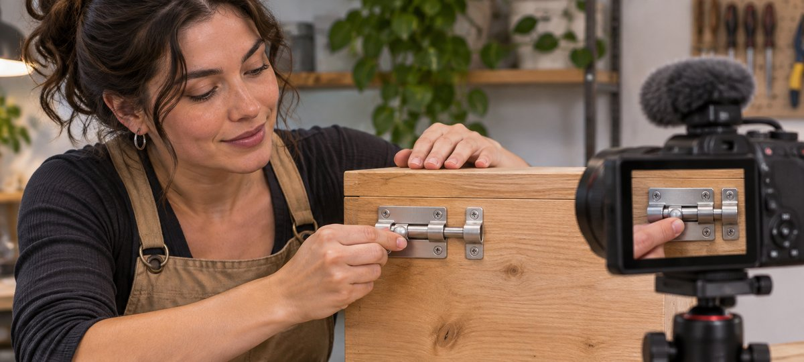

# TikTokers: Build a Production-Ready Shortlist

Status: local review draft; confirm the publication date before release.

Shortlist TikTok creators by visible production skills, role fit and deliverable permissions.

AI-generated editorial illustration, not an actual creator, client, product or event.

TikTokers create or publish on TikTok. For a brand shortlist, define the action, creative role, posting account and usage before reviewing comparable work. Record timecodes and open questions. Follower counts and one popular video provide context. The project depends on whether the creator can show the action clearly, deliver as agreed and grant the needed use.

## Name the action the viewer needs to see

Suppose a brand wants to show how to close the bolt on a wooden storage box. Write why someone needs the demonstration, which angle reveals the movement and what visible result shows it is closed. Use the [campaign brief guide](https://www.quickkol.com/blog/write-a-useful-campaign-brief/#answer) to identify model, length, language, ratio and release destination. A request to show the finger moving the bolt continuously into its catch is easier to review than a request to make the video engaging. A narrative short would need different evidence. Define the assignment before selecting creator types. A seller might need a paid vertical edit, while support needs a repeatable explanation for the product page. Both can use the same action, but the spoken context and approved rights can differ. Give the buyer a reference sketch or an example of the key move, using only material the team can share. If the intended product detail changes, review whether the same candidate examples still provide evidence.

## Cast for performance, production or publication

Separate appearance, narration, filming, editing, captions, posting and reporting. A TikTok creator may explain tools on camera while someone else handles the shoot. Ask what they contributed to the sample and what they can reproduce for this assignment. If the brand only needs a production file, the creator’s audience data may be secondary. For creator publication, review the actual account and relevant evidence. The uploader alone does not establish who can license the footage. Consider a creator with strong hands-only demonstrations and another with clear narration but limited close-up work. The former may be ideal for a silent asset, while the latter may need an approved second camera operator. Give each a fair description of the job. If an agency provides editing, identify who owns source files and who accepts revisions. Keep the decision tied to people and capabilities the assignment can actually use. Do not present a network’s sample as proof of a specific creator’s skill unless the role is confirmed.

## Log timecodes and observed actions in the work sample

Choose one or two comparable pieces per candidate. Record link, date, role and timecodes. At eight seconds you might see the hand and bolt, and at twelve seconds see it enter the catch. Check phone-size visibility, obstruction, continuity, useful audio and captions. The editorial photo shows the hand and component together. A real test should preserve that view through the action. A finished result alone does not show how the creator filmed the full procedure. The [W3C captions guide](https://www.w3.org/WAI/media/av/captions/) describes captions for speech and meaningful sounds. Put the relevant caption needs in the brief. A latch click might help explain the endpoint when the viewer can also see it. If the draft uses text to identify the sound, verify that it is accurate and does not cover the part. For an entirely visual demonstration, give the buyer a way to inspect the key movement with sound off. Ask another reviewer to confirm the same timecodes.

AI-generated editorial illustration. Review whether the hand movement and component remain visible in the same test shot.

## Keep one popular post in its distribution context

The [TikTok recommendation help](https://www.tiktok.com/support/faq_detail?id=7655285288050104852&category=web_account) describes recommendation across surfaces such as For You, Following, search and LIVE. Comparable work can have different distribution contexts. When publication matters, review related topics, format and dates. Document any known advertising or collaboration. One high-view post cannot establish the outcome of a new project. Label public metric scope and leave unavailable fields unknown. If the deal requires a particular market, ask the authorized account owner for the applicable evidence instead of inferring it. A creator may have a large following for entertainment and a smaller sample of product tutorials. The second set may be more relevant to a brand instruction film. Consider whether a short demonstration should be evaluated by view counts or by how clearly it answers a question. A later account report may help explain distribution. It cannot replace a review of whether the right product and steps were shown. Record the information separately so a buyer can see which requirement each source supports.

## Use a short test to resolve a material production gap

If no example shows a comparable latch, first ask whether the creator has relevant work. When a test is necessary, agree scope, sample, timing, compensation, use and retention before filming one core action. Evaluate the examples consistently. A reviewer should see the motion from open to closed, with the hand away from the critical detail when necessary. If only one angle is missing, request a specific pickup. If the actual location, equipment or schedule is unsuitable, change the plan. A short test is not an agreement to produce a complete ad. In a hypothetical assessment, creator A shows a clear wide action but no close detail. Creator B shows the exact part in close-up but no full sequence. Ask each for the missing evidence relevant to the format. Do not ask for a new creative concept merely to verify a camera position. Give candidates the same accepted evaluation conditions and explain what the test will determine.

## Verify rights, copy and disclosure for the actual use

Use the [creator rates and usage rights guide](https://www.quickkol.com/blog/creator-rates-usage-rights/#answer) to separate creation, posting, raw footage, ads, territory, term and edits. Verify music and other materials for the intended placement. For a U.S. endorsement with a material connection, the [FTC influencer disclosure guidance](https://www.ftc.gov/business-guidance/resources/disclosures-101-social-media-influencers) explains clear disclosure. Review the actual market and account settings. If the brand also needs to advertise using the creator’s identity, verify the applicable authorization, start and expiry. Save the version, rights and reviewer. Permission for a post does not establish permanent reuse. A creator can approve the brand’s own page while keeping paid distribution outside the offer. If the buyer wants additional formats, confirm whether they are derivative edits or separately filmed work. Assign someone to review the first live publication and its disclosure before collecting results. If a contract ends, preserve only the permitted material and know which active placements require review. The next team should not have to infer usage from the invoice title.

## Give the shortlist actionable states

For each creator, write fit, work evidence, rights, unknowns and next action. One entry might say the person can film hands, has comparable work and needs to confirm availability. Another might match the required language while the publication account remains open. If a creator does not advance for this assignment, record the specific condition. Avoid a general label about their ability or account. Give production, operations and the rights reviewer their own items. A campaign owner can mark a production-only scope ready while leaving paid use open. Assign an acceptance date for each required deliverable and a way for the publisher to locate the approved cut. If a candidate later provides a better sample, record what changed and update the decision. Preserve the earlier evidence so the next person can understand why the selection moved. Do not send a standard outreach message to every shortlisted person before confirming which role and scope you are offering.

## Use one post-project review to improve the next brief

After delivery, review shot coverage, captions, file version, actual link and use permissions against the agreement. If results are weaker than expected, distinguish production acceptance from distribution. Suppose the edit meets the brief, but user questions reveal that people need to see the latch position earlier. Test a new opening in the next asset. Record the most relevant work example and what the earlier brief missed. Recheck when product, account or advertising use changes. Give the next owner the clip and review criteria so a later campaign can evaluate the same motion. If the team never bought publication, keep its production result separate from untested account performance.

## Make a camera-test decision repeatable

Ask a colleague who missed the test to open the permitted edit and identify where the action begins and where it finishes. If they recognize the product but cannot see the closure, adjust framing or request continuous coverage. Give the creator the actual timecode and change request. Record which issue was resolved and which should be reviewed again. If the planned version adds a caption or different crop, run the same check on the export so the final view still supports the decision. Suppose the first edit hides the bolt behind the hand. The second shows closure but leaves the model unclear. Check the product and ask the editor to identify it accurately, with a wider shot at the start to establish where the latch sits. Recheck whether the captions cover the action in the final version. If the two edits use different models, avoid cutting them together as a continuous motion. Capture a matched pickup or label a comparison clearly. Give the reviewer a specific acceptance condition rather than a general quality score for the creator. Once the shot passes, identify which cut is cleared for the particular channel and time. In the handoff, include the approved file, the timecode of the resolved action and the person who can approve any new use. A later production team can then reuse the requirement for a similar task while checking the actual product and permissions again.

## TikTok creator shortlist review

| Dimension | Evidence | Next action |
| --- | --- | --- |
| Action | Comparable work and timecode | Verify legibility |
| Role | Filming, narration, editing or posting | Verify who delivers |
| Use | Version, account, placement and term | Approve per use |

Set criteria from the actual assignment.

## Creator test preflight

Confirm one key task before pricing.

- [ ] Describe the action the viewer needs
- [ ] Verify roles with work and timecodes
- [ ] Test only a material evidence gap
- [ ] Verify posting, permissions and disclosure

## Research date and limitations

Sources reviewed November 6, 2026. Methods, tables and decision rules are editorial recommendations. Hypothetical examples are not actual client results or industry benchmarks. Source geography and periods are specified where relevant. This draft is in independent local review; confirm its publication date before release.

## Start creator research with a clear task

Use QuickKOL to interpret a brief, discover relevant creators and research their work and contact routes. Verify data, commercial terms and outcomes at their source.

[Explore QuickKOL](https://www.quickkol.com/#capabilities)

## Sources

- [W3C captions guide](https://www.w3.org/WAI/media/av/captions/)
- [TikTok recommendation help](https://www.tiktok.com/support/faq_detail?id=7655285288050104852&category=web_account)
- [FTC influencer disclosure guidance](https://www.ftc.gov/business-guidance/resources/disclosures-101-social-media-influencers)
