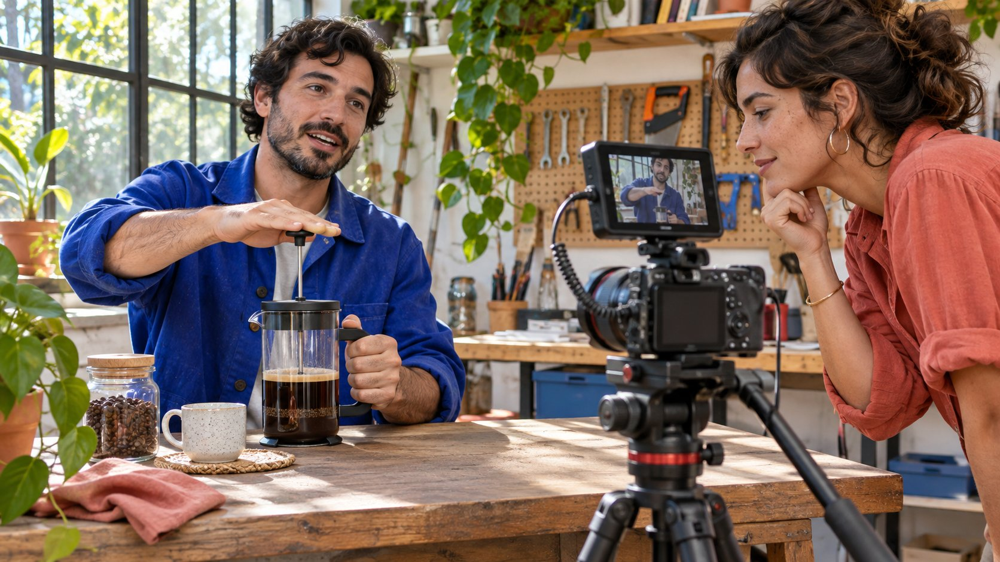
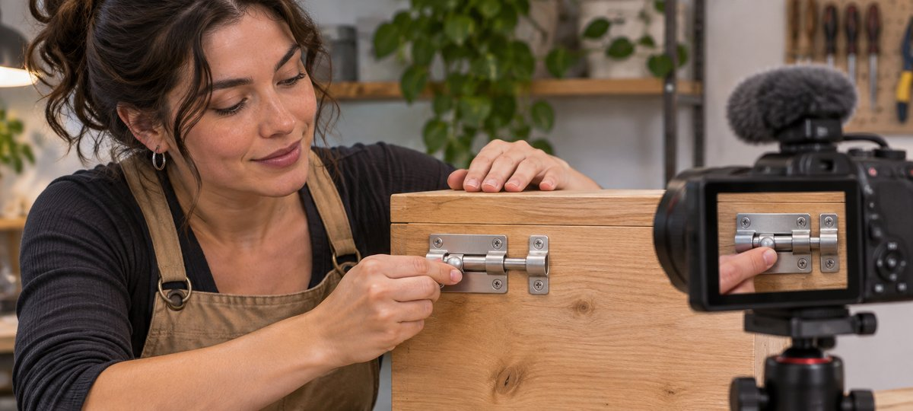

# TikTok 创作者：按制作任务做候选名单

状态：本地审阅稿；正式发布日期待确认。

用可见的制作能力、合适的角色和交付权限筛选 TikTok 创作者。

AI 生成的编辑示意图，不是真实达人、客户、产品或活动。

TikTokers 是在 TikTok 创作或发布内容的人。品牌建名单时，先定义要拍的动作、内容角色、发布账号和许可，再看候选的相近作品。保留时间点与待核项。粉丝数和单条热门视频可以提供背景，实际能否清楚拍出来、按约交付并获准使用才决定项目是否适合。

## 先写给观众看的那个动作

假设品牌想示范木质收纳盒如何扣紧插销。先写清用户为什么要看、从哪个方向能看到插销移动、哪个结果证明关好。用[活动 Brief 撰写指南](https://www.quickkol.com/zh/blog/write-a-useful-campaign-brief/#answer)说明型号、长度、语言、比例和最终发布位置。给候选写“连续展示手指移动插销直到进入扣座”，比“做得抓人”容易核对。若要采购的是剧情短片，可以用不同作品标准。先定任务，再选可能符合的创作者类型。

## 按工作分工找表演、拍摄或发布

把出镜、口播、拍摄、剪辑、字幕、发帖和活动报告分别列开。某位 TikTok 创作者可能会在镜头里解释工具，实际拍摄是另一团队。问他在样片中做了什么，以及这个项目能否复现。若只需成片，关注账号数据不一定是首要条件。若买在达人账号上发布，再查实际账号和受众资料。别从作品的发布方推断素材授权人。

## 给样片记录时间点与实际动作

每位候选选一两条类似作品，记链接、日期、角色和时间点。例如 0:08 看到手指与插销，0:12 看得见是否进入扣座。看手机尺寸、遮挡、稳定性、同期声与字幕。示意图里的部件和手同时可见，试片也要验证在整个动作中都清楚。若只看到结果，不能由此推断候选拍过完整步骤。[W3C字幕指南](https://www.w3.org/WAI/media/av/captions/)解释语音与有意义声音的字幕，需求中写清哪些声音需要文字说明。

AI 生成的编辑示意图。试片时看手部动作和部件是否同时清楚入画。

## 别把某条热门内容当成确定的分发条件

[TikTok 推荐机制帮助](https://www.tiktok.com/support/faq_detail?id=7655285288050104852&category=web_account)介绍 For You、关注、搜索与直播等推荐方式。候选作品可能通过不同入口被看到。若要了解发布能力，比较相近题材、内容结构和时间，保留已知推广或合作背景。不能只用一个高浏览量推断新项目表现。说明公开指标范围，缺失时写未知。若品牌依赖某市场受众，向有权的账号方核对实际报表，而不是猜测。

## 用短测试处理真正影响拍摄的缺口

如果候选的样片都看不到插销，先问有无相近案例。如果确需试拍，约定范围、样品、时间、费用、用途和留存，再拍一个关键动作。尽量用同一标准评估，例如从未关到关好的状态清楚可见，手不遮关键部分。若画面只缺一个角度，可以提出具体补镜；若场地、设备或排期不满足，先改计划。短测试不等于完整广告成片。

## 按用途确认许可、稿件和商业披露

用[达人费率与使用权指南](https://www.quickkol.com/zh/blog/creator-rates-usage-rights/#answer)拆开创作、发布、原片、广告、地域、时长与改编。检查音乐和其他素材能否覆盖想用的平台。美国市场有重要利益关系的推荐参考[美国FTC达人披露指南](https://www.ftc.gov/business-guidance/resources/disclosures-101-social-media-influencers)，按实际市场与账号设置复核。若品牌另需从创作者身份投放，确认实际可用的授权方式、开始和到期日期。保存版本、许可及审核人，不把发布许可推成永久使用。

## 把名单写成可接受、待补和不适用

对每位写任务适合处、作品证据、权限、未知和下一步。例如“可拍手部演示，已有相似样片，需确认拍摄日期”，或“作品语言合适，实际发帖账号仍待核”。若一个候选不满足此任务，写具体原因。不要用一般能力或账号质量标签替代。让负责拍摄、运营与法务的人分别核对自己部分。

## 用一次复盘改善下一份 Brief

交付后检查镜头、字幕、版本、发布链接和许可是否符合约定。若结果低于预期，先分清制作验收与实际分发。假设剪辑合格，但团队后来发现目标用户需要先看开关位置，可以在下一条测试修改开头。记录最有用的一条样片证据和本轮遗漏。新产品、不同账号和广告范围要重新核对。

## 让试片结论可重复

请未参加试拍的同事打开已获准版本，看能否说出动作起点和结束状态。若他只能认出产品、不能看懂闭合，修改画幅或补一个连续镜头。把实际时间点与建议交给创作者。记录哪些问题已解决，哪些留给下一轮。假设首版演示中的手完全遮挡插销，第二版能看到闭合，但角度让观众分不清是哪个型号。先核对产品并请剪辑标明真实型号，在开头加一条能建立位置的全景。发布前复查字幕是否还会遮住动作。若两个版本所用产品不同，不能将其剪成一次动作；用同款补拍或者改成清楚的对照。给同事能检查的验收条件，而不是给创作者一个笼统的质量评分。

## TikTok 创作者名单核对

| 维度 | 实际证据 | 下一步 |
| --- | --- | --- |
| 动作 | 相近作品和时间点 | 确认动作可读 |
| 分工 | 拍摄、口播、剪辑或发布 | 核对谁能完成 |
| 使用 | 版本、账号、媒体和期限 | 逐项批准 |

用实际任务决定比较标准。

## 创作者试片前核对

在报价前确认一项关键任务。

- [ ] 清楚说明观众要看懂的动作
- [ ] 用作品时间点核对分工
- [ ] 只对真正缺失的证据试拍
- [ ] 确认发帖、素材权利与披露

## 研究日期与使用边界

资料核验于 2026 年 11 月 6 日。文中方法、表格和决策规则为编辑建议，标为假设的示例不是实际客户结果或行业基准。外部资料的适用地区与时期按各段说明；本稿处于独立本地审阅阶段，正式发布日期待确认。

## 用清楚的任务开始达人研究

用 QuickKOL 理解 Brief、发现相关达人并研究作品与联系路径；数据、合作条件和结果仍需核验。

[了解 QuickKOL](https://www.quickkol.com/#capabilities)

## 来源

- [W3C字幕指南](https://www.w3.org/WAI/media/av/captions/)
- [TikTok 推荐机制帮助](https://www.tiktok.com/support/faq_detail?id=7655285288050104852&category=web_account)
- [美国FTC达人披露指南](https://www.ftc.gov/business-guidance/resources/disclosures-101-social-media-influencers)
