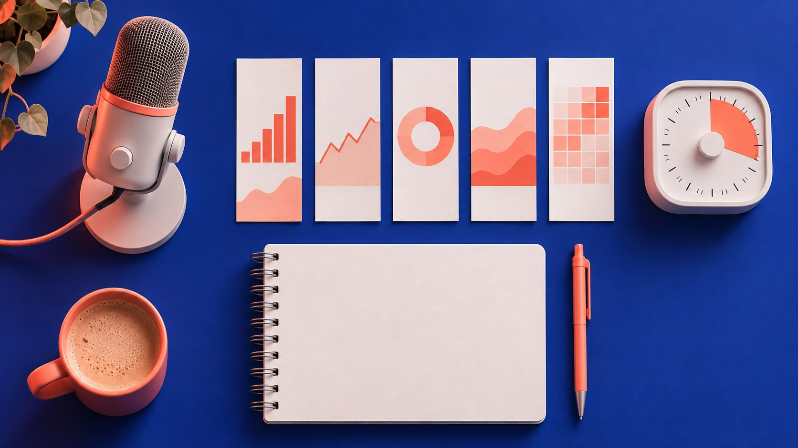

# Twitch TV Statistics: Check Channel and Category Data

Status: local review draft; confirm the publication date before release.

Sample Twitch streams by time and category and keep concurrent snapshots separate from channel analytics.

AI-generated editorial illustration, not an actual creator, client, product or event.

Begin Twitch TV statistics research by separating live snapshots, authorized channel analytics, category samples and campaign reports. A public concurrent count can help you assess a time slot and content context. Save the timestamp, stream ID, category, language and reasons for missing observations. For unique viewers or sponsor results from a broadcast, use the corresponding evidence from the authorized channel owner.

## Choose a channel or category question

A sponsorship timing question starts with the channel’s actual schedule and the comparable shows you can observe. A category discovery question starts with language, subject and eligibility for your sample. Looking only at the highest viewer counts can miss a small relevant show and let a special event dominate the result. Use the [creator selection guide](https://www.quickkol.com/blog/creator-selection-beyond-followers/#answer) to define context, production capability and broadcast structure. Suppose you need a fifteen-minute product demonstration. Two channels that reliably reserve time for audience questions may deserve closer review than ten accounts whose format you have never checked. Category observations can explain why an evening looked unusually busy. The planned segment still needs editorial review. Write the business decision above the data table before collecting numbers. Are you choosing an hour, a category or a collaborator? Decide how much evidence each decision needs. A brand might allow early discovery with one viewing session but require another ordinary episode and an authorized report before booking. Keep the two thresholds visible so nobody mistakes a discovery list for a shortlist already approved for purchase.

## Collect public observations on a common clock

The [Twitch Get Streams reference](https://dev.twitch.tv/docs/api/reference/#get-streams) lists a stream ID, broadcaster identifier, category, language, broadcast start and viewer_count. The count describes users watching at the time of the response. Also record the actual collection time, time zone, filters and page scope. For a fixed group of known channels, collect within a short common window using broadcaster identifiers rather than finding them anew in the popular category list. Preserve UTC and the local time the scheduling team uses. Tuesday at seven in London and Tuesday at seven UTC can differ depending on the date. Write the time basis before comparing a weekly schedule. The broadcast start time does not establish when your collector saw the count. If you collect manually, use an agreed tolerance and flag observations that exceed it. If you collect through the documented API, preserve the query shape and operational status. Do not write access tokens in an evidence sheet. For a reusable report, also keep the observer or job name and the date on which you confirmed the metric definition.

## Handle pagination, category changes and absent rows

The [Twitch Get Streams reference](https://dev.twitch.tv/docs/api/reference/#get-streams) warns that audience changes during pagination can lead to duplicate or missing streams. Flag repeated stream IDs in one collection, preserve start and end times and report which pages you covered. A channel can switch categories. Keep the category actually observed rather than assigning the whole broadcast to the first one. When there is no match, check the filters and collection status. An ended stream, a limited page range, an authorization error and a timeout are different events. Enter zero only where it is justified by the metric and observation. If a technical error occurs during a planned slot, collect again and mark the new time. Do not overwrite a missed observation with a later count. A top-page snapshot can be useful for a team that only wants to review the largest current streams. It cannot represent the distribution of all channels in the category. In a report, distinguish all matching records returned by a known query from the whole platform population. A category name can also change while its identifier provides more continuity.

## Work through three hypothetical observations

Suppose one stream shows 160, 220 and 190 concurrent viewers at seven o’clock, ten past and twenty past. The equally weighted mean of those three snapshots is 190 and the observed high is 220. Summing to 570 merely adds three observations. It does not identify 570 different people. If the channel switched categories by the third observation, the row can remain in the channel series and be separated in the original category summary. If another channel was observed at the same time, label any cross-channel total with its coverage. The same person could watch more than one stream. Use the [campaign measurement guide](https://www.quickkol.com/blog/creator-campaign-measurement/#answer) to define which live and conversion records will be collected after contracting. The figures are hypothetical. They illustrate arithmetic and offer no estimate of current Twitch use. Now imagine the second sample was collected twelve minutes late. You could report the three actual observations, but a simple mean should no longer be presented as a regular ten-minute summary. Describe the irregular intervals and check whether the missing planned time matters to the decision. If the highest observation came just after a schedule change, review the context before treating it as a typical level.

## Separate channel reporting, developer analytics and category samples

The [Twitch developer analytics guide](https://dev.twitch.tv/docs/insights/) describes game and Extension reporting. Some of that reporting uses device-based measures. It answers a different question and cannot fill a gap in one channel’s unique viewer evidence. For a full stream or sponsor segment, request the relevant authorized channel report and record the exact metric label, window, available market detail and traffic scope. A full-stream report does not isolate a ten-minute sponsor segment. Decide which evidence affects the purchase and request only what is needed. If the creator can share only a permitted aggregate, record that scope and adjust the confidence of the decision. Keep any public observation alongside the owner’s report with a source and date on each row. Do not derive a private metric by assuming a conversion from one count to another. Where a vendor dashboard uses an estimate, write how the vendor defines it, or leave the method unknown. The key comparison is between the definitions, time windows and collections a reviewer can inspect.

## Annotate exceptional broadcasts and observe a normal show

Tournaments, collaborations, host changes and schedule changes can all affect a sample. Record the events you actually observed and indicate whether their effect is known. If a special event is a poor match for the proposed sponsorship, repeat the plan on an ordinary weekday and retain both records. Relative time can help as well. An observation twenty minutes into each show can answer a different question from a shared clock time across channels. If the channel name has changed, verify its stable identifier before joining past rows. When the intended sponsorship begins forty-five minutes into the stream, counts during the opening are only context. Observe a comparable part of a later show and confirm what the channel plans to do then. A broadcast without a saved replay may still have a useful timestamped observation, but write which part a reviewer can no longer verify. If a one-off event drew a much larger audience, resist deleting it from the underlying data. Mark it as a different event class and explain when it was excluded from the narrower comparison.

## Hand off a table someone else can reproduce

Provide a sampling plan and an observation table. The plan specifies filters, slots and failure handling. The table holds channel, stream, category, collection time, count and context. State which broadcasts the conclusion covers. For example, the next step could be to review two evening channels and their proposed sponsor breaks because their schedules fit and normal episodes are available for follow-up. Set a review date and retain the original rows and any corrections. A decision that needs two recorded segments does not require an extensive channel database. The final report should let a buyer locate the evidence supporting each shortlist entry, a researcher repeat the relevant part of the sample and a channel owner see which figures came from public observations. A shared summary can omit unrelated account data while leaving the methodology intact. If a later sample overturns the original impression, append the result and change the decision with a short explanation. A timestamped method makes the decision easier to revise as schedules, categories and collaborations change.

## Set the boundaries of the category comparison in advance

Suppose a team is comparing two game categories for a German-language demonstration on weekends. Choose two local time slots over two weekends, use the same language filter and commit to the same page scope. If Saturday yields a result but a Sunday request fails, report the slot as having one observation rather than inserting a zero. Put the number of channels actually covered next to each sum of concurrent counts. If you took only the first page, label it explicitly and watch one smaller relevant channel as a separate editorial check. A broadcaster might switch from one category to the other between requests. Preserve the category on each observation, then review duplicate stream IDs and actual collection times before combining tables. Repeated records cannot establish a larger market. Evaluate scale separately from content fit. The smaller category could be preferable if an observed channel routinely answers product questions and the producer can deliver the right segment. Define what would reverse that decision, such as the only relevant channel changing its schedule or no comparable show being available for review. Keep an evidence column that distinguishes observed facts from the next action. A person reading the table later should see that the comparison is between bounded samples and that the procurement decision depends on additional evidence about the show. If you collect a replacement sample, keep the failure visible and explain how the replacement differs.

## Live sample fields

| Field | Example | Limit |
| --- | --- | --- |
| Collection window | 19:00 UTC ± 2 min | Keep actual time too |
| Channel and category | Stable IDs, language, filters | Categories may change |
| Concurrent viewers | 160 in this response | Unique viewers require other evidence |

Values are hypothetical.

## Sample review checklist

Fix comparison scope before collecting.

- [ ] Record question, language and filters
- [ ] Save actual time and time zone
- [ ] Mark duplicates, gaps and exceptional shows
- [ ] Separate public observations and authorized reporting

## Research date and limitations

Sources reviewed November 6, 2026. Methods, tables and decision rules are editorial recommendations. Hypothetical examples are not actual client results or industry benchmarks. Source geography and periods are specified where relevant. This draft is in independent local review; confirm its publication date before release.

## Start creator research with a clear task

Use QuickKOL to interpret a brief, discover relevant creators and research their work and contact routes. Verify data, commercial terms and outcomes at their source.

[Explore QuickKOL](https://www.quickkol.com/#capabilities)

## Sources

- [Twitch Get Streams reference](https://dev.twitch.tv/docs/api/reference/#get-streams)
- [Twitch developer analytics guide](https://dev.twitch.tv/docs/insights/)
