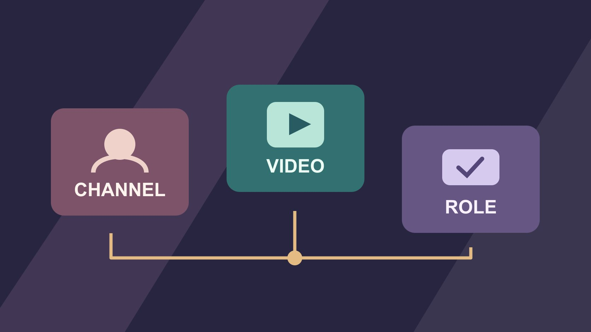

# YouTube Channels: Verify Identity and Scope

Status: local review draft; confirm the publication date before release.

Distinguish YouTube channels, handles, playlists and authorization in a partnership handoff.

QuickKOL editorial graphic; not actual account metrics or a platform interface.

A YouTube channel is the identity under which content is published and organized. In a handoff, record the channel ID, current handle, actual uploader and business authority separately. A playlist or network can help you discover work. Verify the actual publication channel, contracting party and operator permissions before assigning responsibility.

## Start the handoff with an actual assignment

Suppose a brand wants to commission a tutorial. A business contact says it will appear on our YouTube, while the proposal shows only a playlist screenshot. Ask which channel will publish, whether it will be an original upload, which market and language it serves and when it goes live. Record the proposed contracting entity, public identity, approval role and finance contact separately. Use the [YouTube business contact guide](https://www.quickkol.com/blog/find-youtube-channel-owner-business-email/#answer) to review the channel and a verifiable contact route. If the creator has several related channels, agree on the precise public account before sending a detailed brief. A channel with product reviews may serve a different audience from the same group’s training library. One business mailbox can represent both without proving which one will deliver. Have the person who arranged the partnership record the exact intended publication route before passing it to production. If a producer forwards a screenshot, have them also include the actual channel link. A new coordinator should be able to open it and recognize the target identity.

## Distinguish channel ID, handle and display name

The [YouTube channel ID help](https://support.google.com/youtube/answer/3250431?hl=en) describes unique user and channel IDs and explains where the primary owner can find them. The [YouTube handle help](https://support.google.com/youtube/answer/11585688?hl=en) describes handles beginning with the at sign, distinct from channel names and subject to change. Record a verified channel ID, current handle, display name, public URL and observation date. Leave the ID pending when you cannot verify it. If an old record stores only a name, inspect the uploader on the relevant videos before joining records. Similar names and avatars do not establish a match. Preserve the former name and the evidence linking it to the current channel. A channel may update its public name without changing the assets already published. Another channel can publish under a very similar public label. Give a reviewer enough detail to distinguish both. If a report relies on a secondary database’s mapping, compare it with the actual video and record which source supplied the identifier. A contact route should still be confirmed separately before anyone shares an unpublished campaign brief.

## Open the actual video and verify its uploader

The [YouTube playlist help](https://support.google.com/youtube/answer/57792?hl=en) defines a playlist as a collection of videos and describes how other people can add videos where appropriate. Inclusion does not establish that the list owner uploaded, licensed or sponsored each video. Open the work itself and record the uploader, video link, publication date and relevant timecode. Suppose a network’s playlist displays work by different creators. Keep it as the discovery route while recording each actual uploader as a separate fact. If the playlist groups sponsored videos, review the particular video and agreement before describing the commercial relationship. A video can appear in several collections without changing its uploader. If it has been reuploaded, distinguish the new upload from the earlier record and check which version the claim concerns. A campaign report should link to the contracted post. If a related channel uploads a promotional clip, track it separately. Otherwise an analyst may report the combined audience of items that were never part of the same commitment.

## Separate production, publishing and licensing authority

A host, production company, representative and channel manager can be different people. Ask who can agree to production terms, who can publish and who can grant the brand’s intended use. Use the [creator rates and usage rights guide](https://www.quickkol.com/blog/creator-rates-usage-rights/#answer) to separate raw footage, publication, derivatives, ads and term. Buying a post on one channel does not establish permission to copy it to related accounts. For a joint production, review the permission source and limits for the particular asset. In a hypothetical handoff, a host can confirm their availability while a production company controls footage and a separate agency manages the brand placement. Let the people responsible for those decisions confirm each item. If a regional version requires a new voiceover or different music, identify who will approve the change. The publisher may need an approved copy and asset even when they do not handle payment. Keep the commercial record and channel access separate so someone can review authority without getting more operational access than they need.

## Verify roles for viewing, editing and publishing

The [YouTube channel permissions help](https://support.google.com/youtube/answer/9481328?hl=en) describes role-based access without sharing a Google account. Review current roles and what they can view, edit, publish or remove in the actual account. Ask the authorized administrator to run any necessary check with approved test content. Leave live scheduled items undisturbed. If an external agency only needs to review a specific asset, check the appropriate review route before considering broader channel access. Record account recovery ownership and access review at departure or expiry. Do not store passwords in the handoff. Suppose a collaborator can see approved footage in a shared project folder but cannot schedule a video. That may match the planned role. Confirm the designated publisher can use the correct channel at the promised time. If someone can view reports for several channels, check which one the saved report represents before sending it to a client. Verify permission with the actual work the person needs to do rather than inferring from a job title.

## Resolve a worked example with three similar accounts

Imagine A is the City Cycling channel, B is a regional City Cycling Repair channel and C is a collection curated by an agency. The pitch names A, a draft agreement names C and the scheduled link is on B. Confirm the channel identifiers, the contact’s authority and the intended delivery. If both parties agreed on A, have the authorized publisher review the schedule and correct the handoff. If the plan changes to B, confirm the revised decision, audience market and reporting expectations. The presence of A’s video in C does not make C the uploader. Give each record its proper role. The public recap may need a simple link to the released video. The operating record needs enough identity evidence to explain how the location was chosen. A finance reviewer might use the approved agreement and accepted publication link. If the actual release differs from the accepted scope, document the discrepancy and have the responsible parties resolve it before calling the delivery complete.

## Recheck version, link and reporting after release

Record the approved edit, actual link, publication time, channel ID or verified public identifier, rights and reporting owner. Open the link to confirm the channel and copy and note visibility, market limitations and date. If the title or edit changes after publication, retain the time and approval. At closeout, handle public results, authorized creator reporting and brand outcomes under their own definitions. A playlist entry does not create an additional sponsored deliverable. If a scheduled upload becomes a replacement link, make sure the old address is not still listed as the official campaign destination. Update the handoff and identify which observations belong to each version. A colleague preparing a follow-up should know where the licensed edit lives and when its use ends. If a secondary report refers to a region-specific upload, place it under that channel. Keeping the record at the level of the actual video avoids double-counting a syndicated appearance.

## Plan for renaming, migration and exit

When the agency, owner or brand structure changes, ask the current account owner and the receiving team to review the actual channels and permissions. Keep historical links and document which addresses no longer work and which verified routes replace them. At handoff, list pending approvals, unexpired rights, scheduled items and who can still act. Use dates to distinguish previous channel status from what you observe today. If the team cannot establish the relationship between an older account and its current name, keep that row unresolved and avoid assigning its historical performance to a different channel. Give the new owner the evidence they need to finish the review without repeating the entire discovery exercise.

## Give production, publishing and analytics the right handoff

Imagine that production saves the final edit to a shared folder, operations receives a playlist link and analytics has already configured a report for the wrong regional channel. Start with the approved job and verify the actual destination. Ask operations to confirm channel ID, file version and public window. Have analytics build the record from the actual video and explain why the old report needs correction. Production needs the revised delivery scope rather than the whole business conversation. If two people can publish, assign one owner and one backup so the same file is not uploaded twice. At closeout, check which post fulfills the agreement and whether related channels only shared a link. Keep the template for the next batch while verifying its actual accounts again. Ask a reviewer to navigate from the closeout record to the authorized version and intended public result. If the handoff refers only to a shared label such as brand YouTube, replace it with the verified channel and a date. Preserve one short correction note for those who used the earlier destination. The updated record should make it possible to explain the difference to a future buyer without broadening access or asking the old producer to reconstruct the campaign.

## YouTube channel identity handoff

| Entity | Evidence | Use |
| --- | --- | --- |
| Channel | ID, current handle and public link | Verify publishing identity |
| Video or playlist | Original video, uploader and playlist route | Distinguish provenance from curation |
| Contract and access | Approver, role and scope | Verify authority to agree and act |

Keep observation dates and reasons for corrections.

## Channel partnership checklist

Check each item against the same intended deliverable.

- [ ] Record ID, handle and name separately
- [ ] Verify the actual uploader of each video
- [ ] Confirm commercial and publishing authority
- [ ] Retain the actual published link and version

## Research date and limitations

Sources reviewed November 6, 2026. Methods, tables and decision rules are editorial recommendations. Hypothetical examples are not actual client results or industry benchmarks. Source geography and periods are specified where relevant. This draft is in independent local review; confirm its publication date before release.

## Start creator research with a clear task

Use QuickKOL to interpret a brief, discover relevant creators and research their work and contact routes. Verify data, commercial terms and outcomes at their source.

[Explore QuickKOL](https://www.quickkol.com/#capabilities)

## Sources

- [YouTube channel ID help](https://support.google.com/youtube/answer/3250431?hl=en)
- [YouTube handle help](https://support.google.com/youtube/answer/11585688?hl=en)
- [YouTube playlist help](https://support.google.com/youtube/answer/57792?hl=en)
- [YouTube channel permissions help](https://support.google.com/youtube/answer/9481328?hl=en)
