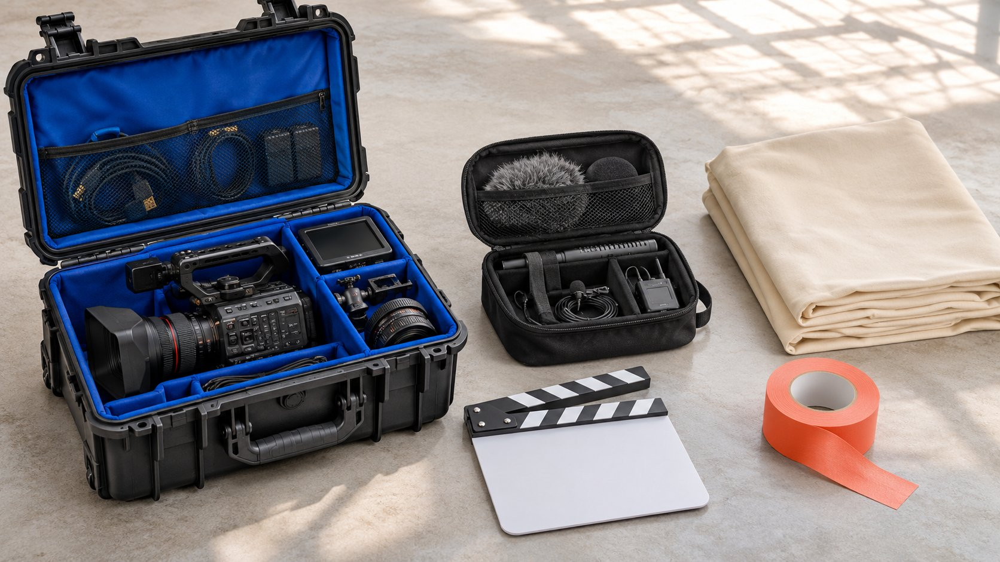

# Biggest YouTube Channels: Define What You Can Buy

Status: local review draft; confirm the publication date before release.

Define the program, production, publication and usage a brand can purchase when researching the biggest YouTube channels.

The biggest YouTube channels matter to a brand through specific purchasable work: a program segment, new production, account publication, licensing or another defined arrangement. Subscribers and cumulative views provide context rather than automatically becoming campaign reach commitments. Define content unit, actual participants, timing, market and use conditions before requesting an applicable quote and evidence. This guide concerns procurement with large channels, not an invented live ranking, universal fee or deal guarantee. Large channels need not be one-person operations or offer identical collaborations. A useful proposal makes clear which part of the publishing operation the brand is considering and what remains outside that purchase.

## Name the purchasable unit

An in-program introduction, jointly produced episode, standalone short, appearance, brand-channel asset and account publication should not share one channel collaboration label. Put audience question and desired unit in the [creator brief](https://www.quickkol.com/blog/write-a-useful-campaign-brief/#answer), then ask whether the team supplies it.

A channel may contain several programs, languages or formats. Interest in one does not establish access to any program, and an alternative offered by the team is not automatically the same purchase.

A named unit lets a creator or representative describe scope and lets the brand identify acceptance. It also prevents a budget discussion from starting with incomparable objects. Two offers can use the same word video while differing in editorial integration, performer involvement, publication and rights.

## Preserve the meaning of channel scale

[YouTube’s channel field reference](https://developers.google.com/youtube/v3/docs/channels?hl=en) distinguishes measures such as subscribers and views and documents precision limits for some values. Preserve field, source and time instead of treating a cumulative total as distinct people this campaign will reach or using one public number to infer every program’s audience.

Enter no current positions without an actual ranking collection. Define platform, metric, date and channel scope before combining comparisons rather than assemble different sources into a seemingly live table.

Scale can inform an initial screen, but the proposed work still needs program and content evidence. A large cumulative history does not establish current publication performance for a new format, a different language or a particular host. Keep those questions open until suitable evidence is available.

## Confirm participation rather than only the channel name

A brand may expect a particular presenter while the proposal confirms only the production team. State the required role and ask whether that person participates, in what capacity and how changes are handled. A familiar channel name does not automatically include every appearance expectation.

[YouTube’s channel permissions guide](https://support.google.com/youtube/answer/9481328?hl=en) provides context for several people operating a channel; platform roles do not automatically establish commercial authority. Have an appropriate representative confirm work, publication and use rather than request commitments beyond an editor’s or uploader’s role.

Person, program and channel need defined objects. A substitute requires actual acceptance rather than an unchanged logo concealing the change. The operator can confirm a technical action while the commercial owner separately confirms the assignment, leaving each approval attached to the matter it actually covers.

## Separate editorial work from product facts

A creator may have an established program style while the brand needs accurate product conditions. Agree on essential facts, suitable creative latitude and revision scope instead of treating a segment purchase as control of every opinion. Claims of personal experience must remain genuine.

[YouTube’s branded content policy](https://support.google.com/youtube/answer/17596007?hl=en) provides context for value exchange and commercial content treatment. A commercial arrangement cannot establish an experience that did not happen or substantiate product benefits for the brand.

Review should concern an actual script or preview. A colleague reading product material is not approval of the entire piece and every later version. The accepted record should identify which factual conditions the adaptation must retain and which editorial choices belong to the creator within the agreed assignment.

## Confirm publication scope separately

Ask which channel, program, format and timing are included. Receiving a file does not establish channel publication, and publication on one channel does not include every other platform. Handle delay, format changes or failure to publish through the actual agreement.

Where a specific next action matters, confirm destination, language and brand receiving conditions beforehand. A creator can issue an invitation without guaranteeing service from an unprepared brand system.

Retain public link and version for publication confirmation, then evaluate performance within its own window. A reservation, transferred file or channel screenshot does not replace evidence of actual release. This distinction lets the brand identify whether a problem concerns execution, destination readiness or later audience response instead of treating every shortfall as the same failure.

## Channel size does not expand asset rights

Use the [paid media licensing scope](https://www.quickkol.com/blog/influencer-content-licensing-paid-media-schedule/#answer) to record reusable excerpts, channel, market, duration and editing conditions. A brand appearing in a program does not establish permission to download the episode, remove context and turn it into an independent endorsement ad.

Music, other performers and third-party material may need distinct confirmation by appropriate owners. Willingness to make a new segment does not establish availability of every older asset.

Label research references, received files and approved use separately to prevent media misuse. A file existing is different from permission to use it. The final asset list should make the applicable version and limits visible enough that a receiving operator does not infer broader use from the channel’s size, the production quality or a prior successful partnership.

## Use two hypothetical proposals to expose scope differences

Suppose proposal A includes one introduction within a program episode, while B offers four standalone shorts. Both say video collaboration, but totals cannot be compared meaningfully before establishing integration, participants, production, publication and licensing. This is neither an actual channel quote nor a market average.

If A includes only program publication while B includes ninety days on brand channels, put that difference in the scope table. Ninety days is a hypothetical condition, not an industry standard. A may offer useful program context; B may serve an asset plan. The actual audience task determines relevance.

Establish whether four means four original explanations or four crops of one piece. More files or a lower per-file amount does not automatically establish better value. Align participation, language and destination conditions too. A proposed unit should remain understandable if the other offer disappears from the table; otherwise the buyer still has a relative price without a defined purchase.

For an internal allocation, dividing a total by four is merely arithmetic until the four objects and included rights are understood. It should not be reported as a universal price per creator video. Nor should an in-program segment’s apparent unit cost be compared with an entire independently produced asset without stating the difference.

Close with the supported decision: choose a scope, request information, revise requirements or decline. The exercise establishes no channel type as permanently better value. Preserve the comparison assumptions with the recommendation so another approver can see what would change if the brand later needs a different market, term or publication role.

A practical comparison can label each requirement essential, optional, excluded or unconfirmed. If brand-channel reuse is essential and one proposal leaves it unresolved, the team cannot assume the omission has zero cost. Ask whether the scope is available, change the requirement or defer the comparison. If a presenter’s appearance is optional, preserve that choice so the later buyer does not mistake its absence for failed delivery. This requirement layer helps compare different formats without forcing them into one supposedly identical video unit or allowing the cheapest visible line to decide an incompletely defined purchase.

## Separate costs and outcome responsibility

Record production, appearance, publication, licensing and media separately with periods and inclusions. Estimated channel income does not determine an acceptable quote, and historical total views do not establish campaign return. Supply actual scope for an applicable offer.

Report delivery, available viewing, relevant responses and business events separately. One disappointing outcome does not invalidate every completed component, while an existing asset does not establish commercial success.

Brand and channel team should identify conditions each controls rather than attribute every difference to a familiar presenter. This makes review more useful: it can identify a destination repair, a needed factual clarification or a different next production without pretending that all those tasks were contained in one undefined channel fee.

## Make unpurchased components visible in handoff

Hand over unit, participants, publication object, version, usage scope, approvals and receiver, including unresolved items. Execution staff should not infer advertising rights from a folder name or factual authority from membership in a project chat.

Confirm new versions, markets or extended terms rather than silently inherit the original scope. Retain ordinary change records so the basis for current use remains visible.

Keep the list with the assets instead of only in procurement email. The receiving owner should be able to identify which work is ready, which action is allowed and which question must return to the appropriate representative. A polished file is not a substitute for that operational understanding.

## Turn large-channel research into a defined purchase

Large YouTube channels can offer production and distribution opportunities worth researching, but a brand must understand the unit and conditions it purchases. Scale context, recognition and actual work each need evidence rather than replacing one another.

Leave an executable proposal, applicable scope and unknowns for the responsible decision-maker. Where actual quotation, ranking collection or outcome evidence was not obtained, do not describe it as verified.

Useful research lets the brand explain what it buys, why it fits, who can confirm it and how acceptance works afterward. That gives the search for the biggest channels a practical role in creator marketing without turning a large public total into an unsupported promise about the next collaboration.

## Purchasable units in a large-channel proposal

| Unit | Confirm | Not automatically included |
| --- | --- | --- |
| Program segment | Program, appearance and editorial task | Entire-episode rights |
| Standalone production | Original work, versions and acceptance | Every account’s publication |
| Account publication | Channel, format and timing | Reach to all subscribers |
| Asset license | Excerpt, market, channel and term | Unlimited reuse |

A, B and ninety days are hypothetical scope, not actual offers or industry standards.

## Before comparing channel proposals

Compare work before price.

- [ ] The content unit has a defined object.
- [ ] Actual participation and publication are separately confirmed.
- [ ] Scale has definition and timing.
- [ ] Usage scope and version travel with the file.
- [ ] Unresolved items are not treated as purchased.

## Research date and limitations

Sources reviewed November 12, 2026. Methods, tables and decision rules are editorial recommendations. Hypothetical examples are not actual client results or industry benchmarks. Source geography and periods are specified where relevant. This draft is in independent local review; confirm its publication date before release.

## Start creator research with a clear task

Use QuickKOL to interpret a brief, discover relevant creators and research their work and contact routes. Verify data, commercial terms and outcomes at their source.

[Explore QuickKOL](https://www.quickkol.com/#capabilities)

## Sources

- [YouTube’s channel field reference](https://developers.google.com/youtube/v3/docs/channels?hl=en)
- [YouTube’s channel permissions guide](https://support.google.com/youtube/answer/9481328?hl=en)
- [YouTube’s branded content policy](https://support.google.com/youtube/answer/17596007?hl=en)
