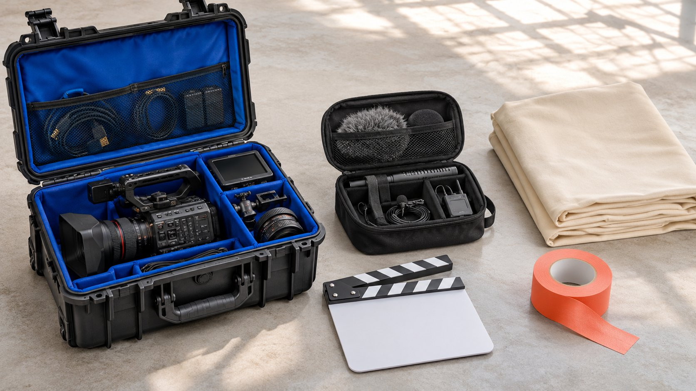

# 最大 YouTube 频道，品牌究竟能购买什么

状态：本地审阅稿；正式发布日期待确认。

研究最大 YouTube 频道时，先确认品牌能采购的节目、制作、发布与使用范围，而不是只比较频道总量。

Biggest YouTube channels 对品牌的价值，取决于能购买的具体工作：某个节目段落、新制作、账号发布、素材许可或其他明确安排。频道订阅与累计观看只是背景，不能自动成为本次触达承诺。先确定内容单元、实际参与人、发布时间、地区与使用条件，再询问适用报价和可用证据。本文提供大型频道合作的采购方法，不编造当前规模榜单、统一价格或成交保证，也不认为所有最大频道都由一个人制作或能按相同方式合作。

## 先给可购买单元命名

节目内介绍、整集联合制作、独立短片、出镜、品牌渠道素材与账号发布，不应共用一句“频道合作”。在[达人 Brief](https://www.quickkol.com/zh/blog/write-a-useful-campaign-brief/#answer) 中说明观众问题与所需单元，再问频道团队是否提供这种工作。

一个频道可能包含多种栏目、语言或内容形式。品牌喜欢其中某个节目，不能默认它能出现在任意栏目，也不能把团队提供的替代形式视为相同采购。

明确单元让创作者或代表更容易给出范围，也让品牌知道验收对象到底是什么。

## 保留频道规模的字段口径

[YouTube 的频道字段说明](https://developers.google.com/youtube/v3/docs/channels?hl=en)区分订阅、观看等字段，并说明部分值有显示精度限制。品牌应保留实际字段、来源与时间，不把累计总量当成本次将触达的独立人数，也不从一个公开数字推算所有节目观众。

当前榜单若没有实际采集，就不要填名次。需要比较时先限定平台、指标、日期和频道范围，避免不同来源混成一张看似实时的表。

规模可以帮助初筛，但本次工作仍需要相应节目与内容证据，不能由频道总量代替。

## 确认谁参与，不只确认频道名称

品牌可能期待某位主持人，但提案只确认制作团队。先写实际需要的角色，询问本人是否参与、参与哪一部分，以及人员变化如何处理。不因频道名称熟悉，就把所有出镜期待默认加入。

[YouTube 的频道权限说明](https://support.google.com/youtube/answer/9481328?hl=en)提供多人参与操作的背景，平台角色不自动证明对外商业权限。让适当代表确认工作、发布与使用，不要求剪辑或上传人员承诺权限之外的事项。

人物、节目和频道都应有明确对象。任何替代安排需要品牌实际接收，而不是靠一个相同标志掩盖变化。

## 分别约定编辑任务与产品事实

创作者可能有成熟节目表达，品牌则需要核对产品条件。先约定必须准确的事实、适当创作空间与修改范围，不把购买一个段落理解为控制全部观点。需要个人体验的表达仍应真实。

[YouTube 的品牌内容政策](https://support.google.com/youtube/answer/17596007?hl=en)提供价值交换与商业内容处理的背景。商业安排不能使没有发生的体验变成事实，也不能替品牌证明产品效果。

审核应指向实际脚本或预览对象。不能把内部某人看过产品资料，写成整条作品和所有后续版本都已批准。

## 发布范围需要单独确认

问清发布在哪个频道、哪个栏目、何种形式与时间安排。品牌获得文件，不证明已经有频道发布承诺；频道发布也不自动包含所有其他平台分发。延期、改形式或未能发布时，按实际约定处理。

若需要带来特定下一步，提前核对目的地、语言与品牌接收条件。创作者可以发出邀请，但不能替尚未准备好的品牌系统保证服务。

发布确认记录公开链接与版本，表现资料按自己的窗口后续评估。不要用预约、发出文件或一张频道截图代替实际发布证据。

## 素材使用范围不随频道规模扩大

用[付费媒体许可范围](https://www.quickkol.com/zh/blog/influencer-content-licensing-paid-media-schedule/#answer)分别记录品牌可以复用的片段、渠道、地区、期限与编辑条件。节目内出现品牌，不等于品牌可以下载整集、剪去背景后当成独立代言广告。

音乐、其他出镜人和第三方素材也可能需要不同确认，由合适人员按实际用途核对。节目愿意制作新段落，不证明所有旧素材都可授权。

将研究参考、已接收文件和已批准使用分别标记，避免媒体团队误用素材。文件存在与可以使用是不同状态。

## 用两个假设提案发现范围差异

假设提案甲是一集节目中的一次介绍，提案乙是四条独立短片。两者都写“视频合作”，仍不能只比较总金额。先确认节目整合、实际出镜、制作、发布与许可分别包含什么。这里没有真实频道报价或市场平均。

如果甲只含节目发布，乙含品牌渠道使用九十天，就把后者写在范围表；九十天是假设条件，不是行业标准。甲也许提供更适合的节目语境，乙也许更适合品牌素材计划，取决于实际观众任务。

还要确认四条是否四种原创解释，还是同一作品的四种裁切。不能把数量相同或单条金额更低，自动解释为更好价值。人物参与、语言与目的地条件也应在同一边界下比较。

最后写出可以决定什么：选择一种范围、要求补充资料、调整需求或不采购。不能从这个练习宣称某类频道永远更划算。

可将需求标为必需、可选、不包含或待确认。若品牌渠道复用是必需，而某方案没有说明，不能把缺项当作零成本；应确认可用范围、修改需求或暂缓比较。如果主持人本人出镜只是可选，也保留该选择，避免后来被误认成未完成交付。这层需求说明有助于比较不同形式，不强行称为相同的视频单元。

## 把费用与结果的责任分开

制作、出镜、发布、许可与媒体支出分项记录，注明期间与包含项。不要把估算收入当作频道应该接受的报价，也不从历史总观看推导本次收益。需要实际报价时提供真实范围。

报告分别说明交付、可用观看、相关回应和业务事件。某项未达到预期不自动使所有已完成工作失效，作品存在也不证明商业结果成功。

品牌与频道团队都应说明自己负责的条件，避免把所有差异归给一个熟悉的出镜人。

## 让交接说明未购买的部分

交接包含内容单元、参与人、发布对象、版本、使用范围、批准与接收人，也说明哪些尚未确认。执行者不应从文件夹名猜是否能投广告，或从合作群成员猜谁有权改事实。

需要新版本、新市场或延长期限时重新确认，不静默继承原范围。保留正常变更记录，让团队知道当前使用依据。

这份清单应随素材一起走，而不是只保留在采购人员的邮件里。

## 把最大频道研究变成清楚采购

大型 YouTube 频道可以提供值得研究的制作与传播机会，但品牌必须知道自己购买的具体单元与条件。规模背景、人物认知和实际工作应各有证据，不能互相代替。

完成时给出可执行提案、适用范围与未知，负责人再作决定。没有实际报价、排名采集或结果证据的部分，不应写成已经核验。

真正有用的研究，让品牌能说明买什么、为什么适合、谁能确认，以及之后如何验收。

## 大型频道可购买单元

| 单元 | 需确认 | 不能自动包含 |
| --- | --- | --- |
| 节目段落 | 栏目、出镜与编辑任务 | 整集权利 |
| 独立制作 | 原创建议、版本与验收 | 所有账号发布 |
| 账号发布 | 频道、形式与时间 | 全部关注者触达 |
| 素材许可 | 片段、地区、渠道与期限 | 无限复用 |

甲、乙与九十天均为假设范围；不代表真实报价或行业标准。

## 比较频道提案前

先比较工作，再比较价格。

- [ ] 内容单元有明确对象。
- [ ] 实际参与与发布分别确认。
- [ ] 规模资料有口径与时间。
- [ ] 使用范围与版本随文件交接。
- [ ] 未确认项不会被当成已购买。

## 研究日期与使用边界

资料核验于 2026 年 11 月 12 日。文中方法、表格和决策规则为编辑建议，标为假设的示例不是实际客户结果或行业基准。外部资料的适用地区与时期按各段说明；本稿处于独立本地审阅阶段，正式发布日期待确认。

## 用清楚的任务开始达人研究

用 QuickKOL 理解 Brief、发现相关达人并研究作品与联系路径；数据、合作条件和结果仍需核验。

[了解 QuickKOL](https://www.quickkol.com/#capabilities)

## 来源

- [YouTube 的频道字段说明](https://developers.google.com/youtube/v3/docs/channels?hl=en)
- [YouTube 的频道权限说明](https://support.google.com/youtube/answer/9481328?hl=en)
- [YouTube 的品牌内容政策](https://support.google.com/youtube/answer/17596007?hl=en)
