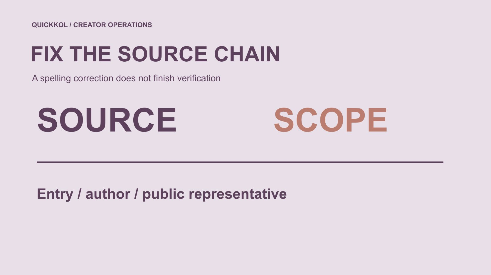

# Bluesku Search: Confirm the Creator Source

Status: local review draft; confirm the publication date before release.

Restore creator-research provenance when a Bluesku-like spelling appears, checking application, account and business contact separately.

QuickKOL editorial graphic; not actual account metrics or a platform interface.

A bluesku reference in brand material may be a Bluesky-like spelling or another object entirely. This guide concerns Bluesky creator research, with context checked first rather than search results automatically treated as the official application or a verified account. Preserve the official entry source, creator’s original work and business contact route separately, then verify their relationships. Similar names, domain handles and badges do not grant asset rights or contracting authority. Correcting a spelling should restore research accuracy rather than accuse every unfamiliar page of being a scam. The useful outcome is a source chain a brand can rely on for its next bounded question.

## Check where the term appeared

Did it appear in a colleague’s note, search result, creator introduction or supplier proposal? Preserve wording and date, then establish whether it refers to an application, account, article or business entity. Correct letters alone do not repair every source relationship.

Put the audience task in the [creator brief](https://www.quickkol.com/blog/write-a-useful-campaign-brief/#answer). The brand needs relevant work and collaborators, not an unrelated installation exercise. Identify the object before deciding which information merits research.

If it actually refers to another product or organization, redefine the scope accordingly rather than force a Bluesky interpretation. This avoids a subtle procurement error: a neat corrected name can make a record appear resolved even though nobody confirmed which account or work the original author intended to reference.

## Preserve official entry and creator material separately

Check entry through application or web links provided by the official platform, then preserve the specific work’s original address. Third-party clients, republications and official explanations can all appear in research, but should retain their actual roles rather than all become official.

[Bluesky’s domain-handle guide](https://bsky.social/about/blog/4-28-2023-domain-handle-tutorial) explains an association between websites and usernames. It helps interpret an account lead without establishing that every similar-looking domain is controlled by the platform or creator.

A brand need not provide passwords, verification codes or account control to an unfamiliar page merely to check provenance. Source assessment and account login are separate tasks. A record can show an appropriate entry route while leaving the particular account relationship unresolved until suitable evidence is available.

## Find the work’s author rather than only its display page

A screenshot or summary may originate with a creator, a repost, a quote or a third-party collection. Return to original work to establish publisher, personal contribution, time and context. If inaccessible, retain the limitation rather than promote a republication into first-party proof.

Explain why the work fits the assignment. Mentioning a product does not establish demonstration capability, and joining a discussion does not establish willingness to partner.

Where several records point to one piece, preserve the source chain instead of counting repeated copies as independent evidence of skill. The corrected spelling can help locate the original, but the location and the interpretation still require separate checks. A familiar-looking page should not inherit authorship simply because it appears higher in the researcher’s search results.

## Ask what a verification signal establishes

[Bluesky’s verification explanation](https://bsky.social/about/blog/04-21-2025-verification) distinguishes domain usernames from badges and describes verification attribution. Inspect appropriate public signals without treating identity as product endorsement, partnership acceptance or an asset license. Copying a badge into a quote table does not complete every review.

No badge does not automatically mean impersonation. Preserve known relationships and unknowns, corroborate public sources and ask a suitable question where needed. An account’s identity signal and an email sender’s authority concern different objects.

Date the check and its use rather than create a permanently trusted or suspicious label. This makes the record more robust when a creator changes a handle or representative: the team can identify which relationship needs updating without discarding unrelated work evidence or assuming every message still comes from the same authorized source.

## Keep original queries and execution state

[Bluesky’s search guide](https://bsky.social/about/blog/05-31-2024-search) describes finding material through phrases, authors and other conditions. When correcting a query, preserve original wording, revision, date and reason instead of presenting a planned query as returned results. Record what was actually opened at the new source.

Not finding an account establishes an unsuccessful route, not nonexistence or inauthenticity. Broad wording may include unrelated objects; exclude them according to the assignment with reasons visible.

Continue through [a bounded research session](https://www.quickkol.com/blog/bsky-app-collaborator-research-session/#answer) where necessary rather than try spelling variations indefinitely. A corrected route can be useful even when it yields no recommendation, provided it identifies which source relationship was repaired and which question remains open for another owner.

## Separate business contact from account identity

A public account may involve the person, team or other authorized operators. Ask who receives this new-work, publication or licensing request instead of inferring all authority from an avatar or email signature. Older representation information may need current confirmation.

An initial inquiry describes actual need without implying approved budget, collaboration or payment. Use the appropriate procurement process for formal authorization rather than gather unrelated private documents during source research.

Account identification helps locate someone; commercial scope helps route the request. Neither can be skipped. A legitimate account reference in an email may help establish context, but it does not itself establish that the sender can accept every proposed term or authorize use of material involving other contributors.

## Rehearse a brief with a spelling problem

Suppose a colleague writes found an equipment creator on Bluesku, attaching a cropped screenshot and an email claiming representation. Correcting the platform name to Bluesky does not make the candidate verified. This fictional example contains no real account or address.

Recover the note’s context, locate source and original work, and check the account and public contact route separately. An equipment photo does not establish original technical-demonstration ability. An unfamiliar address gains no authority merely by mentioning the account.

If only work provenance is recovered, record that success while representation remains unresolved. The team can continue without expanding a partial repair into full approval.

For handoff, three rows may be more useful than one status. Entry source records how the actual application or webpage was identified. Work source records original author, address and the role visible in the piece. Commercial source records where the proposed request should go and what authority still needs confirmation. None inherits the others’ completion state.

If an earlier proposal already relied on the wrong account, identify the affected recipient and correct the implication, not only the spelling. The correction might change the person being approached, the work cited or the permission requested. Preserve the earlier record with a dated correction so later reviewers can understand why the proposed collaboration changed. A clean-looking final name should not erase a material source error from the decision history.

Correct the capability description at the same time as the source where needed. If the recovered work shows someone sharing an equipment photograph, replace an unsupported technical educator label with the actual observed role. That correction does not mean the person lacks the skill; it means this piece did not establish it. The next question can request suitable public work rather than ask the person to defend an inflated description created by the brand’s own note.

Likewise, if the restored source belongs to a team, preserve the visible individual contribution and ask who handles the proposed work. A source repair should not silently convert a team publication into a personal portfolio claim. Recording these implications makes the correction useful for creator selection, rather than a cosmetic edit that leaves the original purchasing assumption untouched.

## Distinguish unchecked from a demonstrated problem

An inaccessible source, unanswered representative or unfamiliar name can limit research without proving fraud. Use accurate states such as not obtained, unconfirmed, irrelevant to the task or a specified inconsistency. Each needs an appropriate next step.

Decline a sensitive access request and route it to the account owner where necessary without waiting for a complete finding about the sender. Declining account action differs from public accusation.

Preserve necessary facts so business review can progress without turning a question into a personal verdict. A team can decide not to use an unconfirmed route while still stating honestly that it has not established the cause of the uncertainty or evaluated every service offered by the sender.

## Keep corrections with the candidate record

Preserve original term, confirmed object, source address, date, correction reason and affected conclusions. Updating a personal note is insufficient if agency, brand or media owners still rely on the old record. Explain changes and remaining unknowns to actual recipients.

Version later handle or contact changes with reasons instead of making an old check permanent. Distinguish direct observation from information someone supplied.

A useful correction reduces guessing rather than creates a history in which no error appears to have happened. It should remain attached to the work and proposed scope so a colleague copying one record into a new brief does not accidentally detach the corrected source from the limitation that made the correction necessary.

## Use spelling repair for accurate creator collaboration

A term such as Bluesku can prompt source recovery without independently determining platform, account or partnership identity. Check entry, work and business route around a real audience question.

A clear source chain makes creator research reviewable and keeps contact and procurement scoped. Similar naming grants no usage right, and an identity lead guarantees no outcome. Preserve those limits in the final proposal.

The receiver should know which source is confirmed, which question remains and who handles it next. That is a useful completion state even when a spelling correction leads to a decision to research further rather than immediately contact or purchase.

## Near-spelling source correction card

| Object | Confirm | Does not inherit |
| --- | --- | --- |
| Entry | Actual product and official source | Official status for every similar page |
| Work | Original author, address and contribution | Original capability of a reposter |
| Account | Public identity evidence and date | Commercial authority |
| Request | Actual receiver and scope | Asset or payment authorization |

The equipment-creator and email case is hypothetical, with no accusation about a real person or service.

## After correcting the record

Repair the source without expanding the conclusion.

- [ ] Original term and actual object are distinct.
- [ ] Official entry and work provenance are separately confirmed.
- [ ] Account identity is not commercial authority.
- [ ] Unchecked differs from a demonstrated problem.
- [ ] Affected receivers can see the correction.

## Research date and limitations

Sources reviewed November 12, 2026. Methods, tables and decision rules are editorial recommendations. Hypothetical examples are not actual client results or industry benchmarks. Source geography and periods are specified where relevant. This draft is in independent local review; confirm its publication date before release.

## Organize useful creator evidence

Keep sources, work, roles and unknowns in a concrete research record before deciding the next step.

[Read the candidate research guide](https://www.quickkol.com/blog/influencer-discovery-tool-brief-to-candidates/)

## Sources

- [Bluesky’s domain-handle guide](https://bsky.social/about/blog/4-28-2023-domain-handle-tutorial)
- [Bluesky’s verification explanation](https://bsky.social/about/blog/04-21-2025-verification)
- [Bluesky’s search guide](https://bsky.social/about/blog/05-31-2024-search)
