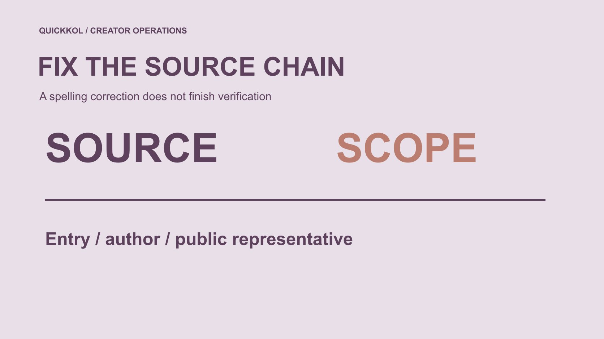

# 搜索 Bluesku 时，怎样确认创作者资料来源

状态：本地审阅稿；正式发布日期待确认。

遇到 Bluesku 等近似拼写时，品牌怎样恢复创作者研究的来源链，并分别核对应用、账号和商业联系。

QuickKOL 编辑图形；不呈现真实账号指标或平台界面。

品牌资料里出现 bluesku，可能是 Bluesky 的近似拼写，也可能指其他对象。本文围绕 Bluesky 创作者研究处理，第一步仍是确认语境，不自动把搜索结果当成官方应用或已验证账号。分别保留官方入口来源、创作者原作品和商业联系路径，再核对它们之间的关系。名称相近、域名账号或验证标记，都不能直接授予素材使用或签约权限。纠正拼写的目标是恢复准确研究，而不是把所有陌生页面都指控为骗局。

## 先看这个词出现在什么地方

它出现在同事笔记、搜索结果、创作者介绍还是供应商提案里？记录原文与日期，再询问它指应用、平台账号、文章或商业主体中的哪一个。不要只把字母改对，就认为所有来源已经修复。

将要解决的观众任务放进[达人 Brief](https://www.quickkol.com/zh/blog/write-a-useful-campaign-brief/#answer)。品牌需要的是相关创作者与作品，而不是完成一项无关的应用安装。确认对象后再决定哪些资料值得研究。

如果确实指其他产品或组织，就按真实对象重新定义范围，不硬把它解释成 Bluesky。

## 官方入口与创作者资料分别保存

从平台官方页面提供的应用或网页链接开始核对入口，再保存具体作品原地址。第三方客户端、转载文章与官方说明可能都出现在研究里，应按实际角色记录，不能全部贴上官方标签。

[Bluesky 的域名账号说明](https://bsky.social/about/blog/4-28-2023-domain-handle-tutorial)介绍网站与用户名之间的关联方式。它可以帮助理解账号线索，不说明任何包含类似字母的域名都由平台或创作者控制。

品牌不需要为了确认来源而给陌生页面密码、验证码或账号控制。来源判断与登录操作可以分开。

## 核对作品原作者，不只核对展示页面

一个截图或转述可能来自创作者，也可能来自转发、引用或第三方整理。回到原作品，确认谁发布、哪部分由本人完成，以及时间与语境。原页面无法打开时保留限制，不把转载自动升级为本人证明。

研究者需要说明作品为什么与本次任务有关。提到一个产品名，不等于能制作相关演示；参与讨论，不等于接受品牌合作。

如果多个资料指向同一作品，记录来源链，避免把重复转载算成多项独立能力证据。

## 验证线索需要知道验证了什么

[Bluesky 的验证机制说明](https://bsky.social/about/blog/04-21-2025-verification)区分域名用户名与验证标记，并说明验证来源。品牌可以查看适用公开线索，但身份信号不证明产品背书、合作接受或素材许可。不要把一个标记复制到报价表就称全部审核完成。

没有标记也不自动是仿冒。保存已知关系与未知，核对公开来源，必要时提出适当问题。某账号的身份线索与某封邮件发送者的权限也不是同一对象。

验证结果应附日期与用途，不变成永久可信或永久可疑标签。

## 查询修正要留下原文与执行状态

[Bluesky 的搜索说明](https://bsky.social/about/blog/05-31-2024-search)提供按词组、作者或其他条件寻找资料的方法。纠正查询时保留原词、修正词、日期与理由，不把计划执行的查询写成已返回的结果。新的来源也要记录实际打开了什么。

找不到某个账号，只说明本次路径没有取得，不能证明账号不存在或个人不真实。过于宽泛的词可能混入无关对象，研究者应按任务排除并说明原因。

必要时用[一次有范围的研究会话](https://www.quickkol.com/zh/blog/bsky-app-collaborator-research-session/#answer)继续，而不是无止境尝试近似拼写。

## 把商业联系人与账号身份分开

公开账号可能由本人、团队或其他获授权人员参与管理。品牌应问谁接收本次新作、发布或许可请求，而不是根据一个头像或邮件签名推定全部权限。旧资料里的代理关系也可能需要当前确认。

首次沟通说明真实需求，不暗示品牌已经批准预算、合作或付款。需要正式授权时按适当采购流程处理；不在来源研究阶段收集无关私人文件。

账号识别帮助找到人，商业范围说明帮助对方把请求交到正确位置。两者都不能跳过。

## 演练一份带拼写问题的 Brief

假设同事笔记写着“在 Bluesku 找到一位设备创作者”，附一张裁切截图和一个自称代表的邮件地址。品牌不能只把平台名改成 Bluesky，就标记为已验证候选。这里没有真实账号或邮件。

先恢复笔记语境，找到实际来源与原作品，再分别核对账号和公开联系路径。截图只显示一张设备图，就不能补成原创技术演示能力；陌生地址也不应因提到该账号而获得权限。

如果最后只恢复了作品来源，就记录来源已恢复，代表关系仍待确认。这样团队可以继续研究，而不把局部修正扩成全部批准。

必要时同时修正能力描述。如果恢复的原文只是分享设备照片，不把它继续称作技术教学证明。改成实际可见角色，不是断言该人没有技能，而是这项作品未建立该能力。下一步可询问适当公开作品，不应让对方为品牌笔记夸大的描述辩护。

若来源属于团队，保留个人实际贡献并问谁处理拟议工作，不静默改成个人作品集。修复由此真正影响达人选择，而非只改拼写、留下错误采购假设。

## 区分没有核对与发现问题

来源打不开、代表未回复或名称不熟悉，都可能限制研究，但不等于已证实欺诈。准确状态可以是未取得、待确认、与任务无关或有具体不一致。每种状态需要相应下一步。

如果出现敏感权限请求，可以拒绝并交给账号负责人，不必等到完整识别对方行为。拒绝账号操作与公开指控是两种不同动作。

记录必要事实，让业务判断既能前进，也不会把疑问变成人物定性。

## 让修正跟随候选资料流转

保存原词、确认对象、来源地址、日期、修正原因与受影响结论。不要只在个人笔记修改，却让机构、品牌与媒体继续引用旧记录。向实际接收人说明哪项改变，哪些仍未知。

如果之后账号改名或联系路径变化，新增版本并保留原因，不让旧确认永久生效。来源链也应能区分直接观察与他人提供的说明。

一份好的纠错记录帮助下一位同事少猜，而不是制造看似没有发生过错误的历史。

## 把拼写修复用于准确的达人合作

Bluesku 这样的词可以成为恢复来源的提示，但不能独自决定平台、账号或合作身份。品牌应围绕真实观众问题，逐项核对入口、作品与商业路径。

清楚的来源链让达人营销研究可复查，也让联系和采购保持适当范围。名称相近不意味着有权使用，身份线索不意味着结果保证；这些边界应保留在最终提案里。

完成时让接收人知道：哪项来源已确认，哪项仍需问题，以及谁接着处理。

## 近似拼写来源修正卡

| 对象 | 确认 | 不继承 |
| --- | --- | --- |
| 入口 | 实际产品与官方来源 | 所有近似页面官方身份 |
| 作品 | 原作者、地址与贡献 | 转载者原创能力 |
| 账号 | 公开身份线索与日期 | 商业权限 |
| 请求 | 实际接收人与范围 | 素材或付款授权 |

设备创作者与邮件案例为假设；不指控真实个人或服务。

## 修正资料后

修复来源，不扩大结论。

- [ ] 原词与真实对象分开保存。
- [ ] 官方入口与作品来源分别确认。
- [ ] 账号身份不冒充商业授权。
- [ ] 未核对与已发现问题不同。
- [ ] 受影响接收人能看到修正。

## 研究日期与使用边界

资料核验于 2026 年 11 月 12 日。文中方法、表格和决策规则为编辑建议，标为假设的示例不是实际客户结果或行业基准。外部资料的适用地区与时期按各段说明；本稿处于独立本地审阅阶段，正式发布日期待确认。

## 继续整理可用的创作者证据

将来源、作品、角色和未知保留在具体研究记录里，再决定下一步。

[阅读候选研究指南](https://www.quickkol.com/zh/blog/influencer-discovery-tool-brief-to-candidates/)

## 来源

- [Bluesky 的域名账号说明](https://bsky.social/about/blog/4-28-2023-domain-handle-tutorial)
- [Bluesky 的验证机制说明](https://bsky.social/about/blog/04-21-2025-verification)
- [Bluesky 的搜索说明](https://bsky.social/about/blog/05-31-2024-search)
