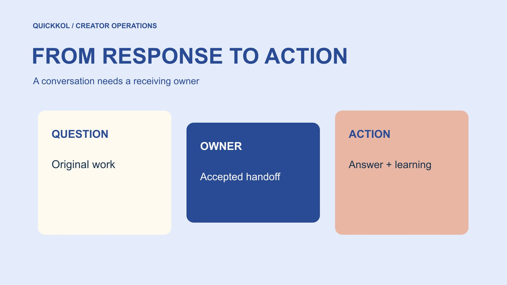

# Social Media Engagement: Turn Responses Into Action

Status: local review draft; confirm the publication date before release.

Route creator-led comments, questions and feedback to an accountable next step instead of stopping at an interaction total.

QuickKOL editorial graphic; not actual account metrics or a platform interface.

Social media engagement in creator marketing means observable interactions around a piece of content. It is not automatically a count of people, approval or orders. Define the interaction relevant to the task, then route product questions, partnership inquiries, support and general feedback to appropriate owners. Keep the original post, observation window and actual handling state traceable. Fast replies are not necessarily accurate, and few comments do not establish a lack of interest. A useful engagement plan gives the audience an appropriate response and carries learning into the next creator assignment, without inventing a universal score for every campaign.

## Define the audience question worth responding to

Start with what the piece should help a viewer understand. A software demonstration may raise compatibility questions, a store activation may raise location questions, and a product trial may raise specification comparisons. All may appear in comments, but they need different responders. Do not place every reaction under one success objective, particularly by treating an emoji as a purchasing need.

Use the [creator brief](https://www.quickkol.com/blog/write-a-useful-campaign-brief/#answer) to define the themes to collect and promises not to make. The brand confirms facts while the creator retains genuine experience and expression. If the campaign cannot support ongoing questions, narrow the invitation rather than creating an unattended service promise. Begin with the actual assignment and then choose observations. Starting with a large total and asking the creator to fill it reverses that logic. A clear question also helps the editor judge whether a proposed follow-up genuinely serves the audience or merely creates another opportunity to request more reactions.

## Retain the definition of each interaction

Record whether the event is a like, comment, save, share, DM or a platform-specific field, preserving the original piece, observation date and source. Repeated actions may come from one person, and accounts may have overlapping audiences. Adding those counts does not produce customers. A custom ratio needs a numerator, denominator and period; an unavailable field is not zero.

Use the [social media metrics decision framework](https://www.quickkol.com/blog/social-media-metrics-creator-decision-tree/#answer) to distinguish acceptance, content learning and commercial judgment. A question may reveal an explanatory gap without being a qualified lead or an order. Conversely, no public question does not establish comprehension or indifference. Each field has a scope. Explain which next action it can support. Clear naming is more useful than a combined engagement value whose meaning cannot be reconstructed. It also prevents a later presentation from changing an observation into a claim simply because the number has moved from a research sheet into a sales or procurement slide.

## Check observation conditions before interpreting silence

[YouTube’s comment settings guide](https://support.google.com/youtube/answer/9482556?hl=en) distinguishes defaults from existing-video settings and lists conditions in which comments cannot be enabled. Visible comments therefore depend on controls and content conditions, not an unrestricted pool of opinion. If the brand observes only newest or prominent comments, record that perspective instead of calling the visible portion complete.

Comment, DM and interaction visibility also differs across platforms. The report does not justify requesting full creator-account access. Start with a proportionate aggregate or original-post record and ask for a missing window where needed. If comments are unavailable, adapt the observation plan instead of reporting zero visible comments as zero interest. Checking conditions prevents settings, filters and missing data from being assigned to creator performance. The same discipline applies after a settings change: preserve the date and avoid comparing the earlier and later period as though the audience had identical opportunities to respond throughout.

## Route questions to people who can act

A practical routing set is product facts, personal experience, merchant support and partnership inquiries. Product staff answer specifications, the creator describes actual use, support handles orders and the partnership team receives proposals. The categories may change by project. What matters is a receiving owner, necessary information and a realistic update route for each.

One comment can contain several questions. Acknowledge it and identify who handles which part rather than asking the creator to guess stock or promise a refund to appear responsive. Not every question needs the campaign director either. Prepare factual references and escalation boundaries so the operator knows what can be answered directly and what needs confirmation. A routing record should show whether the receiving owner accepted the task, not simply that someone forwarded a screenshot. That distinction keeps an apparent handoff from becoming another unattended item while the audience believes a response is already in progress.

## Design response authority and information handling together

[FTC’s business information protection guide](https://www.ftc.gov/system/files/documents/plain-language/pdf-0136_proteting-personal-information.pdf) provides context for proportionate retention and limited access. Handling a comment does not mean copying private orders, contact details and entire chats into a marketing workbook. Connect support work through a necessary summary and reference, giving appropriate material to the person who can resolve it while others receive status.

Where a private route is needed, provide a confirmed brand destination rather than asking someone to post payment information publicly. The creator should know which cases to route and which can be addressed on the original piece. A response-speed target should not reward acting beyond authority. Accuracy, appropriate access and a transferable state need to coexist in the design. The team should therefore distinguish an acknowledgment from a substantive answer and a resolved case. Those states can have different owners without requiring everyone to view the sensitive detail behind the resolution.

## Do not confuse read with answered

[Meta’s DM feature explanation](https://about.fb.com/news/2024/03/instagram-dm-updates/) introduced controls including read receipts in its 2024 announcement. A read indication cannot establish agreement, and its absence does not establish deliberate disregard. Keep a technical messaging state separate from a commercial task state. Actual commitments need explicit expression and appropriate confirmation.

A response record can distinguish seen, accepted by an owner, awaiting facts, answered and resolved. The last two are not identical either; a support answer may merely communicate the next step. Give unfinished work an owner and review date instead of using reply volume to declare everything closed. This avoids unnecessary pressure on creators while locating work waiting inside the brand. It also supports a realistic handover at the end of a campaign: a new team member can see which questions still require action rather than infer completion from a thread that contains several friendly acknowledgments.

## Rehearse routing and deduplication with a hypothetical case

Suppose a sponsored demonstration receives forty comments in the observation window. Twelve concern the same compatibility question and five concern orders. These numbers illustrate workflow, not a client outcome. Twelve comments need not mean twelve people, and twelve votes cannot determine product compatibility. Check whether one factual confirmation is needed, then have an appropriate owner prepare the response.

Route support separately and read the remaining feedback against the work’s purpose. When the same fact is answered repeatedly, retain approved wording and its version to avoid contradictory replies. The recap may show event counts and theme counts together without claiming deduplicated people. Useful outcomes include a confirmed explanation, an accepted support handoff and a change to the next piece, not only the total forty. This example also shows why faster counting is not necessarily better response work. The brand needs to know what was learned and handled, with unresolved items remaining visible after the initial burst of activity.

## Carry engagement learning into the next piece

Repeated compatibility questions may mean a prerequisite appears too late. Questions about where to buy may call for checking the destination. Off-topic responses may justify reconsidering the invitation or audience match. Connect each change to a specific observation instead of rebuilding the strategy from one comment or ignoring unfavorable feedback to preserve the original view.

Retain the original version, window and reason. Test one defined change next time rather than changing creator, script and distribution together and claiming to isolate one cause. Social media engagement is valuable when it tells the brand and creator how to respond and improve. Public reactions still have visibility and representativeness limits. Learning can be useful without being presented as the opinion of the entire market. Close with a receiving owner for each change and ask whether the next brief contains an executable instruction. If it contains only more engagement, the response loop has not yet produced a useful creative decision.

## When two responders give different answers

Suppose a software creator demonstrates an export workflow and a viewer asks whether a file format is supported. The creator says yes from actual trial experience; brand support says no using an older reference. More engagement is not a reason to decide who replied fastest. Identify the version and conditions behind each answer, retain the question and time, and ask the product owner to confirm. If support exists only in particular versions, the final answer needs that prerequisite rather than a vague affirmative designed to avoid embarrassment.

Give both responders the same approved fact and version. The public response can explain the correction’s scope and link an appropriate official reference without discussing the viewer’s private account information. If the video omitted an essential condition, the content owner should decide whether a clarification or later revision is needed. That decision concerns the promise and actual effect, not an automatic comment-volume trigger. The creator’s trial may be genuine without representing every version, while support’s old material may need updating.

Keep conflict identified, fact confirmed, public response corrected and related reference awaiting update as different states. Assign the reference update so that one corrected comment does not coexist with a page producing the same confusion. The next brief may put the version condition before the export and ask a test viewer to restate it. This is a hypothetical case, not a client result or a guarantee that correction increases viewing or orders.

At closure, ask an uninvolved colleague to locate the original question, final condition, public answer and outstanding work. If that person still has to choose which of two chats to trust, the response process is incomplete. The value of an engagement plan is getting an accurate answer to the audience and giving production and support a traceable shared fact. Counting the disagreement as more activity would miss that objective. The record should therefore make the correction usable after the original responders leave the project, preserving the information needed for a consistent answer without turning a private exchange into a public case study about the viewer.

## Engagement response routing

| Question | Owner | Handling evidence |
| --- | --- | --- |
| Compatibility and specifications | Product team | Approved facts and version |
| Personal use | Creator | Scope of actual experience |
| Orders and support | Merchant support | Appropriate reference and state |
| Partnership inquiry | Partnership team | Task and next action |

These are editorial routing recommendations, not universal platform categories.

## Engagement response plan

Confirm who can receive actual questions before release.

- [ ] Define the audience question relevant to the work.
- [ ] Record event, source and period.
- [ ] Assign receiving owners and boundaries.
- [ ] Distinguish read, answered and resolved.
- [ ] Turn learning into a specific next brief.

## Research date and limitations

Sources reviewed November 12, 2026. Methods, tables and decision rules are editorial recommendations. Hypothetical examples are not actual client results or industry benchmarks. Source geography and periods are specified where relevant. This draft is in independent local review; confirm its publication date before release.

## Start creator research with a clear task

Use QuickKOL to interpret a brief, discover relevant creators and research their work and contact routes. Verify data, commercial terms and outcomes at their source.

[Explore QuickKOL](https://www.quickkol.com/#capabilities)

## Sources

- [YouTube’s comment settings guide](https://support.google.com/youtube/answer/9482556?hl=en)
- [FTC’s business information protection guide](https://www.ftc.gov/system/files/documents/plain-language/pdf-0136_proteting-personal-information.pdf)
- [Meta’s DM feature explanation](https://about.fb.com/news/2024/03/instagram-dm-updates/)
