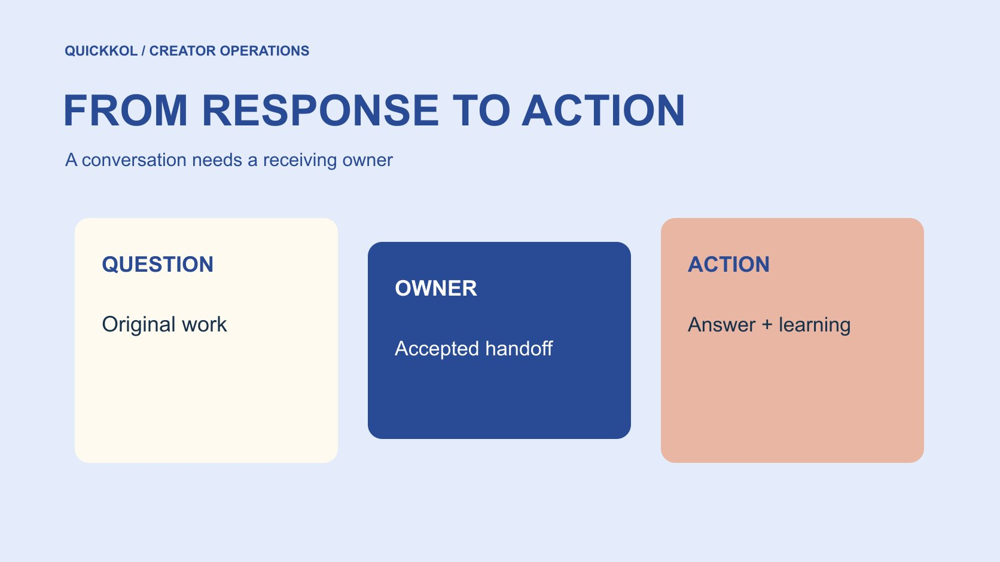

# 社媒互动怎样变成达人合作的下一步

状态：本地审阅稿；正式发布日期待确认。

让创作者带来的评论、提问和反馈进入有人接手的流程，而不止停留在一个互动总数。

QuickKOL 编辑图形；不呈现真实账号指标或平台界面。

Social media engagement 在达人营销中，是围绕作品发生的可观察互动，不等同于独立人数、认可或订单。品牌应先说明本次需要理解的互动，再把产品问题、合作询问、客服与一般反馈分给适当负责人。原帖、窗口和实际处理状态要能追溯；回复快不代表答得准确，评论少也不证明没有兴趣。一个有用的互动计划，应让读者得到适当回应，并把学习带回下一次创作。

## 先定义希望回应的观众问题

先问作品希望读者理解什么。软件演示可能引出兼容性问题，门店活动可能引出地点咨询，产品试用可能引出规格比较。它们都可能出现在评论区，但需要不同人员回答。不要把所有反应放在同一个成功目标里，尤其不能把一个表情当成购买需要。

在[达人 Brief](https://www.quickkol.com/zh/blog/write-a-useful-campaign-brief/#answer) 中说明希望收集的主题和不应作出的承诺。品牌确认事实，创作者保留真实体验与表达方式。若活动没有能力持续答疑，就缩小邀请，不让一句随便来问变成无人接手的服务承诺。计划要从真实任务开始，再决定观察哪些互动；不是先选一个大数字，再要求创作者想办法填满。

## 给互动事件保留自己的定义

记录事件是点赞、评论、收藏、分享、私信还是某种平台字段，并保留原帖、观察日期与来源。重复行为可能来自同一个人，跨账号数据也可能重叠。不要把这些计数相加后叫作客户数。自定义比率需要写清分子、分母和时间，未知字段不能补零。

用[社媒指标决策框架](https://www.quickkol.com/zh/blog/social-media-metrics-creator-decision-tree/#answer)区分作品验收、内容学习和商业判断。一条实际问题可以提示解释缺口，但还不是合格线索或订单。反过来，没有公开提问也不能证明读者不理解或不关心。每个字段有适用范围，报告应说明它能支持哪个具体下一步。清楚命名，比创造一个含义不明的综合互动值更有帮助。

## 先检查观测条件，再解释沉默

[YouTube 的评论设置说明](https://support.google.com/youtube/answer/9482556?hl=en)区分默认设置与既有作品的设置，并列出无法开放评论的情况。它说明可见评论受控件和内容条件影响，不是一个没有限制的意见池。品牌如果只观察最新排序或精选评论，记录这个视角，不把看到的部分当成全部。

不同平台的评论、私信和互动字段可见范围也不同。无需为了报告向创作者索取完整账号权限。先请求与任务相称的汇总或原帖证据，缺少窗口时补问。若评论功能未开放，观察计划要调整，不应把零可见评论写成零兴趣。核对条件能避免把设置、筛选和缺失误归为创作者表现。

## 把问题分到能实际处理的人

可用四类分流：产品事实、个人体验、商家客服和合作询问。品牌产品人员回答规格，创作者说明自己的实际使用，客服处理订单，合作团队接收业务提案。分类可以因项目调整，重要的是每类有接收人、必要信息和合理更新方式。

同一条评论可能有多个问题，先承认已收到，再说明哪个部分由谁接手。不要为了显得反应快，让创作者猜库存或承诺退款。也不必把每个问题都升级给总负责人。给常见情形准备事实核对与升级边界，让操作者能判断自己可以直接回复什么，哪些需要等确认。

## 将回复权限与信息保护一起设计

[FTC 的企业信息保护指南](https://www.ftc.gov/system/files/documents/plain-language/pdf-0136_proteting-personal-information.pdf)为适度保留资料和限制访问提供背景。处理评论不意味着要把私人订单、联系方式和完整聊天复制到市场表里。用必要摘要和事件编号连接客服记录，让能处理的人查看适当材料，其他人只接收状态。

需要转私密渠道时，提供品牌已确认的真实入口，不要求读者在公开评论贴付款资料。创作者应知道哪些情况直接转接，哪些可以在原帖说明。不要把公众回复速度作为鼓励越权的指标。准确答案、适当访问和可交接状态，需要在同一个响应设计里成立，不能为了让处理数量好看牺牲其中一项。

## 不要用已读代替已经回应

[Meta 的私信功能说明](https://about.fb.com/news/2024/03/instagram-dm-updates/)在其 2024 年公告中介绍了已读控制等功能。品牌不能从一个已读信号推断合作同意，也不能因没有信号就说对方故意忽略。消息技术状态与商业任务状态应分别记录，实际承诺需要明确表达与适当确认。

响应表可区分已看到、已确认接手、待事实、已回复和已解决。后两者也不完全相同，一条客服回复可能只是通知下一步。给未完成事项一个负责人和复核时间，而不是用回复数量宣称全部关闭。这样既避免误催创作者，也能让品牌找到真正积压在内部的任务。

## 用假设案例练习分流与去重

假设一条赞助演示在观察窗内出现四十条评论，其中十二条涉及同一兼容问题，五条涉及订单。这里的数字只是流程示例，不是实际客户表现。十二条不一定来自十二个人，也不能按十二票决定产品支持范围。先看是否需要一份事实确认，再由适当人员准备回复。

客服问题分到订单路径，其余意见按作品目的阅读。若多次回复同一事实，保留批准答案和版本，避免不同同事说法冲突。统计可以同时展示事件数量与主题数量，但不要假装已经去重成独立人数。最后的成果应包括一个被确认的解释、清楚的客服交接和下一次作品需要调整的地方，而不只是四十这个总数。

## 把互动学习带回下一份作品

若兼容问题反复出现，检查关键前提是否在作品中出现得太晚；若读者问购买地点，核对入口是否准确；若问题与产品无关，可能需要重审邀请或人群匹配。把每个改动与具体观察连接，不因为一条评论就重做全部策略，也不为了证明自己正确而忽略不利反馈。

保留原版本、观察窗口与修改理由。下一次可测试一个明确变化，而不是同时换创作者、脚本和投放后声称证明其中一项有效。Social media engagement 的价值，是让品牌与创作者知道下一步怎样回应和改进。公开反应仍有可见性与代表性限制，学习可以有用，同时不被夸大成全部市场意见。

## 当两位回复人给出不同答案

假设软件创作者演示一个导出流程，读者问某文件格式是否支持。创作者根据自己的试用说可以，品牌客服引用旧资料说不支持。新增互动不是先去评谁回复快，而是找到两份答案分别依据什么版本、适用什么条件。保留原问题与时间，交产品负责人确认。若只是部分版本支持，最终回复必须把前提说清，不能为了避免尴尬将两种意见混成模糊肯定。

产品确认后，给双方同一份批准事实及版本。原帖回复可说明更正的范围，并提供适当官方资料，不公开讨论读者的私人账号信息。若视频本身省略关键前提，由内容负责人判断需要补充说明还是下一版修订。这个决定依据作品承诺和实际影响，不是由评论数量自动触发。创作者的真实试用可以成立，同时不代表每个版本都支持；客服的旧资料也可能需要更新。

在处理记录中分开“冲突已发现”“事实已确认”“对外回复已修正”和“相关资料待更新”。把资料更新交给对应人员，避免修好一条评论却让旧页面继续引出同样问题。下一次 Brief 可要求在导出前先说明版本条件，并让测试用户尝试复述。此处没有真实客户结果，也不保证更正会提高观看或订单。

收尾时请未参与讨论的同事从记录找到原问题、最终条件、公开答复与剩余任务。如果他仍要在两个聊天里选一个相信，响应流程就没有完成。有效互动计划的价值在于让准确答案抵达读者，并让制作和客服共用一个可追溯的事实，而不只是把这次争论统计成更多活跃。

## 互动响应分流

| 问题 | 负责人 | 处理证据 |
| --- | --- | --- |
| 产品兼容与规格 | 产品团队 | 批准事实与版本 |
| 个人使用体验 | 创作者 | 真实体验范围 |
| 订单与客服 | 商家客服 | 适当事件编号与状态 |
| 合作邀请 | 合作团队 | 任务与下一步 |

这是编辑建议的工作分流，不是平台统一分类。

## 互动响应计划清单

上线前确认谁能接手真实问题。

- [ ] 定义与作品有关的观众问题。
- [ ] 记录事件、来源与窗口。
- [ ] 为每类问题指定接收人和边界。
- [ ] 区分已读、已回复和已解决。
- [ ] 把学习写入下一份具体 Brief。

## 研究日期与使用边界

资料核验于 2026 年 11 月 12 日。文中方法、表格和决策规则为编辑建议，标为假设的示例不是实际客户结果或行业基准。外部资料的适用地区与时期按各段说明；本稿处于独立本地审阅阶段，正式发布日期待确认。

## 用清楚的任务开始达人研究

用 QuickKOL 理解 Brief、发现相关达人并研究作品与联系路径；数据、合作条件和结果仍需核验。

[了解 QuickKOL](https://www.quickkol.com/#capabilities)

## 来源

- [YouTube 的评论设置说明](https://support.google.com/youtube/answer/9482556?hl=en)
- [FTC 的企业信息保护指南](https://www.ftc.gov/system/files/documents/plain-language/pdf-0136_proteting-personal-information.pdf)
- [Meta 的私信功能说明](https://about.fb.com/news/2024/03/instagram-dm-updates/)
