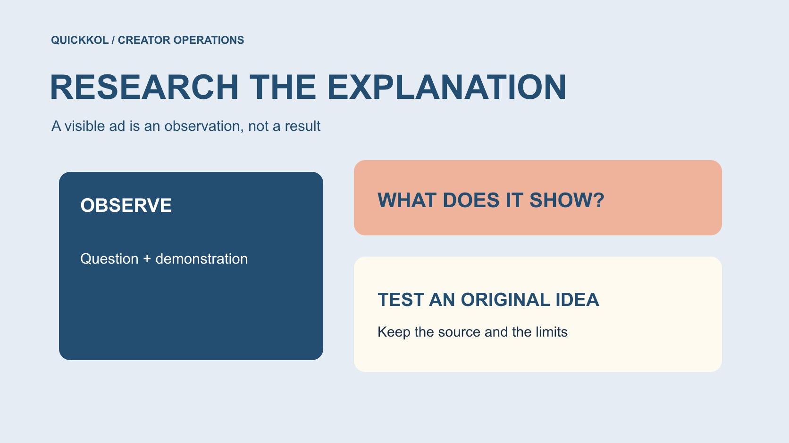

# Facebook Ad Library for Creator Ad Research

Status: local review draft; confirm the publication date before release.

Use public ads as creative research: observe how creators explain a problem, retain provenance and separate visible material from advertising results.

QuickKOL editorial graphic; not actual account metrics or a platform interface.

The search facebook ads libary usually refers to Meta Ad Library. Brands can study publicly visible ads to understand how creators introduce a problem, demonstrate a product and invite a next step. Visibility, multiple variants or a recurring opening do not by themselves prove effectiveness. Preserve query context and source links, translate observations into original creative questions, and confirm partnership and asset rights separately. This is a research method, not a completed live ad-sample study or access to a competitor’s private advertising results. The useful output is a brief a creator can interpret, rather than an unsupported list of winning ads.

## Rehearse the same work appearing under two identities

Suppose the same demonstration appears under a brand and a local distributor in public ad records. A researcher should not immediately count two independent creative concepts or conclude that the creator contracted separately with both businesses. Record both sources, compare visible versions and markets, and preserve the commercial relationship as unknown. This is a hypothetical without an actual ad sample.

For a question about explaining compatibility, the repeated work can sit under one creative observation with two distribution contexts retained. A question about commissioning new work instead needs further confirmation of the original author, representative and contact route. One grouping cannot resolve every research question.

Explain why observations were combined while publishing identities were preserved. The receiving colleague can then understand that deduplication prevents overstating the number of approaches; it does not establish identical rights or advertising strategies across the two businesses.

## Start with a question creative observation can answer

For example, a brand may want to know how comparable tools explain an installation prerequisite in short video, or how a professional creator demonstrates an easily misunderstood operation. These questions can be answered by examining the work. A competitor’s actual acquisition cost needs different evidence and cannot be inferred from polished production.

Put the question in the [creator brief](https://www.quickkol.com/blog/write-a-useful-campaign-brief/#answer) and define product category, market language, format and research date. Do not label anything this week’s hottest without an actual current search. A narrow, explicit scope is often more useful than collecting hundreds of ads. The purpose is deciding what explanation and creator capability the assignment needs, not finding a similar-looking person to imitate. If the question changes during research, record that change so the eventual recommendation does not pretend the sample was designed from the start to support a conclusion discovered later.

## Understand the library without expanding its evidence scope

[Meta’s Ad Library announcement](https://about.fb.com/news/2019/03/a-better-way-to-learn-about-ads/) described broader active-ad visibility in 2019 while distinguishing some information for political or issue advertising. It provides transparency context, not a promise that every field in today’s interface is identical. At the current official page, record the country, category and search conditions actually available rather than inventing button-by-button instructions for an inaccessible interface.

Information can differ by region, category and period. Spend information for one ad category does not establish complete results for every commercial creator ad. Record which fields are visible and which are unavailable instead of labeling the entire source as containing all advertising data. This article does not substitute a historical announcement for live-sample verification. Keeping that distinction visible allows a colleague to reproduce the method while also recognizing that a new session may offer different fields or fail to retrieve the same material.

## Establish the publishing identity before the creator role

A person appearing in an ad may be a creator, actor, employee or product user. A face alone does not establish their account, exclusivity or actual experience. Preserve the displayed advertiser and available source. Cross-check public work only where identity can be established; otherwise keep the role unknown.

[Meta’s creator collaboration explanation](https://about.fb.com/news/2024/02/creator-marketplace-for-brands-and-creators-to-collaborate-on-instagram/) described partnership ads using a creator’s or another partner’s account identity for amplification in 2024. That establishes a collaboration format, not that every ad featuring a person uses it or that anyone currently holds rights to reuse its footage. Research can examine expression while outreach still requires the proper collaborator and public contact route. This prevents the team from sending a proposal that assumes an existing personal endorsement when the visible person may have supplied production only. It also keeps an advertiser’s commercial identity separate from the identity of whoever performs the demonstration.

## Analyze the explanation rather than copying the work

Break each sample into audience question, first visible evidence, demonstration conditions, limitations and next step. A concrete action, such as showing the connector before explaining compatibility, is more reusable than an opening described as engaging. Music, setting and captions can be recorded as observations without becoming proven causes of growth.

When briefing a new creator, describe the task rather than requesting an exact recreation of somebody else’s complete script. Let the creator propose a method grounded in genuine experience while the brand verifies product facts. Explain why comparable demonstration conditions matter. A prop appearing elsewhere does not establish that this assignment needs it. Creative references should help solve an explanation problem while preserving the original author’s distinctive expression. The brief can specify what the audience needs to understand without prescribing another creator’s personal story, voice or claimed experience as something the new partner must perform.

## Do not infer a winner from apparent longevity

An ad remaining visible for a long period can have several explanations. This method has not obtained its spend, conversions, internal tests or scheduling evidence. Multiple versions may reflect markets, languages or production arrangements rather than a demonstrated number of successes. Still running is not a substitute for performance evidence.

Separate an observation such as several openings were visible from a recommendation such as test different openings. The first comes from the sample; the second is editorial judgment. To evaluate the brand’s own project, use appropriately authorized records with a defined window. Do not mix the visible characteristics of competitor examples into the brand’s results and create an industry benchmark that does not exist. An internal presentation should preserve this distinction when it shortens the research note. Otherwise a cautious observation can become a claim of proven creative effectiveness simply through a change of slide title.

## Separate public visibility from permission to reuse

[U.S. Copyright Office’s work-use FAQ](https://www.copyright.gov/help/faq/faq-fairuse.html) explains that permission and circumstances matter when using someone else’s work; a fixed word count or percentage does not automatically establish fair use. This is U.S.-specific context, with applicable requirements elsewhere needing separate assessment. An ad being publicly playable is not permission to download it, replace a logo and advertise it again.

If purchasing original footage or new work is genuinely relevant, define version, market, channel, duration and editing conditions through the [paid media licensing scope](https://www.quickkol.com/blog/influencer-content-licensing-paid-media-schedule/#answer). Preserve the source link and handle internal references according to applicable organizational requirements too. Reference material and ready-to-run assets should have different statuses, so a media colleague does not mistake research for cleared inventory. The creator’s agreement and any other required rights still need appropriate review; this table is a handoff aid rather than a universal legal clearance.

## Translate an observation into an original, reviewable brief

Suppose the research concerns installation explanation. One hypothetical sample shows the result first and another starts with compatibility. This does not establish which drives better conversion. It can generate a question for the brand’s own project: must the intended viewer understand compatibility before the result becomes useful?

The brand supplies the actual product, verified compatibility facts and an approver, then invites a creator with suitable demonstration capability to propose two approaches. Agree on comparable conditions, deliverables and available observations without promising that a controlled experiment is feasible. If audience and media budget change together, preserve the inability to isolate causation. This is a fictional rehearsal, not client research already completed. A useful resulting brief names the explanation problem and acceptable evidence. It does not label one variant the industry winner before the brand has produced or observed either version in its own setting.

## Bound the sample and record unsuccessful searches

Preserve selection reasons rather than collecting only samples that support an expectation. If a brand or creator cannot be found, record query conditions and time. That establishes an unsuccessful search, not that the party never advertised, never partnered or stopped operating. Do not force an advertiser attribution where the displayed identity remains unclear.

State coverage, exclusions and reasons. Reviewing one language and market cannot establish a worldwide creative preference. With an insufficient sample, present a few questions for testing instead of announcing an industry shift. Limited research remains valuable when the conclusion matches its scope. The same rule applies to a later update: a disappeared result does not erase what was observed earlier, but neither does an archived note establish that the ad is still active. Each observation should keep its own date and should not inherit a stronger current-status claim.

## Hand over the question, sources and next step

The handoff should include the original question, query scope, sample links, visible facts, editorial inferences, unresolved matters and proposed action. A brand may continue research, commission original production or defer an approach. Do not supply a folder of videos and leave the execution team guessing which materials have authorization.

In creator marketing, Facebook Ad Library is useful as an entry point for observing public creative work. It helps a brand see explanation approaches and identify collaborators requiring further research. It does not automatically supply their performance, intentions or asset rights. A more specific next brief, with source-preserving conclusions, is a deliverable the research can actually support. Before closing, check that a colleague could distinguish an observed feature, a proposed original test and an approved advertising asset. If those appear in one undifferentiated list, the handoff is not yet ready for use.

## Creator-ad creative research card

| Field | Record | Do not infer |
| --- | --- | --- |
| Source | Link, time and query conditions | Complete worldwide sample |
| Explanation | Question, demonstration and prerequisite | High conversion |
| Identity | Established advertiser and partner | Appearance means actual endorsement |
| Next step | Original test question and owner | Reference means permission |

A research method, not a completed live Ad Library sample.

## Creative research handoff checklist

Use observation to inform production while preserving evidence limits.

- [ ] Visible work can answer the research question.
- [ ] Query scope, sources and timing are traceable.
- [ ] Unknown performance and rights remain unknown.
- [ ] The brief describes a task rather than copying a complete work.
- [ ] Further research or production has a named owner.

## Research date and limitations

Sources reviewed November 12, 2026. Methods, tables and decision rules are editorial recommendations. Hypothetical examples are not actual client results or industry benchmarks. Source geography and periods are specified where relevant. This draft is in independent local review; confirm its publication date before release.

## Start creator research with a clear task

Use QuickKOL to interpret a brief, discover relevant creators and research their work and contact routes. Verify data, commercial terms and outcomes at their source.

[Explore QuickKOL](https://www.quickkol.com/#capabilities)

## Sources

- [Meta’s Ad Library announcement](https://about.fb.com/news/2019/03/a-better-way-to-learn-about-ads/)
- [Meta’s creator collaboration explanation](https://about.fb.com/news/2024/02/creator-marketplace-for-brands-and-creators-to-collaborate-on-instagram/)
- [U.S. Copyright Office: using another person’s work](https://www.copyright.gov/help/faq/faq-fairuse.html)
