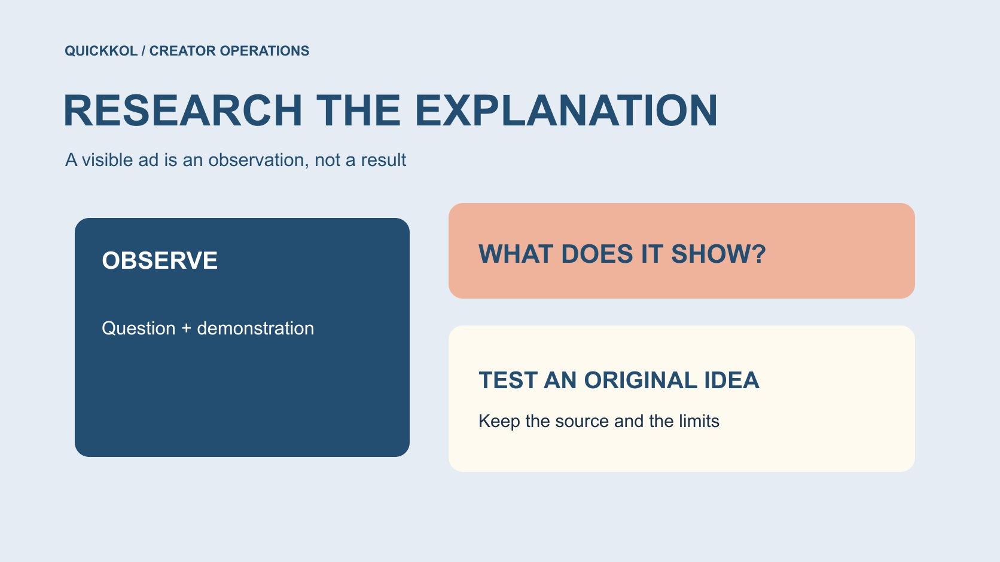

# 怎样用 Facebook Ad Library 研究达人广告表达

状态：本地审阅稿；正式发布日期待确认。

把公开广告当成创意研究材料：观察达人如何解释问题，保留来源，并把可见内容与投放效果分开。

QuickKOL 编辑图形；不呈现真实账号指标或平台界面。

搜索 facebook ads libary 时，通常寻找的是 Meta Ad Library。品牌可以用公开可见的广告研究创作者怎样提出问题、展示产品和邀请下一步，但不能仅凭广告仍可见、版本多或开头相似就断言效果好。保存查询条件与原始地址，将观察转成自己的创意问题，并单独确认达人合作和素材许可。本文提供研究方法，不声称已经完成本次实时广告样本调查，也不提供竞争对手的未公开投放数据。

## 演练同一作品出现两个主体的情况

假设同一段演示分别出现在品牌与当地经销商的广告记录里。研究者不能立刻把它们计为两个独立创意，也不能断言创作者和两家公司分别签约。先记录两个来源，比较可见版本和市场，保留商业关系未知。此处是假设，没有实际广告样本。

若问题是演示怎样解释适配条件，可以把重复作品归在一个创意观察下，同时保留两个投放上下文。若问题是应联系谁采购新作，则需要进一步确认原作者、代理人与可用联系路径。一个整理方式不能同时解决所有研究问题。

交接时说明为什么合并观察、为什么没有合并发布主体。下一位同事才能理解，样本去重是为了避免夸大表达数量，不代表已经证明两家公司拥有相同权利或采用相同投放策略。

## 先写一个可以通过创意观察回答的问题

例如，品牌想知道同类工具怎样在短片里解释安装前提，或专业创作者如何展示一个容易误解的操作。这样的问题可以观察作品本身。想知道竞争品牌真实获客成本，则需要不同证据，不能靠素材看起来专业来推断。

把问题放进[达人 Brief](https://www.quickkol.com/zh/blog/write-a-useful-campaign-brief/#answer)，再约定范围：产品类别、市场语言、作品形式和研究日期。没有实际检索就不要填“本周最热门”。范围小而清楚，往往比一口气收藏几百个广告更容易形成有用判断。研究是为了决定需要什么解释和创作者能力，不是挑一个外观相似的人去复制。

## 了解广告库的用途，不扩大它的证据范围

[Meta 的广告库发布说明](https://about.fb.com/news/2019/03/a-better-way-to-learn-about-ads/)在 2019 年介绍了主动广告可见范围的扩展，同时区分政治或议题广告的部分资料。它提供透明度背景，不是今天所有界面字段都相同的承诺。进入当前官方页面后，按实际可用国家、类别与搜索条件记录，不为无法访问的界面编写按钮步骤。

不同地区、类别与时期可能提供不同信息。某类广告显示支出信息，不代表每个达人商业广告都能看到完整结果。研究表应逐项写哪些字段可见、哪些未提供，而不是给整个来源贴上“有所有投放数据”的标签。本文没有以历史公告代替实时样本验证。

## 确认发布主体，再识别创作者角色

一个广告里出现的人可能是创作者、演员、员工或产品使用者。仅凭面孔不能判断其账号、独家关系或真实经验。保存广告显示的主体与可用来源，能确认个人身份时再交叉核对公开作品；无法确认就保留角色未知。

[Meta 的创作者合作说明](https://about.fb.com/news/2024/02/creator-marketplace-for-brands-and-creators-to-collaborate-on-instagram/)在 2024 年描述合作广告如何使用创作者或其他合作方的账号身份扩大传播。它说明这类合作形式存在，不证明每个带人像的广告都是该形式，也不证明当前任何人有权再次使用素材。研究可以观察表达方式，外联则需找到正确合作主体与公开联系路径。

## 拆解表达，不复制作品

把每条样本拆成观众问题、第一项可见证据、演示条件、限制和下一步。记录具体动作，例如先展示接口再说明兼容前提，比“开头很抓人”更容易复用。音乐、场景和字幕可以记录为观察，不把它们升级成已证明的增长原因。

交给新创作者时，描述任务而不是要求照拍另一人的完整脚本。允许他们用真实经验提出合适方法，产品事实由品牌核对。需要相同演示条件时写清原因；只是因为别人用了某道具，不足以证明本次也需要。创意参考应帮助解释问题，不能抹去原作者的独特表达。

## 不要从运行时间推导胜出结论

一条广告可见很久，可能有多种原因；本文未获得其支出、转化、内部测试或排期证据。多个版本也可能是市场、语言或制作安排差异，不是已经证实的成功次数。不要用“还在投”代替效果证明。

在研究表中，把“观察到多个开头”与“值得测试不同开头”分成两栏。前者来自样本，后者是编辑建议。若需要判断自己项目的效果，使用获授权的本方记录并定义窗口；不要把竞争样本的可见特征混进自家结果，造成一种实际上不存在的行业基准。

## 公开可见与复用许可分开

[美国版权局的作品使用问答](https://www.copyright.gov/help/faq/faq-fairuse.html)说明，使用他人作品涉及许可与具体情境，不能靠固定字数或比例自动认定合理使用。这是美国范围的参考，其他地区需按适用规则判断。不要因广告能公开播放，就默认可以下载后换品牌标志再投放。

如果确实想采购原作者的素材或新作，用[付费媒体许可范围](https://www.quickkol.com/zh/blog/influencer-content-licensing-paid-media-schedule/#answer)明确版本、地区、渠道、期限和编辑条件。研究记录保留原地址，内部使用参考也按团队适用要求处理。表格中“参考”与“可投放”应是两个不同状态，避免媒体同事误把研究资料当成已清权资产。

## 把观察变成能验证的原创 Brief

假设研究的问题是设备安装解释。某条假设样本先展示最终结果，另一条先说明适配条件。不能从这个例子断定哪条带来更好转化；可以为自己的项目提出测试：目标观众是否先需要知道适配条件，才能理解结果？

品牌准备真实产品、适配事实与审核人，邀请有相应演示能力的创作者设计两种表达。约定可比条件、交付和可用观察，不承诺严格实验一定可行。若媒体预算和受众同时改变，就保留无法隔离因果的限制。这是虚构演练，不是我们已完成的客户研究。

## 限制样本结论，也记录没有找到的情况

保留选择理由，不只收藏符合预期的样本。未找到某品牌或创作者时，记录查询条件与时间；它只说明本次搜索没有返回所需结果，不能证明对方从未投广告、没有合作或业务停止。显示主体不清楚时也不要强行归属。

研究者应说明覆盖了什么、排除了什么和为什么。若只看某语言和市场，就不能把表达偏好写成全球趋势。没有充分样本时，可以把成果写成几个待测试的问题，而不是用数量很少的观察包装“广告行业正在转向”。有限研究仍有价值，前提是结论范围相符。

## 交出问题、来源和下一步

最终交接应包含原问题、查询范围、样本地址、可见事实、编辑推断、尚未知事项和建议动作。品牌可以决定继续研究、采购原创制作，或暂不采用某个表达方向。不要只交一堆视频，让执行同事自行猜哪些已经获授权。

Facebook Ad Library 在达人营销中更适合作为公开创意观察入口。它帮助品牌看到表达方式和需要进一步研究的合作主体；它不自动提供对方效果、创作者意图或素材使用权。让下一份 Brief 更具体，并让每个结论保留来源，才是这项研究实际可以交付的成果。

## 达人广告创意研究卡

| 字段 | 记录 | 不要推断 |
| --- | --- | --- |
| 来源 | 地址、时间与查询条件 | 全球完整样本 |
| 表达 | 问题、演示与前提 | 高转化 |
| 主体 | 可确认的广告与合作方 | 人像等于真实背书 |
| 下一步 | 原创测试问题与负责人 | 参考等于许可 |

此表是研究方法，不是已经完成的实时广告库样本。

## 创意研究交接清单

让观察帮助创作，同时保留证据边界。

- [ ] 问题可由可见作品回答。
- [ ] 查询范围、来源和时间可追溯。
- [ ] 表现与许可未知没有被补成事实。
- [ ] Brief 描述任务而非复制完整作品。
- [ ] 下一步研究或制作有具体负责人。

## 研究日期与使用边界

资料核验于 2026 年 11 月 12 日。文中方法、表格和决策规则为编辑建议，标为假设的示例不是实际客户结果或行业基准。外部资料的适用地区与时期按各段说明；本稿处于独立本地审阅阶段，正式发布日期待确认。

## 用清楚的任务开始达人研究

用 QuickKOL 理解 Brief、发现相关达人并研究作品与联系路径；数据、合作条件和结果仍需核验。

[了解 QuickKOL](https://www.quickkol.com/#capabilities)

## 来源

- [Meta 的广告库发布说明](https://about.fb.com/news/2019/03/a-better-way-to-learn-about-ads/)
- [Meta 的创作者合作说明](https://about.fb.com/news/2024/02/creator-marketplace-for-brands-and-creators-to-collaborate-on-instagram/)
- [美国版权局：使用他人作品](https://www.copyright.gov/help/faq/faq-fairuse.html)
