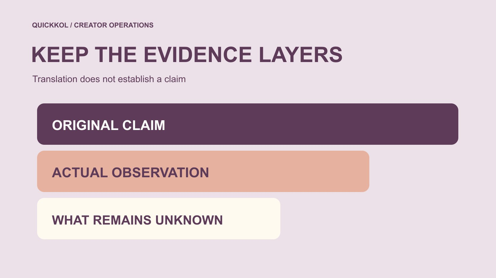

# Fake Takipçi: Review Follower Claims Across Languages

Status: local review draft; confirm the publication date before release.

Preserve meaning and provenance when reviewing follower-authenticity claims across languages, without confusing suspicion and established fact.

QuickKOL editorial graphic; not actual account metrics or a platform interface.

Fake takipçi combines English fake with Turkish takipçi; this article treats it as a follower-authenticity claim. When a brand encounters the phrase across languages, first establish whether it concerns a service, general risk, an author’s suspicion or an evidenced specific fact. Correct translation does not establish an accusation. Preserve original wording, date, source and actual observation, then cross-check. One growth event, interaction ratio or unfamiliar avatar cannot settle a person’s conduct. This is risk and evidence education, not follower purchasing, artificial-engagement instructions or a personal blacklist. It promises no complete detection and offers a way to keep both account safety and conclusions proportionate to evidence.

## A term supports understanding rather than proof of conduct

[Cambridge’s follower entry](https://dictionary.cambridge.org/dictionary/english-turkish/follower) lists takipçi among Turkish translations. A dictionary supports lexical understanding, not an account-authenticity finding or platform judgment for every combined phrase. The treatment of the complete expression here is editorial context rather than a dictionary verdict on any account.

Preserve the original instead of only a translated summary. Questions, negation, quotation and conditions change meaning. A discussion asking whether followers are fake must not become followers proven fake in translation. Have an appropriate language reviewer check the passage where necessary.

The same term may occur in advertising, warnings, complaints or research. Identify the type before deciding what information it supplies. This first distinction can prevent an entire review from starting with an accusation the original author never actually made.

## Preserve the original claim and context

Record URL, the author’s stated identity, publication date, retrieval time and necessary surrounding context. A crop can remove time, platform, unit or questioning tone. Repeated sharing does not make it independent evidence, and several pages reproducing one screenshot may still be one source chain.

Describe who first made the claim, who quoted it and which items are republications. Preserve material through an appropriate team process without collecting private conversations or unrelated personal information to enlarge the record.

Mark deleted or inaccessible sources accordingly. An earlier observation may be retained without pretending the original page was freshly verified today. A later reviewer needs to know whether the team saw the source itself, saw only a copy or received an unsupported description, because those states justify different confidence in what the original statement actually contained.

## Separate signal, inference and established fact

An unusual daily increase, changed interaction pattern or inconsistent records can be a signal for review. An explanation of possible causes is an inference. A factual conclusion needs evidence appropriate to its claim; a larger number of signals does not automatically complete that step.

Do not replace method, source and false-positive limits with a high system score. If the tool’s reasoning is unknown, describe an output needing interpretation rather than translate a score into a person having purchased followers.

Internal states may include review needed, cause unknown or supported by specified evidence. Do not place suspicious permanently beside a name without explanation and update time. The three-layer record should remain intact when translated or summarized, so a colleague does not mistake the team’s reason to ask a question for the answer to it.

## Understand the scope of historical platform action

[Meta’s 2020 fake-engagement statement](https://about.fb.com/news/2020/10/taking-action-against-fake-engagement-and-ad-scams/) records legal action concerning services that artificially increased interaction. It supplies risk context, not proof that an unfamiliar current service or an unmentioned creator did the same. Filing a case, making an allegation and a final court finding are different states.

Preserve date and attribution when citing it instead of presenting a platform statement as an independent audit completed by this article. No purchase route is needed, and historical service names are not recommendations.

A brand should learn to distinguish claims and evidence from historical material rather than borrow an old announcement to assign one certain cause to every current anomaly. If a report invokes a historical event, it should explain the limited principle it illustrates and avoid implying a factual connection to the person currently being discussed.

## Cross-check an unusual growth observation

First match account, field, window, time zone and precision. Totals, net changes and acquisition events differ, while collection delay or display rounding may affect comparison. List alternative explanations for checking without treating them as proof that nothing is wrong.

Request only necessary, appropriately authorized aggregates if more information is needed. Keep questions public information cannot answer unresolved instead of guessing from avatars, nationality or language. Use the [data reconciliation method](https://www.quickkol.com/blog/social-blade-accuracy-measurement-reconciliation/#answer) to compare definitions before attaching an authenticity claim to a difference. Creators should not need to surrender messages or entire contact collections to establish innocence.

Use the [social media metrics decision framework](https://www.quickkol.com/blog/social-media-metrics-creator-decision-tree/#answer) to identify the conclusion that must wait and the content observations still usable. Unknown is not zero and does not invalidate every piece. This helps a team avoid both an unsupported accusation and an unsupported reassurance while it decides what evidence is proportionate to the task.

## Separate access risk from authenticity assessment

[Meta’s clone-site risk explanation](https://about.fb.com/news/2022/07/how-meta-safeguards-people-against-clone-sites/) describes credentials surrendered in connection with free-interaction promises. A brand does not need to prove fake followers already exist before declining unnecessary requests for login details, verification codes or account control.

If action occurred, record actual steps and time for the account owner. Do not publish recovery information or continue trying an unknown service merely to write a risk report. Opening a link is not equivalent to a confirmed intrusion.

Safety measures can address a specific request promptly while conclusions about who did what still require corresponding evidence. Keep those workstreams separate. A team may reasonably stop a proposed access action without declaring a supplier criminal, just as it may protect an account while leaving the cause of a measurement anomaly unresolved.

## Rehearse a cross-language summary without escalation

Suppose Turkish material questions a period of growth, while an English summary removes the question and timing. A Chinese relay then says purchasing proven. This fictional example involves no actual person. Return to the original, restore tone, source and window, and reduce the conclusion to what the evidence supports.

If only a secondary summary is available, state that the original cannot be checked rather than propagate a stronger assertion. Correct recipients of an earlier mistaken conclusion with its implications instead of silently editing a file.

Translation conveys meaning, research interprets evidence and a business owner makes the relevant decision. None automatically supplies facts missing from another stage. The useful result may be a corrected record and a narrower question, not a discovery about anyone’s behavior. That is still a meaningful educational outcome because it prevents the brand from acting on a claim that became stronger only as it crossed languages.

A separate numeric rehearsal helps. Suppose the source explicitly defines a dot as a thousands separator and displays 1.250. Copying that into a decimal convention as 1.25 changes its meaning; the documented source value is 1250. This is hypothetical notation, not a rule inferred for every Turkish document. Preserve the original and its documented convention. Likewise, an ambiguous 03/04 date needs its source format rather than a translator’s guess. Correcting notation can remove an apparent discrepancy without establishing anything about follower authenticity. The corrected record should explain the conversion so another colleague does not repeat the same mistake.

## Ask necessary questions in neutral language

Ask whether two records use consistent windows and fields rather than demanding proof of no fraud. Explain why a particular item is needed, who receives it and which decision it affects. Refusal to supply irrelevant private information is not evidence of dishonesty.

For a supplier proposal, request only non-sensitive scope and method category, not instructions for artificial engagement. Decline without further collection where no actual business need exists.

Keep the record bounded to the project. One measurement question should not become an unsupported conclusion about every collaboration or a person’s reputation. Neutral wording does not mean ignoring risk; it makes the inquiry precise enough that an appropriate answer can resolve the actual uncertainty instead of forcing the recipient to defend against a much broader accusation.

## Take action proportionate to evidence

Possible actions include withholding one number from reporting, requesting suitable clarification, protecting account access or routing a defined incident to an owner. These differ from public accusation and require no promise of complete detection. Explain the basis and remaining work.

If collaboration continues, accept work against facts and scope without pretending unresolved questions disappeared. If a purchase stops, preserve the specific reason rather than create a personal blacklist.

Update judgments when evidence changes and retain versions. Without new evidence, do not rewrite speculation into progressively stronger facts. An action record should identify what the team controlled, such as access or use of a field, separately from the behavior it could not establish. That lets colleagues continue necessary work without inheriting either an unsupported verdict or a false statement that the entire issue was conclusively cleared.

## Leave an educational, reviewable record

Preserve original, translation notes, source chain, observation, inference, unknowns and project action. Remove unrelated personal information while letting a receiver see the support for each conclusion. Attribute lexical explanation separately from event findings.

The educational value of fake takipçi research is understanding access and data risks around free or artificial-interaction promises while respecting factual boundaries. An anomaly merits review without automatically accusing a person; a tool can offer a lead without guaranteeing complete detection.

Accurate language and proportionate action let creator-marketing decisions rest on evidence rather than wording strengthened during translation. Another colleague should be able to identify both the question still open and the steps already taken without interpreting a risk warning as a completed investigation.

## Cross-language follower-claim review card

| Layer | Record | Do not upgrade to |
| --- | --- | --- |
| Meaning | Original, tone and context | Translation equals proof |
| Signal | Actual field, time and source | A verdict on conduct |
| Inference | Possible causes and open checks | Established fact |
| Action | Necessary scope, owner and basis | A public blacklist |

Educational method only; no artificial-engagement service recommendation or detection guarantee.

## Before relaying or acting

Preserve meaning and unknowns.

- [ ] Original, date and source chain are retained.
- [ ] Questions and negation survive translation.
- [ ] Anomaly, inference and proof are separate.
- [ ] Review does not expand account access.
- [ ] Project action is proportionate to evidence.

## Research date and limitations

Sources reviewed November 12, 2026. Methods, tables and decision rules are editorial recommendations. Hypothetical examples are not actual client results or industry benchmarks. Source geography and periods are specified where relevant. This draft is in independent local review; confirm its publication date before release.

## Learn the boundaries of metrics and evidence

Use definitions, sources and windows to interpret data, without judging a person from one signal or promising complete detection.

[Read the metrics decision guide](https://www.quickkol.com/blog/social-media-metrics-creator-decision-tree/)

## Sources

- [Cambridge’s follower entry](https://dictionary.cambridge.org/dictionary/english-turkish/follower)
- [Meta’s 2020 fake-engagement statement](https://about.fb.com/news/2020/10/taking-action-against-fake-engagement-and-ad-scams/)
- [Meta’s clone-site risk explanation](https://about.fb.com/news/2022/07/how-meta-safeguards-people-against-clone-sites/)
