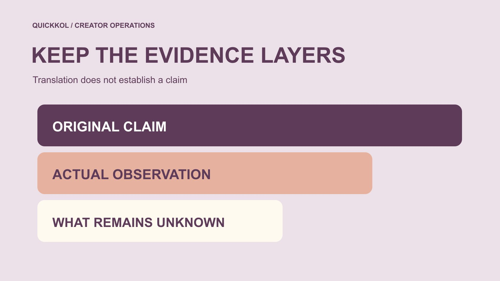

# Fake Takipçi 是什么？品牌怎样跨语言复核假粉说法

状态：本地审阅稿；正式发布日期待确认。

品牌遇到跨语言假粉说法时，怎样保留原意、检查来源，并把可疑信号与已证实事实分开。

QuickKOL 编辑图形；不呈现真实账号指标或平台界面。

Fake takipçi 将英语 fake 与土耳其语 takipçi 放在一起，本文按“假粉说法”讨论。品牌在跨语言资料中看到这个词，应先核对它描述的是一个服务、一般风险、作者猜测，还是有证据的具体事实。翻译正确不等于指控成立。保存原文、日期、来源与实际观察，再交叉核对；不要靠一次增长、互动比例或陌生头像给个人定性。本文仅做风险与证据教育，不推荐购买或刷量服务，不提供个人黑名单，也不承诺百分之百识别。

## 词语帮助理解，不证明行为

[Cambridge 的 follower 词条](https://dictionary.cambridge.org/dictionary/english-turkish/follower)将 takipçi 列在土耳其语译法中。词典帮助理解词义，不能替品牌确认某账号真假，也没有为每个组合词给出平台判定。本文对完整说法的处理是编辑语境说明，不冒充词典对具体账号的结论。

保存原文而不只保留中文或英文摘要。问句、否定、引用和条件会改变意思；一条“是否是假粉”的讨论，不能翻译成“已经证明是假粉”。必要时请懂相关语言的人核对整段。

同样的词可能出现在广告、警示、投诉或研究里。先确认文本类型，再决定它能提供哪种信息。

## 保留原始说法与可核对上下文

记录地址、作者自述身份、发布日期、获取时间与必要前后文。截图可能裁去时间、平台、单位或疑问语气，不能因为转发次数多就升级为独立证据。多个网页重复同一截图，也未必是多个独立来源。

把来源链写清：谁首先提出，后续谁引用，哪些资料只是转载。需要保全时使用团队适当方式，不为扩大证据收集私人聊天或无关个人信息。

已删除或无法打开的来源应标明状态。可以保留当时已记录内容，但不能谎称今天重新核验了原页面。

## 把信号、推断与证实分三层

某日增长异常、互动结构改变或资料间不一致，可以构成需要复核的信号。关于可能原因的解释属于推断。只有适合该主张的证据，才能支持相应程度的事实结论；信号数量多也不自动完成最后一步。

不要用“系统分数高”代替方法、来源与误判限制。若不知道工具怎么得出判断，就说明它是待理解输出，不把分数翻译成某个人已经购买假粉。

内部状态可写为待复核、原因未知或有特定证据支持。不要用“可疑”永久贴在人名旁边而不保留解释和更新日期。

## 了解平台行动的历史边界

[Meta 的 2020 年虚假互动说明](https://about.fb.com/news/2020/10/taking-action-against-fake-engagement-and-ad-scams/)记录当时针对人工增加互动服务的法律行动。它提供风险背景，不证明今天某个陌生服务或未被提及的创作者有同样行为；起诉、指控与法院最终认定也不能混用。

引用时保留日期和归属，不将平台对特定事件的说明改成我们完成的独立审计。本文不需要列出供应商购买路径，也不把历史服务名称当作推荐。

品牌应从历史资料学会区分主张与证据，而不是借一份旧公告给当前所有异常一个确定原因。

## 异常增长需要交叉核对

先核对同一账号、字段、窗口、时区与精度。总量、净变化和新增事件不同，采集延迟或显示舍入也可能影响比较。把替代解释列为待查，不把它们反过来当已证实无问题。

如果需要更多资料，只请求任务必要且适当授权的汇总。公开资料不能回答的问题可以保持未知，不靠猜头像、国籍或语言补全。 用[数据核对方法](https://www.quickkol.com/zh/blog/social-blade-accuracy-measurement-reconciliation/#answer)先比较口径，再判断差异能支持什么。创作者也不应为了自证清白交出不必要的私信和全部联系人。

用[社媒指标决策框架](https://www.quickkol.com/zh/blog/social-media-metrics-creator-decision-tree/#answer)说明哪个结论需要暂缓，哪些内容观察仍可以使用。未知不等于零，也不自动否定全部作品。

## 账号权限风险与真实性判断分开

[Meta 的仿冒网站风险说明](https://about.fb.com/news/2022/07/how-meta-safeguards-people-against-clone-sites/)描述了以免费互动等承诺诱导交出凭证的风险。品牌看到相关提案时，不需要先证明账号里已有假粉，才能拒绝不必要的登录、验证码或控制权请求。

若已经发生操作，记录真实动作与时间，交给账号负责人。不要在公共讨论里发布恢复信息，也不为写风险报告继续试用未知服务。没有证实盗号时，不能把“点击过”写成“已被入侵”。

安全处理可以立即针对明确请求采取措施，关于谁实施了什么行为的结论则仍需对应证据。两条工作线不必混在同一个标签里。

## 用跨语言转述演练避免升级

假设土耳其语资料以疑问形式讨论某段增长，另一份英文摘要删去了问号和时间。品牌再收到中文转述“已证明买粉”。这个例子不涉及真实人物。应回到原文，恢复语气、来源和窗口，把结论降回证据实际支持的位置。

若只能取得二手摘要，就标明无法核对原文，不继续传播更强说法。需要向已经接收错误结论的人更正时，说明变化与影响，不只静默改文件。

翻译者负责准确传达，研究者负责解释证据，业务负责人负责相应决定。任何一个角色都不能替另一个缺失环节自动补上事实。

再做一个数字演练：假设来源明确以点作千位分隔，显示 1.250，按十进制小数抄成 1.25 就改变了意思，原定义对应 1250。这不是对所有土耳其语文件的规则推断。保留原文与已确认格式；03/04 这类日期也需要来源说明，不能靠翻译者猜。修正记法可能消除表面差异，但不证明关注真实性。记录转换依据，让下一位同事不再重复错误。

## 用中性语言提出必要问题

可以问“这两份资料的窗口与字段是否一致”，而不是“请证明你没有造假”。说明为什么需要某项资料、谁会接收以及它影响哪个项目判断。不要用拒绝提交无关私人信息作为不诚实的证据。

如果讨论的是供应商服务，只索取非敏感范围和方法类别，不要求教你怎样刷量。没有真实业务需要时，可直接拒绝，不必继续增加采集。

沟通记录保持项目范围。一次数据问题不应成为对个人所有合作与声誉的无依据结论。

## 采取与证据相称的项目动作

可以暂缓某个数字在报告中的使用、要求适当说明、保护账号权限，或将明确事件交给合适负责人。它们与公开指控不同，也不要求品牌先做一个百分百检测器。动作应说明依据与待完成项。

如果继续合作，仍按作品、事实与约定范围验收，不因为保留未知就假装所有问题已解决。如果停止某个采购，记录具体原因，不扩大为个人黑名单。

新资料到来时更新判断，保留前后版本。没有新证据，不反复把猜测改写成越来越强的事实。

## 把教育成果留成可复查记录

最终保存原文、翻译说明、来源链、观察、推断、未知与项目动作。移除无关个人资料，让接收人能看到每项结论由什么支持。词语解释与具体事件判断应分别归属。

Fake takipçi 的品牌教育重点，是理解免费或虚假互动承诺可能造成的权限和数据风险，同时尊重事实边界。异常值得复核，但不能自动指控个人；工具可以提供线索，但不能保证百分百识别。

保持准确语言与适当动作，让达人营销决定建立在实际证据，而不是一次跨语言转述的强烈措辞上。

## 跨语言假粉说法复核卡

| 层次 | 记录 | 不要升级成 |
| --- | --- | --- |
| 原意 | 原文、语气与语境 | 翻译等于证实 |
| 信号 | 实际字段、时间与来源 | 个人行为定案 |
| 推断 | 可能原因与待查项 | 已经确认 |
| 动作 | 必要范围、负责人和依据 | 公开黑名单 |

仅为教育方法；不推荐刷量服务，不保证识别准确率。

## 转述或采取动作前

保留原意，也保留未知。

- [ ] 原文、日期和来源链存在。
- [ ] 疑问与否定没有被翻译丢失。
- [ ] 异常、推断与证实分开。
- [ ] 账号权限不因复核而扩大。
- [ ] 项目动作与证据相称。

## 研究日期与使用边界

资料核验于 2026 年 11 月 12 日。文中方法、表格和决策规则为编辑建议，标为假设的示例不是实际客户结果或行业基准。外部资料的适用地区与时期按各段说明；本稿处于独立本地审阅阶段，正式发布日期待确认。

## 继续学习指标与证据的边界

用清楚的定义、来源和窗口理解数据；不凭单一信号判断个人，也不承诺完整检测。

[阅读指标决策指南](https://www.quickkol.com/zh/blog/social-media-metrics-creator-decision-tree/)

## 来源

- [Cambridge 的 follower 词条](https://dictionary.cambridge.org/dictionary/english-turkish/follower)
- [Meta 的 2020 年虚假互动说明](https://about.fb.com/news/2020/10/taking-action-against-fake-engagement-and-ad-scams/)
- [Meta 的仿冒网站风险说明](https://about.fb.com/news/2022/07/how-meta-safeguards-people-against-clone-sites/)
