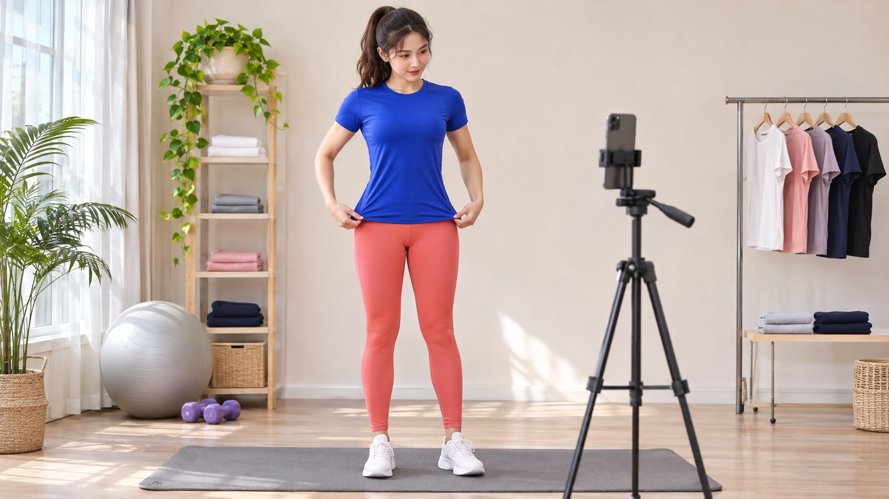
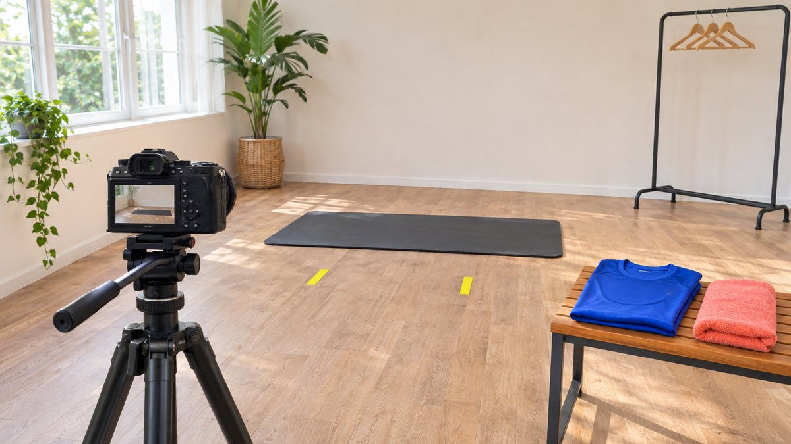

# Female Fitness Model: Scope Production and Publication

Status: local review draft; confirm the publication date before release.

Scope on-camera production, professional instruction, account publication and asset use separately when working with a female fitness model.

A female fitness model may provide on-camera production and may also be a creator or instructor, but appearance, photographs or an account label do not establish those additional capabilities. Define garment or equipment demonstration, professional explanation, account publication and licensing as separate purchases, then verify relevant work, credentials and conditions. Appearance does not substantiate health benefits, and personal experience should not become a universal guarantee. This guide concerns production and use in creator marketing, not training or weight-loss advice or appearance rankings. A clear assignment lets the brand select suitable capabilities while respecting the individual’s scope, experience and consent.

## Separate roles before making requests

Garment modeling needs framing and movement, product demonstration needs actual use conditions, instruction may need additional professional capability and account publication brings audience and communication work. One person can supply several roles, but each needs evidence and agreement rather than automatic inclusion under fitness model.

Use the [creator brief](https://www.quickkol.com/blog/write-a-useful-campaign-brief/#answer) to specify product, audience question, role and deliverables. Research work matching the explanation needed. Where professional credentials matter, verify them for the actual field and applicable requirements instead of inferring them from physique.

Clear roles also improve the invitation. Production can be discussed without assuming personal-account promotion or training outcomes. The receiving collaborator should know whether the brand needs a demonstration they can genuinely perform, a production appearance or advice outside their current scope.

## Review specific work against the task

Examine how work presents clothing, movement or equipment conditions, noting which parts the individual performed. Team production, personal-account content and professional instruction can involve different contributors. Do not assign every achievement to the person on camera.

For a specific movement, ask about actual familiarity and conditions instead of introducing an unconfirmed task onsite. The brand supplies accurate product information rather than asking a model to guess functionality or perform an untrue claim.

Retain relevant samples, provenance and open questions. This research concerns the assignment, not judgment of a body or private life. A short, suitable portfolio discussion should establish what needs demonstration and what the person can actually provide, leaving unrelated personal information outside the procurement process.

## Agree on scene and comfort boundaries in advance

Describe clothing, movement, camera position, venue, participants and intended framing beforehand. Do not add previously undiscussed exposure, close body framing or strenuous activity on the day. Consent concerns the actual scene rather than every change following acceptance of a collaboration.

Handle sizing and fitting information only as necessary, identifying recipients. Do not require unnecessary public body data or present one body standard as representative of every viewer.

Provide a route to request adjustment or stop where conditions are unsuitable. Respecting boundaries clarifies production without preventing a brand from purchasing the demonstration it needs. The approved plan should make differences visible: a clothing-fit shot, an exercise instruction and a transformation claim are distinct requests even if they could be filmed in the same room with the same camera.

Agree on camera position, clothing and movement area so production requirements become concrete conditions.

## Appearance does not substantiate a health claim

[FTC’s health-product advertising guidance](https://www.ftc.gov/business-guidance/resources/health-products-compliance-guidance) discusses express and implied claims and substantiation for U.S.-relevant advertising. Review what image and language communicate together rather than using a fitness appearance as support for product health benefits. Applicable requirements elsewhere still need assessment.

A clothing or equipment demonstration should not be edited into unsupported weight-loss, treatment or transformation guarantees. Personal experience is not automatically everyone’s outcome. Route specific health claims to appropriately responsible review instead of asking the model to substantiate them merely by appearing.

This article defines a content assignment and makes no individual health assessment or inference of health from appearance. A useful production note can identify prohibited implications as well as approved words, so a technically unchanged shot does not acquire a different claim through added copy, sequencing or surrounding advertising context.

## Agree publication and asset use separately

[U.S. Copyright Office’s work-use FAQ](https://www.copyright.gov/help/faq/faq-fairuse.html) supplies U.S.-specific permission context. Receiving images does not establish unlimited advertising, third-party adaptation or use of the performer’s account identity. Appropriate owners should check work, personal consent, music and other elements against actual use.

Record channel, market, duration, version and editing conditions through the [work and usage scope](https://www.quickkol.com/blog/creator-rates-usage-rights/#answer). Separate account publication from brand-channel use, rather than equating a production fee with every future right.

Preserve approved context and qualifications when reusing work. A crop or caption can change meaning, so identify changes within scope and those needing confirmation again. The handoff should make it possible for a media operator to locate a usable approved variant without guessing whether a similar file carries the same permissions or preserves the same product claim.

## A commercial arrangement does not establish actual experience

[Meta’s creator collaboration explanation](https://about.fb.com/news/2024/02/creator-marketplace-for-brands-and-creators-to-collaborate-on-instagram/) supplies context for account partnerships and amplification. It does not establish long-term personal use by this performer or grant a particular brand permission. Distinguish a model demonstration, personal experience and actual advertising arrangement.

A garment scene can describe the present demonstration without becoming I have always recommended this. Where a genuine personal opinion is wanted, let the creator identify what they can truthfully say and confirm applicable commercial context.

A refusal to state a particular experience does not automatically make the production defective. Scope and authenticity belong in the same discussion. This protects the brand too: an attractive performance should not be accepted as evidence for a factual claim the performer never made and the production agreement never required.

## Rehearse a clothing shoot and an added request

Suppose a brand purchases five garment images and one fit explanation, without instruction or personal-account publication. Onsite it adds training advice and a promised body change. That is not a simple extra sentence: role, claim and deliverable changed. This fictional case concerns no real model or client.

Return to scope and assess whether the addition is suitable, what professional support and fact review it requires and whether the person accepts. Keep the original production, decline an unsupported claim or redefine a reasonable assignment.

Attendance or partial payment does not establish acceptance of every addition. Later advertising use needs its own scope check too. The useful record explains which original deliverables remain valid, which request was declined or revised and who owns the next decision. It does not classify a principled refusal of an unagreed health promise as failure to perform the agreed clothing shoot.

For a concrete acceptance note, the five agreed images might cover overall garment presentation, a seam detail, a label, an agreed everyday movement and an equipment-context scene. These are hypothetical creative choices, not mandatory poses or evidence of product efficacy. Identify the actual approved five before filming, including framing and any conditions the performer accepted.

If the buyer later asks for a sixth image or an altered crop, describe whether it is a correction within the original scope or additional work. The file handoff can associate each approved image with version and intended use, without attaching unnecessary personal sizing information. This lets the media team locate the right asset while keeping a clothing-production decision separate from professional instruction, private body data and claims about what the product will do for viewers. Record the accepted version so future operators who did not attend the shoot can understand the same limits.

## Accept against facts and delivery rather than body judgments

Check approved version, garment and product facts, agreed framing, captions and use conditions. Do not turn personal taste into a factual defect or introduce an unagreed body standard after collaboration. Describe actual production issues so a receiver knows how to address them.

Discuss additional filming or angles according to cause and scope. A new advertising claim may need new production rather than free retouching. Do not alter appearance without appropriate confirmation in a way that implies an unreal product effect.

Retain necessary feedback and approval while avoiding irrelevant personal commentary. Professional acceptance concerns a reviewable work object. A feedback note about a product label being unreadable is actionable in a way that an unexplained judgment about the person’s appearance is not; the distinction should remain clear when an agency consolidates comments.

## Clarify fees, samples and follow-up responsibility

Separate production, publication, licensing and extra-version fees. Agree whether samples are loans or gifts and how returns work. Derive no universal price from scale or appearance, and treat a gift as neither automatic publication obligation nor a substitute for defined scope.

Who handles sizing inquiries, orders and product questions after publication? The model or creator has agreed responsibilities rather than an obligation to guess support policy or refund guarantees. Brand receiving capacity affects readiness too.

Provide a route for term expiry, changed conditions or correction so assets do not remain indefinitely in usable inventory without review. A production handoff should identify the person who can stop future use and the record needed to locate affected files, while leaving unrelated completed work and obligations accurately described.

## Build a respectful collaboration through a clear task

Hand over role, evidence, scene, consent, claims, version, fees and permission. Performer, creator, brand and media receiver should each understand their responsibility. A photograph cannot supply unverified credentials or conditions.

A female fitness model can contribute valuable production and expression in creator marketing when selected for actual capability and scope. Body stereotypes, unsupported health claims and vague usage do not replace a concrete assignment.

Genuine work, clear personal boundaries and reviewable product facts turn a shoot into a responsible content asset. The final handoff should let another colleague explain the intended use and limitations without making fresh assumptions about the person on camera or the results an audience might obtain.

## Fitness-model partnership role card

| Role | Confirm | Do not infer |
| --- | --- | --- |
| Performance | Clothing, movement and framing consent | Consent for every scene |
| Explanation | Capability, conditions and relevant credentials | Physique proves credentials |
| Publication | Account, commercial context and reception | Production includes account promotion |
| Reuse | Channel, duration and version | An image substantiates health benefits |

The clothing-shoot case is hypothetical; this article provides no training, weight-loss or individual health advice.

## Before confirming a shoot

Purchase by role and accept against facts.

- [ ] Performance, explanation and publication are separately agreed.
- [ ] Scene and personal boundaries are confirmed beforehand.
- [ ] Health claims receive appropriate review.
- [ ] Asset rights and versions are traceable.
- [ ] Added work is not accepted by presumed onsite consent.

## Research date and limitations

Sources reviewed November 12, 2026. Methods, tables and decision rules are editorial recommendations. Hypothetical examples are not actual client results or industry benchmarks. Source geography and periods are specified where relevant. This draft is in independent local review; confirm its publication date before release.

## Start creator research with a clear task

Use QuickKOL to interpret a brief, discover relevant creators and research their work and contact routes. Verify data, commercial terms and outcomes at their source.

[Explore QuickKOL](https://www.quickkol.com/#capabilities)

## Sources

- [FTC’s health-product advertising guidance](https://www.ftc.gov/business-guidance/resources/health-products-compliance-guidance)
- [U.S. Copyright Office: using another person’s work](https://www.copyright.gov/help/faq/faq-fairuse.html)
- [Meta’s creator collaboration explanation](https://about.fb.com/news/2024/02/creator-marketplace-for-brands-and-creators-to-collaborate-on-instagram/)
