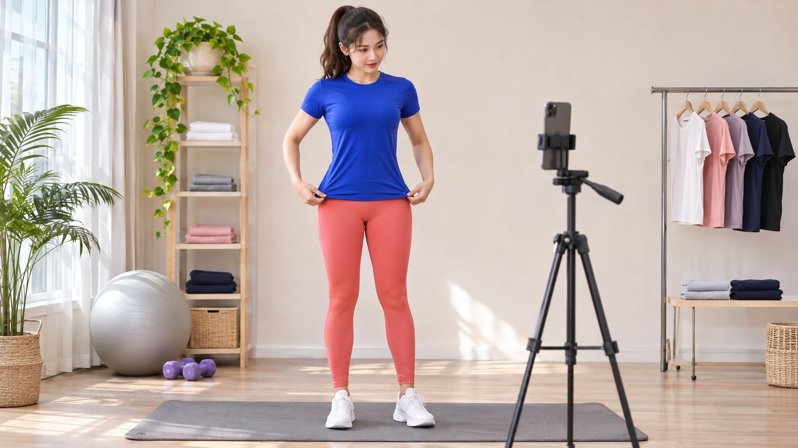
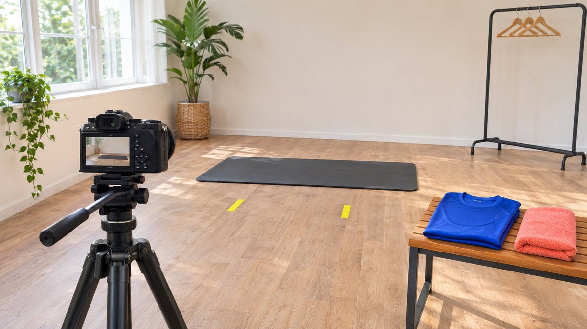

# 与女性健身模特合作，怎样界定拍摄与发布

状态：本地审阅稿；正式发布日期待确认。

与女性健身模特合作时，怎样分别约定出镜制作、专业指导、账号发布和素材使用。

Female fitness model 可以指运动场景中的出镜模特，也可能同时是创作者或教练；品牌不能仅凭体型、照片或账号标签推断后两项能力。先约定要采购服装或设备展示、专业讲解、账号发布还是素材许可，再核对相应作品、资质与条件。健康效果不能由模特外形证明，个人体验也不能被品牌改成普遍保证。本文围绕达人营销的拍摄与使用分工，不提供训练、减重建议或外貌排名。

## 把角色拆开，避免模糊要求

服装出镜需要画面与动作配合，产品演示需要理解真实使用条件，教学可能需要额外专业能力，账号发布还涉及受众与沟通。一个人可以承担多种角色，但每项都需证据与约定，不能因叫健身模特就默认全部包括。

用[达人 Brief](https://www.quickkol.com/zh/blog/write-a-useful-campaign-brief/#answer) 写明产品、观众问题、角色与交付。品牌需要怎样的说明，就研究对应作品；若需专业资格，按实际领域和适用要求核对，不从肌肉线条推断。

明确角色也帮助邀请：可以讨论模特制作，而不要求对方同时承诺个人账号推广或训练效果。

## 用具体作品核对任务能力

看作品如何展示服装、动作或设备条件，说明哪些部分由本人完成。团队拍摄、个人账号内容和专业教学可能由不同人参与，不把所有成果都归给镜头前的人。

需要拍摄某个动作时，询问实际熟悉程度与条件，不让对方现场承担未确认任务。品牌有责任提供准确产品资料，不能要求模特猜功能或配合不真实主张。

保留相关样本、来源与尚需确认事项。作品研究不是对身体或私生活的评判，应只围绕实际合作需要。

## 把场景与舒适边界提前说清

明确服装、动作、机位、场地、参与人员与预期画面。不要在拍摄当天才加入未谈过的暴露程度、身体特写或高负荷动作。出镜同意应对应实际情境，不因已接受合作就推定任何变化都可执行。

与尺寸或试穿有关的信息只按必要范围处理，说明谁接收。不要求对方公开不必要身体数据，也不用某种身体标准冒充所有观众。

出现不适合的条件时，有明确提出调整或停止的路径。尊重边界能让实际制作更清楚，并不妨碍品牌采购需要的产品展示。

提前确认机位、服装与动作区域，有助于把拍摄要求讲成具体条件。

## 健康主张不能由外形证明

[FTC 的健康产品广告指南](https://www.ftc.gov/business-guidance/resources/health-products-compliance-guidance)针对美国相关广告讨论明示、暗示主张与证据要求。它提醒品牌审核画面与语言整体传达什么，不能让健身形象替代产品健康效果的支持。其他地区仍按适用要求处理。

服装或器材展示不应被剪成未经支持的减重、治疗或身体变化保证。个人经验也不自动成为所有人的结果。需要具体健康主张时交给有相应责任的专业审核，而不是要求模特凭出镜承担证明。

本文提供内容任务边界，不做个体健康判断，也不以某种外观推断健康状态。

## 分别约定发布与素材使用

[美国版权局的作品使用问答](https://www.copyright.gov/help/faq/faq-fairuse.html)提供美国范围的许可背景。收到图片不等于品牌可以无限期投放、交给第三方修改或使用出镜人的账号身份。作品、人物同意、音乐和其他元素的范围，应由合适人员按实际用途核对。

用[作品与许可范围](https://www.quickkol.com/zh/blog/creator-rates-usage-rights/#answer)记录渠道、地区、期限、版本与编辑条件。账号发布与品牌渠道使用分别说明，不把制作费等同于所有未来权利。

需要复用时保留批准的上下文与限定条件。裁切或改文案可能改变含义，应明确哪些变化可以直接执行，哪些需要重新确认。

## 商业合作不等于真实体验已经发生

[Meta 的创作者合作说明](https://about.fb.com/news/2024/02/creator-marketplace-for-brands-and-creators-to-collaborate-on-instagram/)提供账号合作与放大的平台背景，但不证明本次出镜人实际长期使用产品，也不授予具体品牌权限。品牌应分清模特演示、个人体验与合作广告的实际安排。

拍摄一个穿着场景，可以只说明这次展示；不能未经事实支持改成“我一直推荐”。需要真实个人意见时，让创作者决定自己能够如实表达什么，并确认适用商业说明。

品牌也不应因为对方不愿说某句经历，就认定其制作表现不合格。范围与真实性需要一起讨论。

## 演练一次运动服拍摄与追加要求

假设品牌采购五张运动服展示图和一条适配说明，未包含教学或个人账号发布。拍摄当天又要求模特录制训练建议并承诺某种身体变化。此时不是简单补一句话，而是角色、主张和交付都改变了。案例没有真实模特或客户。

负责人应回到原范围，确认新增工作是否适合、需要何种专业支持与事实审核，以及对方是否愿意。可以保留原制作，拒绝未经支持的主张，或重新定义合理任务。

不能用已经到场或收到部分费用，推定所有新增内容都自动同意。后续广告用途也要单独核对。

一份具体验收记录可以把五张图分别约定为整体服装展示、接缝细节、标签、已同意的日常动作和设备场景。这些是假设创意选择，不是统一姿势要求，更不是产品效果证据。拍摄前确认实际五项、画面范围和出镜人接受的条件。

后来要求第六张或不同裁切时，说明属于原范围纠正还是额外工作。交接按批准图片记录版本与用途，不附带不必要的私人尺寸资料。媒体团队因此能找到正确素材，同时不把服装制作混成教学、身体数据或观众效果承诺。

## 按事实与交付验收，不评价身体价值

验收核对批准版本、服装与产品事实、约定画面、字幕和使用条件。不要把个人审美偏好改成事实错误，也不在合作结束后才加入未约定的身体标准。真实制作问题应具体说明，让接收人知道如何处理。

如果需要补拍或新角度，按原因与原范围讨论；新广告主张可能需要新制作而非免费修图。后期也不应在未经确认时改变身体外观，使作品传达不真实效果。

保留必要的反馈与批准记录，减少对出镜人的无关评论。专业验收应围绕可讨论的作品对象。

## 把费用、样品与后续责任写清

费用分别说明制作、账号发布、许可与额外版本；样品是借用还是赠送、如何归还，也应实际约定。不从关注数或外貌推导统一价格，也不将赠送产品自动当作发布义务。

作品公开后，谁处理尺码咨询、订单与产品问题？模特或创作者只承担约定范围，不应猜客服政策或退款保证。品牌接收能力也影响整个合作是否准备好。

期限结束、条件变化或需要修正时有明确联系路径，避免素材无限期停在可用库存里而没有任何复核。

## 用明确任务形成尊重的合作

最终交出角色、证据、场景、同意、主张、版本、费用与许可。让出镜人、创作者、品牌和媒体接收人都能知道自己负责什么。没有确认的资格与条件不应由照片补全。

女性健身模特可以在达人营销中承担有价值的制作与表达角色，但应按实际能力与约定选择。对身体的刻板判断、未经支持的健康主张和模糊使用范围，都不能替代一份具体合作说明。

让作品真实、人物边界清楚、品牌事实可核对，才能把拍摄转成负责任的内容资产。

## 健身模特合作角色卡

| 角色 | 需确认 | 不能推断 |
| --- | --- | --- |
| 出镜 | 服装、动作与画面同意 | 无限场景同意 |
| 讲解 | 实际能力、条件与必要资格 | 体型证明资质 |
| 发布 | 账号、商业说明与接收 | 制作包含账号推广 |
| 复用 | 渠道、期限与版本 | 照片证明健康效果 |

服装拍摄例子是假设；本文不提供训练、减重或个体健康建议。

## 确定拍摄前

按角色采购，按事实验收。

- [ ] 出镜、讲解与发布分别约定。
- [ ] 场景与个人边界提前确认。
- [ ] 健康主张经过适当审核。
- [ ] 素材许可与版本可追溯。
- [ ] 额外任务不靠现场压力默认同意。

## 研究日期与使用边界

资料核验于 2026 年 11 月 12 日。文中方法、表格和决策规则为编辑建议，标为假设的示例不是实际客户结果或行业基准。外部资料的适用地区与时期按各段说明；本稿处于独立本地审阅阶段，正式发布日期待确认。

## 用清楚的任务开始达人研究

用 QuickKOL 理解 Brief、发现相关达人并研究作品与联系路径；数据、合作条件和结果仍需核验。

[了解 QuickKOL](https://www.quickkol.com/#capabilities)

## 来源

- [FTC 的健康产品广告指南](https://www.ftc.gov/business-guidance/resources/health-products-compliance-guidance)
- [美国版权局：使用他人作品](https://www.copyright.gov/help/faq/faq-fairuse.html)
- [Meta 的创作者合作说明](https://about.fb.com/news/2024/02/creator-marketplace-for-brands-and-creators-to-collaborate-on-instagram/)
