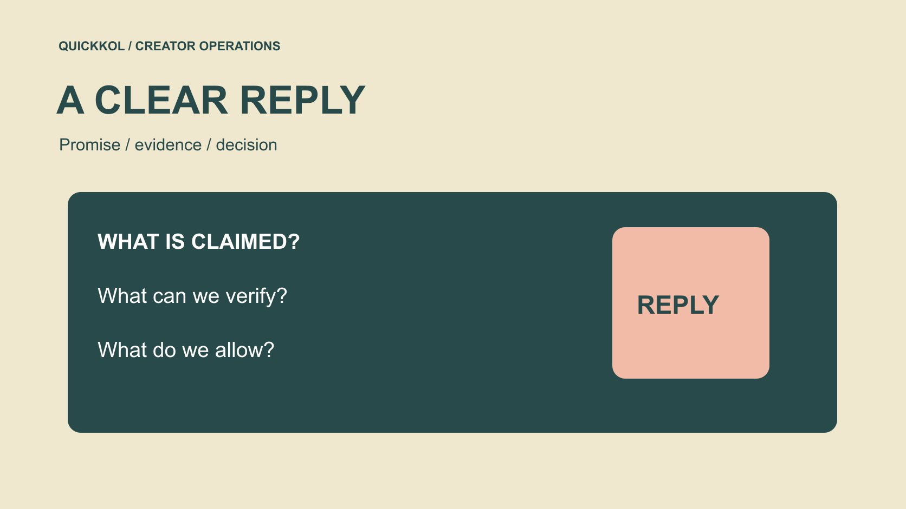

# Free Insta Followers: Respond to a Growth Pitch

Status: local review draft; confirm the publication date before release.

How a brand can respond to a free-follower pitch, retain necessary evidence and choose a clearer next step for creator partnerships.

QuickKOL editorial graphic; not actual account metrics or a platform interface.

A free insta followers pitch is a commercial request to evaluate, not something made safe by the word free. A suspicious subject line alone also does not prove the sender committed fraud. Preserve the original promise, establish what work and access are requested, and distinguish evidence from assertions before declining, asking for non-sensitive clarification or routing the message to an owner. Do not surrender passwords, verification codes or unauthorized creator data to test an offer. This educational guide offers a response method, not follower vendors or artificial-growth instructions. Its purpose is to protect the decisions and relationships behind an influencer campaign.

## Prevent a decline from being bypassed through another contact

A pitch may reach the brand, agency and creator separately. Declining in one inbox without informing the actual project owner can leave another colleague assuming approval already exists. Keep a necessary internal record of the project decision without extending it to unrelated clients or suppliers.

If a different service scope later arrives, assess the new facts rather than treating the earlier decline as a permanent blacklist. A revised proposal inherits no permission that was never granted. A forwarded email also does not establish creator consent. The record preserves a consistent decision rather than distributing an unverified negative assessment.

## Check whether the offer fits the assignment

Start with the [creator brief](https://www.quickkol.com/blog/write-a-useful-campaign-brief/#answer): is the assignment product explanation, relevant professional inquiries or event participation? A promised follower number may correspond to none of these tasks. Even genuine additional follows would not establish audience fit, understanding or purchase intent. Where no suitable need exists, a direct decline is often more useful than requesting a large information package.

Identify who can decide. A brand employee cannot accept account operations on a creator’s behalf, and an agency cannot interpret client silence as authorization. Forward only the necessary message to the project owner rather than attaching contact lists, contracts or account information. Establish the task and decision authority before discussing the supplier’s claimed speed or scale. This first screen is about relevance, not a verdict on the sender. A service can be unsuitable for the assignment without the brand needing to establish how every part of that service operates.

## Preserve what was actually promised

Record receipt time, sender identity, exact wording and attached scope. Separate what the supplier says, what the team observed and what remains unknown. If the pitch claims organic growth, record that assertion without upgrading it to verified humans, permanent retention or compliance with every platform requirement. Do not assemble screenshots into a stronger accusation than the original material supports.

If a colleague already opened a link, document the actual action instead of substituting account theft for an unknown. Entering information, granting access and observing an anomaly are different events with different evidence. Use established internal security channels where preservation is necessary. Do not continue clicking, attempting logins or downloading unknown attachments merely to finish a marketing assessment. The record should help the appropriate owner understand what occurred without turning an ordinary procurement inquiry into an improvised investigation by people who lack the relevant remit.

## Account safety is not determined by price

[Meta’s clone-site risk explanation](https://about.fb.com/news/2022/07/how-meta-safeguards-people-against-clone-sites/) describes risks associated with third-party sites obtaining login information. It supplies context for evaluating an access request, not proof that a particular current sender acted unlawfully. Examine what is actually sought: passwords, verification codes, account control, software installation or merely a non-sensitive description of business needs. No payment requirement does not remove that question.

Where sensitive access is requested, stop marketing-side action and route it to the account or security owner. A brand should not ask the creator to assume that risk on its behalf. No response needs to reveal a live verification code, recovery detail or customer record to establish ownership. The relevant questions are necessity and an authorized route, not how friendly the sales language appears. An offer that cannot be understood without access to the real account should not gain that access simply because the team wants a more complete supplier comparison.

## Ask only for clarification that supports a decision

If a genuine business need remains, request a written description of deliverables, method category, permissions, responsibility and measurement definitions. Do not solicit a demonstration of artificial engagement or provide a live account as a test target. Deciding whether a suitable content, advertising or operational service exists should not require exposing credentials.

Ask what a guaranteed quantity means: following events, an ending net total or a particular screenshot? These are not interchangeable. Receiving an explanation still does not make the supplier’s own description independent evidence. Ask for applicable limits, cancellation arrangements and the responsible contracting entity. End the review if it cannot support the assignment rather than investing further because time has already been spent. A useful clarification reduces a specific uncertainty that could change the decision. Questions that merely produce a longer sales deck add work without making the brand’s acceptance criteria clearer.

## Make the response explicit about the decision

Where there is no relevant need, a response might read: “Thank you for the explanation. We purchase relevant content and defined deliverables for this creator partnership, rather than a follower quantity. Please do not perform operations on our accounts or our collaborators’ accounts.” This is example wording, not a message already sent or a judgment on every service the sender offers.

Where clarification remains useful: “Please provide a non-sensitive written scope, access requirements and metric definitions first. This discussion does not authorize account operations, testing or data use.” Have an owner adapt the language to actual events. Avoid declining while inviting a trial or saying something like show us what happens if it could be understood as permission to execute. A useful reply communicates the next decision clearly enough that a different employee will not later mistake a discussion for an approved purchase or an approved account action.

## Separate an access incident from supplier evaluation

[Meta’s account security guidance](https://about.fb.com/news/2021/07/keeping-instagram-safe-and-secure/) is an official starting point for understanding protection and recovery measures; use the current official entry points and actual account situation for action. Marketing staff should give the account owner timing, actual actions and available notices rather than requesting codes in a chat or promising that recovery is certain.

Preserve the project assessment separately: which measurement periods may be affected, which work can still be accepted and which conclusions should wait. Genuine comments after an anomaly do not automatically become fake engagement, and earlier completed work does not automatically become invalid. Route account safety, metric interpretation and contractual performance to suitable owners. That separation prevents an unknown from expanding into accusations against every collaborator. It also lets necessary production continue where justified while keeping a potentially affected growth number out of a performance claim until its meaning is adequately understood.

## Redirect effort toward explainable creator work

[Instagram’s creator education explanation](https://about.fb.com/news/2024/10/best-practices-education-hub-creators-instagram/) offers context for content learning, not a guaranteed growth recipe. More controllable purchases include an actual demonstration, a scoped question session or a licensed set of assets. State the intended audience and specific question so the team can judge whether the work was delivered.

Use the [asset rights checklist](https://www.quickkol.com/blog/creator-rates-usage-rights/#answer) to confirm publication and reuse scope rather than replacing a rejected follower service with unauthorized copying of creator work. The alternative also has costs and uncertain outcomes; do not promise it necessarily produces more followers. Its value is a clearer task, owner and evidence basis for a purchasing decision. For example, a demonstration can be accepted against agreed product conditions even if distribution is disappointing, while audience response remains a separate learning question. This allows the brand to discuss improvements with a creator without pretending that either party sold a guaranteed audience reaction.

## Rehearse a hypothetical exchange

Suppose a brand assistant receives a free-follow offer that requests account login. No information has been supplied. The correct record is a sensitive access request received without authorization to execute, not an account already attacked. The project owner decides not to purchase a quantity service and issues an explicit decline. This is a hypothetical, not a real supplier or client incident.

If another colleague proposes testing with a creator’s smaller account, return to authorization, necessity and the assignment’s objective. A small account is not automatically an acceptable risk. Preserve the pitch, decision, whether any action occurred and receiving owner. Public naming or an unverified blacklist is unnecessary to complete this educational task. If the facts later change, add the new observation with its date rather than silently rewriting the original record as though the team knew it from the start. This keeps both internal learning and any later review anchored to the evidence actually available at each decision.

## Leave a decision another colleague can use

A closing note should state whether a response was sent, whether any action was permitted, whether an access issue remains and who owns follow-up. Do not invent a security incident where none occurred or declare everything safe while relevant facts remain unknown. A sales proposal and an account incident should not share one ambiguous handled status.

The useful response to a free-follower pitch makes task, authorization and evidence explicit. Rejecting an unsuitable service does not require proving every unfamiliar account is fake. Continuing creator research does not require transferring credentials to an unexplained service. Clear boundaries preserve time for actual content and collaboration. They also make the next decision easier: colleagues can see whether the conversation ended, whether a real service scope merits procurement review or whether an account owner needs to act on something that already happened.

## Free-follower pitch response record

| Field | Record | Do not replace with |
| --- | --- | --- |
| Original wording | The actual claim | Our verification |
| Action | What did and did not occur | An assumed attack |
| Permission | Specific request and decision | Free means safe |
| Receiving owner | Business or account owner | A vague handled status |

Editorial guidance; proposal wording alone does not establish fraud by a person or service.

## Five checks before responding

Discuss only what is necessary for this decision.

- [ ] Does the service fit an actual project task?
- [ ] Who can decide and authorize?
- [ ] Which statements are claims and which are observations?
- [ ] Was sensitive access requested?
- [ ] Does the response clearly allow or decline something?

## Research date and limitations

Sources reviewed November 12, 2026. Methods, tables and decision rules are editorial recommendations. Hypothetical examples are not actual client results or industry benchmarks. Source geography and periods are specified where relevant. This draft is in independent local review; confirm its publication date before release.

## Continue learning about metrics and evidence

Understand sources, windows, permissions and unknowns without judging a person from one signal or promising complete detection.

[Read the metrics decision guide](https://www.quickkol.com/blog/social-media-metrics-creator-decision-tree/)

## Sources

- [Meta’s clone-site risk explanation](https://about.fb.com/news/2022/07/how-meta-safeguards-people-against-clone-sites/)
- [Meta’s account security guidance](https://about.fb.com/news/2021/07/keeping-instagram-safe-and-secure/)
- [Instagram’s creator education explanation](https://about.fb.com/news/2024/10/best-practices-education-hub-creators-instagram/)
