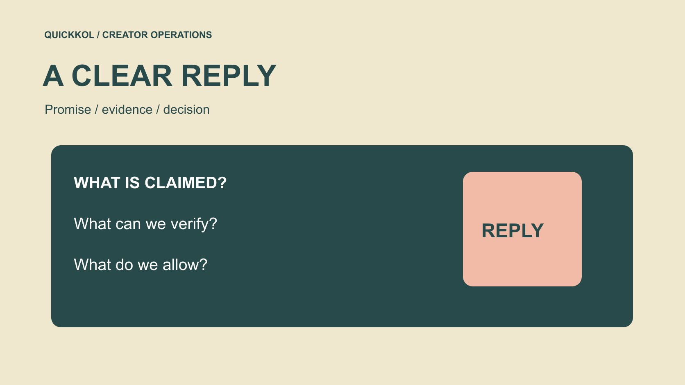

# 收到免费 Insta Followers 提案怎样回复

状态：本地审阅稿；正式发布日期待确认。

品牌收到免费涨粉提案时，怎样回应、保留必要证据，并为创作者合作选择更清楚的下一步。

QuickKOL 编辑图形；不呈现真实账号指标或平台界面。

Free insta followers 提案应被当作一个待判断的商业请求，不能因“免费”就默认安全，也不能仅因标题可疑就指控发送者欺诈。品牌先保留原始承诺，核对实际服务、所需权限及指标定义，再决定拒绝、要求非敏感说明或转给合适负责人。不要为测试提案而交出密码、验证码或未获授权的创作者数据。本文是风险教育和回复方法，不推荐涨粉供应商，也不提供刷量步骤。

## 不要让拒绝绕过新的联系人

同一个提案可能分别送到品牌、机构和创作者。只在一个收件箱中拒绝，却不告知实际项目负责人，可能让另一位同事误以为供应商已经获批。用必要的内部记录说明本项目决定，仍不扩大到不相关客户或供应商。

如果后来提供了不同服务范围，按新事实重新判断，而不是把旧拒绝当成永久黑名单。新方案不能继承过去没有授予的操作权限；供应商也不能仅凭一个转发邮件认定创作者同意。记录的用途是维持决定一致，不是传播未经证实的负面评价。

## 先判断提案和项目是否有关

先读[达人 Brief](https://www.quickkol.com/zh/blog/write-a-useful-campaign-brief/#answer)：本次是解释产品、邀请专业咨询，还是推广活动？对方承诺一个粉丝数，未必对应任何实际任务。即使新增关注是真的，也不能自动证明这些人符合目标、理解产品或愿意购买。没有明确需求时，直接拒绝通常比继续索取大量资料更有效。

回复由谁处理也应清楚。品牌员工不能替创作者同意账号操作，机构不能把客户的沉默解释为授权。将消息转给项目负责人时，只附必要内容，不把整份联系方式、合同或账号信息一起转发。先确定任务与决策权，再讨论供应商自称的速度或规模。

## 保存说了什么，不替对方补充保证

记录收到时间、发送身份、原文及所附范围。把“对方声称”“我方已观察”“仍未知”分开。若对方说自然增长，只能记录该说法，不能替它补成已核验真人、永久留存或符合全部平台规则。不要通过拼接截图制造更强指控。

若同事已经点击过链接，先记录真实动作，不用“账号已被盗”代替未知。是否输入资料、是否批准权限和是否出现异常，各有不同证据。需要保全时使用团队既有安全渠道；不为了写一份提案评估而继续点击、试登录或下载未知附件。

## 账号安全不是付款金额的问题

[Meta 的仿冒网站风险说明](https://about.fb.com/news/2022/07/how-meta-safeguards-people-against-clone-sites/)描述过第三方网站获取登录信息的风险。这是评估权限请求的背景，不是当前某个发送者确有违法行为的证明。看它实际要什么：密码、验证码、控制权、安装程序，还是不敏感的业务需求描述？不要因不用付款就跳过这个问题。

遇到敏感请求，停止营销侧操作并交给账号或安全负责人。品牌也不应要求创作者代替品牌冒险。任何后续回复都不需要展示真实验证码、恢复信息或客户资料来证明自己是账号所有人。判断依据是必要性与正式授权路径，而不是销售话术是否友好。

## 只索取能支持决定的非敏感说明

如果确有业务需要，可以要求对方用文字说明交付、方法类别、权限、责任和衡量口径。不要要求演示如何刷量，也不要发送真实账号作为测试目标。只需要判断是否有合适的内容、投放或运营服务，就不必触碰账号凭证。

“保证数量”需要追问它究竟代表什么：关注事件、期末净值，还是某个截图？这几种并不相同。即便得到说明，也不能把供应商自述写成独立证据。让对方列出适用限制、取消路径和联系主体，仍无法满足任务时就结束评估，不为已花时间继续投入。

## 回复应明确决定和边界

没有需求时，可回复：“谢谢说明。本次达人合作按相关内容和明确交付采购，不采购以关注数量为交付的服务。请勿对我方或合作方账号执行操作。”这是示例文本，不是已发送消息，也不评价对方所有业务。

仍需说明时，可回复：“请先提供非敏感的书面服务范围、权限需求与指标定义。本次沟通不构成账号操作、测试或数据使用授权。”如果涉及真实事件，交由负责人按事实调整。不要一边拒绝一边邀请试用，也不使用能被误解为允许执行的“可以先看看效果”。

## 如果已经交出权限，分开处理事件与供应商评估

[Meta 的账号安全说明](https://about.fb.com/news/2021/07/keeping-instagram-safe-and-secure/)可作为了解恢复与保护措施的官方起点；实际操作应以当前官方入口及账号情况为准。营销人员将发生时间、真实动作和可用通知交给账号负责人，不在聊天里索取验证码，也不自行承诺账号一定能恢复。

同时保存项目判断：哪些数据期间可能受影响，哪些内容仍可验收，哪些结论需要暂缓。异常后出现的真实评论不自动变成假互动，之前完成的作品也不自动失效。把安全事件、指标解释与合同履行分别交给合适负责人，避免一个未知问题被扩成对所有合作方的指控。

## 把资源转回可解释的达人工作

[Instagram 的创作者学习说明](https://about.fb.com/news/2024/10/best-practices-education-hub-creators-instagram/)提供了内容教育背景，但不是保证增长的配方。品牌更可控的采购对象包括一个真实演示、一个有范围的问答或一组已获许可的素材。说明目标读者与具体问题，才有条件判断这些工作是否完成。

用[素材授权检查表](https://www.quickkol.com/zh/blog/creator-rates-usage-rights/#answer)确认发布与复用范围，避免从拒绝涨粉服务转成未经许可搬运创作者内容。新的内容方案也有成本与不确定性，不能承诺替代方案一定带来更多粉丝。其价值在于任务、责任与证据更清楚，让品牌能为实际工作作出决定。

## 用一份假设来往检查回复是否清楚

假设一名品牌助理收到“免费送关注”的提案，对方要求账号登录。助理尚未提供资料。正确记录是“收到敏感权限请求，未授权执行”，而不是“账号已被攻击”。项目负责人决定不采购数量服务，并发出明确拒绝。这里没有真实供应商或客户事件。

若另一位同事问是否可用创作者小号测试，答案仍需回到授权、必要性与项目目标，不能因为是小号就默认可承担风险。最终交接保留原提案、决定、是否已发生操作与接收人。它不需要公开点名，也不需要制作未经证实的黑名单来完成风险教育。

## 让下一位同事能继续正确处理

结案说明应写明是否回复、是否允许任何动作、是否存在待处理权限问题以及谁继续跟进。没有发生安全事件就不要虚报；仍有未知就不要宣布全部安全。销售提案与账号事件不应共用模糊的“已处理”状态。

品牌对免费涨粉提案最有用的回应，是把任务、授权和证据讲清。拒绝一个不合适的服务，不需要证明每一个陌生账号是假粉；继续研究达人合作，也不需要把凭证交给不明服务。清楚的边界帮助团队把时间用于实际内容与真实合作。

## 免费涨粉提案回复记录

| 字段 | 应记录 | 不要替换成 |
| --- | --- | --- |
| 原话 | 对方实际承诺 | 我方认证 |
| 动作 | 已做与未做 | 猜测中的攻击 |
| 权限 | 具体请求与决定 | 免费等于安全 |
| 接收人 | 业务或账号负责人 | 泛泛的已处理 |

这是编辑建议；不得仅凭提案措辞指控个人或服务欺诈。

## 回复前五问

只讨论完成本次决定所必需的内容。

- [ ] 服务是否对应真实项目任务？
- [ ] 谁有权决定与授权？
- [ ] 哪些是承诺，哪些是观察？
- [ ] 是否出现敏感权限请求？
- [ ] 回复是否明确允许或拒绝什么？

## 研究日期与使用边界

资料核验于 2026 年 11 月 12 日。文中方法、表格和决策规则为编辑建议，标为假设的示例不是实际客户结果或行业基准。外部资料的适用地区与时期按各段说明；本稿处于独立本地审阅阶段，正式发布日期待确认。

## 继续学习指标与证据

理解来源、窗口、权限与未知；不凭单一信号判断个人，也不承诺完整检测。

[阅读指标决策指南](https://www.quickkol.com/zh/blog/social-media-metrics-creator-decision-tree/)

## 来源

- [Meta 的仿冒网站风险说明](https://about.fb.com/news/2022/07/how-meta-safeguards-people-against-clone-sites/)
- [Meta 的账号安全说明](https://about.fb.com/news/2021/07/keeping-instagram-safe-and-secure/)
- [Instagram 的创作者学习说明](https://about.fb.com/news/2024/10/best-practices-education-hub-creators-instagram/)
