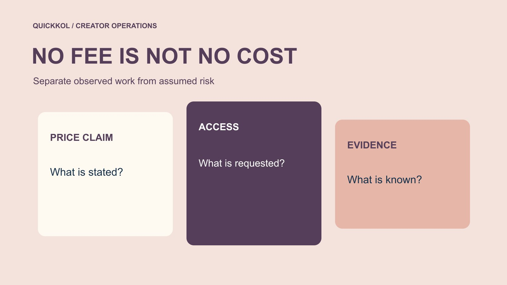

# Free Instagram Followers: Understand the Hidden Costs

Status: local review draft; confirm the publication date before release.

Review access, handling time, reporting distortion and opportunity costs behind a zero-price promise while protecting legitimate creator work.

QuickKOL editorial graphic; not actual account metrics or a platform interface.

Free followers on Instagram for free is a pricing claim, not evidence that an offer has no account, data or partnership cost. A brand should inspect requested access, handling time, affected metrics and the opportunity cost to actual work. Do not turn an unverified risk estimate into a loss that supposedly occurred. Unusual growth may justify review without proving deception by a creator. This article is educational: it neither recommends free-follower services nor provides steps for obtaining artificial engagement. The useful outcome is a proportionate no-purchase assessment that separates what was observed, what is uncertain and which campaign decision may need attention.

## Separate zero price from zero risk

A free claim describes a stated cash price. It does not establish unconditional use, platform authorization or a relevant audience. Save the wording, address and observation date instead of adopting promotion as brand fact. List any required following tasks, information submission or access request separately rather than summarizing the arrangement with one word.

Use the [creator brief](https://www.quickkol.com/blog/write-a-useful-campaign-brief/#answer) to specify genuine production and appropriate publication rather than procuring false engagement. Establish who introduced the offer without assuming the creator sought it. Zero price can affect purchasing interest, but it should not remove access, provenance and task-value checks. Define the decision before requesting more evidence. Caution does not require registering or testing the service. The team can assess a public claim, decline an unsuitable proposal and continue the legitimate partnership without demonstrating the growth tactic or giving an uncertain provider new opportunities to collect information.

## Treat access as a separately controlled resource

[Meta’s clone-site risk explanation](https://about.fb.com/news/2022/07/how-meta-safeguards-people-against-clone-sites/) describes credential-sharing risks associated with offers such as free followers or likes. It is historical security context, not an investigation of any current named provider. Familiar naming, marks or page styling cannot replace verification of an official authorization route.

The brand or agency should not request passwords, verification codes or recovery codes for research. The owner or appropriately authorized person can inspect current logins and connections through official routes. A no-password claim does not establish the absence of data, permission or task costs. Record the requested object and scope instead of letting a low-price proposal become whole-account access. This is a separate decision from whether the campaign’s follower movement looks unusual. An unnecessary access request can be declined without proving that every promised follower is false, while a growth concern can remain open even when no additional permission was granted.

## Record handling time as actual work

Even without payment, reading a pitch, checking access, clarifying evidence, revising a report and restoring collaboration may consume time. Record work that actually occurred. Keep unperformed actions in a scenario rather than presenting possible hours as spent cost. Do not inflate a risk calculation by treating every colleague’s waiting time as equivalent labor.

Suppose two people spend half an hour and one hour reviewing the concern: one and a half handling hours. At an assumed internal planning rate of forty dollars per hour, that represents sixty dollars of illustrative time value. It is not wages paid, a service charge or an established loss. Keep the assumption visible so an owner can judge further work, not use the example to claim that every provider causes the same cost. The distinction also lets the organization replace an assumption with its own appropriate planning basis without rewriting the underlying observation about what work was actually performed.

## Identify the decision affected by data uncertainty

Uncertain follower or interaction origin may affect candidate ordering, budget comparison or one reporting interpretation. Identify the field and window instead of invalidating all deliverables. Actual work can still be checked against the agreement, and commercial events need their own sources. A falling total does not establish that every issue was repaired.

Use the [interaction-data revision method](https://www.quickkol.com/blog/free-instagram-likes-measurement-contamination/#answer) to preserve the original count, concern and changed use. Without evidence separating affected activity, do not invent a net genuine figure. Annotation or holding one comparison can be a reasonable outcome. Inform people using the old report instead of only editing the upstream file. Data risk here means a limit on evidentiary use, not a proven finding about who manufactured activity. This preserves useful independent information while preventing the uncertain field from continuing to support a decision beyond its scope. It also keeps report repair distinct from account-security repair, which may have another owner and completion condition.

## Do not convert an anomaly directly into fraud loss

A growth shape, language change or comment pattern can be a review lead without proving purchase, responsibility or a loss amount. Retain reasonable alternatives such as ordinary releases, media events or confirmed promotion. Do not invent a service fee as loss where no purchase record exists.

Within its U.S. scope, [FTC’s false social indicator FAQ](https://www.ftc.gov/business-guidance/resources/consumer-reviews-testimonials-rule-questions-answers) discusses knowledge qualifications and distinguishes genuine voluntary following. It does not make every free promotion the same prohibited conduct. A brand can decline manufactured engagement while keeping case conclusions within the evidence. Risk education should improve the questions a reader asks rather than provide a supposedly authoritative perfect-detection or conviction method. That also applies to financial language: an uncertain metric may weaken a budget comparison, but it does not automatically establish that the entire creator fee was wasted or that every order attributed during the period was invalid. Those conclusions need their own support.

## Compare opportunity cost against the actual task

Reviewing an offer may displace sample confirmation, asset review or customer questions. Describe the displaced task and consequence instead of assigning every unrealized sale to the service. An unestablished revenue gap remains unknown. The brand needs to decide where the next hour is useful, not exaggerate loss to make the team distrust all growth.

Compare continuing a detail that cannot change the current decision with addressing an open access or release issue. The choice depends on evidence, assignment and appropriate ownership rather than one fixed investigation sequence. A bounded scope and review time let caution support actual collaboration instead of allowing a free pitch to absorb the whole team. The stopping rule should be explicit: once the brand has enough evidence to decline new procurement, further work may concern account protection or reporting repair, each with its own purpose, rather than an endless effort to prove every statement in the supplier’s advertisement false.

## If already connected, handle security and partnership separately

[Meta’s account security guidance](https://about.fb.com/news/2021/07/keeping-instagram-safe-and-secure/) provides background on login checks, recovery information and two-factor authentication. Actual handling belongs with authorized people using current official routes. Ending unnecessary access need not wait for complete growth attribution. Retain appropriate incident evidence without circulating reusable credentials or asking unrelated staff to log in.

After repair, check whether legitimate scheduling, analysis and publication still work. A disconnected service does not automatically mean the campaign resumed or historical data was corrected. Hand over account, delivery and reporting matters separately, assigning remaining questions to owners. Authentic work already completed should not be automatically erased by an unproven concern; commercial handling returns to the actual arrangement and appropriate process. This separation can protect the account quickly while keeping factual judgments fair. It also gives the receiving campaign manager a usable state instead of a broad reassurance that everything is fixed when different workstreams remain at different stages.

## Deliver an explainable no-purchase decision

A conclusion can state the claim, request, confirmed facts, unknowns and reason the offer does not fit the assignment. There is no need to register for a trial or publish an accusation about the provider. Keep account or reporting follow-up separate so no purchase does not conceal unfinished protection or correction.

Free followers on Instagram for free is a useful brand education topic when the article stays focused on access, information and partnership decisions. Genuine voluntary following may be an outcome of content; an uncertain-origin total is not automatically proof of value. Preserve facts, scenarios and unknowns so an owner can allocate resources reasonably and treat legitimate creators fairly. A final review should ask whether each claimed cost was observed or assumed and whether the proposed action can actually address it. That check prevents a useful cautionary memo from becoming an inflated loss narrative unsupported by the record.

## Do not label the whole creator fee a loss

Suppose a brand sees an unverified follower-service offer and proposes labeling the entire creator fee a loss. Check what that fee purchased. It may include completed authentic filming and permission that a data question does not invalidate. If one settlement condition depends on the affected metric, an authorized owner should review the actual arrangement. A chart cannot replace that contractual assessment.

A risk record can separate established facts, potentially affected decisions and pending scope. An offer email existing is a fact while connection remains unknown. A report field being unsuitable for ranking is a use limitation, not proof that all brand revenue was harmed. Actual handling time can be listed, but do not combine waiting, estimates and paid amounts into an inflated total.

A clarification request should identify the period and evidence needed through a reasonable response route. It should not demand full account access or identity proof for every follower. Check the brand’s own promotion and agency arrangements too. Update the record when evidence explains a change; preserve an unknown when it does not. Holding one purchase can be a risk-control decision without first proving personal deception.

The recommendation should identify who stops what, who handles access, who revises which report and how genuine work will be accepted. This is not a real client loss or a finding about any current service’s legal status. A bounded risk explanation can protect budget and collaboration without turning caution into an unsupported rejection of completed work. The receiving owner should also be able to explain which new evidence would change the decision, keeping the review open to correction rather than requiring every later fact to fit the first suspicion.

## Cost record for a free offer

| Object | Record | Do not assume |
| --- | --- | --- |
| Cash price | Original claim and conditions | Zero price means authorization |
| Access | Request and actual state | No password means no risk |
| Time | Separate actual handling and scenarios | Assumed value equals paid loss |
| Reporting | Affected field and use | Anomaly equals proven deception |

Hours and rate are explicit assumptions, not benchmarks, vendor prices or established losses.

## Free-follower risk education checklist

Review the claim without registering for or purchasing manufactured engagement.

- [ ] Retain the price claim and attached conditions.
- [ ] Have authorized staff inspect access.
- [ ] Separate actual work, scenarios and unknowns.
- [ ] Identify which metric affects which decision.
- [ ] Do not accuse a creator from one signal.

## Research date and limitations

Sources reviewed November 12, 2026. Methods, tables and decision rules are editorial recommendations. Hypothetical examples are not actual client results or industry benchmarks. Source geography and periods are specified where relevant. This draft is in independent local review; confirm its publication date before release.

## Continue learning about metrics and evidence

Understand sources, windows, permissions and unknowns without judging a person from one signal or promising complete detection.

[Read the metrics decision guide](https://www.quickkol.com/blog/social-media-metrics-creator-decision-tree/)

## Sources

- [Meta’s clone-site risk explanation](https://about.fb.com/news/2022/07/how-meta-safeguards-people-against-clone-sites/)
- [FTC’s false social indicator FAQ](https://www.ftc.gov/business-guidance/resources/consumer-reviews-testimonials-rule-questions-answers)
- [Meta’s account security guidance](https://about.fb.com/news/2021/07/keeping-instagram-safe-and-secure/)
