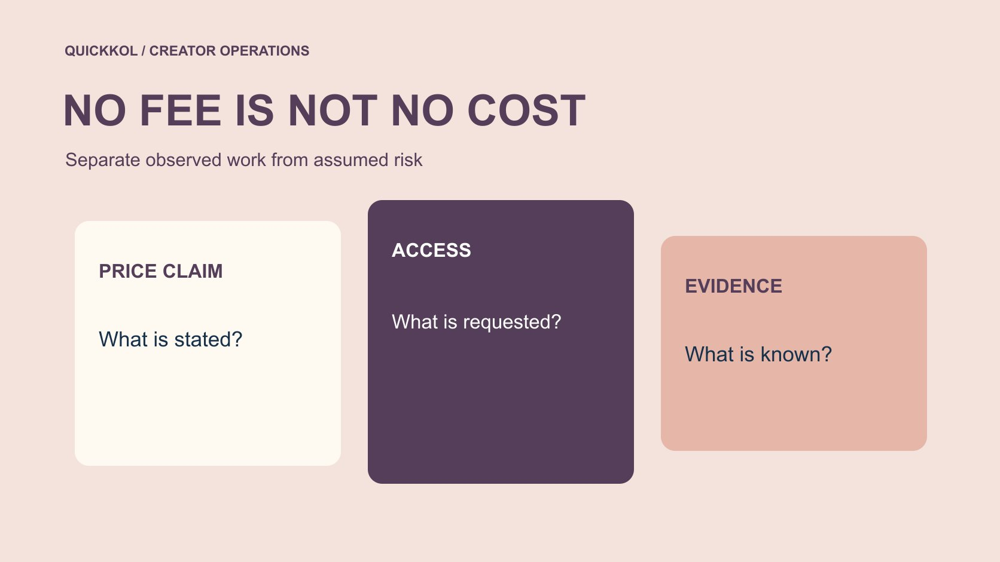

# 免费 Instagram 粉丝承诺有哪些隐性成本

状态：本地审阅稿；正式发布日期待确认。

把零价格承诺中的访问、处理时间、报表失真与机会成本分开核对，保护真实达人合作。

QuickKOL 编辑图形；不呈现真实账号指标或平台界面。

Free followers on Instagram for free 只是一种价格表述，不能证明没有账号、数据或合作成本。品牌应分别核对访问要求、处理时间、受影响指标和真实任务的机会成本，不把未经证实的风险金额算成已经发生的损失。增长异常可以触发复核，不能单凭一次变化指控创作者。本文用于风险教育，不推荐免费涨粉服务，也不提供获取虚假粉丝的步骤。

## 把零价格与零风险分开

服务写免费，只描述它声称的现金价格，不证明无条件、获得平台授权或能带来相关受众。先保存原文、地址与看到的日期，不把宣传直接写入品牌事实表。若附带关注任务、资料提交或访问请求，分别列出，不用“免费”一个词概括全部安排。

用[达人 Brief](https://www.quickkol.com/zh/blog/write-a-useful-campaign-brief/#answer) 明确本次预算购买真实制作和适当发布，不采购虚假互动。品牌还需核对是谁提出邀约，不能默认创作者主动寻求。报价为零可以影响采购选择，但不应让权限、来源和任务价值检查消失。先定义需要判断的问题，再决定还要哪些证据，不用注册或尝试服务来证明谨慎。

## 把访问看作需要独立批准的资源

[Meta 的仿冒网站风险说明](https://about.fb.com/news/2022/07/how-meta-safeguards-people-against-clone-sites/)描述了以免费关注或点赞等承诺诱导凭证分享的一般风险。这里作为历史安全背景使用，不是对任何当前具名服务的调查结论。熟悉的名称、标识和页面样式都不能代替官方授权核验。

品牌与代理不应为了研究要求创作者交出密码、验证码和恢复码。由账号所有者或适当有权人员通过官方入口查看当前登录与连接。服务声称无需密码，也不代表没有数据、权限或任务成本。把请求对象与范围写清，不让一个低价或免费提案悄悄变成整账号访问。

## 将处理时间纳入实际工作记录

即使没有付款，阅读提案、核对访问、澄清资料、修正报表和恢复协作都可能占用时间。只记录真实发生的工作；还没有执行的事项放在情景栏，不把可能工时写成已花成本。也不要为显示风险大而把每位同事的等待时间都当成同等劳动。

假设两位人员分别用了半小时和一小时复核，实际处理共一点五小时。若内部情景按每小时四十美元估算，得到六十美元的规划时间价值，不是工资实付、服务收费或已证实损失。保持假设标签，让负责人判断是否需要进一步处理，而不是用一个算例证明某服务必然造成相同成本。

## 说明数据污染影响哪一个决定

粉丝或互动来源不明，可能影响候选排序、预算比较或某项报告解释。先指出受影响字段与窗口，不把所有交付一概作废。真实作品仍可以按合同核对，商业事件也需要各自来源。不能用一个总数下降宣称所有问题已修复。

用[互动数据修正方法](https://www.quickkol.com/zh/blog/free-instagram-likes-measurement-contamination/#answer)保留原数、疑问和修改用途。如果没有依据分离哪些行为受影响，就不要猜一个“净真实”数字。标注或暂缓某项比较可以是合理结果。修订应通知实际使用旧表的人，不只是改掉上游文件。数据风险在这里指证据用途受到限制，不等同于已证明谁造假。

## 不要把异常信号直接换算成欺诈损失

某个增长形状、语言变化或评论模式只能作为复核线索，不能单独证明购买、责任人或受损金额。合理替代解释应保留，例如同时发生的正常发布、媒体事件或已核实推广。没有订单证据时，不虚构一笔服务费用作为损失。

[FTC 的虚假社媒指标问答](https://www.ftc.gov/business-guidance/resources/consumer-reviews-testimonials-rule-questions-answers)在美国规则下讨论知情等条件，并区分真实自愿关注。它不把每项免费推广都视作同类违规。品牌可以明确不采购虚假互动，同时让个案结论停留在证据范围内。风险教育应帮助读者提出更准确的问题，而不是提供一个看似权威的百分百识别或定罪方法。

## 比较机会成本时回到真实任务

处理一项邀约，可能推迟原本要完成的样品确认、作品审核或客户答疑。描述被挤占的任务与影响，不把所有未发生销售都算成服务造成。无法证明的收入缺口应保持未知。品牌需要决定下一小时放在哪里，而不是用夸大损失让团队害怕所有增长。

可比较两种行动：继续追查一个不影响当前决定的细节，或优先处理仍在开放的账号风险与发布问题。选择取决于证据、任务和适当负责人，不是固定流程要求。限定调查范围与复核时间，能让谨慎服务实际合作，而不让免费提案无限占用整个团队。

## 若已接入，分别处理安全与合作

[Meta 的账号安全说明](https://about.fb.com/news/2021/07/keeping-instagram-safe-and-secure/)提供登录、恢复资料与双重验证等背景，具体处理以当前官方入口与有权人员判断为准。需要结束不必要访问时，不必等增长归因全部查清。保存适当事件证据，但不要传播可复用凭证或让无关人员登录代查。

恢复后再核对合法排期、分析或发布是否仍能完成。一个连接断开，并不自动说明活动已恢复或历史数据已修复。把账号、交付和报表分别交接，给每项剩余问题负责人。创作者已完成的真实工作也不应因一个未证实问题被自动否定；商业处理回到实际安排与适当流程。

## 交付一个可解释的不采购决定

结论可以写服务声称什么、请求什么、品牌确认什么、目前不知道什么，以及为何不符合本次任务。无需注册体验，也无需给对方公开造假标签。若存在账号或报表后续工作，单独列出，不让“不采购”掩盖尚未完成的保护与修正。

Free followers on Instagram for free 适合做品牌风险教育，前提是正文始终解释访问、信息与合作决策。真实自愿的关注可以是内容结果，来源不明的数量却不能自动成为价值证明。保留事实、情景与未知，让负责人能合理分配资源，也让真实创作者受到公平对待。

## 不要把整个达人费用写成风险金额

假设一个品牌看到未经证实的涨粉邀约，就准备把已经支付的达人费用全部写为损失。先核对这笔费用购买什么。如果包含已完成的真实拍摄和许可，数据疑问未必否定这些交付；若某项结算明确依赖受影响指标，再由有权负责人按实际安排复核。不能让一个图表替代合同判断。

风险记录可以分成三列：已经发生的事实、仍可能影响的决定、待确认的范围。比如邀请邮件存在是事实，是否接入仍未知；一段报表暂不能用于排序是一项用途限制，不等于品牌全部收入受损。处理时间若确实记录，可以单列，但不要把等待、预估与实付混合后得到夸大总额。

对创作者请求澄清时，说明窗口与所需证据，给出合理回复路径，不要求完整账号访问或每位关注者身份证明。品牌自己的推广与代理安排也应核对。若新证据能解释变化，就更新记录；仍无法确认时，保留未知而非补一个指控。风险控制可以采取暂停某项采购，并不要求先证明个人造假。

最终建议应写谁停止什么、谁处理访问、谁修订哪项报告，以及真实作品怎样验收。此处没有实际客户损失，也不推断任何当前服务的违法状态。一个有边界的风险说明可以保护预算与合作关系，同时避免把“谨慎”变成对所有已完成工作无依据的否定。

## 免费承诺的成本记录

| 对象 | 应记录 | 不能假定 |
| --- | --- | --- |
| 现金价格 | 原声明与条件 | 零价等于授权 |
| 访问 | 请求与实际状态 | 无需密码等于无风险 |
| 时间 | 真实处理与情景分开 | 假设价值等于实付损失 |
| 报告 | 受影响字段与用途 | 异常等于已证实造假 |

工时及费率为明确假设，不是行业基准、供应商价格或已证实损失。

## 免费涨粉风险教育清单

评估承诺，不注册或采购刷量。

- [ ] 保留价格声明与附加条件。
- [ ] 由有权人核对访问。
- [ ] 区分已发生工时、情景与未知。
- [ ] 明确哪项指标影响哪个决定。
- [ ] 不凭单一信号指控创作者。

## 研究日期与使用边界

资料核验于 2026 年 11 月 12 日。文中方法、表格和决策规则为编辑建议，标为假设的示例不是实际客户结果或行业基准。外部资料的适用地区与时期按各段说明；本稿处于独立本地审阅阶段，正式发布日期待确认。

## 继续学习指标与证据

理解来源、窗口、权限与未知；不凭单一信号判断个人，也不承诺完整检测。

[阅读指标决策指南](https://www.quickkol.com/zh/blog/social-media-metrics-creator-decision-tree/)

## 来源

- [Meta 的仿冒网站风险说明](https://about.fb.com/news/2022/07/how-meta-safeguards-people-against-clone-sites/)
- [FTC 的虚假社媒指标问答](https://www.ftc.gov/business-guidance/resources/consumer-reviews-testimonials-rule-questions-answers)
- [Meta 的账号安全说明](https://about.fb.com/news/2021/07/keeping-instagram-safe-and-secure/)
