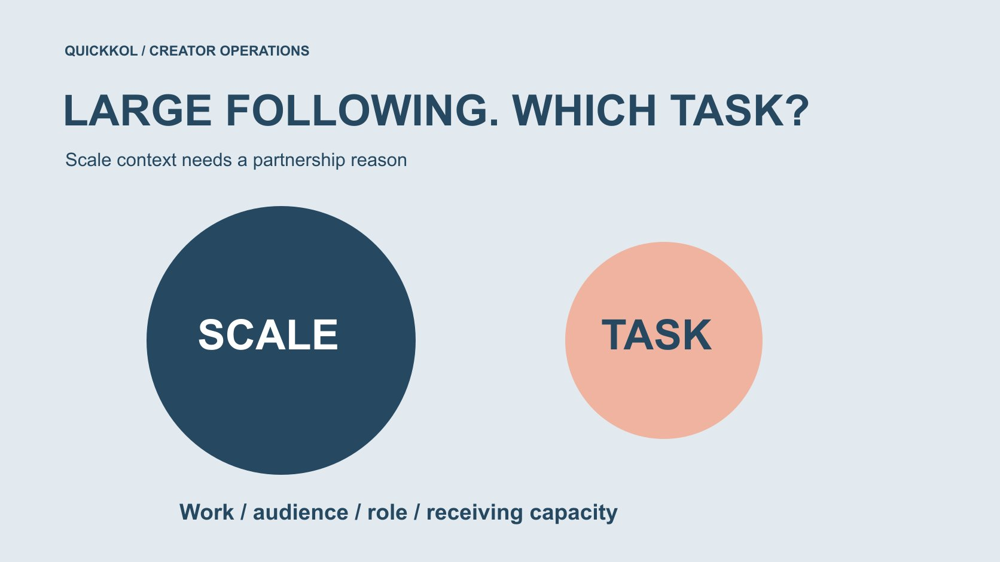

# High Instagram Followers: Check the Task Fit

Status: local review draft; confirm the publication date before release.

Assess whether a large Instagram following supports the specific creator assignment rather than automatically rewarding or suspecting scale.

QuickKOL editorial graphic; not actual account metrics or a platform interface.

When researching instagram followers high, a brand needs to ask what scale contributes to this assignment. A large total gives account-size context without establishing relevant work, suitable geography, actual reach or purchases. It is not evidence of fake followers either. Define the audience task and necessary creator capability before reviewing appropriate audience information, production conditions and receiving arrangements. This guide supports an invitation, further research or a decision to decline. It does not rank large accounts as universally good or bad or accuse people from one metric. The relevant comparison is between the proposed work and the project’s requirements, not between impressive numbers alone.

## Explain why scale is needed

A brand may want broader distribution, but more people still needs a subject and task. A local event, complex demonstration and international brand story use scale differently. Put whom the brand wants to inform or prompt into the [creator brief](https://www.quickkol.com/blog/write-a-useful-campaign-brief/#answer), then ask how a large account helps.

If reusable production is the main purchase, the creator’s own following may not be the primary object. Account publication also needs audience and expression review. Do not select the largest account first and revise the assignment afterward to justify it.

Scale can be a reasonable condition when its reason, evidence and limits are explicit. Describe a threshold as an internal choice rather than an industry rule. This lets a colleague challenge the underlying need without implying the account is deficient. It also leaves room for different production and distribution partners where one person need not supply both.

## A large following is not this campaign’s delivered reach

[Meta’s unconnected recommendation explanation](https://ai.meta.com/blog/ai-unconnected-content-recommendations-facebook-instagram/) provides context for distribution beyond a following network. Following, viewing and recommendation are different questions. An account total does not establish that every follower sees this partnership, while nonfollower viewing means the total is not a ceiling on every possible view either.

Separate scale context from available actual performance, preserving fields, time and source. Expectations can be discussed without turning forecast exposure into people already reached. A media plan needs suitable authorized information rather than a precise promise reconstructed from public follower totals.

This limit does not devalue a large account. It makes the purchase and later observation clearer. A creator may provide useful audience context, but the brand should still know which statements describe historical work, which are planning assumptions and which will require evidence after this particular publication.

## Examine actual explanation and production capability

Review work relevant to the product question rather than only the most popular profile item. Check explanation, visible prerequisites and language fit. Entertainment, hosting and technical operation are different capabilities; scale does not make them interchangeable.

Retain specific work evidence and questions still needing confirmation. Do not assign reposted work to the account owner where provenance is unclear, or rewrite a personal experience into a brand endorsement.

The [candidate research method](https://www.quickkol.com/blog/influencer-discovery-tool-brief-to-candidates/#answer) helps place assignment and evidence together. Explain relevance in the invitation rather than using you have many followers as the entire rationale. This makes the proposal more actionable for the creator too. They can suggest an appropriate format or identify a missing condition instead of guessing whether the brand wants their production skill, their publishing account or merely a recognizable face for another team’s script.

## Separate audience suitability from identity guessing

A local assignment may need geographic evidence, while a professional topic may need relevant interests and communication capability. Request appropriately authorized aggregates relevant to the task and preserve date, definition and source. Usernames, avatars and comment language should not determine every follower’s country or occupation.

Where evidence is missing, ask further or retain the unknown rather than treating absence as proof of unsuitability. A broad account does not automatically lack local viewers, but global scale cannot replace relevant local information.

Tell procurement which fit is supported and which is merely possible pending review. That supports fair comparison. It also prevents a smaller account with a clearer local explanation from being overlooked solely because another profile displays a larger worldwide number, while avoiding the opposite mistake of assuming every small account is automatically more locally relevant.

## Platform eligibility and assignment fit differ

[Meta’s recommendation eligibility explanation](https://about.fb.com/news/2020/08/recommendation-guidelines/) distinguishes permitted content from recommendation eligibility. It supplies platform context, not a diagnosis of this account or certification of brand fit. Do not infer wrongdoing from a single distribution decline or treat recommendation eligibility as a reason the brand must partner.

The brand still evaluates work, product facts, applicable market and scope. Let account owners verify relevant status instead of having outside researchers replace it with public screenshots.

A decision to decline can rest on task mismatch without inventing a safety or authenticity accusation to make it sound stronger. This keeps research proportionate: the team needs enough evidence for the purchasing decision, not an unnecessary verdict on the creator’s entire account. It can preserve a suitable contact for another project even when the present assignment is a poor match.

## Specify production, publication or both

[Meta’s creator collaboration explanation](https://about.fb.com/news/2024/02/creator-marketplace-for-brands-and-creators-to-collaborate-on-instagram/) provides context for partnerships and content amplification. It establishes formats, not that a large account accepts this assignment or includes every usage right in a quote. Ask separately about production, account publication, reuse and paid distribution.

One brand may need a strong demonstration distributed through its own media; another needs professional conversation on the creator’s account. Scope and evidence differ, so follower count alone cannot establish which offer is better value.

Provide task, versions, duration and markets for the creator or representative to confirm. This article has no actual quote and derives no universal fee from scale. A well-scoped proposal can discover that only one component is suitable. Declining the publication component while discussing licensed production is different from deciding the creator has no useful role at all.

## Confirm the brand can receive attention

Broader distribution may produce questions, but unprepared support, event or destination work should not be transferred to the creator. Confirm the next step, product-question owner and service conditions that cannot be promised. One publication is not unlimited customer-support procurement.

Where capacity is limited, make actual conditions clear instead of letting a scale objective conceal receiving limits. More exposure may not be necessary before explanation and destination are ready.

This is not a prediction that a particular account will produce a traffic surge. It assigns responsibility for the action the brand invites. A practical readiness check can therefore change the timing or scope of a partnership without changing the creator shortlist. The issue may be the brand’s receiving process rather than the creator’s follower number or audience quality.

## Rehearse a local-workshop comparison

Suppose a brand considers two creators for a local photography workshop. A has a larger global following; only B currently supplies suitable local-work and event-hosting evidence. This does not establish that B’s followers are more genuine or that A lacks local viewers. It supports B for this onsite assignment under the available evidence.

Reassess if A supplies relevant information. If the assignment becomes a cross-market brand film, the selection basis may change too. The example contains no actual account, data or quote.

Preserve task, knowns and unknowns rather than summarizing large accounts are worse. Different work can justify a different choice among the same people. The receiving owner should see which requirement drove the decision and what new evidence could alter it, so a project-specific choice does not become an unsupported permanent ranking in the agency’s contact system.

A separate hypothetical illustrates why percentages alone are insufficient. If one account has ten thousand followers with a suitable local aggregate of forty percent, and another has one hundred thousand with five percent, the products are four thousand and five thousand. These are arithmetic illustrations, not actual audience or reach estimates. The source definitions, dates and coverage would need to agree before such a comparison were useful. Even then, a local share would not prove workshop attendance, viewing or purchase. Preserve both the denominator and limitation instead of declaring the higher percentage the automatic winner.

## Make a decline specific and bounded

A record can say that current evidence does not establish the local execution capability this assignment needs, rather than fake followers or no value. Internal candidate judgments do not require public naming. Date updates when new information arrives so an older conclusion does not masquerade as a current fact.

Explain task and next step in a reply without demanding every personal or commercial record as proof of innocence. Research serves a necessary decision and should not use suspicion to expand collection.

Where colleagues disagree, return to scope and evidence and identify the requirement an owner must decide. A composite score cannot automatically resolve competing objectives. A limited reason also preserves fairness in future outreach: the creator can understand what was missing for this project without being told that the brand has reached an unsupported conclusion about their entire audience.

## Give scale a defined place in the decision

Hand over audience task, capability evidence, appropriate audience information, scope, receiving conditions and unknowns. Explain scale’s role where relevant, and continue research or choose another collaboration form where evidence is insufficient. A public number should not become a judgment on every commercial capability.

A large Instagram following can identify an opportunity worth studying. It replaces neither work-to-task matching nor a basis for accusing an individual. Selecting around actual assignments allows a brand to value distribution while keeping evidence and terms clear.

Another colleague should be able to explain the final choice rather than merely display the larger total. That is the test of whether scale has supported the partnership decision or quietly substituted for it.

## High-following account task-fit card

| Question | Need | Scale does not replace |
| --- | --- | --- |
| Who needs to understand what? | Audience and task | Relevance |
| What work can be made? | Specific capability evidence | Expertise and production |
| How will it be used? | Production, publication and rights scope | Commercial agreement |
| Who receives responses? | Destination, capacity and owner | Brand readiness |

The workshop example is hypothetical, without ranking real accounts or accusing follower authenticity.

## Before shortlisting a large account

Explain fit before discussing scale.

- [ ] The reason scale is needed is explicit.
- [ ] Work capability fits the audience task.
- [ ] Known, unknown and unsuitable are distinct.
- [ ] Scale proves neither reach nor authenticity.
- [ ] Production, publication and brand reception are scoped.

## Research date and limitations

Sources reviewed November 12, 2026. Methods, tables and decision rules are editorial recommendations. Hypothetical examples are not actual client results or industry benchmarks. Source geography and periods are specified where relevant. This draft is in independent local review; confirm its publication date before release.

## Start creator research with a clear task

Use QuickKOL to interpret a brief, discover relevant creators and research their work and contact routes. Verify data, commercial terms and outcomes at their source.

[Explore QuickKOL](https://www.quickkol.com/#capabilities)

## Sources

- [Meta: unconnected recommendations on Facebook and Instagram](https://ai.meta.com/blog/ai-unconnected-content-recommendations-facebook-instagram/)
- [Meta’s recommendation eligibility explanation](https://about.fb.com/news/2020/08/recommendation-guidelines/)
- [Meta’s creator collaboration explanation](https://about.fb.com/news/2024/02/creator-marketplace-for-brands-and-creators-to-collaborate-on-instagram/)
