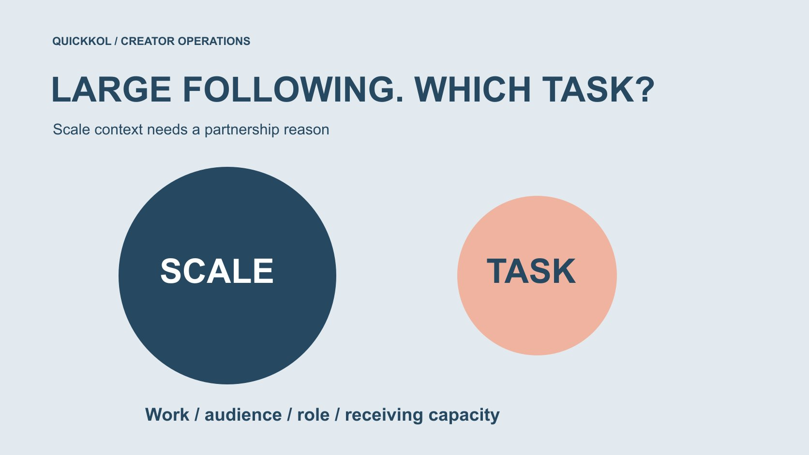

# Instagram 粉丝很多，为什么仍可能不适合本次合作

状态：本地审阅稿；正式发布日期待确认。

当 Instagram 关注规模很大时，品牌怎样判断它是否能支持本次达人任务，而不是自动加分或怀疑。

QuickKOL 编辑图形；不呈现真实账号指标或平台界面。

搜索 instagram followers high 时，品牌真正需要回答的是：这个规模对本次任务有什么用？高关注数可以提供账号规模背景，却不证明作品相关、地域适合、实际触达或购买。它也不是假粉证据。先定义观众任务与需要的创作者能力，再核对适当受众资料、制作条件和接收安排。本文帮助品牌决定邀请、继续研究或不采用，不把大账号做成统一好坏排名，也不凭单一指标指控个人。

## 先说明为什么需要规模

品牌可能希望更广传播，但“更多人”还需要对象与任务。当地门店活动、复杂产品演示和国际品牌故事，对规模的用途不同。用[达人 Brief](https://www.quickkol.com/zh/blog/write-a-useful-campaign-brief/#answer) 写清希望谁理解或做什么，再问大账号如何帮助完成它。

如果任务主要是制作可复用演示，创作者个人关注量可能不是主要采购对象。若需要其账号发布，则还要看受众与表达。不要先选最大账号，再临时改变项目目标来解释选择。

规模可以是合理条件，但应说明原因、证据和限制。把门槛写成内部取舍，不冒充行业统一标准。

## 大关注关系不等于本次实际触达

[Meta 的非关注推荐说明](https://ai.meta.com/blog/ai-unconnected-content-recommendations-facebook-instagram/)介绍关注网络之外的内容分发背景。关注、观看与推荐是不同问题，不能从一个账号总量推定本次每位关注者都会看到。反过来，非关注者观看也可能存在，不能用关注数限制全部潜在观看。

报告应分开规模背景与实际可用表现，保留字段、时间和来源。预期可以讨论，但不能把预计触达写成已交付人数。若需要投放计划，使用相应获授权资料，不从公开关注总量补出精确承诺。

这个限制不是贬低大账号，而是让品牌知道它正在购买什么以及后来应观察什么。

## 看实际解释与制作能力

研究与本次产品问题相关的作品，而不是只看主页最热门一条。核对演示是否清楚、必要条件是否可见、语言是否适合。娱乐能力、主持能力和技术操作能力可以不同，不能由规模自动互换。

保留一项具体作品证据与尚需确认的问题。作品来源不清时，不把转发内容认定为本人制作；个人经历也不能由品牌任意改写成产品背书。

[候选研究方法](https://www.quickkol.com/zh/blog/influencer-discovery-tool-brief-to-candidates/#answer)可以帮助把任务与作品放在一起。邀请时说明为什么相关，而不是用“你粉丝很多”代替一个创作者能理解的合作理由。

## 把受众适合与个人身份推断分开

当地项目可能需要地域证据，专业项目可能需要相关兴趣与沟通能力。只请求适当授权且与任务有关的汇总，记录日期、定义与来源。不能靠用户名、头像或评论语言替所有关注者确定国家或职业。

缺少证据时可以继续询问或保持未知，不把未知视为不适合的证明。大账号覆盖广，也不自动说明当地观众不足；但它的全球规模不能代替本地可用资料。

让采购人知道哪项是已支持的适合、哪项只是需要复核的可能。这样才能公平比较不同账号。

## 平台允许与本次合作适合不同

[Meta 的推荐资格说明](https://about.fb.com/news/2020/08/recommendation-guidelines/)区分可以发布与符合推荐条件。它提供平台背景，不是我们对当前账号的诊断，也不是品牌适合度认证。不要从一次未获推荐或表现下降推断创作者违规，更不能把“可推荐”当作品牌必须合作的理由。

品牌仍要自行判断作品、产品事实、适用市场和合作范围。平台状态有待确认时由账号负责人核对，不让外部研究者用公开截图代替正式状态说明。

选择不合作可以基于实际任务不匹配，不需要制造一个安全或真假指控来让决定显得更有分量。

## 明确购买制作、发布还是两者

[Meta 的创作者合作说明](https://about.fb.com/news/2024/02/creator-marketplace-for-brands-and-creators-to-collaborate-on-instagram/)介绍平台合作与内容放大的背景。它说明多种合作形式存在，不意味着大账号一定愿意接受本次条件，也不证明其报价包含全部使用权。把制作、账号发布、素材复用和投放分别询问。

一个品牌可能需要高质量演示加自己的媒体渠道，另一个需要创作者账号里的专业对话。两者的范围和证据不同，不能只按关注数计算谁更划算。

询价应提供任务、版本、期限与市场，让创作者或代表确认条件。本文没有真实报价，也不从粉丝数推算统一费用。

## 先确认品牌能承接，再采购更大关注

较广传播可能带来更多问题，但品牌不能把尚未准备的客服、活动或页面工作转给创作者。确认观众下一步是否可用，谁回答产品问题，以及哪些服务条件不能承诺。一次发布不是无限期客服采购。

如果只能处理有限名额，就把实际条件写清，不用规模目标掩盖接收能力。没有真实需求时，未必需要增加更多曝光；也可能先完善说明与入口。

这不是预测某大账号一定引发流量，而是让品牌为自己主动邀请的动作负责。

## 用当地工作坊作一次假设比较

假设品牌为当地摄影工作坊考虑两个创作者。甲全球关注较多，乙规模较小，但目前只有乙提供适当的当地作品与活动主持证据。不能据此断言乙粉丝更真实，或甲一定没有当地受众；可以说现有证据更支持乙承担这次现场任务。

若甲之后提供相应资料，可以重新评估。若项目改为跨市场品牌短片，选择依据也可能变化。这个案例没有实际账号、数据或报价。

比较记录应保留任务、已知与未知，而不是只写“大号不如小号”。同一组人可能因工作不同产生不同选择。

另一个假设说明比例不能单独决定：一万关注者的百分之四十是四千，十万关注者的百分之五是五千。这里只是算术，不是真实地域或触达估计。先确认定义、日期和覆盖一致，比例才可能适合比较；即便如此，也不证明到场、观看或购买。保留分母与限制，不能直接选比例较高者。

## 把拒绝理由写得具体且有限

记录可以写“当前缺少本次所需的当地执行证据”，而不是“粉丝虚假”或“没有价值”。没有必要把内部候选判断公开点名。相关新资料到来时保留更新日期，避免旧结论长期冒充当前事实。

对创作者的回复说明任务与下一步即可，不要求他们提交所有个人或商业资料来证明清白。研究应围绕必要决定，不能用怀疑扩大采集。

当团队意见分歧，回到范围与证据，说明哪项需求需要负责人决定。一个综合分数不能自动解决不同目标之间的取舍。

## 让规模成为有位置的背景

完成时交出观众任务、能力证据、适当受众资料、范围、接收条件与未知。规模有作用时说明作用，没有足够证据时继续研究或选择其他合作方式。不要把一个公开数字变成对全部商业能力的判断。

大 Instagram 关注量可以带来值得研究的机会，但它不替代作品与任务匹配，也不构成怀疑个人的理由。品牌围绕真实工作选择创作者，才能既重视传播能力，又保持证据和合作条件清楚。

最终决定应该能被另一个同事解释，而不是只展示一个更大的总数。

## 高关注账号任务适合卡

| 问题 | 需要 | 规模不能替代 |
| --- | --- | --- |
| 谁需要理解什么？ | 观众与任务 | 相关性 |
| 能完成什么作品？ | 具体能力证据 | 专业与制作 |
| 如何使用？ | 制作、发布和许可范围 | 商业约定 |
| 谁接收回应？ | 入口、能力与负责人 | 品牌准备 |

工作坊例子为假设，不比较真实账号或指控粉丝真假。

## 大账号进入名单前

先解释适合，再讨论规模。

- [ ] 需要规模的原因明确。
- [ ] 作品能力与观众任务相关。
- [ ] 已知、未知与不适合分开。
- [ ] 没有以规模证明触达或真假。
- [ ] 制作、发布与品牌承接均有范围。

## 研究日期与使用边界

资料核验于 2026 年 11 月 12 日。文中方法、表格和决策规则为编辑建议，标为假设的示例不是实际客户结果或行业基准。外部资料的适用地区与时期按各段说明；本稿处于独立本地审阅阶段，正式发布日期待确认。

## 用清楚的任务开始达人研究

用 QuickKOL 理解 Brief、发现相关达人并研究作品与联系路径；数据、合作条件和结果仍需核验。

[了解 QuickKOL](https://www.quickkol.com/#capabilities)

## 来源

- [Meta：Facebook 与 Instagram 的非关注内容推荐](https://ai.meta.com/blog/ai-unconnected-content-recommendations-facebook-instagram/)
- [Meta 的推荐资格说明](https://about.fb.com/news/2020/08/recommendation-guidelines/)
- [Meta 的创作者合作说明](https://about.fb.com/news/2024/02/creator-marketplace-for-brands-and-creators-to-collaborate-on-instagram/)
