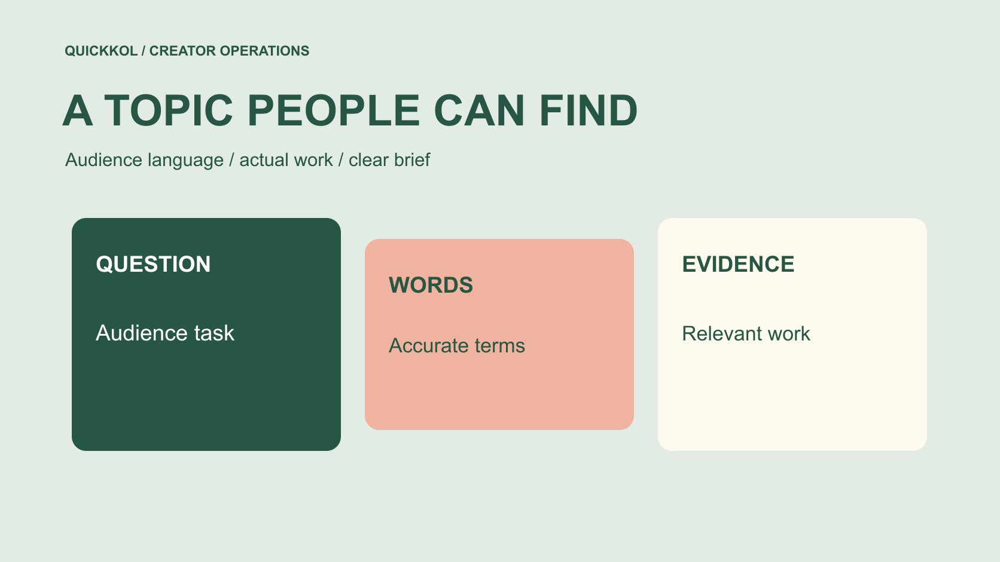

# Instagram SEO: Build a Searchable Creator Topic Brief

Status: local review draft; confirm the publication date before release.

Organize Instagram creator research around audience language and make the topic brief clear, searchable and reviewable.

QuickKOL editorial graphic; not actual account metrics or a platform interface.

Instagram SEO can serve creator marketing through a practical task: describe a topic in clear audience language and research which actual creator work answers that question. It is not repetitive keyword insertion or a guarantee that an account ranks first. Map audience questions and alternative expressions, record search conditions, verify candidate work and give the creator an accurate topic brief. This article provides neither undisclosed keyword weights nor a completed live ranking study. Its aim is to improve the connection between a brand’s task, the words a relevant audience uses and the evidence that a potential collaborator can explain the subject responsibly.

## Preserve query wording through translation

In multilingual handoff, preserve the original query with its explanation rather than only a translated summary. A term may be a model name, local nickname or different product category. Have an appropriate local editor check its meaning instead of merging results merely because literal translations look similar. This preserves the connection between the actual search and the work selected from it.

## Put the audience task before the keyword

State what the audience needs to learn, compare or decide. A keyboard brand might need to explain the prerequisites for replaceable switches rather than merely find technology influencers. Product terminology, problem language and the content task can differ; internal company vocabulary should not define the entire candidate pool.

Put the task in the [creator brief](https://www.quickkol.com/blog/write-a-useful-campaign-brief/#answer) and identify facts the brand must confirm. A creator’s natural phrasing can aid understanding without making an inapplicable popular term part of a product claim. The question should let a researcher judge whether a piece is relevant instead of checking only for an exact phrase in a biography. This prevents a search exercise from becoming a superficial naming match. A candidate can have the right vocabulary and lack demonstration ability, while another may explain the task well using a different but accurate expression.

## Build a small, accurate vocabulary map

For each task, retain a common name, technical name, question phrasing and terms that may be confused with it. Explain whether they are true synonyms or refer to different products or conditions. Ask someone familiar with the actual operation to check them. A larger result count does not prove semantic accuracy.

For multilingual projects, preserve real phrasing in each language rather than declaring a literal translation locally standard. Record whether a term came from customer questions, product material or creator work. Without actual collection, label it an editorial candidate for validation. The map supports research and communication, not a requirement to force every term into every caption. It can also reveal a necessary exclusion: if a term commonly refers to a product feature this model does not have, the brief should make that limitation clear rather than exploiting the term’s popularity.

## Make queries reviewable by another researcher

Combine topic and task terms, adding language or location clues where appropriate. Preserve the exact query, date, account context and filters actually available. Do not enter result positions for searches never performed or describe one person’s displayed order as a universal ranking.

[Meta’s content ranking explanation](https://about.fb.com/news/2023/06/how-ai-ranks-content-on-facebook-and-instagram/) provides context for personalization and user choices affecting presentation. It is not a fixed weight table for a particular Instagram search term. The record should explain what the researcher saw and did not verify rather than announce a new ranking rule on the platform’s behalf. A colleague reproducing the query may see different results, which does not by itself establish an error or manipulation. What needs to remain reproducible is the research procedure and selection reasoning, with observed outputs tied to the session in which they actually appeared.

## Move from term matching to work evidence

A topic in a candidate biography is a research starting point. Open relevant work and examine the actual question, visible demonstration conditions and distinction between personal experience and general conclusions. Preserve source links and review dates. Reposted work is not automatically production completed by the account owner.

Before outreach, confirm account, author and public contact route. Similar names do not establish the same person, and keyword presence does not prove professional credentials. The brand is selecting capability and terms appropriate to the assignment, not whichever profile is best at listing popular vocabulary. Where necessary evidence is missing, keep it unresolved rather than upgrading a candidate to verified expert. This distinction is especially useful for complex demonstrations: a short clip may show an interesting result but leave the underlying procedure or creator’s role unclear. Research should identify that gap before procurement assumes the person can reproduce the work.

## Make the partnership topic accurate rather than overloaded

Titles, openings and descriptions can naturally explain the audience problem while preserving prerequisites. Do not add undemonstrated features, service locations or credentials to satisfy a search term. A clearer topic helps the creator understand completion, but it does not guarantee ranking.

[Instagram’s creator education explanation](https://about.fb.com/news/2024/10/best-practices-education-hub-creators-instagram/) supplies official context for content and performance guidance. Invite the creator to consult resources applicable to their account while preserving genuine expression. Public learning material is not a mandatory caption formula and does not establish a required keyword count. Review facts, understanding and rights before asking whether the language naturally identifies the subject. If a proposed term changes the claim, return it to the appropriate fact owner rather than treating it as a harmless optimization. The partnership should remain accurate when a viewer encounters the caption alone, outside the original brief or surrounding research conversation.

## Do not attribute all exposure to keywords

[Meta’s unconnected recommendation explanation](https://ai.meta.com/blog/ai-unconnected-content-recommendations-facebook-instagram/) describes content and interest understanding in recommendation systems. It does not establish that a word produced this project’s views or that replacing it would yield a particular change. Viewing, search discovery and following should be discussed separately according to available evidence.

Without the necessary source breakdown, total views cannot reveal how much came from search. Relevant questions or an editorial judgment after clearer topic wording may still be recorded, but should not be called proven search-optimization results. Avoid crediting every performance difference to a caption or making creators responsible for an attribution claim without evidence. This preserves room for useful learning: the team can improve how it describes a product even when the platform does not expose a field that would support a precise search contribution. The limitation belongs beside the conclusion rather than only in a general methodology appendix.

## Rehearse a keyboard-topic research task

Suppose a brand needs to explain switch replacement for a particular keyboard. Editorial query candidates include the product category plus replacement, the audience question does it require soldering, and the technical expression hot-swappable. These are hypothetical terms, not verified search volumes or live rankings. The product owner first confirms what the model actually supports.

The researcher checks work for the connector, procedure and compatibility limits. The creator assignment is to explain the actual operation in appropriate language, not put every term into the title. A candidate who only demonstrates sound is not thereby proven able to perform disassembly safely. Request suitable work evidence or choose a different production role. Topic research thus informs creator matching directly. It also avoids commissioning a claim that looks searchable but cannot be demonstrated with the product and expertise available to the project.

## Write a brief the creator can execute

Supply a topic sentence, intended audience, required conditions, expressions that may be used naturally and claims that must not be made. Provide product-fact sources and a receiving approver rather than treating a vocabulary list as a complete script. Creators can suggest more natural language, with factual changes checked again.

Use the [candidate research method](https://www.quickkol.com/blog/influencer-discovery-tool-brief-to-candidates/#answer) to preserve how the work matches the task and why this person is being invited. Outreach can reference one specifically relevant piece without claiming a complete follower audit or guaranteed search traffic. Clear research makes an invitation specific rather than more certain than the evidence allows. The receiving creator should be able to distinguish essential facts from optional wording. Otherwise a useful search vocabulary map can accidentally become a rigid script that removes the very explanatory ability the brand selected the collaborator to provide.

## Retain reasons when updating vocabulary

Product renaming, changing audience questions or a corrected local expression may require updates. Record old term, new term, reason and affected work rather than changing a published address for every wording adjustment. Correct factual errors through the applicable workflow instead of rewriting genuine experience merely to chase a popular term.

Research samples have dates too. Work found last month should not be called the most relevant current result forever. Recheck task fit, source identity and contact suitability rather than continuously pursuing an undefined SEO score. Where no new need exists, stable language helps teams share terminology. An update record should also say whether the change affects meaning or simply improves readability. That helps the brand decide which pieces need factual review and avoids asking creators to reopen an entire completed assignment for a cosmetic preference.

## Use a clearer topic to support a better collaboration

Preserve audience question, vocabulary provenance, query record, candidate evidence and final topic. State what was actually searched and which items remain suggestions for validation. Without a live ranking study, do not claim complete search-opportunity coverage in the handoff.

Instagram SEO can reasonably help a brand organize and clarify relevant content and creator research. It should serve genuine explanation, accurate matching and specific outreach rather than turn influencer marketing into keyword accumulation. A natural title, work that answers its question and evidence supporting the next action give this exercise a useful role. The final brief should make sense to the creator even without the search spreadsheet. If it only contains a target term and a promise of traffic, the brand has not yet supplied the audience task or factual boundaries needed to commission responsible work.

## Searchable topic brief

| Field | Content | Boundary |
| --- | --- | --- |
| Audience question | What to understand or do | Not generic traffic |
| Vocabulary | Common, technical and question language | Near-synonyms may differ |
| Evidence | Work, account and date | Term matching is not capability |
| Topic | Actual features and prerequisites | No ranking guarantee |

The keyboard example is hypothetical query design, not actual search volume or ranking data.

## Before handing over the topic

Vocabulary aids understanding; evidence supports decisions.

- [ ] The topic serves an actual creator-partnership task.
- [ ] Vocabulary provenance and unverified status are clear.
- [ ] Candidates have specific work evidence.
- [ ] No keyword weights or ranking guarantees are invented.
- [ ] The brief includes facts, scope and next action.

## Research date and limitations

Sources reviewed November 12, 2026. Methods, tables and decision rules are editorial recommendations. Hypothetical examples are not actual client results or industry benchmarks. Source geography and periods are specified where relevant. This draft is in independent local review; confirm its publication date before release.

## Start creator research with a clear task

Use QuickKOL to interpret a brief, discover relevant creators and research their work and contact routes. Verify data, commercial terms and outcomes at their source.

[Explore QuickKOL](https://www.quickkol.com/#capabilities)

## Sources

- [Meta’s content ranking explanation](https://about.fb.com/news/2023/06/how-ai-ranks-content-on-facebook-and-instagram/)
- [Instagram’s creator education explanation](https://about.fb.com/news/2024/10/best-practices-education-hub-creators-instagram/)
- [Meta: unconnected recommendations on Facebook and Instagram](https://ai.meta.com/blog/ai-unconnected-content-recommendations-facebook-instagram/)
