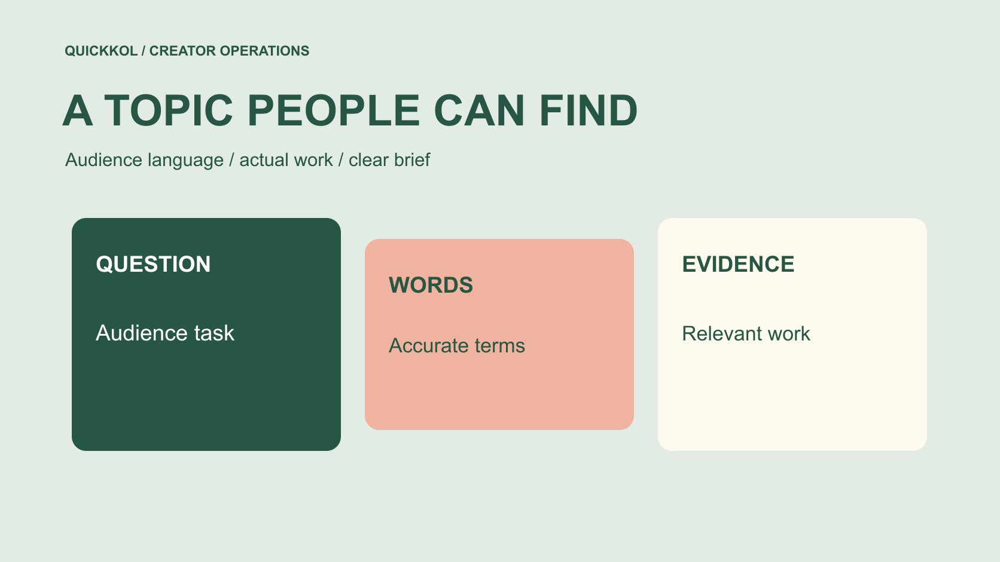

# Instagram 搜索怎样帮助品牌找到相关创作者

状态：本地审阅稿；正式发布日期待确认。

用观众实际使用的语言组织 Instagram 创作者研究，并把主题 Brief 写得清楚、可搜索、可核验。

QuickKOL 编辑图形；不呈现真实账号指标或平台界面。

Instagram SEO 在达人营销中可以从一个实用任务开始：让品牌和创作者用清楚的观众词汇描述主题，并研究哪些真实作品能回答该问题。它不是把关键词反复塞进标题，也不是承诺某个账号必然排第一。先整理受众问题与同义表达，记录搜索条件，核对候选作品，再把准确主题交给创作者。本文不提供平台未公开的关键词权重，也不声称本次完成了实时搜索排名调查。

## 保留查询原文，避免翻译抹去含义

交接多语言研究时，同时保留原查询和解释，不只留翻译后的概括。某词可能是型号名、当地昵称或另一类产品。让当地编辑检查其含义，不能因为直译相似就合并结果。

## 把观众任务放在关键词前面

品牌先说明观众需要学会、比较或决定什么。例如，键盘品牌需要解释可更换轴体的前提，而不是笼统寻找“科技达人”。产品词、问题词和作品任务可以不同，不能只用公司内部术语来限定候选。

把这个任务写进[达人 Brief](https://www.quickkol.com/zh/blog/write-a-useful-campaign-brief/#answer)，同时标出哪些事实必须由品牌确认。创作者的自然说法可能帮助理解，但不能把不适用的流行词写进产品主张。一个清楚的问题应能让研究者判断某篇作品是否相关，而不是只看简介里有没有出现某个精确词组。

## 建立一个小而准确的词汇表

为每个任务保留常用名称、专业名称、问题表达与容易混淆的词。说明它们是否真正同义，还是指不同产品或条件。品牌可以请熟悉实际操作的人核对，不用把搜索结果多当成词义正确的证明。

多语言项目保留各语言的实际表达，不逐字翻译后就宣称当地通用。记录词来自客户问题、产品资料还是创作者作品；没有真实采集就标为待验证的编辑候选。词汇表应帮助研究与沟通，不应变成要求每篇文案强塞全部词的清单。

## 查询要能让同事复查

用主题词与任务词组合查询，再视需要加入语言或地域线索。保留查询原文、日期、账号上下文与实际可用筛选。不要在没有执行搜索时填入结果排名；也不要把一次个人界面看到的顺序写成所有人的统一排名。

[Meta 的内容排序说明](https://about.fb.com/news/2023/06/how-ai-ranks-content-on-facebook-and-instagram/)介绍个性化与用户选择如何影响内容呈现。它提供理解结果差异的背景，不是某个 Instagram 搜索词的固定权重表。研究记录应说明自己看见什么以及没核验什么，而不是替平台宣布一种新的排名规则。

## 从词汇匹配走到作品证据

候选简介写了某个主题，只是研究起点。打开相关作品，看它实际解释哪个问题、演示条件是否可见、是否能区分个人经验与一般结论。保存作品地址与核对日期，不把转发作品自动当成账号自己完成的制作。

需要联系时再核对账号、作者和公开联系路径。相似名称不能证明是同一个人，关键词出现也不能证明专业资质。品牌选择的是适合本次任务的能力与合作条件，而不是谁更擅长在简介堆热门词。缺少必要证据时，保留待确认而不是把候选改写成已验证专家。

## 让合作主题准确，而不是过度优化

标题、开头和说明可以用自然语言清楚表达观众要解决什么，保留必要前提。不要为了搜索词，把未演示的产品功能、地域服务或资质写进文案。主题越清楚，创作者越容易知道什么内容算完成，但这不是排名保证。

[Instagram 的创作者学习说明](https://about.fb.com/news/2024/10/best-practices-education-hub-creators-instagram/)提供内容与表现指导的官方背景。品牌可以让创作者参考其账号适用资料，同时尊重真实表达。公开学习资源不是强制文案公式，不能从中推导“每条必须放几个关键词”。合作审核应先看事实、理解与许可，再看词汇是否自然帮助识别主题。

## 不要把推荐曝光全部归给关键词

[Meta 的非关注推荐说明](https://ai.meta.com/blog/ai-unconnected-content-recommendations-facebook-instagram/)介绍内容与兴趣等因素参与推荐的背景。它没有证明某个词带来本次观看，也没有确认把词换掉就会得到相同比例变化。观看、搜索发现与关注选择，应按可用证据分别讨论。

如果平台没有提供所需来源拆分，就不能从总观看反推出搜索带来多少。可以记录主题更清楚后的相关问题或编辑判断，仍不称为已证明搜索优化效果。品牌应避免把所有表现变化都归功于文案，也避免用没有依据的归因要求创作者承担结果。

## 演练键盘主题研究

假设品牌需要解释某型号的轴体更换。编辑候选查询包括产品类别加“更换”、观众问题“需要焊接吗”，以及专业表达“热插拔”。这些是假设词，不是已核验搜索量或实时排名。产品负责人先确认该型号实际支持什么。

研究者在作品中检查是否展示接口、过程与适配限制。最终给创作者的任务，是用适当语言说明真实操作，而不是把三个词都塞进标题。若某候选只做声音展示，不应据此认定能安全完成拆装；可以继续询问作品或选择更适合的制作角色。主题研究由此直接帮助达人匹配。

## 把 Brief 写成创作者能执行的说明

交付主题句、目标观众、必须说明的条件、可以自然使用的表达和不能声称的内容。提供产品事实来源与审核接收人，不把一个词汇列表当完整脚本。创作者可以提出更自然说法，但有事实变化时重新核对。

用[候选研究方法](https://www.quickkol.com/zh/blog/influencer-discovery-tool-brief-to-candidates/#answer)保留作品与任务的对应关系，说明为什么邀请这个人。外联可以引用一项具体相关作品，不要说已全面审计其粉丝或承诺本次一定获得搜索流量。清楚的研究让邀请更具体，而不是给不必要的确定性包装。

## 更新词汇时保留原因

产品更名、观众提问变化或市场翻译修正，都可能需要更新。记录旧词、新词、原因与影响作品，不必为每次微调改动已发布地址。若原文有事实错误，按团队适用流程纠正，不只为了追热门词重写真实经历。

研究样本也有日期，不能将上月找到的作品永久称为当前最相关。复核重点是任务仍适合、作品来源仍清楚和联系方式可用，不是不断追求一个未经定义的 SEO 分数。没有新的必要性时，保持稳定表达也有助于团队使用同一套术语。

## 用更清楚的主题支持更好的合作

完成时保留观众问题、词汇来源、查询记录、候选证据和最终主题。说明实际搜索了什么，哪些只是待验证建议。没有实时排名调查，就不要在交接页称为“已覆盖全部搜索机会”。

Instagram SEO 对品牌的合理价值，是让相关内容与创作者研究更容易被理解和组织。它应服务真实解释、准确匹配和具体外联，不应把达人营销变成关键词堆砌。让标题自然表达问题、作品真正回答问题，并让证据支持下一步，才符合这份研究的用途。

## 可搜索主题 Brief

| 字段 | 内容 | 边界 |
| --- | --- | --- |
| 观众问题 | 需要理解或完成的任务 | 不是笼统流量 |
| 词汇 | 常用、专业与问题表达 | 不把近义当完全同义 |
| 证据 | 作品、账号与日期 | 词汇匹配不等于能力 |
| 主题 | 真实功能与必要条件 | 不保证排名 |

键盘例子为假设查询设计；不提供真实搜索量或排名数据。

## 主题交接前核对

词汇帮助理解，证据帮助决定。

- [ ] 主题围绕真实达人合作任务。
- [ ] 词汇来源与未验证状态明确。
- [ ] 候选有具体作品证据。
- [ ] 没有编造关键词权重或排名保证。
- [ ] Brief 同时包含事实、范围与下一步。

## 研究日期与使用边界

资料核验于 2026 年 11 月 12 日。文中方法、表格和决策规则为编辑建议，标为假设的示例不是实际客户结果或行业基准。外部资料的适用地区与时期按各段说明；本稿处于独立本地审阅阶段，正式发布日期待确认。

## 用清楚的任务开始达人研究

用 QuickKOL 理解 Brief、发现相关达人并研究作品与联系路径；数据、合作条件和结果仍需核验。

[了解 QuickKOL](https://www.quickkol.com/#capabilities)

## 来源

- [Meta 的内容排序说明](https://about.fb.com/news/2023/06/how-ai-ranks-content-on-facebook-and-instagram/)
- [Instagram 的创作者学习说明](https://about.fb.com/news/2024/10/best-practices-education-hub-creators-instagram/)
- [Meta：Facebook 与 Instagram 的非关注内容推荐](https://ai.meta.com/blog/ai-unconnected-content-recommendations-facebook-instagram/)
