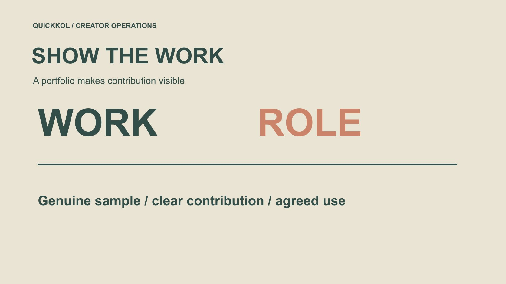

# Build a Male Creator Portfolio Brands Can Evaluate

Status: local review draft; confirm the publication date before release.

Help brands evaluate a male creator through genuine capability, documented contribution and a clear purchasable scope.

QuickKOL editorial graphic; not actual account metrics or a platform interface.

To become an influencer as a man, start with work that demonstrates genuine capability rather than a universal masculine image. Explain whom you help, what you clarify, which parts you produced and whether a brand can commission production, publication or both. Label self-initiated samples instead of presenting them as client partnerships. Keep work evidence separate from audience scale and income expectations. This creator-marketing guide offers a portfolio method without appearance rankings or guarantees of followers, contracts or earnings. Men do not need one topic or performance style; a brand needs to understand the specific role a particular creator can responsibly fulfill.

## Define the role through an audience question

Choose a task you can actually explain or perform, such as software operation, clothing use, a craft process or product comparison. A topic need not be selected because someone considers it masculine. State genuine experience, necessary conditions and credentials you do not claim to hold.

A brand needs to see how the work helps its intended audience. Use the [creator brief](https://www.quickkol.com/blog/write-a-useful-campaign-brief/#answer) in reverse to review your introduction: can a buyer understand what to invite you to do? Enjoying lifestyle and technology is not specific enough.

A role can develop, but the current portfolio should represent demonstrated ability rather than future interests presented as completed experience. This also gives a brand a constructive next question. Instead of asking whether you are generally an influencer, it can ask about a defined task, your method and the conditions needed to produce suitable work.

## Show a few complete works instead of a vague capability list

A complete piece should make the question, your actual action, necessary conditions and conclusion understandable. Attractive production can help viewing without replacing explanation. Do not provide only a montage that leaves the original task unclear.

Preserve the original address or appropriately accessible file with version and date. Published work and unpublished samples can coexist if their states are clear. Do not claim another person’s work or every team contribution as your own to appear more experienced.

A brand may need different lengths, languages or uses. The portfolio establishes capability; discuss deliverables after receiving the assignment rather than promising every format at no additional cost. A buyer should be able to inspect one relevant piece without being required to infer production quality from a follower number or a list of software names.

## Use a work card to explain your contribution

Record task, your role, collaborators, conditions and permitted display scope. Filming, performance, research, editing and account publication may belong to different people. A brand needs to know what you can deliver independently and what requires a team.

For team work, obtain appropriate display permission and describe contributions accurately. [U.S. Copyright Office’s work-use FAQ](https://www.copyright.gov/help/faq/faq-fairuse.html) provides permission context for U.S.-relevant material, with applicable requirements elsewhere needing assessment. A public portfolio is not permission for a brand to advertise with its contents.

Separate available for research display from available for licensed reuse. The latter requires rights-holder, version and actual scope confirmation. Use the [work and usage scope](https://www.quickkol.com/blog/creator-rates-usage-rights/#answer) to describe the actual proposed use, rather than treating a visible sample as cleared inventory. This keeps a portfolio useful to a buyer without misleading them about inventory already cleared for a new campaign or creating a promise you cannot fulfill on other contributors’ behalf.

## Label self-initiated samples without inventing clients

Without brand experience, make a suitable self-initiated sample around an actual task and state that it is not commissioned or endorsed by the brand. Do not give practice work a client-case heading, invented results or a nonexistent testimonial. A buyer can study capability without a fabricated commercial history. A useful sample note identifies what you would need to change for a real purchase: an approved product version, verified claims, publication terms and a responsible approver. The note is not permission to reuse the existing sample.

Suppose a brand later requests several crops and advertising use. That is a new scope to confirm, not proof those rights were included because the sample was easy to view. The creator can explain available source files and actual contributions while the buyer identifies the versions it needs. This turns a portfolio discussion into a concrete purchase without retroactively inventing a client relationship.

Product experience must remain genuine, with unconfirmed features excluded from conclusions. Where gifts, other relationships or commercial publication are involved, assess applicable disclosure from actual facts.

Keep sample status visible in both work card and file notes so forwarding does not remove it. Without real project performance, do not create something resembling a client analytics screenshot. Clear labeling also helps a brand ask for an appropriate new assignment instead of assuming it can republish the practice piece under conditions never discussed.

## Use performance evidence only for supported claims

Record source, period and definition separately for scale, views, interaction and commercial outcomes. Without sales evidence, do not infer income from views; without audience information, do not let a few comments represent everyone. Explicit unknowns are more professional than an attractive unreviewable success rate.

Brands should use these records according to task too. A new creator may demonstrate production ability without enough publication evidence. That can support discussing production rather than pretending a mature distribution record exists.

Do not purchase followers or artificial engagement to complete the portfolio. It makes the data harder to interpret without establishing ability to deliver the brand’s work. The distinction gives an emerging creator an honest proposition: suitable work can be commissioned on its own merits while audience development remains a separate, uncertain process.

## Check commercial content requirements by platform

[YouTube’s branded content policy](https://support.google.com/youtube/answer/17596007?hl=en) addresses brand influence, an exchange of value and corresponding disclosure in context. Distinguish independent samples, actual sponsorship and later brand reuse rather than assigning the same status whenever one file appears somewhere new.

For U.S.-relevant collaborations, [FTC’s influencer disclosure guide](https://www.ftc.gov/system/files/documents/plain-language/1001a-influencer-guide-508_1.pdf) is another reference for assessing actual material connections. Platform labels and regional requirements need applicable review; this article supplies no universal legal conclusion.

Brands need accurate commercial context, and creators should recognize that personal claims require genuine experience. Payment cannot turn an experience that never happened into a fact. A portfolio can therefore show how you handle a relationship responsibly without advertising a blanket compliance certification. The relevant evidence is the actual work and its circumstances, not merely a statement that you always follow every rule.

## Rehearse an initial three-work collection

Suppose an adult male creator understands desk equipment and prepares three self-initiated works: explaining a connector, demonstrating installation and answering a common misunderstanding. Different tasks can share genuine capability without an exaggerated masculine persona. This fictional case contains no client, payment or growth data.

Each work card records question, contribution, conditions and sample state. If a friend performs installation, record that instead of claiming the friend’s operation as your technical skill. A brand can identify the role or team it actually needs.

The collection guarantees no partnership. Its value is moving the first conversation from what can you do to a concrete assignment. The creator can also identify a gap responsibly: if every work explains a product but none demonstrates onsite hosting, the portfolio should not claim that additional capability merely because it sounds commercially attractive.

## Give a brand a specific reason to talk

Outreach should concern one relevant question and one piece, identifying the role you would discuss. Avoid claiming to promote every product or pretending to have researched a client need you never examined. Without a quote scope, request an appropriate brief instead of offering one fee for every future use.

After a response, confirm production, publication, rights and timing. An invitation to discuss is not a contract, and a gifted product does not automatically establish mutually agreed publication obligations. Record the actual arrangement.

The contact route can be simple but should let a responsible owner continue without unnecessary personal or client information in the first exchange. A clear next step might be a scope discussion or a request for relevant work, rather than an immediate demand that either party commit to a result neither has defined.

## Choose a scoped pilot without promising outcomes

A first collaboration can define deliverables and one learning question, with acceptance, revision scope and receiving owner. A brand should not transfer every sales risk to an emerging creator, while being new does not excuse ignoring confirmed facts and requirements.

Review delivery, expression and available performance separately. Agree again for extra variants or filming instead of treating every lesson as unpaid revision. Portfolio updates should use only material and results suitable for public display.

Reliable capability grows through actual work and clear feedback, not a promise of reaching a follower or income threshold by a given month. A pilot should leave both parties able to explain what was delivered, what remains uncertain and whether a further assignment is justified, without turning a useful learning experience into a claim of guaranteed career success.

## Build a partnership identity through reviewable capability

The finished portfolio should show genuine topic, complete work, contribution, commercial state, discussable scope and public contact route. Appearance and gender replace none of that evidence and do not determine every suitable subject.

Men entering creator marketing can begin with one task they can genuinely perform. Brands can evaluate actual work instead of stereotypes, scale alone or unrealistic income expectations.

The next step is not adding more titles, but connecting relevant work with a defined requirement under appropriate conditions. A recipient should be able to distinguish demonstrated skill, proposed services and ambitions still in development. That makes the portfolio a useful partnership document rather than a collection of claims whose meaning a buyer must guess.

## Creator portfolio work card

| Field | Content | Do not misrepresent |
| --- | --- | --- |
| Task | Who learns what | Universal capability |
| Contribution | Personal role, team and conditions | All work done personally |
| State | Independent sample or actual partnership | Invented client |
| Scope | Production, publication and discussable rights | Display means unlimited reuse |

The three-work case is hypothetical; a portfolio guarantees no followers, partnership or income.

## Before sharing a portfolio

Make actual capability clearer than a title.

- [ ] Actual tasks match the work.
- [ ] Personal and team contributions are distinguished.
- [ ] Samples are not presented as client results.
- [ ] Work and usage scope are explicit.
- [ ] The next contact step is specific without outcome guarantees.

## Research date and limitations

Sources reviewed November 12, 2026. Methods, tables and decision rules are editorial recommendations. Hypothetical examples are not actual client results or industry benchmarks. Source geography and periods are specified where relevant. This draft is in independent local review; confirm its publication date before release.

## Start creator research with a clear task

Use QuickKOL to interpret a brief, discover relevant creators and research their work and contact routes. Verify data, commercial terms and outcomes at their source.

[Explore QuickKOL](https://www.quickkol.com/#capabilities)

## Sources

- [U.S. Copyright Office: using another person’s work](https://www.copyright.gov/help/faq/faq-fairuse.html)
- [YouTube’s branded content policy](https://support.google.com/youtube/answer/17596007?hl=en)
- [FTC’s influencer disclosure guide](https://www.ftc.gov/system/files/documents/plain-language/1001a-influencer-guide-508_1.pdf)
