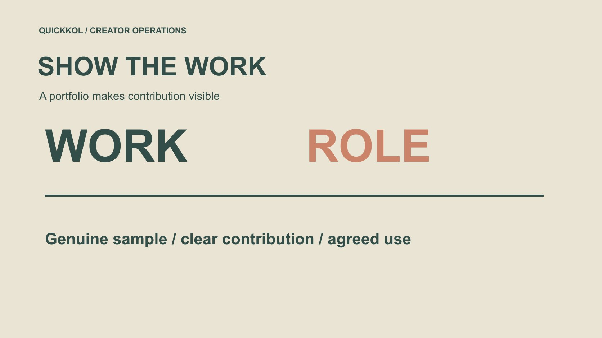

# 男性创作者怎样建立品牌可评估的合作作品集

状态：本地审阅稿；正式发布日期待确认。

男性创作者怎样把真实能力、作品贡献和可采购范围整理成品牌能评估的合作作品集。

QuickKOL 编辑图形；不呈现真实账号指标或平台界面。

男性想成为品牌愿意研究的创作者，可以先建立一组能证明实际能力的作品，而不是寻找通用的男性形象模板。明确你为谁解释什么、作品里由你完成哪些部分，以及品牌可以采购制作、发布还是两者。自发样片应标清状态，不冒充真实客户合作；作品与关注规模、收入预期分开。本文从达人营销合作角度提供作品集方法，不按外貌排名，不保证粉丝、签约或收入，也不认为所有男性创作者需要使用同一种题材或表达。

## 用观众问题定义自己的角色

先选择你确实能解释或完成的任务，例如软件操作、服装使用情境、手工过程或产品比较。不是因为某类题材被认为适合男性就必须采用。说明你有什么真实经验、需要哪些条件，以及不能代表什么专业资格。

品牌评估时需要看到作品如何帮助目标观众。可以用[达人 Brief](https://www.quickkol.com/zh/blog/write-a-useful-campaign-brief/#answer) 反过来检查自己的介绍：对方能否知道适合请你做什么？只有“喜欢生活与科技”还不够具体。

角色可以逐步发展，但当前作品集应忠于已经能展示的能力，不把未来想学的技能写成完成过的经验。

## 用少量完整作品替代模糊能力表

一条完整作品应让人看懂问题、你的实际动作、必要条件与结论。画面漂亮可以帮助观看，但不能替代清楚解释。不要只交混剪，让品牌无法知道原作品做了什么。

保留原始地址或适当可访问文件，说明版本与时间。账号发布过的作品和未发布样片可以同时存在，只要状态清楚。不能为了显得经验丰富，把他人作品或团队成果全部认领为个人完成。

品牌可能需要不同长度、语言或使用范围。作品集先证明能力，具体交付在获得任务后讨论，不提前承诺所有格式都能无成本提供。

## 让每张作品卡说明你的贡献

记录作品任务、你的角色、合作人员、使用条件和可展示范围。拍摄、出镜、研究、剪辑和账号发布可能由不同人完成，品牌需要知道你能独立承担哪些部分，哪些需要团队。

如果使用团队作品，取得适当展示许可并准确署明贡献。[美国版权局的作品使用问答](https://www.copyright.gov/help/faq/faq-fairuse.html)可作为美国相关作品使用的许可背景，其他地区按适用要求处理。作品集公开展示不等于品牌可以拿去投放。

把“可以展示以供研究”与“可以购买复用”分开。后者需要核对权利人、版本和实际使用范围。 用[作品与许可范围](https://www.quickkol.com/zh/blog/creator-rates-usage-rights/#answer)说明拟使用方式，不把可以查看的样片当作已经清权的库存。

## 把自发样片标清，不虚构客户

没有品牌经验时，可以围绕真实任务自发制作适当样片，但说明它不是品牌委托或背书。不要把练习加上客户案例标题、虚构结果或不存在的推荐语。品牌可以从样片研究能力，不需要你伪装一段商业履历。 可以在样片卡说明真实采购还需要哪些确认：批准的产品版本、核验主张、发布条件与接收人。这不是授予样片复用权。

假设品牌之后要求多种裁切和广告用途，应作为新范围确认，不因样片容易查看就视为已包含。创作者说明实际源文件与贡献，品牌说明所需版本，让沟通进入具体采购，而不倒过来虚构客户关系。

产品体验仍要真实，无法确认的功能不作为结论。免费获得产品、存在其他关系或准备发布商业内容时，按实际情况核对适用披露。

样片状态应在作品卡与文件说明中都能找到，避免转发后丢失。没有真实项目表现，就不制作看似客户后台的数据截图。

## 表现数据只说明它实际支持的内容

账号规模、观看、互动和商业结果分别记录来源、时间与口径。没有销售证据，不从观看推导收入；没有受众资料，不用个人观众留言代表全部群体。适当说明未知，比一个漂亮但无法复核的成功率更专业。

品牌也应按任务看待这些资料。新创作者可能有相关制作能力，但尚未建立足够发布证据；这可以支持先讨论制作，不必虚称拥有成熟分发能力。

不要通过买粉或刷量补作品集。它会使原本需要解释的数据更难使用，也不能证明你能完成品牌的内容任务。

## 按发布平台核对商业内容要求

[YouTube 的品牌内容政策](https://support.google.com/youtube/answer/17596007?hl=en)把品牌影响、价值交换与相应披露放在实际内容情境中。作品集中的独立样片、真实赞助与后续品牌复用要分别说明，不因为同一个文件出现于不同地方就使用同一种状态。

面向美国消费者的相关合作，还可参考 [FTC 的达人披露指南](https://www.ftc.gov/system/files/documents/plain-language/1001a-influencer-guide-508_1.pdf)，按实际利益关系核对。平台标签与地区要求都需要适用判断，本文不提供全球统一法律结论。

品牌需要准确商业说明，创作者也应知道哪些个人主张只能由真实经验支持。付款不能使没有发生的体验变成事实。

## 演练一份三个作品的初始组合

假设一位成年男性创作者熟悉桌面设备，准备三项自发作品：解释接口、演示安装和回答一个常见误解。它们展示不同任务，但都围绕真实能力，不需要用夸张男性形象来维持一致。案例没有实际客户、报酬或增长数据。

每张作品卡写清问题、本人贡献、条件和样片状态。若安装由朋友完成，就如实记录，不把对方操作认领为自己的技术能力。品牌可以据此判断需要哪种角色或团队。

初始组合不保证拿到合作。它的价值是让第一次沟通从“你到底能做什么”进入具体需求。

## 给品牌一条具体联系理由

联系时围绕一个相关问题与一项作品，说明你愿意讨论什么角色。不要群发“我能推广所有产品”，也不假装读过没有研究的客户需求。没有明确报价范围时，先请求适当 Brief，不用一个价格包住全部未来使用。

品牌回复后，确认制作、发布、许可与时间。对方邀请讨论不是已经签约，赠送产品也不自动等于双方达成了发布义务。按实际约定记录。

联系路径可以简单，但要能让真正负责人继续处理，不在初次交流里索取不必要个人或客户资料。

## 选择试点范围，学习而不保证结果

第一份合作可以围绕清楚的交付与学习问题，说明验收、修改范围与接收人。品牌不应把全部销售风险转给新创作者；创作者也不能用“新人”忽略已经确认的事实与工作要求。

完成后分别复盘交付、表达与可用表现。需要额外版本或新拍摄时重新约定，不把所有学习都视为免费返工。对作品集更新，也只使用可以适当公开的素材与结果。

稳定能力来自真实工作与清楚反馈，不来自承诺某个月一定达到粉丝或收入门槛。

## 用可核验能力建立合作身份

最终作品集应让人看到真实主题、完整作品、本人贡献、商业状态、可讨论范围与公开联系路径。外貌与性别不能替代这些证据，也不决定所有适合的题材。

男性创作者进入达人营销，可以从一个自己确实能完成的任务开始。品牌则可以按具体工作与证据评估，而不是用刻板形象、规模或不切实际的收益预期作决定。

下一步不是给自己增加更多头衔，而是让一项相关作品与一份明确需求有条件地连接。

## 创作者作品卡

| 字段 | 内容 | 不要冒充 |
| --- | --- | --- |
| 任务 | 帮助谁理解什么 | 泛泛全能 |
| 贡献 | 本人、团队与条件 | 所有工作都由本人完成 |
| 状态 | 独立样片或真实合作 | 虚构客户 |
| 范围 | 制作、发布与可讨论许可 | 展示等于无限复用 |

三作品案例是假设；作品集不保证粉丝、合作或收入。

## 作品集发给品牌前

让实际能力比头衔更清楚。

- [ ] 真实任务与作品对应。
- [ ] 个人贡献与团队贡献区分。
- [ ] 样片不冒充客户成果。
- [ ] 作品与许可范围明确。
- [ ] 联系下一步具体且不保证结果。

## 研究日期与使用边界

资料核验于 2026 年 11 月 12 日。文中方法、表格和决策规则为编辑建议，标为假设的示例不是实际客户结果或行业基准。外部资料的适用地区与时期按各段说明；本稿处于独立本地审阅阶段，正式发布日期待确认。

## 用清楚的任务开始达人研究

用 QuickKOL 理解 Brief、发现相关达人并研究作品与联系路径；数据、合作条件和结果仍需核验。

[了解 QuickKOL](https://www.quickkol.com/#capabilities)

## 来源

- [美国版权局：使用他人作品](https://www.copyright.gov/help/faq/faq-fairuse.html)
- [YouTube 的品牌内容政策](https://support.google.com/youtube/answer/17596007?hl=en)
- [FTC 的达人披露指南](https://www.ftc.gov/system/files/documents/plain-language/1001a-influencer-guide-508_1.pdf)
