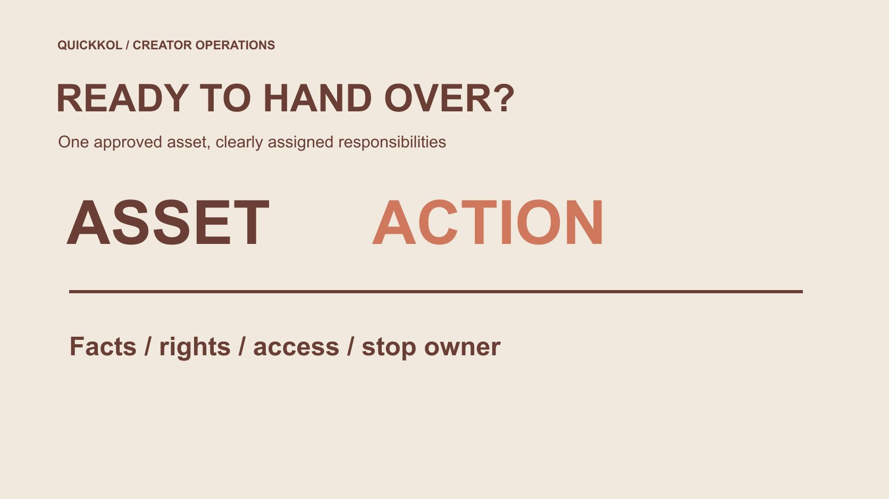

# Paid Media Agency: Define the Creator Asset Handoff

Status: local review draft; confirm the publication date before release.

Define licensing, editing, publication, costs and reporting responsibilities before handing creator assets to a paid media agency.

QuickKOL editorial graphic; not actual account metrics or a platform interface.

When a paid media agency receives creator assets, a brand should distinguish four responsibilities: confirming facts and the creator’s expression, checking permission, operating advertising and interpreting results. Receiving a video file does not authorize arbitrary editing, use of a creator’s account identity or an extended term. Specify the asset version, channel, market, duration, approver and stop owner, alongside the agency’s actual service scope. This is a creator-marketing handoff method, not an agency ranking, universal contract or performance guarantee. A usable handoff lets each party know both what it may do and which unresolved decision must return to someone else.

## Define the work the agency is taking over

Media buying, asset editing, creative strategy and creator management may belong to different teams. List what this handoff actually includes rather than assuming a full-service label assigns all fact-checking, licensing negotiation and creator communication. Preserve the original assignment in the [creator brief](https://www.quickkol.com/blog/write-a-useful-campaign-brief/#answer) and add a responsibility note for the media work.

Each task needs an executor and an owner who can accept the decision. An agency can recommend a change without unilaterally rewriting the creator’s experience. A brand can confirm product facts without necessarily controlling every right in the creator’s expression. Responsibility allocation is not transferring every uncertainty to whoever last received the file. It routes a decision to someone with the facts and relevant authority. This also prevents unpaid work from appearing between teams: if ongoing creator communication is necessary but outside the agency scope, the brand must assign it rather than hoping an editor will absorb it informally.

## Identify the version rather than receiving a folder

Preserve source, approved version, language, aspect ratio, captions and explanatory notes. Different endings or crops need distinct version identifiers rather than same-name overwrites. A published link and a downloadable file are different objects and do not establish that their content always remains identical.

The original, media adaptation and final ad preview should be traceable to one another. If the agency receives only a low-resolution preview, it should not replace it with another version found publicly. Confirm the correct asset with the authorized owner. A missing file can delay action on that asset without invalidating the creator’s whole delivery. Naming the missing item is more actionable than marking everything unusable. The version record should also identify who supplied the file and when, so a later editor can distinguish a deliberate approved change from a stale attachment that happened to appear in the most recent email thread.

## Attach permission to the actual use

[U.S. Copyright Office’s work-use FAQ](https://www.copyright.gov/help/faq/faq-fairuse.html) explains permission in the context of using another person’s work. For U.S.-relevant assignments it helps distinguish public visibility from authorized use; applicable requirements elsewhere still need assessment. Receiving a file does not establish every advertising, adaptation and sublicensing right.

Use the [paid media licensing scope](https://www.quickkol.com/blog/influencer-content-licensing-paid-media-schedule/#answer) to record channel, market, term, version and permitted edits separately. Music, third-party footage, people and account identity may also require distinct confirmation rather than one blanket commercial-use label. Appropriate owners handle actual agreement and rights review. The working card helps executors distinguish confirmed matters from open ones; it does not claim to complete legal clearance itself. Where one element remains unresolved, identify whether an authorized alternative is feasible. Do not remove a credit, substitute music or reframe the creator merely to make the file appear ready while leaving the underlying permission question unanswered.

## Confirm platform access separately from asset rights

[Meta’s creator collaboration explanation](https://about.fb.com/news/2024/02/creator-marketplace-for-brands-and-creators-to-collaborate-on-instagram/) described partnership ads amplifying content with a partner’s account identity in 2024. This supplies format context, not proof that an agency has every platform permission because a brand emailed it. Appropriate account owners should verify current eligibility, allowed content and settings.

Track asset permission confirmed, platform access unresolved and ad preview unapproved separately. Do not request a creator’s password as a substitute for an authorized permission route or infer indefinite scope from an earlier authorization. Technical ability does not establish commercial permission, and contractual permission does not establish that current platform conditions are met. Both must be understood before the corresponding action proceeds. This distinction gives an agency a precise escalation request. It can ask the account owner to resolve a specific access issue without reopening every commercial term or telling the creator that the entire collaboration failed.

## Adaptation must preserve the original meaning

Cropping vertically, shortening an opening or adjusting captions can affect whether qualifications remain visible. Establish which changes are within scope and which need renewed review. Turning applicable under a condition into suitable for everyone changes the claim even if the edit removes only a few seconds. It is not merely technical processing.

After adaptation, have the product owner review facts, the creator or appropriate representative review personal expression and an authorized owner accept the ad preview. These decisions need not belong to the same person, and the creator need not endorse every technical media setting. State the object of each review so a casual looks fine email does not become approval of every edit, right and advertising condition. The final preview should show the actual combination the audience will receive, including captions and destination context, rather than a clean video detached from the claims added around it.

Check framing, captions and qualifications in each adaptation; a shorter file does not establish unchanged meaning.

## Make fees and result reporting explainable

[Google’s third-party advertising policy](https://support.google.com/adspolicy/answer/6086450?hl=en) requires relevant third parties to be transparent about services, costs and expected results. That applies within Google Ads rather than automatically defining one rule for every other platform. A brand can nevertheless request explicit itemization for its own agreement.

Record agency services, creator work, licensing and media spend separately, including currency, period and inclusions. Preserve source, metric definition and attribution window in reports. Views, platform-recorded conversions and business-confirmed revenue are different outcomes. The agency can explain observations and optimization actions while the brand supplies evidence for commercial events it owns. If either party lacks data, state the effect rather than having the other endorse an unknown. This makes cost discussions fairer as well: a creator’s agreed production fee should not be reclassified as an agency performance failure merely because a separate media or business outcome did not meet expectations.

## Establish what can be stopped and by whom

Who receives a notice, assesses impact and pauses activity when permission approaches expiry, product facts change or a creator requests an appropriate correction? Define that at handoff rather than searching for someone over a weekend. A platform operator may be able to pause advertising without having authority to approve new budgets or accept new rights terms.

Preserve identifiable ad references, asset versions and applicable end dates for running work. After a stop, record actual state and time instead of treating agency notified as evidence that delivery ended. Organic publication, asset storage and later reuse may require separate handling. Pausing one ad does not establish that every copy disappeared or every obligation ended. A stop owner needs enough context to act on the affected item without guessing which similar filename or campaign it belongs to. This is an operational requirement to agree, not a promise that every platform action takes effect instantly.

## Rehearse a shortened-video change

Suppose a brand approves a thirty-second demonstration and the agency creates a fifteen-second ad. The original begins with a required-accessory condition. Removing it makes the remaining footage appear to show immediate use. This fictional example contains no client results. The agency should flag a change needing fact review instead of treating a shorter derivative as already approved.

The product owner checks the condition, the creator confirms the revised work preserves the experience and an authorized owner approves the version containing the necessary qualification. If fifteen seconds cannot communicate it clearly, change the approach, extend the piece or decline the adaptation. Record the final version and reason. Shorter is not automatically more effective, and an unverified performance expectation does not justify sacrificing accuracy. The exercise also reveals the handoff’s missing field: the original qualification should have been identified as something the adaptation must preserve, rather than relying on an editor to discover its importance after the cut.

## Discuss improvement against the agreed responsibilities

When an ad underperforms, first ask whether evidence is sufficient and comparison conditions hold. Explanation, paid audience, destination and follow-up may each affect observations, but general possibilities do not establish the actual cause. Do not make the creator responsible for every business difference merely because it happened during the partnership.

Separate whether delivery met the agreement from how to improve the next round. The first checks version, facts and scope; the second proposes suitable questions and new work. Additional filming, licensing or editing needs clear purchasing and responsibility rather than every lesson automatically becoming unpaid revision. An honest review lets brand, creator and agency continue collaborating without competing for unsupported credit or blame. It should identify a concrete next decision, such as clarifying one prerequisite, and the evidence needed to assess it. Otherwise a lengthy report can still leave each party with a different understanding of what is expected next.

## Complete handoff through actual acceptance

Completion should state which files the agency received, which scope it accepted, what remains missing and who owns open items. Sending a download link is a transfer action, not proof of readable files, correct versions or complete permission. Give the recipient a way to identify problems before calling the handoff complete.

A paid media agency can use appropriately licensed creator work for a defined advertising assignment. Its value should appear in specific services, explainable reporting and responsible execution rather than an all-inclusive label obscuring the boundaries between creator, brand and agency. A handoff that can be executed, stopped and reviewed preserves the collaboration’s facts and terms as it enters the media process. Keep the accepted record with the relevant assets so a later operator does not need to reconstruct permission from a scattered conversation before making the next routine change.

## Creator-asset agency responsibility card

| Work | Review object | Receiving owner |
| --- | --- | --- |
| Facts and expression | Conditions, experience and captions | Product owner and appropriate creator representative |
| Rights | Version, channel, market and duration | Authorized owner |
| Advertising | Access, preview and budget | Authorized media operator |
| Stop | Ad identifier, timing and state | Owner able to act and confirm |

Assign responsibilities through the actual agreement; this table grants neither rights nor account access.

## Before the agency takes over

Make every approval refer to a defined object.

- [ ] Agency scope and receiving owner are explicit.
- [ ] Original, adaptation and ad preview are traceable.
- [ ] Rights and platform access are separately confirmed.
- [ ] Edits preserve necessary qualifications.
- [ ] Costs, results and stopping each have an owner.

## Research date and limitations

Sources reviewed November 12, 2026. Methods, tables and decision rules are editorial recommendations. Hypothetical examples are not actual client results or industry benchmarks. Source geography and periods are specified where relevant. This draft is in independent local review; confirm its publication date before release.

## Start creator research with a clear task

Use QuickKOL to interpret a brief, discover relevant creators and research their work and contact routes. Verify data, commercial terms and outcomes at their source.

[Explore QuickKOL](https://www.quickkol.com/#capabilities)

## Sources

- [U.S. Copyright Office: using another person’s work](https://www.copyright.gov/help/faq/faq-fairuse.html)
- [Meta’s creator collaboration explanation](https://about.fb.com/news/2024/02/creator-marketplace-for-brands-and-creators-to-collaborate-on-instagram/)
- [Google: third-party advertising policy](https://support.google.com/adspolicy/answer/6086450?hl=en)
