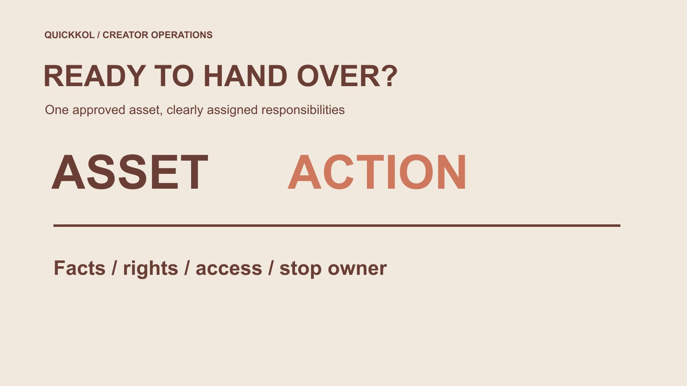

# 付费媒体代理怎样接手达人素材

状态：本地审阅稿；正式发布日期待确认。

品牌把达人素材交给付费媒体代理前，应怎样划分许可、编辑、发布、费用与复盘的责任。

QuickKOL 编辑图形；不呈现真实账号指标或平台界面。

Paid media agency 接手达人素材时，品牌应把四类责任分开：谁确认事实与创作者表达，谁核对许可，谁能操作广告，谁解释结果。拿到视频文件不等于可以任意剪辑、使用创作者账号或延长期限。交接应指定素材版本、渠道、地区、期限、批准人和停用接收人，并确认代理实际接到的服务范围。本文提供达人营销的工作分工方法，不是代理榜单、通用合同或广告效果保证。

## 先界定代理接手什么工作

媒体采购、素材剪辑、创意策略和达人管理可能由不同团队承担。品牌应列出本次交接实际包含什么，不因对方叫全案代理就默认它承担全部事实核验、许可谈判和创作者沟通。用[达人 Brief](https://www.quickkol.com/zh/blog/write-a-useful-campaign-brief/#answer) 保存原始任务，再为媒体接手部分补一份职责说明。

每项任务需要一个执行人和一个有权确认的接收人。代理可以提出调整建议，但不能自行重写创作者经历；品牌可以确认产品事实，却未必拥有创作者个人表达的所有权利。分工不是把风险转给最后拿到文件的人，而是让每个决定回到知道事实且有相应权限的人。

## 确认素材版本，而不是只收一个文件夹

交接记录保存源文件、批准版本、语言、比例、字幕与说明。不同结尾或裁切需要独立版本标识，避免同名文件覆盖。发布链接和下载文件不是同一种对象，也不证明两者内容一直相同。

原片、媒体适配和最终广告预览应能相互对应。代理只拿到低清预览时，不要自行从公开渠道寻找另一个版本替换；先向授权接收人核对。文件缺失可以延迟该素材的动作，不必因此否定整份达人作品。明确缺什么，比笼统标注“素材不能用”更容易让创作者或制作方解决。

## 把许可写到实际使用动作上

[美国版权局的作品使用问答](https://www.copyright.gov/help/faq/faq-fairuse.html)提醒，使用他人作品的许可要按具体情况判断。对美国相关项目，这能说明公开可见与获得使用权不同；其他地区仍按适用要求处理。品牌收到文件，不等于已经获得每种投放、改编和再授权权利。

用[付费媒体许可范围](https://www.quickkol.com/zh/blog/influencer-content-licensing-paid-media-schedule/#answer)分别记录渠道、地区、期限、版本与允许编辑。音乐、第三方画面、人物和创作者账号身份也可能需要不同确认，不由一个“可商用”标签全部代替。实际合同与权利审核由合适人员负责；这份工作卡帮助执行者识别已确认和待确认，不声称自身完成法律清权。

## 平台权限与素材许可分别确认

[Meta 的创作者合作说明](https://about.fb.com/news/2024/02/creator-marketplace-for-brands-and-creators-to-collaborate-on-instagram/)在 2024 年介绍合作广告如何使用合作方账号身份扩大内容传播。这是了解合作形式的背景，不意味着代理只要收到品牌邮件就具备所有平台权限。当前账号资格、允许的内容和设置，应由适当账号负责人核对。

把“素材许可已确认”“平台权限待确认”“广告预览未批准”分开记录。不要索取创作者密码来替代正式权限路径，也不要用过去一次授权推断永久范围。平台里能执行，不等于商业约定允许；合同允许，也不保证当前平台技术条件已经满足。两边都清楚才有条件推进相应动作。

## 编辑适配不能改变原来的意思

裁成竖版、缩短开头或调整字幕，可能影响限定条件是否仍可见。先确认哪些改动在范围内，哪些需要重新审核。把“在某条件下适用”剪成“适用所有人”，即使只是少了几秒，也改变了主张。不能把它当成纯技术处理。

代理制作版本后，让产品负责人看事实、创作者或适当代表看个人表达，再由有权人员确认广告预览。不是每项都必须由同一人决定，也不要求创作者为所有媒体技术设置背书。工作流应说明审核对象，避免一封“看起来没问题”被扩大成对全部修改、许可与投放条件的批准。

适配版本需要确认画面、字幕与限定条件；文件变短并不代表原意没有改变。

## 费用与结果报告要能解释清楚

[Google 的第三方广告政策](https://support.google.com/adspolicy/answer/6086450?hl=en)要求其适用第三方对服务、成本与预期结果保持透明。这是 Google Ads 范围的要求，不自动成为其他平台统一规则；品牌仍可把清楚分项作为本次合作的采购要求。

分别记录代理服务、创作者工作、素材许可和媒体支出，注明币种、期间与包含项。报告保留数据来源、指标定义和归因窗口，不把观看、平台记录转化与业务确认收入混成一个结果。代理可以说明观察与优化动作，品牌也应提供其负责的商业事件证据。谁缺少某项数据，就明确其影响，不让另一方替未知背书。

## 上线前确认能停什么、谁来停

许可即将结束、产品事实改变或创作者提出合理纠正时，谁接收通知、核对影响和执行暂停？交接时就要写清，不等到周末才寻找负责人。平台操作人可能能暂停广告，但未必有权决定新预算或接受新权利条件。

为正在运行的广告保留可核对的标识、所用版本与期限。停用后记录实际状态和时间，不以“已通知代理”代替广告确已停止。相关自然发布、素材库存与再使用也需要分别处理，不能默认暂停一条广告就删除了所有副本或结束全部义务。

## 演练一个缩短视频的变更

假设品牌批准了一条三十秒演示，代理为广告制作十五秒版。原片开头说明“需先安装指定配件”，被剪去后剩下的画面看起来像直接可用。这里是虚构示例，没有客户实绩。代理应提出需要事实复核的变更，而不是把较短版本直接归为已批准。

产品负责人核对前提，创作者确认新片没有改变体验表达，有权人员再确认包含必要条件的版本。若十五秒无法清楚保留条件，可以换表达、延长或不采用。最终记录版本与决定原因。广告更短不自动更有效，也不值得为一个未验证的效果预期牺牲事实准确。

## 复盘按职责讨论改进

某条广告表现不足时，先看资料是否足够、比较条件是否成立。创意解释、媒体受众、落地页和后续响应分别可能影响观察，但本文不以一般可能性判断真实原因。避免只因同一时间发生，就让达人为所有业务差异负责。

把“交付是否符合约定”与“下一轮怎样改进”分开。前者查版本、事实和范围，后者提出适当问题与新工作。需要补拍、重新授权或额外剪辑时，明确采购与责任，不把任何学习自动命名为免费返工。诚实的复盘让品牌、创作者与代理可以继续合作，而不是互相争夺一个没有证据支持的功劳或责任。

## 交接完成要有实际接收

完成状态应说明代理已经收到哪些文件、接受哪份范围、还缺什么，以及哪位负责人接收了待办。发出下载链接只是传递动作，不代表文件可读、版本正确或许可齐全。让接收方能指出问题，才有条件确认交接完成。

付费媒体代理在达人营销中可以把已获适当许可的作品用于明确投放任务。其价值应通过具体工作、可解释报告和负责的执行体现，而不是靠“全包”一词模糊创作者、品牌与代理的边界。一份能执行、能停用、能复盘的交接，才让原创合作进入媒体流程时保持原来的事实与约定。

## 达人素材交给代理的责任卡

| 工作 | 确认对象 | 实际接收人 |
| --- | --- | --- |
| 事实与表达 | 产品条件、经历与字幕 | 产品负责人及适当创作者代表 |
| 许可 | 版本、渠道、地区与期限 | 有权确认者 |
| 投放 | 权限、预览与预算 | 获授权媒体操作人 |
| 停用 | 广告标识、时间与状态 | 能执行并回报的人 |

职责按本次实际约定落实；表格不授予使用权或账号权限。

## 代理接手前核对

让每一项批准都指向明确对象。

- [ ] 代理服务范围与接收人明确。
- [ ] 原片、适配与广告预览可追溯。
- [ ] 许可与平台权限分别确认。
- [ ] 修改没有删去必要条件。
- [ ] 费用、结果与停用各有责任。

## 研究日期与使用边界

资料核验于 2026 年 11 月 12 日。文中方法、表格和决策规则为编辑建议，标为假设的示例不是实际客户结果或行业基准。外部资料的适用地区与时期按各段说明；本稿处于独立本地审阅阶段，正式发布日期待确认。

## 用清楚的任务开始达人研究

用 QuickKOL 理解 Brief、发现相关达人并研究作品与联系路径；数据、合作条件和结果仍需核验。

[了解 QuickKOL](https://www.quickkol.com/#capabilities)

## 来源

- [美国版权局：使用他人作品](https://www.copyright.gov/help/faq/faq-fairuse.html)
- [Meta 的创作者合作说明](https://about.fb.com/news/2024/02/creator-marketplace-for-brands-and-creators-to-collaborate-on-instagram/)
- [Google：第三方广告政策](https://support.google.com/adspolicy/answer/6086450?hl=en)
