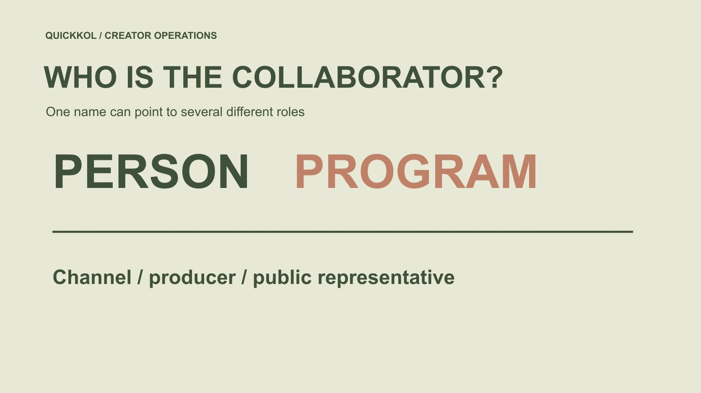

# Popular YouTubers: Verify the Person and Program

Status: local review draft; confirm the publication date before release.

Distinguish performer, program, channel, producer and representative when researching a popular YouTuber for a brand partnership.

QuickKOL editorial graphic; not actual account metrics or a platform interface.

This guide treats the popularist youtuber query as a starting point for researching a popular YouTube creator. Establish whether the brand wants an on-camera person, a program or the channel’s production and publishing team; they need not be one party. Preserve the original channel, relevant work and public role evidence, then ask who can confirm this assignment and usage scope. A familiar face, similar name or official label does not establish contracting or asset authority. This is not a live popularity ranking or a claim that unfinished identity research has confirmed a partnership. The useful result is the right request routed to an appropriately verified public business recipient.

## Define whom the brand wants to do what

A brand may value a presenter’s explanation, want sponsorship of a regular program or commission the channel team’s new production. Define role, audience question and deliverables in the [creator brief](https://www.quickkol.com/blog/write-a-useful-campaign-brief/#answer) rather than use find this YouTuber for every need.

For personal appearance, confirm the individual is part of the proposed work. For publication, identify the exact channel and program. Someone appearing in earlier work does not establish current participation or that a personal account substitutes for the program’s audience.

Scope determines the next verification task. Do not collect many contact routes and leave recipients guessing the purchase. A person-focused brief and a program-focused brief may share the same inspiration while requiring different representatives, production conditions and acceptance criteria.

## Anchor the research to a channel identifier

[YouTube’s channel identifier guide](https://support.google.com/youtube/answer/3250431?hl=en) explains that channels have identifying IDs. Match the same channel through appropriate public sources and supplied information instead of relying only on a changeable display name. An ID anchors the research object; it does not establish a person’s legal identity or commercial authority.

Preserve channel address, checkable identifier, name and date. Do not request account login or control of advanced settings. Research needs suitable evidence rather than possession of the account.

Keep other platforms and channels separate. A team operating several programs does not make their totals one deduplicated audience. This distinction becomes important in handoff: the buyer should know exactly which channel supplied the work being assessed and which account is proposed for a new publication, even when the same familiar presenter appears across both.

## Map the person, program and channel

A relationship map records who appears, program title, publishing channel, production credits and confirmed representation. Include sourced relationships only, keeping missing ones unknown rather than completing them from fan material or familiarity.

The person may be a host, guest, performer or product user. Publication by a channel does not necessarily concentrate every asset right in its operator. Route the request according to the actual role and permission needed.

This is not a public dossier. Retain information necessary for the assignment and exclude private relationships, identity guesses and unrelated history. A practical map can identify an unresolved link clearly, such as who handles a host appearance outside the regular program, without making the entire record unusable. It gives the next researcher a bounded question instead of a vague instruction to verify everything.

## Separate platform access from commercial authority

[YouTube’s channel permissions guide](https://support.google.com/youtube/answer/9481328?hl=en) describes managing different access roles. It helps explain participation by several people without establishing that someone able to upload or edit can license advertising, promise exclusivity or contract for every contributor.

Ask who receives this scope, who confirms appearance and publication and who handles asset use. Process necessary formal records through the applicable organizational route instead of replacing authority with a chat statement that someone can operate the channel.

If a representative handles one component only, route other questions to an appropriate receiver rather than request commitments beyond that role. Several people can collaborate without being forced into one identity. The handoff should preserve those boundaries so a later media request does not inherit permission from an earlier operational conversation that concerned only uploading an approved file.

## Check similar names without automatic accusations

[YouTube’s impersonation policy](https://support.google.com/youtube/answer/2801947?hl=en) provides context for misleading unauthorized impersonation. A similar avatar or official wording does not confirm identity, while similarity alone does not establish a policy violation. Separate observed facts, questions and platform findings.

Cross-check original work and current public sources, including whether an account describes itself as personal, program-related or a fan channel. Until the match is established, do not transmit sensitive project material or payment arrangements, and avoid public accusation.

Use appropriate official routes for a defined issue. Procurement research is not platform enforcement and should not pretend to determine every similar account’s intent. It can reasonably withhold action on an unconfirmed route while continuing to locate the genuine public business contact, leaving the account-safety question and partnership fit as separate matters.

## Use work and current public representation for contact

Locate a receiver through the channel’s or creator’s current public business route, preserving source and date. A contact in an older video may have changed, and a personal social account may not handle program procurement. Ask for the right route where evidence is absent instead of guessing a private email.

An initial message identifies the work, proposed role, task and necessary conditions. Do not imply an existing relationship with the host or program, or ask for unpaid new production as identity proof.

Public contact information is a lead, not a guarantee of reply, authority or acceptance. Update each later state from actual evidence. This makes the request useful even when the first recipient needs to redirect it: they can identify whether the brand is asking about a host, show, publishing slot or existing asset.

## Rehearse a host-and-program distinction

Suppose a brand values a program presenter’s explanation and wants an independent product demonstration from that person. The program channel has a public business email, but it is unclear whether it represents the host’s work outside the show. This hypothetical names no actual channel or person.

State that the request concerns new personal work rather than show sponsorship and ask for an appropriate route. If it later becomes an in-program segment, confirm production, publication and audience scope again rather than expand the earlier discussion automatically.

For existing footage, check asset rights separately. Willingness to film new work does not establish availability of an older program clip. These requests can be related without sharing one unexplained consent. A usable record identifies which request received which answer, keeping an exploratory introduction separate from approval of a defined assignment.

An example inquiry could read: “We are researching a new independent demonstration by the presenter featured in this program. We are not currently requesting show sponsorship or permission to reuse the linked clip. Is your public business team the appropriate receiver for that personal production request? If not, please indicate an official route where available.” This is proposed wording, not a sent message or a request concerning a real person.

The reply may establish only a contact route. Before purchase, confirm the actual scope, performer participation, publication object and any asset use separately. If the receiving team instead offers a program segment, preserve it as a different proposal rather than quietly replacing the requested work while retaining the original approval. That record prevents an introductory answer from turning into permission for a materially different campaign.

## Review identity and fit as separate questions

After identity is established, assess capability, relevant audience, production conditions and commercial scope. The right person can be unsuitable for this assignment, while an apparently suitable piece can still have uncertain provenance. One verified label should not conceal both questions.

Use the [candidate research method](https://www.quickkol.com/blog/influencer-discovery-tool-brief-to-candidates/#answer) to retain evidence by task. Explain reasons for continuing, asking or declining rather than interpreting no reply as untrustworthy or a familiar name as mandatory approval.

This preserves future opportunities: a role unsuitable now may be relevant to another explicit assignment. It also lets procurement distinguish a practical mismatch from an identity problem. The actions differ, and collapsing them can either block a legitimate route unnecessarily or allow an unconfirmed recipient to inherit the credibility of a person whose work the team recognizes.

## Include unresolved relationships in handoff

Hand over person, program, channel, production and representation relationships with sources and confirmation times. Open items need a question and receiving owner, not merely a red marker. Where authority is unconfirmed, do not leave execution colleagues assuming they can contract or use assets.

Preserve later representation or program changes with reasons instead of silently overwriting records and pretending the earlier decision already contained the new knowledge. Correct affected recipients where an issued proposal needs revision.

The deliverable is a clear next step, not the appearance of complete information. A useful map can remain partly unresolved if it tells the team what is safe to discuss, what requires confirmation and which person is responsible for obtaining that confirmation before execution.

## Return popularity research to the actual partnership

Brand research on popular YouTubers should go beyond names and channel totals. Connect the desired role, relevant work, public route and usage scope so a request reaches someone able to handle it.

Identifiers support matching, role evidence supports understanding and permission records support operation. Each is limited and cannot replace the others. Honest unknowns still permit concrete research progress.

The final note should answer whom the brand wants to do what, why the route appears suitable and which item needs confirmation before execution. That turns recognition into a reviewable partnership inquiry without claiming a popularity ranking, private identity check or agreement the team has not obtained.

## Person-and-program partnership map

| Object | Evidence needed | Does not replace |
| --- | --- | --- |
| Person | Public role and relevant work | Every channel right |
| Program | Provenance, production and publication | Personal work outside the program |
| Channel | URL, identifier and date | Personal legal identity |
| Representative | Confirmation for this scope | All future authority |

The host example is hypothetical; platform access does not automatically establish commercial authority.

## Before sending the request

Identify the role before choosing the route.

- [ ] Person, program and channel are distinguished.
- [ ] The research object has a checkable identifier.
- [ ] Public contact and representation have dates.
- [ ] New work, publication and existing-footage requests are separate.
- [ ] Unresolved relationships cannot be mistaken for approval.

## Research date and limitations

Sources reviewed November 12, 2026. Methods, tables and decision rules are editorial recommendations. Hypothetical examples are not actual client results or industry benchmarks. Source geography and periods are specified where relevant. This draft is in independent local review; confirm its publication date before release.

## Start creator research with a clear task

Use QuickKOL to interpret a brief, discover relevant creators and research their work and contact routes. Verify data, commercial terms and outcomes at their source.

[Explore QuickKOL](https://www.quickkol.com/#capabilities)

## Sources

- [YouTube’s channel identifier guide](https://support.google.com/youtube/answer/3250431?hl=en)
- [YouTube’s channel permissions guide](https://support.google.com/youtube/answer/9481328?hl=en)
- [YouTube’s impersonation policy](https://support.google.com/youtube/answer/2801947?hl=en)
