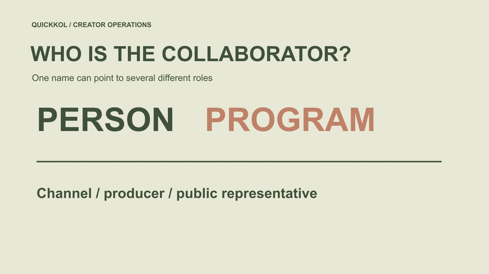

# 寻找热门 YouTuber 时怎样确认实际合作对象

状态：本地审阅稿；正式发布日期待确认。

寻找热门 YouTuber 合作时，区分出镜人、节目、频道、制作方与代表，确认本次应该向谁提出什么请求。

QuickKOL 编辑图形；不呈现真实账号指标或平台界面。

本文将 popularist youtuber 作为品牌寻找热门 YouTube 创作者的研究入口。先确认你想合作的是某位出镜人、一个节目，还是整个频道的制作与发布团队；三者不一定是同一主体。保存原频道、相关作品和公开角色证据，再询问谁能确认本次工作与使用范围。熟悉的面孔、相似频道名或“官方”字样，都不能自动证明对方有签约或素材授权权限。本文不提供实时人气排名，也不把未完成的身份研究称为已确认合作。

## 先定义品牌希望谁做什么

品牌可能喜欢某位主持人的解释，也可能想赞助固定节目，或采购频道团队的新制作。先在[达人 Brief](https://www.quickkol.com/zh/blog/write-a-useful-campaign-brief/#answer) 中写出角色、观众问题与交付，不用“找这个 YouTuber”概括所有需求。

如果需要本人出镜，确认本人是否属于拟议工作；如果需要账号发布，确认具体频道与节目。一个人过去出现在作品里，不证明他仍参与，也不证明其个人账号可以替代节目受众。

范围清楚才知道接下来要核对什么。不要先获取一堆联系方式，再让接收人猜品牌真正需要哪一项。

## 用频道标识固定研究对象

[YouTube 的频道标识说明](https://support.google.com/youtube/answer/3250431?hl=en)指出频道有用于识别的 ID。品牌可在适当公开来源与对方提供的资料中匹配同一频道，不只靠会变化的显示名称。ID 帮助确认研究对象，不证明某个人的法律身份或商业权限。

保存频道地址、可核对标识、名称与日期。不要要求创作者把账号登录或高级设置控制权交给品牌；本次研究需要的是适当证据，不是控制账号。

跨平台资料或其他频道仍分别记录。一个团队运营多个节目，也不能因此将所有账号总数合并成一个独立受众。

## 把人物、节目与频道画成关系表

一张关系表记录谁出镜、节目叫什么、在哪里发布、谁署名制作，以及哪些代表关系已确认。只写有来源的关系，没找到就保留未知，不用粉丝百科或熟悉印象补完。

出镜角色可能是主持、嘉宾、演员或产品使用者。节目由某频道发布，不必然说明所有素材权利都集中于频道负责人。品牌的请求应对应需要的角色与权利。

关系表不是公开人物档案。它仅保留本次合作必要的信息，避免私人关系、猜测身份或无关经历进入采购讨论。

## 把平台访问权限与商业授权分开

[YouTube 的频道权限说明](https://support.google.com/youtube/answer/9481328?hl=en)介绍不同访问角色的管理。它帮助理解多人可以参与频道工作，不意味着能上传或编辑的人就能代表所有参与者许可广告、承诺排他或签约。

品牌可以询问谁接收本次范围、谁能确认出镜与发布、谁处理素材使用。必要的正式文件按团队适用流程处理；不以聊天里“我能操作频道”代替完整授权依据。

如果代表只负责其中一项，让它转给适当接收人，而不是要求对方在权限之外承诺。不同角色可以协作，不必强行合并成一个人。

## 相似名称值得核对，不自动定性

[YouTube 的冒充政策](https://support.google.com/youtube/answer/2801947?hl=en)说明平台对误导性未经授权冒充的处理背景。品牌不能只看相似头像或“Official”字样就确认身份，也不能仅凭相似就宣布某频道已经违规。将事实、疑问与平台结论分开。

从原始作品和当前公开来源交叉核对，注意个人、节目或粉丝频道的自述。没有完成核对时，不发送敏感项目资料或款项安排，也不公开指控。

必要时通过官方渠道处理明确问题。品牌自己的采购研究不是平台执法，也不应假装有能力判断每一个相似账号的真实意图。

## 以作品和当前公开代表确认联系

从频道或创作者当前公开业务入口寻找接收人，记录来源与日期。旧视频里的联系人可能已变化，个人社交账号也可能不接收节目采购。没有当前依据，就先询问正确路径而不是猜私人邮箱。

首次联系说明你参考哪项作品、希望哪个角色完成什么，以及需要哪些条件。不要暗示已经与主持人或节目达成关系，也不让对方免费制作新内容来确认身份。

公开联系信息只是沟通线索，不保证回复、代表权限或合作接受。每个后续状态都按实际证据更新。

## 演练主持人和节目分离的请求

假设品牌喜欢某节目里的主持解释，想请该人制作独立产品演示。节目频道有一个公开业务邮箱，但目前不清楚它是否代理主持人的节目外工作。案例没有真实频道或人物。

先说明需求是本人新作，而非节目赞助，询问适当接收路径。如果后来改成节目内段落，重新确认制作、发布和受众范围；不能让原来的讨论自动扩展。

若品牌要买旧片段，则另核对素材权利，不因主持人愿意新拍就认定旧节目可用。三个请求可以相关，但不能使用同一个未说明的“同意”。

假设询问可写为：“我们研究由该节目出镜人制作一条独立演示，目前不申请节目赞助或旧片段许可。贵方公开业务团队是否接收这类本人新作请求？如不适用，请说明可用官方路径。”这只是示例，没有实际发送或对应真实人物。

回复可能只确认联系路径。采购前仍需分别确认范围、本人参与、发布对象与素材使用。如果对方改提节目段落，保留为另一方案，不能悄悄替换原请求却沿用原批准。

## 把身份确定与适合合作分别验收

确认人物或频道之后，仍要研究作品能力、相关观众、制作条件和商业范围。正确对象可能不适合本次任务；适合作品的来源也可能尚未确认。不要让一个“已验证”标签掩盖两项问题。

用[候选研究方法](https://www.quickkol.com/zh/blog/influencer-discovery-tool-brief-to-candidates/#answer)逐项保存证据。决定继续、询问或不采用时，写具体理由，不把未回复解释成不可信，也不把熟悉名字当作必须批准。

这有助于团队保留未来机会：今天不适合的角色，可能在另一个明确任务里有价值。

## 让交接包含尚未确认的关系

交出人物、节目、频道、制作与代表关系，附对应来源和确认时间。待确认项必须有问题与接收人，不只留一个红色标记。没有核对权限时，不让执行同事误以为已经可以签约或使用素材。

后续代表变化或节目调整，保留新记录与原因。不要静默覆盖旧资料后，再把旧判断说成当时已经知道。需要修正已经发出的提案时，通知实际接收人并说明影响。

身份研究的成果是清楚的下一步，而不是让所有资料看起来完整。

## 让热门人物研究回到实际合作

寻找热门 YouTuber 的品牌任务，不应停在名字和频道总量。把想要的角色、对应作品、公开路径与使用范围接起来，才能让询问真正抵达能处理的人。

频道标识帮助匹配，角色资料帮助理解，权限记录帮助管理；它们各自有限，不能互相代替。对未知保持诚实，也能继续推进具体研究。

最终应能回答：我们想请谁做什么，为什么认为这个路径合适，以及执行前还要确认哪一项。

## 人物与节目合作关系表

| 对象 | 需要证据 | 不能代替 |
| --- | --- | --- |
| 人物 | 公开角色与相关作品 | 频道全部权利 |
| 节目 | 来源、制作与发布关系 | 本人节目外合作 |
| 频道 | 地址、标识与日期 | 个人法律身份 |
| 代表 | 本次范围的实际确认 | 所有未来授权 |

主持人案例为假设；平台访问权限不自动证明商业授权。

## 发送请求前

先找对角色，再找对路径。

- [ ] 人物、节目与频道分别记录。
- [ ] 研究对象有可核对标识。
- [ ] 公开联系与代表关系有日期。
- [ ] 新作、发布和旧素材请求分开。
- [ ] 未知关系不会被执行者当作批准。

## 研究日期与使用边界

资料核验于 2026 年 11 月 12 日。文中方法、表格和决策规则为编辑建议，标为假设的示例不是实际客户结果或行业基准。外部资料的适用地区与时期按各段说明；本稿处于独立本地审阅阶段，正式发布日期待确认。

## 用清楚的任务开始达人研究

用 QuickKOL 理解 Brief、发现相关达人并研究作品与联系路径；数据、合作条件和结果仍需核验。

[了解 QuickKOL](https://www.quickkol.com/#capabilities)

## 来源

- [YouTube 的频道标识说明](https://support.google.com/youtube/answer/3250431?hl=en)
- [YouTube 的频道权限说明](https://support.google.com/youtube/answer/9481328?hl=en)
- [YouTube 的冒充政策](https://support.google.com/youtube/answer/2801947?hl=en)
