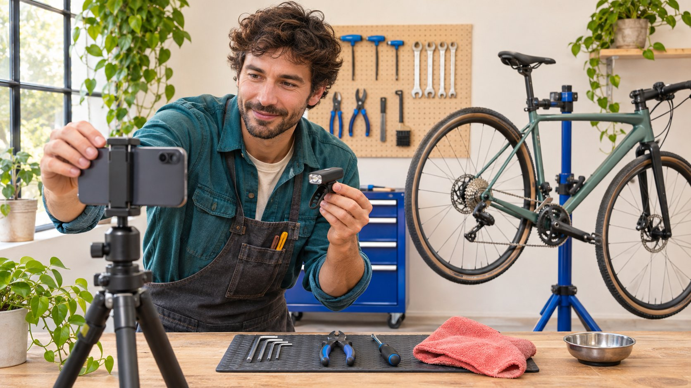

# 2025 年 Reels 涨粉建议，品牌现在该怎样使用

状态：本地审阅稿；正式发布日期待确认。

把 2025 年的 Reels 涨粉建议拆成可复核的主张，再决定哪些适合当前达人合作。

Grow followers with reels best practices 2025 应作为带年份的建议来复核，而不是直接套用的增长公式。品牌先找原始来源、发布时间和适用对象，区分功能事实、编辑经验与效果承诺，再用当前账号可用条件设计达人合作。关注增长也不能代替作品验收、观众理解或商业结果。本文在 2026 年回看相关建议，提供取舍方法，不把历史产品发布当成今天的实时涨粉基准。

## 先核对建议针对哪个账号

有些建议针对个人创作者持续经营自己的账号，品牌却把它用于一次性素材采购。在[达人 Brief](https://www.quickkol.com/zh/blog/write-a-useful-campaign-brief/#answer) 中先核对谁发布、观众关注谁、后续由谁维护。不能把一个人的长期创作经验直接转成另一方账号的短期验收条件。

## 先找出建议到底承诺什么

一句“多发 Reels 有助于涨粉”可能混合三种意思：平台提供更多制作工具，某作者观察到增长，或任何品牌照做都能达到结果。它们需要不同证据。先逐项改写为可核对的主张，不因句子流畅就接受全部含义。

把原文、日期、作者和适用人群记下来。没有出处的截图只提供一条待查信息，不应成为达人采购要求。尤其不要让创作者保证实现一个来自第三方短帖的比例。品牌可以采购作品与明确定义的任务，但不能把未经验证的旧建议升级成合作方无条件承担的结果。

## 把 2025 年功能变化留在正确日期

[Instagram 的 2025 年创意更新](https://about.fb.com/news/2025/06/inspiring-creativity-that-brings-people-together/)在六月介绍了 Trial Reels 的更广泛开放。它说明当时的产品方向，不能证明今天每个账号都具备相同界面，也不说明一个品牌现在采用后必然涨粉。先核对实际账号条件，再决定是否把它写进计划。

公告里的平台汇总分析，也不能直接变成你方创作者的预期增长率。即使某组作者出现表现变化，仍要看研究对象、比较窗口和结果指标。品牌这里需要判断的是一个具体选题如何测试，而不是借历史公告给采购方案附上并不存在的收益保证。

## 制作建议与发布频率分别判断

有些建议可以转成作品检查：开头有没有让人知道要解决什么，演示条件是否清楚，字幕是否保留必要限定。另一些是固定频率、时间或长度，应追问来源与适用范围。不要把所有建议都叫算法规则。

[Instagram 的创作者学习说明](https://about.fb.com/news/2024/10/best-practices-education-hub-creators-instagram/)介绍个性化学习与表现指导的背景。当前账号内资料可以帮助创作者学习，但不是所有品牌通用的最佳次数。制作能力、批准速度和实际观众问题都影响可行安排。品牌应与创作者约定能兑现的计划，而不是用没有依据的高频要求压缩事实审核或真实制作。

## 关注增长不是所有 Reels 目标的替代

一个硬件项目可能需要清楚说明兼容条件，一个专业服务项目可能希望相关人员理解使用场景。关注可以作为适当观察之一，但作品是否完成和观众是否采取特定行动，应分别判断。不要因为某条片没有涨粉就认定演示无效。

用 [Reels 内容任务方法](https://www.quickkol.com/zh/blog/reels-brand-education-content-assignment/#answer)写出作品承担什么解释，再说明为什么关注有助于本次关系。如果后续没有对应内容计划，单纯邀请关注也可能缺乏理由。品牌应给观众真实的下一步，而不是把增长建议变成每条作品结尾都使用同一句口号。

## 把推荐观看与关注选择分开

[Meta 的非关注推荐说明](https://ai.meta.com/blog/ai-unconnected-content-recommendations-facebook-instagram/)解释平台会向人们展示其关注网络之外的内容。这个背景支持观看与关注不同的判断，不说明某条片具体通过什么路径被看到，也不提供本次增长归因。高观看不能直接命名为高新粉留存。

保存可用字段、来源和窗口，说明是否能区分净变化、关注事件或后续观看。不能区分就不造队列。品牌可以据此调整解释或主页内容，仍要把这些编辑判断与已证明的增长原因分开。数据不完整时，缩小结论比制造一个精确但错误的比例更有用。

## 把旧建议转成一个当前测试问题

例如，旧文建议先展示结果。品牌可以问：本次目标观众是否需要先知道设备前提，才理解结果？邀请熟悉实际操作的创作者提出两种表达，并先确认哪些条件不能删。这个问题比“照着去年的爆款拍”更能指导原创工作。

约定保留什么可比条件、能观察哪些结果以及何时复盘。如果两条作品换了观众、媒体和时间，就不能把全部差异归给开头。不能做严格实验时，称为有限观察或制作学习。测试的价值在于帮助下一次决定，不在于为所有情况宣布唯一最佳格式。

## 用维修演示做一次假设演练

假设自行车配件品牌发现一份 2025 年建议，要求所有 Reels 省去准备步骤直接展示变化。创作者指出某配件只适用特定接口，删去前提可能让观众误解。品牌应保留兼容条件，讨论怎样更早展示必要证据，而不是把“快”放在事实之上。

两种原创结构可以先展示接口再展示结果，或先给出结果并立即说明适用条件。演练没有真实表现数据，不能说某一种已经胜出。验收先检查事实、范围和清晰度，后续观察另行解释。如果需要新拍摄，明确工作而非要求免费补成一个未经承诺的增长结果。

## 记录保留、修改或不采用的理由

给每条建议一个决定：保留可用制作原则，修改不适用条件，或不采用缺乏证据的承诺。记录日期、原因和下一位负责人，避免同一个过时截图每隔几周重新出现。无需把原作者整体贴上不可信标签，判断的是这条建议的用途。

如果当前功能不可用，可以设计其他合适观察；不要伪装成已开通，也不为了满足计划借用未经授权账号。需要临时改发布范围时，重新确认创作者与品牌约定。任务改变不应在项目结束时才让合作方发现。

## 让报告保留年份与当前条件

报告可以写“参考某年建议后，我们选择测试某个解释问题”，不能简化成“平台证实最佳做法”。保留历史来源、当前研究日期与项目实际条件。没有完成的测试和未取得的字段，都应写明。

不同年份的作品也不能只按涨粉数直接排名。账号、题材、媒体、受众和指标可能变化。适当比较需要先确认口径与条件；不具备时，仍可记录内容经验，但不声称严格证实因果。让读者知道结论来自哪里，比给旧建议换一个新年份更有价值。

## 以可执行的原创合作结束复核

最后留下一个明确任务、适合的创作者能力、实际产品条件、批准路径和观察方法。不是每条旧建议都必须产生一条新视频；若它没有对应真实观众问题，可以不采用。把预算用于需要的内容，而不是为了证明某个建议永远有效。

回顾 2025 年 Reels 建议，对品牌的价值在于学会如何复核增长主张。平台会变，读者任务也会变。保持作品真实、事实清楚和结论适度，才能让达人营销计划在当前条件下有意义，而不把一个带年份的搜索词当成结果保证。

## 2025 年建议复核卡

| 主张 | 需核对 | 可能决定 |
| --- | --- | --- |
| 功能可用 | 历史日期与当前账号 | 确认条件后采用 |
| 固定频率 | 来源、对象和可行性 | 调整或不采用 |
| 增长比例 | 样本、指标与归因 | 不升级为保证 |
| 制作结构 | 观众问题与必要前提 | 转成原创测试 |

本文是 2026 年的回顾方法，不提供实时涨粉基准。

## 把旧建议放进新 Brief 前

先确认适用，再决定工作。

- [ ] 原始来源与年份明确。
- [ ] 功能、建议与保证分开。
- [ ] 当前账号条件已确认或保留未知。
- [ ] 测试围绕真实观众问题。
- [ ] 没有向创作者转嫁未经承诺的增长结果。

## 研究日期与使用边界

资料核验于 2026 年 11 月 12 日。文中方法、表格和决策规则为编辑建议，标为假设的示例不是实际客户结果或行业基准。外部资料的适用地区与时期按各段说明；本稿处于独立本地审阅阶段，正式发布日期待确认。

## 用清楚的任务开始达人研究

用 QuickKOL 理解 Brief、发现相关达人并研究作品与联系路径；数据、合作条件和结果仍需核验。

[了解 QuickKOL](https://www.quickkol.com/#capabilities)

## 来源

- [Instagram 的 2025 年创意更新](https://about.fb.com/news/2025/06/inspiring-creativity-that-brings-people-together/)
- [Instagram 的创作者学习说明](https://about.fb.com/news/2024/10/best-practices-education-hub-creators-instagram/)
- [Meta：Facebook 与 Instagram 的非关注内容推荐](https://ai.meta.com/blog/ai-unconnected-content-recommendations-facebook-instagram/)
