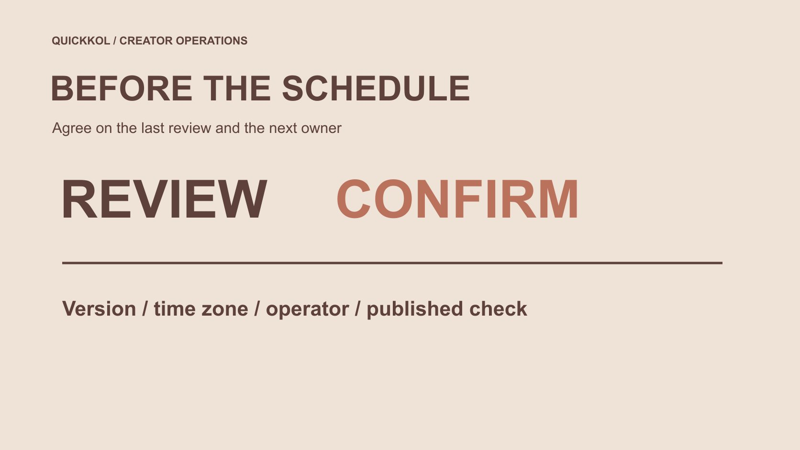

# How to Schedule an Instagram Post With a Review Cutoff

Status: local review draft; confirm the publication date before release.

Set a final review cutoff before deciding who may schedule an Instagram creator post, make changes and resolve late feedback.

QuickKOL editorial graphic; not actual account metrics or a platform interface.

How to schedule a post on Instagram is more than selecting a time in a creator partnership. Confirm a suitable current scheduling route for the account and content, establish the final review cutoff, approved version, time zone and operator, then use the account’s available controls and check both the scheduled record and published result. A reservation is not approval, and publication is not performance evidence. This guide focuses on decisions before scheduling and handling late feedback. It does not supply an unverified universal day limit or fixed menu path for every account. The goal is a publishable agreement that another colleague can execute without guessing which opinion became final.

## Preserve one instant across time zones

Suppose a brand specifies November 12 at ten with a UTC+08:00 offset, corresponding to two on the same date in UTC. This is a conversion example, not an actual project. Ten o’clock alone can mean different instants to a creator and operator in other zones. Preserve local display, offset and corresponding instant, then obtain the receiver’s confirmation.

Give the review cutoff an explicit zone too. Nine on that date at UTC+08:00 is one in UTC. There is one hour between cutoff and publication. Another colleague’s calendar displaying different hours does not create additional preparation time. Plan around actual availability rather than hoping a different display resolves a delay.

For regions with seasonal clock changes, do not carry an unchecked fixed offset indefinitely. The operator confirms the tool’s display for the actual date and records the time reference used. This example guarantees no city’s offset on a future date. Confirm the scheduled record afterward and retain equally clear timing in subsequent changes. A colleague should be able to identify the same instant without inferring it from headquarters, device settings or an earlier campaign’s convention.

## Work backward from the publication task

Start with the account, content, intended audience and reason for the publication time. Creator and brand accounts may have different operators; a date selected on the brand calendar does not establish creator acceptance. Event timing, product readiness and actual audience language belong in the [creator brief](https://www.quickkol.com/blog/write-a-useful-campaign-brief/#answer).

List asset preparation, product facts, creator expression, permissions and final-preview review as necessary steps. Give each an actual receiving owner and expected completion time instead of saying marketing will look. Scheduling follows these decisions rather than allowing a reservation button to replace them.

Where the assignment is still unclear, correct scope before asking the creator to hold an entire day for scattered comments. A time commitment affects production and other collaborations and should be accepted under conditions both parties understand. This backward plan also identifies which delays genuinely affect release and which optional preferences can wait for the next piece.

## Define what the final review cutoff means

The cutoff is the last point for routinely incorporating feedback into this plan, not a prohibition on correcting real errors. Define what is due: consolidated comments, factual confirmation, rights confirmation or final-preview approval. Different matters can have different owners; one vague approved email should not cover every authority.

State date, time zone and asset version. The brand consolidates internal comments and an authorized receiver communicates one decision, rather than making the creator choose which colleague outranks another. Without an explicit applicable agreement, silence is not approval.

Define who can delay, withdraw or commission additional work after the cutoff. This protects necessary factual correction while preventing every later preference from becoming an immediate mandatory remake. The definition should be visible to the people providing comments before they review, not introduced afterward to reject an inconvenient but timely concern.

## Check the current scheduling conditions

[Meta’s Instagram production tools update](https://about.fb.com/news/2023/11/new-ways-to-create-content-on-instagram/) described draft management and advance scheduling direction in 2023. It supplies historical context, not identical current eligibility, content types and controls for every account. Have the actual operator confirm a suitable route, using applicable official help and the current interface.

With the approved file, caption and cover ready, confirm the correct account and content type. Set date and time through the available scheduling controls, save and inspect the scheduled record. If the required route is unavailable, document the limit and agree on an appropriate alternative. A calendar reminder should not be described as automatic platform scheduling.

Do not share passwords temporarily or change account type without assessing consequences just to meet a time. Unverified limits remain unknown rather than unlocked by inference from another person’s screenshot. The operator’s confirmation should identify what was actually arranged and what still requires a human action at release.

## Make approval refer to the complete publication combination

Video, cover, title, description, necessary disclosure and destination together determine the audience’s experience. Reviewing only the original file can miss claims added through surrounding copy. Preserve the approved combination instead of treating a viewed attachment as approval of everything.

Use the [paid media licensing scope](https://www.quickkol.com/blog/influencer-content-licensing-paid-media-schedule/#answer) to check intended use, particularly before extending organic approval to later advertising. [U.S. Copyright Office’s work-use FAQ](https://www.copyright.gov/help/faq/faq-fairuse.html) provides permission context for U.S.-relevant assignments; apply appropriate requirements elsewhere. This workflow grants no rights.

If the approved cover or captions are missing during operation, return to the correct owner rather than substituting similar material. A small file difference may affect facts and usage. The approval record should make the combination findable without requiring the operator to reconstruct it from several messages, each referring to a different stage of editing.

## Handle late feedback according to its nature

Separate factual or safety issues, failure to meet original scope and new preferences or assignments. This is a handling recommendation, not a verdict on an actual dispute. Describe the specific concern and evidence before an authorized owner decides to pause, correct or defer.

A scheduled record does not require publishing a real error. Conversely, a new preference does not automatically make the original defective. Where refilming, extended review or a changed publication time is needed, explain cost, timing and creator availability.

Have one identified receiver communicate the decision rather than letting different brand colleagues demand both retention and removal of the same scene. Until a conflict is resolved, do not ask the operator to guess between incompatible instructions. Record which decision replaced which earlier approval so a later person does not revive an obsolete version while attempting to help.

## Rehearse a factual change near release

Suppose a brand schedules publication for ten in the morning, but at nine twenty learns the event-registration page is not open. The creator’s work may meet scope while the destination is unready. This fictional scenario is not an actual incident. An owner should decide on delay or suitable correction instead of having the creator guess when the page will recover.

If copy alone changes, check whether it still fulfills the invitation; commission new recording separately if needed. After moving the scheduled time, the operator checks the revised record and a receiver confirms affected teams know.

The example establishes no universal minute allowance. It distinguishes discovery, decision and execution, with a sent message replacing neither of the latter steps. The completed record should state what the audience will now be invited to do, not simply that someone changed a time on a calendar.

## Preserve necessary account-security boundaries

[Meta’s account security guidance](https://about.fb.com/news/2021/07/keeping-instagram-safe-and-secure/) provides an official protection reference, with actual action using current official entry points. A brand coordinating scheduling should not request a creator’s verification codes or recovery details or demand account ownership for temporary agency convenience.

Confirm suitable permissions and a substitute for absence. Check whether the substitute can operate this content before release rather than discovering only one person is available. Several people able to operate does not establish that all may alter facts or collaboration scope.

Route account safety separately from marketing preferences. If access appears abnormal, preserve known actions and notify the account owner instead of accusing a collaborator on unverified grounds. The substitute needs the accepted publication combination and escalation path, not another person’s secret credentials or an assumption that an earlier approval applies to every later revision.

## Verify the actual publication after release

Check the public account, asset version, caption, cover and destination as agreed. Retain link and time, distinguishing published, scheduled, failed and still requiring human action. A successful reservation screenshot does not complete every release check.

For a discrepancy, describe the specific issue and contact the receiver before duplicate publication creates another problem. Authorized owners decide on removal or correction within actual platform conditions. Do not claim all distribution stopped merely to complete a status.

This check answers whether execution occurred. Views, interactions and business outcomes need their own later sources and windows; publication does not automatically establish campaign success. The confirmation should also tell the creator and brand where the accepted version can be found, so later reporting does not accidentally evaluate a preview or a different account’s repost.

## Hand over a scheduling record that remains usable

Preserve account, approved combination, review cutoff, publication time and zone, operator, substitute, late-change decisions and public confirmation. Simplify for project size without leaving essential objects and responsibilities in one person’s memory.

Scheduling a creator partnership should align content, authorization and timing. A cutoff supports timely ordinary review, a defined exception route supports real corrections, and publication verification gives arranged and published different evidence.

Not every post needs a complex system, but the next colleague should know which version is approved, who can do what and whom to contact when conditions change. That is the operational value of this approach: it preserves the original collaboration while making the next action concrete enough to execute and the completed action specific enough to verify.

## Partnership-post review cutoff record

| Item | Specify | Evidence |
| --- | --- | --- |
| Review cutoff | Version, time and receiver | Consolidated feedback or approval |
| Scheduling | Account, content and zone | Actual scheduled record |
| Late change | Concern, decision and scope | Explicit replacement of earlier decision |
| Publication | Public version and destination | Link, time and discrepancies |

Ten o’clock and nine twenty form a hypothetical, not a universal review deadline.

## Before confirming a schedule

Leave no final decision for the operator to guess.

- [ ] Account and current scheduling route are explicit.
- [ ] Final cutoff and time zone are agreed.
- [ ] The approved combination is findable.
- [ ] Late feedback and substitution have a receiving path.
- [ ] Someone owns verification of actual publication.

## Research date and limitations

Sources reviewed November 12, 2026. Methods, tables and decision rules are editorial recommendations. Hypothetical examples are not actual client results or industry benchmarks. Source geography and periods are specified where relevant. This draft is in independent local review; confirm its publication date before release.

## Start creator research with a clear task

Use QuickKOL to interpret a brief, discover relevant creators and research their work and contact routes. Verify data, commercial terms and outcomes at their source.

[Explore QuickKOL](https://www.quickkol.com/#capabilities)

## Sources

- [Meta’s Instagram production tools update](https://about.fb.com/news/2023/11/new-ways-to-create-content-on-instagram/)
- [U.S. Copyright Office: using another person’s work](https://www.copyright.gov/help/faq/faq-fairuse.html)
- [Meta’s account security guidance](https://about.fb.com/news/2021/07/keeping-instagram-safe-and-secure/)
