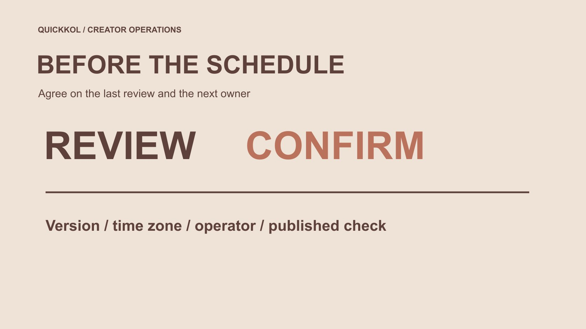

# Instagram 合作帖怎样设置最终审核截止

状态：本地审阅稿；正式发布日期待确认。

安排 Instagram 达人合作帖时，先设最终审核截止，再决定谁能排程、改动和处理迟到意见。

QuickKOL 编辑图形；不呈现真实账号指标或平台界面。

How to schedule a post on Instagram 在达人合作中不只是选择时间。先确认当前账号具备适合本次内容的排程方式，明确最终审核截止、批准版本、时区和操作人，再按账号实际提供的入口设置，并检查预约记录与发布结果。预约不是自动批准，发布也不是效果证明。本文重点解决团队如何在排程前完成决定，以及迟到意见如何处理，不提供适用所有账号的天数上限或未经核验的固定按钮路线。

## 跨时区安排时保留同一个时刻

假设品牌把发布写为十一月十二日十点、偏移 UTC+08:00，对应 UTC 的同日两点。这只是时间换算示例，不指向某个实际项目。只写“十点发布”会让处于其他时区的创作者或操作人理解成不同时间。保存本地显示、偏移和对应时刻，再让接收人确认。

审核截止也要采用明确时区。若定为同日九点、偏移 UTC+08:00，它在 UTC 是一点。两项之间只有一小时，并不因为另一位同事的日历显示不同小时就多出准备时间。工作安排需要按真实可用时间判断，不能靠换一种显示方式消除延迟。

当项目跨越采用季节性时钟调整的地区，不能长期沿用一个未核对的固定偏移。由操作人确认当前工具显示与本次日期，记录使用的时间来源。这里不提供任何城市在未来日期的时区保证。核对之后再确认预约，并让变更记录继续使用同样清楚的时间表示。

## 从发布任务倒排，而不是从时间格开始

先写清哪一个账号发布、什么内容、面向谁以及为什么选择这个时点。创作者账号与品牌账号可能由不同人员操作，不能因为品牌选好了日历，就认为对方已经接受。活动时间、产品可用性和实际读者语言都应进入[达人 Brief](https://www.quickkol.com/zh/blog/write-a-useful-campaign-brief/#answer)。

把素材准备、产品事实、创作者表达、许可和最终预览审核列成必要步骤。每一步写真实接收人和预期完成时间，不用“市场部会看”代替负责者。排程应建立在这些决定之上，不是让一个预约按钮代替团队完成它们。

如果任务还不清楚，先修正范围，不要求创作者保留一整天等待零散意见。时间承诺会影响制作和其他合作安排，应在双方能理解的条件下确认。

## 明确最终审核截止的含义

截止时间指本次计划可以正常纳入意见的最后时点，不是禁止纠正真实错误。明确届时需要什么：完整意见、事实确认、许可确认，还是最终预览批准。不同事项可以有不同负责人，不应靠一封笼统“通过”覆盖所有权限。

写明时区、日期与对应作品版本。品牌内部汇总零散意见，再由有权接收人发出一致决定，不让创作者自行判断哪个同事优先。若没有明确约定，不把沉默解释为批准。

还要说明截止后谁能决定延期、撤回或追加工作。这样可以保护真实事实纠正，又避免每个新偏好都被称为必须立即重做。

## 核对当前排程条件，不沿用旧截图

[Meta 的 Instagram 制作工具更新](https://about.fb.com/news/2023/11/new-ways-to-create-content-on-instagram/)在 2023 年介绍了草稿管理与提前安排的产品方向。它是历史背景，不证明今天账号的资格、内容类型和界面都一样。由实际操作人确认本次可用方式，再采用对应官方帮助与当前界面。

准备批准文件、文案和封面后，确认选择的是正确账号及内容类型。在实际入口中设置日期与时间，保存后核对预约记录。界面不提供所需方式时，记录限制并与负责人决定适当替代，不把日历备忘录称为平台自动排程。

不要为了满足一个时间点临时共享密码，或切换账号类型却不评估影响。本次未核验的限制应保持未知，不能从他人的截图推断已解锁。

## 让批准指向完整发布组合

视频、封面、标题、说明、必要披露和目的地一起决定观众收到的内容。只审原片而不看新增文案，可能漏掉改变主张的部分。保留最终组合的版本，而不是把任何一个附件“看过”都当整体批准。

用[付费媒体许可范围](https://www.quickkol.com/zh/blog/influencer-content-licensing-paid-media-schedule/#answer)核对计划用途，尤其不要把自然发布的批准自动扩展到后续广告。[美国版权局的作品使用问答](https://www.copyright.gov/help/faq/faq-fairuse.html)可作为美国相关项目的许可背景；其他地区按适用要求处理。这份工作流程不授予权利。

如果操作时缺少批准的封面或字幕，返回正确接收人，不自行找相似素材补齐。小文件差异也可能影响事实与使用条件。

## 按性质处理迟到意见

把意见分为事实或安全问题、未满足原范围，以及新的偏好或新增任务。分类是处理建议，不是对真实争议的预判。先描述具体内容与证据，再由有权人员决定暂停、修正或留到下一轮。

已预约并不意味着必须照常发布真实错误；相反，新偏好也不自动证明原片不合格。若需要重新拍摄、延长审核或改变发布时间，说明成本、时间和创作者可用条件。

对外由一个明确接收人沟通决定，避免品牌不同同事分别要求保留和删除同一画面。冲突没有解决之前，不把两份相反意见一起交给操作人猜。

## 演练一个临近发布的事实变化

假设品牌安排上午十点发布，九点二十分才确认活动报名页尚未开放。创作者的作品可能符合约定，但下一步入口并不符合发布条件。这是虚构情境，不是实际故障记录。负责人应确认延迟或适当修改，而不是让创作者猜页面什么时候恢复。

如果只需更新文案，也核对它是否仍符合原邀请；如果需要新录制，则单独安排工作。预约时间改变后，实际操作人检查新的记录，接收人确认相关团队已知道。

演练不设所有项目通用的分钟数。时间只是说明发现问题、作出决定与执行变更三个不同动作，不能用“已发消息”代替后两步。

## 保留必要账号安全边界

[Meta 的账号安全说明](https://about.fb.com/news/2021/07/keeping-instagram-safe-and-secure/)可作为官方保护措施的参考，实际操作使用当前官方入口。品牌协调排程时，不向创作者索取验证码或恢复资料，也不要求他们把所有权交给代理以便临时处理。

确认谁有适当权限，并为缺席情况安排接替。替补是否能操作本次内容应提前核对，不到发布时才发现只有一个人可用。也不要把多人能操作误当成每个人都有权改变事实与合作范围。

安全问题与营销意见分别交接。如果疑似权限异常，保留已知动作并交给账号负责人，不用未核验判断指控合作方。

## 发布后核对实际结果

按约定检查公开账号、作品版本、文案、封面与目的地。记录链接和时间，确认是已经发布，还是预约、失败或仍待人工动作。不能用一个预约成功截图完成所有上线验收。

若有差异，先描述具体问题并联系接收人，避免重复发布造成另一项问题。需要删除或修改时，由有权人员决定并按实际平台条件操作。不要为了完成状态而声称已停止所有传播。

发布核对回答的是执行是否完成。观看、互动和商业结果按各自来源与窗口后续观察，不在发布当刻自动判定活动成功。

## 交接一份能继续执行的排程记录

最终保留账号、批准组合、审核截止、发布时间与时区、操作人、接替人、迟到变更决定和公开确认。流程可按项目规模简化，但必要对象与责任不能只留在某个人记忆里。

Instagram 达人合作的排程，应让内容、授权和时间一致。一个明确截止帮助团队及时完成普通审核；清楚的例外路径支持纠正真实问题；实际发布核对则让“已安排”和“已发布”各有证据。

品牌与创作者不必为每条帖建立复杂系统，但应能回答下一位同事最基本的问题：现在批准哪一版，谁可以做什么，以及发生变化时找谁。

## 合作帖审核截止记录

| 事项 | 明确内容 | 证据 |
| --- | --- | --- |
| 审核截止 | 版本、时间与接收人 | 汇总意见或批准 |
| 排程 | 账号、内容与时区 | 实际预约记录 |
| 迟到变更 | 问题性质、决定与范围 | 明确替代原决定 |
| 发布 | 公开版本与目的地 | 链接、时间与差异 |

十点与九点二十分为假设场景，不是统一审核时限。

## 按预约键之前

让操作人无需猜测最终决定。

- [ ] 发布账号和当前可用方式明确。
- [ ] 最终审核截止与时区已约定。
- [ ] 批准组合可以准确找到。
- [ ] 迟到意见与接替有接收路径。
- [ ] 有人负责检查实际公开结果。

## 研究日期与使用边界

资料核验于 2026 年 11 月 12 日。文中方法、表格和决策规则为编辑建议，标为假设的示例不是实际客户结果或行业基准。外部资料的适用地区与时期按各段说明；本稿处于独立本地审阅阶段，正式发布日期待确认。

## 用清楚的任务开始达人研究

用 QuickKOL 理解 Brief、发现相关达人并研究作品与联系路径；数据、合作条件和结果仍需核验。

[了解 QuickKOL](https://www.quickkol.com/#capabilities)

## 来源

- [Meta 的 Instagram 制作工具更新](https://about.fb.com/news/2023/11/new-ways-to-create-content-on-instagram/)
- [美国版权局：使用他人作品](https://www.copyright.gov/help/faq/faq-fairuse.html)
- [Meta 的账号安全说明](https://about.fb.com/news/2021/07/keeping-instagram-safe-and-secure/)
