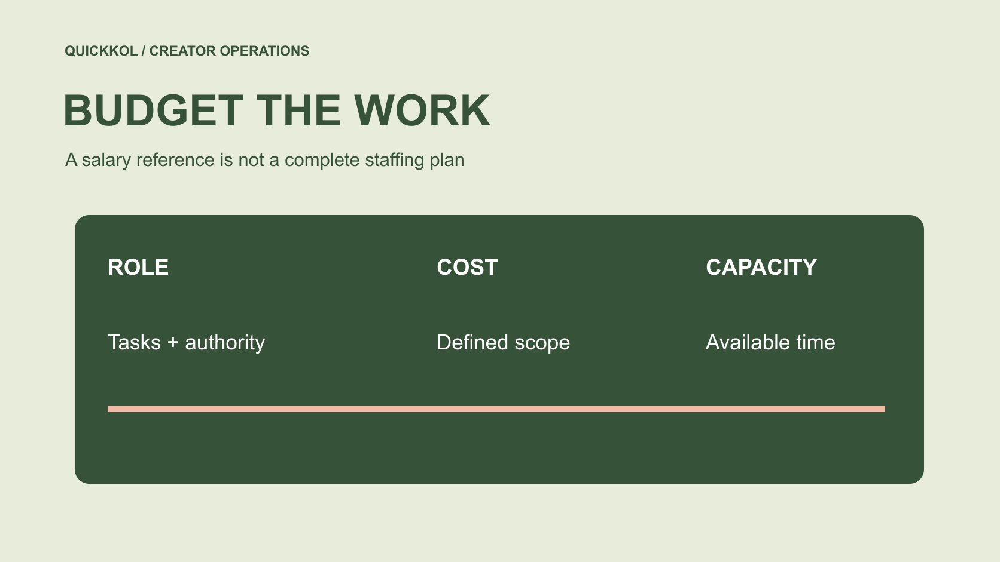

# Social Media Manager Salary for Creator Operations

Status: local review draft; confirm the publication date before release.

Define the manager’s creator-program responsibilities before using geographically scoped wage evidence to plan capacity.

QuickKOL editorial graphic; not actual account metrics or a platform interface.

Social media manager salary is not one universal average. A brand should first assign creator discovery, briefing, review, scheduling, responses and reporting, then select wage evidence with a relevant geography, period and role scope. U.S. BLS public relations specialist data can provide related occupational context, not a global social media manager salary. Employee pay, employer benefit costs, creator fees and agency services are separate budget objects. Estimate capacity from available time and actual tasks rather than deriving a creator workload directly from annual salary. The aim is an explainable staffing plan for the partnership program, not a promise about what any individual should earn.

## Describe the work before researching pay

The same title may describe maintaining owned accounts or researching creators, negotiating scope and coordinating multilingual projects. Define tasks and approval authority instead of relying on the job label. Identify who prepares the list, verifies facts, confirms price, publishes and handles audience questions. Unassigned work should not automatically become this person’s responsibility.

Use the [creator brief](https://www.quickkol.com/blog/write-a-useful-campaign-brief/#answer) to distinguish creator deliverables from internal execution. Commissioning filming does not eliminate management work, and handling contact does not qualify an employee to review every product claim. Identify where product specialists, appropriate legal reviewers or finance contribute. A clearer scope makes wage evidence more comparable and helps decide whether to hire, add support or purchase a particular service. It also prevents an apparently reasonable salary from masking an unrealistic job that combines production, technical review, commercial approval and continuous support without the authority or resources needed for any of them.

## Keep occupation and geography on the wage reference

[BLS’s public relations specialist profile](https://www.bls.gov/ooh/media-and-communication/public-relations-specialists.htm) reports a U.S. median annual wage of $74,750 for that occupation in May 2025. Its role description includes related social communication work. It is not a separate measurement of the commercial title social media manager or a current worldwide hiring quote. Retain the country, occupation and period instead of extracting only the dollar amount.

A median is neither an individual entitlement nor a particular candidate’s proposal. Location, responsibility, experience and organizational conditions need separate assessment. A brand can retain this adjacent occupational reference as context while collecting appropriate local evidence for the actual role. Do not average unlike sources and call the result more accurate. A stronger salary record explains why a reference was selected, which duties overlap and which do not. That lets the budget owner use the figure responsibly without turning a reliable occupational statistic into a precise answer to a different job-market question.

## Separate wages from loaded employment cost

[BLS’s OEWS methods FAQ](https://www.bls.gov/oes/oes_ques.htm) explains that wage estimates exclude employer nonwage benefit costs and do not cover groups such as the self-employed. An employee wage should not be compared directly with a freelancer’s service proposal. The latter may contain equipment, administration and other costs under a different scope. Define the objects before comparing totals.

A complete brand budget may also include applicable employer costs, equipment, software, training and support. Authorized staff should establish actual organizational amounts rather than applying one universal uplift as though it fits every country. Separate these from creator service fees, samples and paid media. Otherwise a staffing increase can leave the team with no production or release budget. Keep the cost owner and basis beside each assumption so the proposal can be updated when a real quote or internal figure arrives. Unknown cost is not zero merely because it is absent from the salary headline.

## Do not confuse a cost index with a role quote

[BLS’s Employment Cost Index overview](https://www.bls.gov/eci/) concerns employment-cost change over time. It is not a salary quote for one role in one city. Wage levels, cost changes and a vendor fee are different evidence objects. Any annual-change claim needs its matching population and period; it should not automatically be added to every old proposal.

This article does not use the index to calculate an amount due. A budget owner can check the organization’s own cost-update method and identify which lines need a new quote. Where matching evidence is unavailable, retain ranges and assumptions instead of assembling decimal precision from unrelated statistics. Salary research should support staffing and resources rather than converting public data into a conclusion about one person’s negotiation. This distinction also makes the plan easier to revise: a change in benefits, a change in local hiring conditions and a change in campaign volume can be handled separately instead of all being attributed to one headline index.

## Estimate capacity from available hours

Record the steps and approximate effort rather than defining workload through one creator count. Ten people supplying assets may require different work from ten needing samples, several review rounds and original-account publication. Coordination, waiting, rework and internal approvals should remain visible. A pause may reflect another party’s missing prerequisite rather than unused employee effort.

Suppose one hundred monthly hours are approved for creator work, routine records and coordination take twenty, and each new partnership’s listed tasks require four. The remaining eighty hours represent twenty such task units before accounting for timing concentration, failure and other constraints. These are planning inputs, not an industry capacity benchmark or a permanent employee quota. The exercise is useful because the owner can challenge the task estimate or available hours. It should not become a precise staffing promise merely because the division is simple. Validate the assumptions against an appropriate small project before using them to expand the program.

## Identify gaps that salary alone cannot solve

If product staff do not confirm facts, a higher manager salary does not automatically remove that wait. If every asset use needs clarification, repair scope and records first. Use the [creator campaign status system](https://www.quickkol.com/blog/creator-campaign-status-system/#answer) to separate production, approval, publication and waiting, identifying who can change the blocker instead of calling every issue understaffing.

Do not use process problems to deny genuine overload either. Inspect when tasks concentrate and which need different expertise before adding staff, reducing scope or improving allocation. Hiring and process repair may both be necessary. A credible budget explains which work the extra resource changes rather than promising more partnerships or sales from headcount alone. It should also identify a realistic decision right: someone coordinating a queue needs an escalation route when a specialist’s answer is missing, not responsibility for independently inventing the answer to protect a release date. That boundary is part of a viable role design.

## Compare employment, freelance and agency scope

An employee can provide continuing coordination and organizational knowledge. A freelancer or agency may add a particular production, market or operational capability. Define the need before comparing equivalent scope and handover conditions. A full-time wage and one project fee are not automatically a cheap-versus-expensive comparison, and an agency fee does not necessarily include creator compensation or media spend.

Check who holds records, approves prices, handles failure and continues work when the service ends. Access and asset permissions need clear boundaries too. A brand can purchase a limited task without giving an external party all historical information. The appropriate arrangement depends on the project; this article makes no universal claim that one staffing model is cheaper. A useful comparison allows the budget owner to remove an unneeded service line or add missing coordination explicitly, rather than accepting a total whose apparent completeness depends on assumptions nobody has checked with the provider.

## Hand over a reviewable role and budget proposal

The proposal should contain tasks, authority, geography, the wage reference’s occupation and period, loaded-cost lines, capacity assumptions and unknowns. Appropriate HR or finance owners can verify applicable amounts and arrangements. Marketing can explain the work without treating a public median as everyone’s price ceiling.

Update capacity assumptions from actual task records next time rather than account scale or total partnerships alone. Social media manager salary matters to creator marketing because coordination, review and relationship work need real resources. A defined role and budget give creator deliverables a receiving owner and expose commitments the current team cannot yet support. The final decision should therefore identify what the organization can execute under this arrangement and what remains outside scope. That is a more useful outcome than a single salary number detached from the responsibilities it is supposed to fund.

## Check capacity when two campaigns overlap

Suppose the monthly total seems sufficient, but two campaigns both need final review on Thursday. Viability depends on timing concentration and capability, not the monthly average alone. Place samples, fact confirmation, creator revisions and scheduling on the calendar, identifying work that can happen earlier and work that must wait for a final version.

If the same manager must approve price, verify technical facts, handle support and publish simultaneously, the gap may concern authority as well as time. Decide which confirmations product and finance own, then estimate the manager’s remaining coordination. Adding someone who can only schedule may not solve technical approval; purchasing a specialist review may not cover daily replies. The need is task-matched capacity rather than headcount itself.

Wage references remain scoped background. If the organization uses a hypothetical annual budget and converts it into a monthly planning cost, retain that assumption instead of describing a public median as a candidate’s actual fee. Temporary service costs need their own scope. Compare who retains records, who provides cover during absence and which tasks would be affected by ending an external arrangement.

A small project can supply task observations for updating effort estimates. Do not turn the first observation into a permanent productivity quota or infer employee capability from one delayed release. The budget handoff should contain tasks, congestion, proposed resources and unknowns rather than a universal claim that each manager can handle twenty creators. That is a clearer explanation of why spending is needed and which work condition it would change. It also distinguishes a staffing decision from a compensation judgment: the team can identify a missing review function without concluding that a particular employee’s pay is too high or that the salary alone should purchase unrelated specialist duties.

## Different objects in salary and campaign cost

| Object | Use | Does not establish |
| --- | --- | --- |
| Related occupational wage | Geographically and temporally scoped context | Current quote for the exact role |
| Loaded employment cost | Pay plus applicable employer costs | Creator service included |
| Available time | Task-capacity scenarios | Permanent creator quota |
| Agency or freelance fee | Defined external scope | Direct equivalence to employee wages |

The $74,750 figure is U.S. May 2025 public relations specialist wage context; hours in the worked example are explicit assumptions.

## Creator operations staffing checklist

Define the work before checking cost.

- [ ] Specify tasks and approval authority.
- [ ] Retain occupation, geography and period.
- [ ] Separate wages, benefits, creator and media costs.
- [ ] Test capacity through steps and available time.
- [ ] Name the owner confirming actual amounts and arrangements.

## Research date and limitations

Sources reviewed November 12, 2026. Methods, tables and decision rules are editorial recommendations. Hypothetical examples are not actual client results or industry benchmarks. Source geography and periods are specified where relevant. This draft is in independent local review; confirm its publication date before release.

## Start creator research with a clear task

Use QuickKOL to interpret a brief, discover relevant creators and research their work and contact routes. Verify data, commercial terms and outcomes at their source.

[Explore QuickKOL](https://www.quickkol.com/#capabilities)

## Sources

- [BLS’s public relations specialist profile](https://www.bls.gov/ooh/media-and-communication/public-relations-specialists.htm)
- [BLS’s OEWS methods FAQ](https://www.bls.gov/oes/oes_ques.htm)
- [BLS’s Employment Cost Index overview](https://www.bls.gov/eci/)
